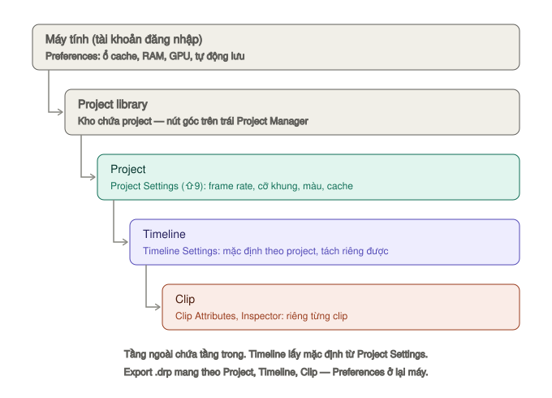
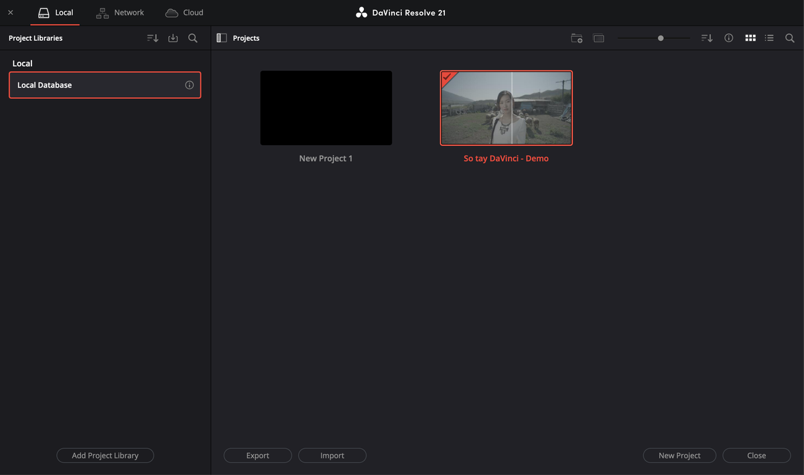
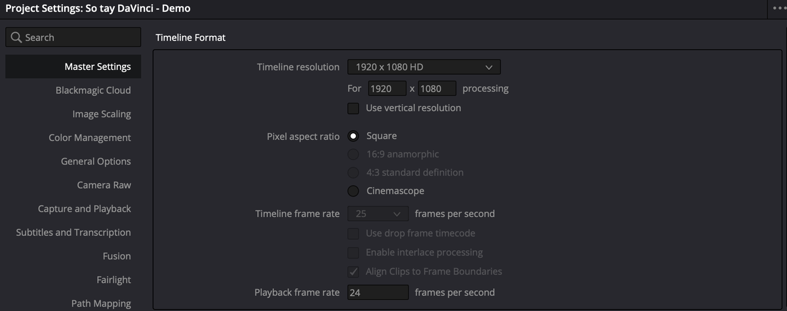
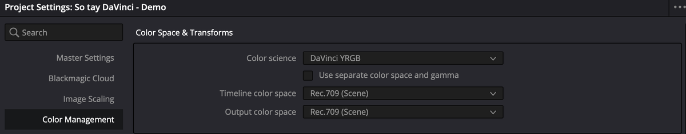
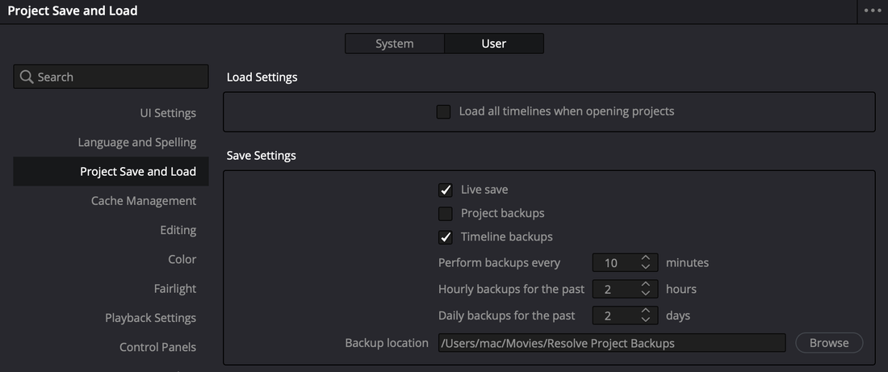

# Tạo project đúng ngay từ đầu

Phần lớn rắc rối về sau (video giật, tiếng lệch hình, xuất ra mờ) bắt nguồn từ năm phút đầu tiên. Làm đúng ở đây thì về sau không phải sửa.

| Bước | Làm ở đâu | Mức |
|---|---|---|
| [1. Tạo project](#bước-1--tạo-project-trong-project-manager) | Project Manager | `★★★ Hằng ngày` |
| [2. Frame rate](#bước-2--frame-rate-thứ-không-sửa-được-về-sau) | Project Settings → Master Settings | `★★★ Hằng ngày` |
| [3. Độ phân giải](#bước-3--độ-phân-giải) | Project Settings → Master Settings | `★★★ Hằng ngày` |
| [4. Quản lý màu](#bước-4--chọn-cách-quản-lý-màu) | Project Settings → Color Management | `★★☆ Thường dùng` |
| [5. Nơi lưu cache](#bước-5--nơi-lưu-cache-và-file-tạo-ra) | Project Settings → Master Settings → Working Folders | `★★☆ Thường dùng` |
| [6. Tự động lưu](#bước-6--tự-động-lưu-và-bản-sao-lưu) | Preferences → User → Project Save and Load | `★★★ Hằng ngày` |

**Thiết lập nằm ở ba tầng.** Trước khi chỉnh, biết ô đó thuộc tầng nào thì khỏi tìm sai chỗ:

*Tầng ngoài chứa tầng trong. Preferences theo máy và tài khoản đăng nhập (manual tr. 16); Project Settings theo project; Timeline Settings mặc định lấy theo project nhưng tách riêng được cho từng timeline (tr. 860–861).*

| Tầng | Bảng thiết lập | Mở bằng | Ví dụ ô ở đây |
|---|---|---|---|
| Máy tính | **Preferences** (System, User) | **DaVinci Resolve → Preferences** | Ổ cache (Media Storage), RAM, tự động lưu |
| Project | **Project Settings** | `⇧9` hoặc bánh răng góc dưới phải | Frame rate, độ phân giải, quản lý màu, nơi lưu cache, định dạng proxy |
| Timeline | **Timeline Settings** | Chuột phải timeline trong Media Pool → **Timelines → Timeline Settings** | Cỡ khung, frame rate riêng cho một timeline (bỏ tick **Use Project Settings**) |
| Clip | **Clip Attributes**, Inspector | Chuột phải clip trong Media Pool | Kênh tiếng, frame rate của riêng clip |

## Bước 1 — Tạo project trong Project Manager

*Project Manager: mỗi thumbnail là một project. Bên trái là các project library.*

**Project Manager** là cửa sổ hiện ra đầu tiên khi mở Resolve. Đang làm dở thì mở lại bằng `⇧0`, hoặc nút **ngôi nhà** góc dưới phải.

**Tạo project mới:**
`★★★ Hằng ngày`

1. Bấm **New Project** ở đáy cửa sổ (manual tr. 77).
2. Gõ tên. Nên có ngày tháng, ví dụ `2026-10 Vlog Da Lat`.
3. Xem ô **Media Location** — nơi Resolve lưu file nó tự tạo ra (tiếng thu voiceover…). Bấm **Change Location** nếu ổ đó sắp đầy.
4. Bấm **Create**. Resolve mở project ở trang Media.

Ví dụ: project `So tay DaVinci - Demo`, Media Location để mặc định trên ổ trong của Mac, timeline đầu tiên `Demo - Vlog` ở 25 fps.

**Chuột phải một project** trong Project Manager (manual tr. 77–79, 95):

| Mục | Làm gì | Mức |
|---|---|---|
| **Rename** | Đổi tên | ★★☆ |
| **Open in Read Only Mode** | Mở mà không sợ sửa nhầm | ★☆☆ |
| **Project Backups** | Mở lại bản sao lưu tự động — xem [Bước 6](#bước-6--tự-động-lưu-và-bản-sao-lưu) | ★★☆ |
| **Export Project** | Xuất file `.drp` — chỉ project, không kèm media | ★★☆ |
| **Export Project With Stills and LUTs** | Như trên, kèm still trong Gallery và LUT đang dùng | ★☆☆ |
| **Export Project Archive** (tr. 95 gọi là **Archive**) | Gói cả project lẫn media thành một thư mục `.dra`. Tuỳ chọn kèm optimized media, render cache, proxy | ★☆☆ |
| **Load Project Settings to Current Project** | Chép thiết lập của project này sang project đang mở | ★☆☆ |
| **Delete** | Xoá project. Không xoá được project đang mở | ★☆☆ |

Nhập project từ máy khác: kéo file `.drp` thả vào Project Manager, hoặc bấm **Import** ở đáy cửa sổ (tr. 78). Bấm đúp file `.drp` trong Finder cũng được — Resolve tự mở và nạp project.

> **Lưu ý:** Resolve lưu project trong một **project library** (thư viện project), không phải file rời. Nút góc trên trái Project Manager mở thanh **Project Libraries** — xem project đang nằm ở thư viện nào (tr. 82). Muốn mang project sang máy khác thì dùng **Export Project** hoặc **Export Project Archive**. Chỉ copy thư mục footage là không đủ.

## Bước 2 — Frame rate, thứ không sửa được về sau

*Timeline frame rate bị khoá ngay khi timeline đầu tiên có clip. Hãy đặt trước khi dựng.*

`★★★ Hằng ngày`

**Frame rate** (số khung hình mỗi giây, fps) quyết định chuyển động trông thế nào và phải khớp với lúc quay.

Mở **Project Settings** (`⇧9`, hoặc nút **bánh răng** góc dưới phải) → **Master Settings** → nhóm **Timeline Format** → **Timeline frame rate**.

Đặt đúng bằng frame rate bạn quay. Quay 24 thì để 24, quay 30 thì để 30.

> **Lưu ý:** manual ghi rõ: khi Media Pool đã có file, frame rate của project không đổi được nữa (tr. 375). Nên đặt trước khi nạp media.

Lần đầu nạp clip vào Media Pool trống, nếu frame rate clip khác project, Resolve hỏi có đổi project cho khớp không. **Chọn Change.** Chọn Don't Change là bị khoá ở frame rate cũ.

> **Mẹo:** lỡ khoá sai rồi thì vẫn cứu được ở tầng timeline: tạo timeline mới, bỏ tick **Use Project Settings** trong hộp New Timeline rồi đặt frame rate đúng cho riêng timeline đó (tr. 860).

Cách an toàn để timeline khớp clip: nạp clip vào Media Pool, chọn clip → chuột phải → **Create New Timeline Using Selected Clips…**. Xem thêm [Tạo timeline và Timeline Settings](../02-trang/edit/timeline-nang-cao.md#tạo-timeline-và-timeline-settings).

## Bước 3 — Độ phân giải

`★★★ Hằng ngày`

Cùng nhóm **Timeline Format**, ô **Timeline resolution** — cỡ khung bạn dựng:

| Làm gì | Đặt |
|---|---|
| Video ngang thông thường | 1920×1080 |
| Video 4K | 3840×2160 |
| TikTok, Reels, Shorts | 1920×1080 rồi tick **Use vertical resolution** → thành 1080×1920 |

**Use vertical resolution** đảo chiều ngang và dọc của khung (tr. 144). Muốn một project có cả bản ngang lẫn bản dọc thì để project ngang, chỉ đổi riêng timeline dọc — xem [Timeline Settings](../02-trang/edit/timeline-nang-cao.md#timeline-settings--mỗi-timeline-một-cỡ-khung) và [Luồng: video dọc](../03-luong/video-doc.md).

Timeline resolution đổi được bất cứ lúc nào — Resolve tự tính lại mọi chỉnh sửa theo cỡ mới. Nó cũng **khác** resolution lúc xuất: dựng ở 1080 cho nhẹ máy rồi xuất 4K được. Xem [Tối ưu hiệu năng](../04-tham-khao/hieu-nang.md#bước-3--hạ-timeline-resolution).

**Clip khác cỡ khung xử lý thế nào:** **Project Settings → Image Scaling → Input Scaling → Mismatched resolution files** (tr. 152). Mặc định **Scale entire image to fit** — giữ toàn hình, khác tỉ lệ thì có viền đen. Muốn lấp kín khung (cắt bớt mép): **Scale full frame with crop**.

## Bước 4 — Chọn cách quản lý màu

*Color science quyết định Resolve tự quản lý màu hay để bạn tự làm bằng node.*

`★★☆ Thường dùng`

**Project Settings → Color Management → Color science** (tr. 153). Quyết định trước khi bắt đầu chỉnh màu — đổi sau khi đã chỉnh là mọi grade lệch.

| Color science | Resolve làm gì | Hợp với |
|---|---|---|
| **DaVinci YRGB** (mặc định) | Không tự chuyển gì. Bạn tự chuyển bằng node **Color Space Transform** hoặc LUT | Quay điện thoại, máy ảnh màu thường. Một máy LOG mà muốn thấy rõ từng bước |
| **DaVinci YRGB Color Managed** | Tự chuyển mọi clip về không gian màu chung | Trộn nhiều máy LOG khác hãng, muốn ít thao tác |
| **DaVinci YRGB Color Managed (Legacy)** | Bản cũ, để mở project cũ | Project từ bản Resolve cũ |
| **ACEScc / ACEScct** | Chuẩn ACES của ngành phim | Quy trình xưởng phim |

**Bật Color Managed — cách đơn giản** (tr. 1708):
1. **Color science** → **DaVinci YRGB Color Managed**.
2. Tick **Automatic Color Management**.
3. **Color processing mode** → **SDR**.
4. **Output color space** → Rec.709 (YouTube, TV, mạng xã hội).

Khi đã bật, clip chưa nhận dạng được mặc định coi là **Rec.709 Gamma 2.4** (tr. 233).

Resolve tự đoán không gian màu đầu vào theo loại file. Đoán sai (hay gặp với LOG): chuột phải clip trong Media Pool → **Input Color Space** → chọn đúng profile máy quay.

> **Lỗi hay gặp:** chuyển màu hai lần. Đã bật Color Managed thì không thêm CST hay LUT chuyển đổi nữa. Chi tiết: [LUT và quản lý màu](../02-trang/color/lut-va-quan-ly-mau.md#color-management-của-project) và [Luồng: LOG sang Rec.709](../03-luong/log-sang-rec709.md).

## Bước 5 — Nơi lưu cache và file tạo ra

`★★☆ Thường dùng`

**Project Settings → Master Settings → Working Folders** (tr. 148):

| Ô | Chứa gì | Mặc định |
|---|---|---|
| **Project media location** | File Resolve tự tạo (tiếng voiceover…) | Đặt lúc tạo project |
| **Proxy generation location** | Proxy media | — |
| **Cache files location** | Render cache | Thư mục ẩn `CacheClip` trên ổ đầu tiên trong danh sách Media Storage của Preferences |
| **Gallery stills location** | Still lưu ở Gallery trang Color | Thư mục ẩn `.gallery` trên cùng ổ đó |

Trỏ **Cache files location** vào một ổ SSD nhanh, đừng để chung ổ với footage nếu có thể. Ổ cache bị rút ra thì Resolve sẽ báo.

> **Mẹo:** "ổ đầu tiên trong Media Storage" đặt ở **Preferences → System → Media Storage** (tr. 17). Muốn cache và still mặc định nằm ở SSD ngoài thì đưa SSD đó lên đầu danh sách ở đây — áp cho mọi project mới.

Cùng trang Master Settings, nhóm **Optimized Media and Render Cache** chọn định dạng và độ phân giải của proxy, optimized media, render cache — xem [Tối ưu hiệu năng](../04-tham-khao/hieu-nang.md).

**Dùng lại thiết lập cho mọi project:** menu ba chấm của cửa sổ Project Settings → **Save Current Settings as Preset**. Chọn preset → **Set As Default Preset** để project mới tự dùng (tr. 142–143).

## Bước 6 — Tự động lưu và bản sao lưu

*Live Save và ba ô sao lưu định kỳ. Ba ô này dùng chung cho cả Project Backups lẫn Timeline Backups.*

`★★★ Hằng ngày`

**DaVinci Resolve → Preferences → User → Project Save and Load** (manual tr. 115–117). Đây là thiết lập của máy, áp cho mọi project.

| Ô | Làm gì | Mặc định | Nên |
|---|---|---|---|
| **Live Save** | Lưu liên tục khi bạn làm. Cut, Edit, Fairlight lưu ngay từng thao tác; Fusion, Color lưu khi chuyển clip và định kỳ ngầm | Bật | Để bật |
| **Project Backups** | Lưu định kỳ bản sao đầy đủ của project (không gồm still và LUT) | Tắt | Bật |
| **Timeline Backups** | Lưu bản sao riêng từng timeline | Bật | Để bật |
| **Perform backups every X minutes** | Bao lâu lưu một bản trong giờ gần nhất | **10** phút → luôn giữ 6 bản của giờ gần nhất | Giữ |
| **Hourly backups for the past X hours** | Giữ bao nhiêu bản theo giờ | **2** | Tăng lên 8 nếu ngày dài |
| **Daily backups for the past X days** | Giữ bao nhiêu bản theo ngày | **2** | Tăng lên 7–14 cho dự án kéo dài |
| **Backup location** | Nơi lưu bản sao, gồm cả project lẫn timeline backup | Trên Mac: `~/Movies/Resolve Project Backups` | Trỏ sang ổ khác ổ hệ thống nếu có |

Ba ô số dùng chung cho cả Project Backups và Timeline Backups (tr. 116). Resolve chỉ lưu bản mới khi project có thay đổi — để máy đứng yên thì không ghi đè bản cũ.

> **Lưu ý:** manual ghi hai bộ số mặc định. Chương 3, mục Project Backups (tr. 90–91) ghi **10 phút / 8 bản theo giờ / 5 bản theo ngày**. Chương 4, mục Project Save and Load (tr. 116–117) và mục Timeline Backup (tr. 93, 866) ghi **10 phút / 2 / 2**. Resolve 21.0.4 trên máy viết tài liệu này cài mới hiện **10 / 2 / 2**, nên coi tr. 90–91 là đoạn cũ. Số thật trên máy bạn hiện ngay trong các ô này.

Ví dụ: làm project `So tay DaVinci - Demo` từ 9h tới 17h với mặc định 10 / 2 / 2 → lúc 17h có 6 bản của giờ cuối, 2 bản theo giờ (15h, 16h), và bản cuối ngày hôm qua, hôm kia.

**Mở bản sao lưu:** Project Manager → chuột phải project → **Project Backups** → chọn bản (bấm tiêu đề cột để sắp theo giờ) → **Load** (tr. 91). Bản sao mở thành project riêng, không đè bản gốc.

**Lưu một điểm khôi phục ngay:** **File → Create Timeline Backup** (`⌥⌘S`, tr. 92) trước khi sửa lớn.

**Khôi phục timeline:** chuột phải timeline trong Media Pool → **Restore Timeline Backup** → chọn bản theo ngày giờ. Bản khôi phục vào Media Pool thành timeline mới, tên có thêm chữ "Backup" (tr. 116). Xem [Timeline Backup](../02-trang/edit/timeline-nang-cao.md#timeline-backup--điểm-khôi-phục).

Chữ **Edited** cạnh tên project ở đầu cửa sổ nghĩa là còn thay đổi chưa lưu. Lưu tay: `⌘S`.

## Sau khi tạo xong

1. [Nạp media](../02-trang/media/nap-media.md) và [chia bin](../02-trang/media/bin.md).
2. Có thẻ nhớ chưa backup: [Clone Tool](../02-trang/media/clone-tool.md).
3. Đi theo một luồng: [Vlog YouTube](../03-luong/vlog-youtube.md), [Video dọc](../03-luong/video-doc.md), [LOG sang Rec.709](../03-luong/log-sang-rec709.md).
