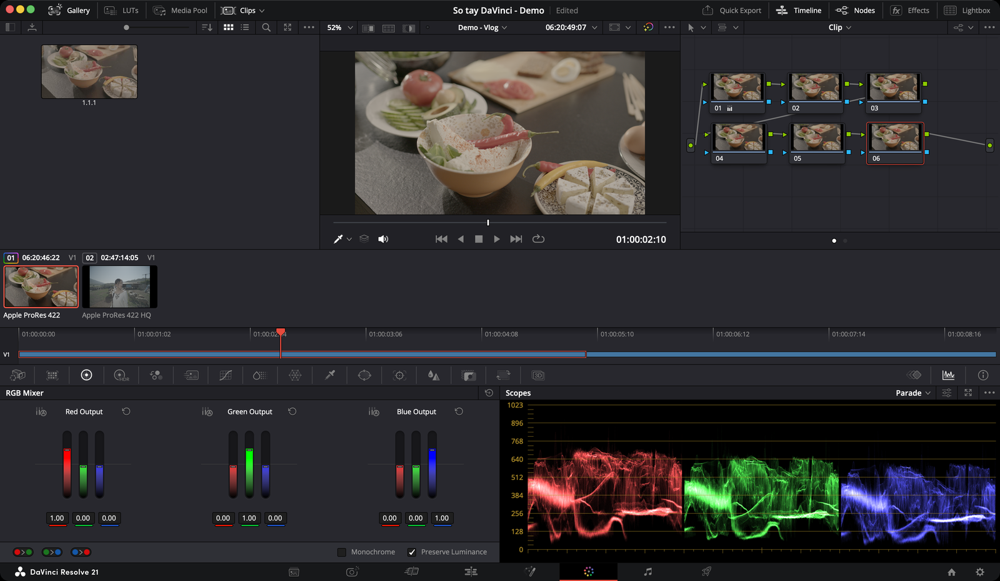

# Color — chỉnh màu

> **Một câu:** nơi chỉnh màu bằng **node** — mỗi node một bước chỉnh, nối tiếp nhau như dây chuyền.

*Ảnh chụp thật: chuỗi 6 node ở góc trên phải, scope Parade ở góc dưới phải. Node 01 đã có chỉnh sửa (icon nhỏ cạnh số 01).*

## Bố cục

| Vùng | Vị trí | Dùng để |
|---|---|---|
| **Gallery** | Trên trái | Lưu và áp lại grade (still) |
| **Viewer** | Trên giữa | Ảnh đang chỉnh |
| **Node Editor** | Trên phải | Chuỗi node |
| **Dải clip** | Giữa | Chọn clip cần chỉnh |
| **Palette** | Dưới trái | Các bảng công cụ — đổi bằng hàng icon |
| **Scopes** | Dưới phải | Đo màu và độ sáng |

### Hàng icon palette — từ trái sang phải

**Camera Raw · Color Match · Color Wheels · HDR · RGB Mixer · Motion Effects** (cụm trái), rồi **Curves · ColorSlice · Color Warper · Qualifier · Window · Tracker · Blur · Key · Sizing · 3D** (cụm giữa). Ngoài cùng bên phải: **Keyframes · Scopes · Info**.

Bảng đầy đủ, mức độ dùng và link từng palette: [Giao diện — hàng icon palette](giao-dien.md#hàng-icon-palette).

> **Chấm cam nhỏ trên icon palette** = node đang chọn có chỉnh sửa ở palette đó. Nhìn là biết node làm gì.

## Tính năng hay dùng

| Mức | Tính năng | Trang |
|---|---|---|
| ★★★ | **Cân bằng trắng** — 4 cách | [Cân bằng trắng và sáng tối](can-bang.md#cân-bằng-trắng-chỉnh-ở-đâu) |
| ★★★ | Lift, Gamma, Gain, Contrast | [Cân bằng trắng và sáng tối](can-bang.md#sáng-tối--4-bánh-xe) |
| ★★★ | Chuỗi node, thêm node `⌥S` | [Node](node.md) |
| ★★★ | Copy grade sang clip khác | [Node](node.md#áp-grade-cho-nhiều-clip) |
| ★★★ | Đọc Parade, Waveform | [Scope](scopes.md) |
| ★★★ | Curves — tương phản, đổi một màu | [Curves và chỉnh vùng](curves-va-vung.md#curves) |
| ★★★ | Qualifier + Window — chỉnh riêng da, trời | [Curves và chỉnh vùng](curves-va-vung.md#chỉnh-riêng-một-vùng) |
| ★★☆ | Tracker — vùng bám theo chuyển động | [Curves và chỉnh vùng](curves-va-vung.md#tracker) |
| ★★☆ | Vignette, làm nét, giảm cường độ | [Curves và chỉnh vùng](curves-va-vung.md#hoàn-thiện) |
| ★★★ | Wipe, Split Screen, Highlight `⇧H` — so sánh trên Viewer | [Giao diện](giao-dien.md#thanh-công-cụ-viewer--ba-nút-so-sánh) |
| ★★★ | Hue vs Sat — bớt đỏ da, đậm trời | [Curves chi tiết](curves-chi-tiet.md#hue-vs-sat--đậmnhạt-một-màu) |
| ★★☆ | Lum vs Sat — giảm bão hoà vùng tối | [Curves chi tiết](curves-chi-tiet.md#lum-vs-sat--độ-đậm-theo-vùng-sáng-tối) |
| ★★☆ | Áp LUT vào node, LUT Browser | [LUT và quản lý màu](lut-va-quan-ly-mau.md#ba-chỗ-đặt-lut) |
| ★★☆ | Color Space Transform — LOG sang Rec.709 | [LUT và quản lý màu](lut-va-quan-ly-mau.md#color-space-transform) |
| ★★☆ | Color Managed hay YRGB | [LUT và quản lý màu](lut-va-quan-ly-mau.md#color-management-của-project) |
| ★★☆ | Shot Match — khớp màu cả cảnh | [Palette khác](palette-khac.md#shot-match--khớp-nhiều-clip-theo-một-clip) |
| ★★☆ | Color Warper — đổi màu áo, trời | [Palette khác](palette-khac.md#color-warper--kéo-màu-này-sang-màu-kia) |
| ★☆☆ | RGB Mixer đen trắng, HDR, ColorSlice, Sizing | [Palette khác](palette-khac.md) |

## Ví dụ: chỉnh một clip LOG xám xịt

Đúng những bước đã làm với clip món ăn trong ảnh trên:

1. **Mở trang Color**, bấm clip trên dải clip.
2. **Dựng khung:** bấm `⌥S` năm lần → 6 node.
3. **Node 01 — Balance:** mở **Color Wheels**. Bấm nút **A** (Auto Color) để có điểm khởi đầu. Nhìn **Parade**: chân ba cột R G B chưa ngang nhau thì kéo **Temp** và **Tint**.
4. **Node 02 — Contrast:** kéo **Contrast** lên khoảng 1.2. Vùng tối bệt quá thì hạ **Pivot**.
5. **Node 03 — Color:** **Color Boost** lên khoảng 20.
6. **Node 04 — Secondary:** dùng **Qualifier** hút màu da nếu có người. Clip món ăn thì bỏ qua.
7. **Node 05 — Look:** chuột phải node → **LUT** → chọn tông màu.
8. **Node 06 — Finishing:** `⌥C` thêm node có sẵn khung tròn, kéo **Gain** xuống nhẹ, đảo khung → vignette.
9. **So sánh:** `⇧D` bật/tắt toàn bộ grade.
10. **Lưu:** chuột phải Viewer → **Grab Still**. Áp cho clip khác: chọn clip đó, chuột phải still trong Gallery → **Apply Grade**.

## Các trang con

* [Giao diện — từng nút nằm ở đâu](giao-dien.md)
* [Cân bằng trắng và sáng tối](can-bang.md)
* [Node — dựng chuỗi, copy grade](node.md)
* [Curves và chỉnh vùng](curves-va-vung.md)
* [Curves chi tiết — 7 chế độ](curves-chi-tiet.md)
* [LUT và quản lý màu](lut-va-quan-ly-mau.md)
* [Các palette khác](palette-khac.md)
* [Scope — đọc Parade, Waveform](scopes.md)
