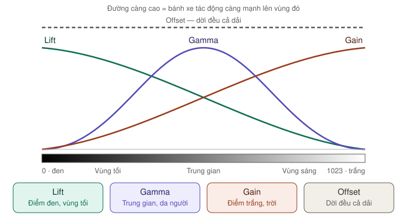
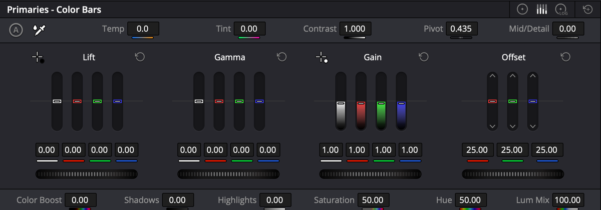

# Cân bằng trắng và sáng tối

Tất cả nằm trong **một palette**: **Primaries** — icon thứ 3 trên hàng palette, hình vòng tròn có chấm giữa. Tiêu đề palette ghi **Primaries - Color Wheels** (hoặc **Color Bars**, **Log** tuỳ chế độ). Nhiều người vẫn gọi tắt là "Color Wheels".

> Làm trên **node 01** của [chuỗi 6 node](node.md#chuỗi-6-node-cơ-bản). Chọn node trước rồi mới kéo.

| Vùng của palette | Có gì |
|---|---|
| **Dải trên cùng, bên trái** | Nút **A** (Auto Color) và ống hút **White Balance** |
| **Dải trên cùng, giữa** | Thanh **Temp**, **Tint**, **Contrast**, **Pivot**, **Mid/Detail** |
| **Góc trên phải** | Ba icon đổi chế độ **Wheels / Bars / Log**, và nút **reset cả palette** |
| **Giữa** | 4 bánh xe **Lift**, **Gamma**, **Gain**, **Offset** |
| **Dải dưới cùng** | Thanh **Color Boost**, **Shadows**, **Highlights**, **Saturation**, **Hue**, **Lum Mix** |

---

## Cân bằng trắng chỉnh ở đâu?

Có **4 cách**, từ nhanh đến chính xác:

| Cách | Nhanh | Chính xác | Thấy được giá trị để chỉnh tiếp? |
|---|---|---|---|
| 1. Nút **A** | ★★★ | ★★☆ | Có — hiện trên bánh xe |
| 2. Ống hút **White Balance** | ★★★ | ★★★ nếu có vật trắng | **Không** — chỉnh ẩn |
| 3. Thanh **Temp** / **Tint** | ★★☆ | ★★☆ | Có |
| 4. Bánh xe + **Parade** | ★☆☆ | ★★★ | Có |

### Cách 1 — Nút A (Auto Color)

`★★★` · Nhanh nhất

**Ở đâu:** **góc trên trái** palette Primaries, nút tròn chữ **A**. Hoặc menu **Color** → **Auto Color** (`⌥⇧C`).

**Làm gì:** tự cân lại điểm đen, điểm trắng và màu dựa trên **khung hình tại con trỏ**. Dùng DaVinci Neural Engine (AI của Resolve), tính cho ảnh chuẩn **Rec.709 gamma 2.4** — chuẩn màu của TV và YouTube.

**Dùng khi:** muốn có điểm khởi đầu nhanh, nhất là trước khi dùng **Shot Match** (xem [Shot Match](palette-khac.md#shot-match--khớp-nhiều-clip-theo-một-clip)).

**Cách làm:**
1. Chọn node 01.
2. Kéo con trỏ tới khung hình **đại diện nhất** của clip (có người, có vùng sáng và tối).
3. Bấm **A**.
4. Xem kết quả trên bánh xe, chỉnh tiếp bằng tay.

> **Lưu ý:** footage LOG còn xám thì Auto Color đoán kém. Chuyển LOG sang Rec.709 trước (CST hoặc Color Managed), rồi mới bấm A.

### Cách 2 — Ống hút White Balance

`★★★` · Nhanh và chính xác khi có vật màu trắng

**Ở đâu:** **góc trên trái** palette, **ngay cạnh nút A**, icon ống hút.

**Cách làm:**
1. Bấm ống hút — con trỏ chuột đổi thành ống hút.
2. Bấm vào một vật **đáng lẽ màu trắng** trong Viewer: tường trắng, áo trắng, khung cửa trắng.
Khi rê ống hút trên Viewer, một tooltip hiện **giá trị RGB** dưới con trỏ. Ba số gần bằng nhau là chỗ đó trung tính.

**Lưu ý từ manual:**
- Chọn vật **trắng thật**, không phải trắng ngà.
- Chọn chỗ **không bị cháy sáng** — chỗ cháy trông trắng nhưng không phản ánh đúng màu.
- Điều chỉnh này **không hiện lên thanh nào** — nó là một chỉnh sửa ẩn. Muốn bỏ thì reset node (`⇧Home`).

> **Lỗi hay gặp:** bấm ống hút lên **da người** hoặc **mây hồng hoàng hôn** → cả ảnh ngả xanh. Chỉ bấm vào thứ thật sự trung tính: trắng hoặc xám.

### Cách 3 — Thanh Temp và Tint

`★★★` · Chỉnh bằng mắt, dễ kiểm soát nhất

**Ở đâu:** **dải thanh phía trên** các bánh xe.

| Thanh | Kéo lên | Kéo xuống | Dải giá trị |
|---|---|---|---|
| **Temp** | Ấm hơn, ngả **cam** | Lạnh hơn, ngả **xanh dương** | −4000 tới +4000, mặc định 0 |
| **Tint** | Ngả **hồng tím** | Ngả **xanh lá** | −100 tới +100, mặc định 0 |

Temp và Tint thực chất chỉnh **Gain** (vùng sáng) — nên tác động mạnh nhất lên chỗ sáng.

**Cách chỉnh trên thanh:**
- **Kéo chữ hoặc con số** sang trái/phải để đổi giá trị.
- **Bấm đúp con số** để gõ trực tiếp.
- **Bấm đúp tên thanh** để reset về mặc định.

**Ảnh ám màu gì thì kéo thế nào:**

| Ảnh bị | Kéo |
|---|---|
| Ám xanh dương (quay ngoài trời râm, buổi tối) | **Temp** lên |
| Ám cam vàng (đèn sợi đốt, đèn trong nhà) | **Temp** xuống |
| Ám xanh lá (đèn tuýp, đèn huỳnh quang) | **Tint** lên |
| Ám hồng tím | **Tint** xuống |

**Ví dụ:** clip cô gái ở trang trại cừu quay lúc trời râm, hơi xanh. Đặt **Temp 300**, **Tint 5** → da ấm lại, cỏ vẫn xanh.

### Cách 4 — Bánh xe màu + Parade

`★★☆` · Chính xác nhất, cần nhìn scope

1. Mở **Scopes** → chọn **Parade** (xem [Scope](scopes.md#parade)).
2. Kéo **vòng tròn màu** của bánh xe **Offset** về phía **ngược** với màu đang dư. Ví dụ cột B cao nhất → kéo về phía cam vàng.
3. Dừng khi **chân ba cột R G B ngang nhau** và **đỉnh ba cột ngang nhau** (ở vật trung tính như tường trắng).
4. Lệch riêng vùng tối thì sửa bằng vòng màu **Lift**, lệch riêng vùng sáng thì sửa bằng **Gain**.

---

## Sáng tối — 4 bánh xe

`★★★ Hằng ngày`

*Lift mạnh ở vùng tối, Gamma ở trung gian, Gain ở vùng sáng — ba vùng chồng lên nhau rất rộng. Offset dời đều tất cả.*

| Bánh xe | Tác động lên | Kéo **thanh dưới** bánh xe sang phải | Số mặc định |
|---|---|---|---|
| **Lift** | Vùng tối | Điểm đen nâng lên, ảnh bớt đậm | 0.00 |
| **Gamma** | Vùng trung gian | Cả ảnh sáng lên, vùng tối và sáng gần như giữ nguyên | 0.00 |
| **Gain** | Vùng sáng | Điểm trắng sáng hơn — kéo quá là **cháy** | 1.00 |
| **Offset** | **Toàn bộ** ảnh | Cả ảnh sáng lên đều, như nâng cả dải | 25.00 |

Mỗi bánh xe có ba phần:
- **Vòng tròn màu** — kéo **dấu chấm ở giữa** về một màu để đổi màu cho vùng đó.
- **Thanh xoay (master wheel) bên dưới** — kéo sang trái/phải để đổi sáng tối.
- **Hàng số Y R G B** dưới cùng — bấm đúp để gõ số chính xác. Offset không có Y.

**Thao tác trên vòng màu** (manual tr. 3198):

| Thao tác | Kết quả |
|---|---|
| Kéo ở **bất kỳ đâu** trong vòng | Dời màu **tương đối** từ vị trí đang có |
| `⇧` + kéo | Chấm nhảy **thẳng tới** chỗ bạn bấm |
| `⌘` + kéo | Chỉnh **sáng tối** (như thanh xoay) |
| Bấm đúp trong vòng | Reset **màu**, giữ sáng tối |
| Nút **reset** góc trên phải bánh xe | Reset **cả màu và sáng tối** |

**Ví dụ:** clip đĩa phô mai sau khi chuyển LOG sang Rec.709 vẫn hơi nhạt. Đặt **Lift −0.03** cho đen sâu hơn, **Gain 1.08** cho phô mai sáng, **Gamma +0.02**. Xem Waveform: chân sát 0, đỉnh khoảng 940.

### Ống hút điểm đen, điểm trắng

**Ở đâu:** icon dấu cộng nhỏ ở **góc trên trái** của bánh xe **Lift** (điểm đen) và **Gain** (điểm trắng). Có ở chế độ Wheels và Bars.

| Ống hút | Bấm vào | Kết quả |
|---|---|---|
| **Pick Black Point** | Chỗ **đen nhất** đáng lẽ phải đen: bóng tối sâu, vải đen | Vùng tối đậm hơn, hết ám màu ở vùng tối |
| **Pick White Point** | Chỗ **trắng nhất** đáng lẽ phải trắng | Vùng sáng sáng hơn, hết ám màu ở vùng sáng |

Khác ống hút White Balance: hai ống hút này **có hiện kết quả** trên bánh xe Lift và Gain, nên chỉnh tiếp được.

> Manual cảnh báo: rất dễ kéo quá tay làm **cháy vùng sáng** hoặc **bệt vùng tối**. Luôn nhìn Waveform sau khi dùng.

### Thứ tự chỉnh chuẩn

1. **Offset** — cân màu tổng thể
2. **Lift** — đặt điểm đen chạm 0 trên Waveform
3. **Gain** — đặt điểm trắng gần đỉnh nhưng không chạm trần
4. **Gamma** — chỉnh độ sáng chung theo cảm nhận

> **Mẹo:** chỉnh Lift xong thì Gain bị lệch một chút, và ngược lại. Lặp lại bước 2–3 một lần nữa là khớp.

---

## Hàng thanh điều chỉnh

Hai dải thanh nằm **trên và dưới** các bánh xe. Dùng được ở cả ba chế độ của palette.

### Hàng trên

| Thanh | Làm gì | Dải giá trị | Mặc định | Mức |
|---|---|---|---|---|
| **Temp** | Ấm ↔ lạnh | −4000 … +4000 | 0.0 | ★★★ |
| **Tint** | Hồng ↔ xanh lá | −100 … +100 | 0.00 | ★★★ |
| **Contrast** | Tương phản quanh điểm Pivot | — | 1.000 | ★★★ |
| **Pivot** | Tâm của tương phản — mức sáng đứng yên khi tăng Contrast | — | 0.435 | ★★☆ |
| **Mid/Detail** | Độ nét cảm nhận ở chi tiết vừa. Số âm làm mịn da | −100 … +100 | 0.00 | ★★☆ |

**Contrast + Pivot:** ảnh tối mà tăng Contrast thì vùng tối bị bệt — hạ **Pivot** xuống trước. Ảnh sáng thì nâng Pivot lên.

**Ví dụ:** **Contrast 1.15**, **Pivot 0.40** cho clip trang trại — trời vẫn giữ chi tiết, bóng cừu đậm hơn.

> Mặc định Contrast tạo **đường cong chữ S** mềm ở hai đầu, nên ít bị cháy hay bệt. Tuỳ chọn này nằm ở **Project Settings** → **General Options** → **Use S-curve for contrast** (bật sẵn).

### Hàng dưới

| Thanh | Làm gì | Dải giá trị | Mặc định | Mức |
|---|---|---|---|---|
| **Color Boost** | Tăng độ tươi ở **chỗ còn nhạt**, không đụng chỗ đã đậm (kiểu "vibrance") | −100 … +100 | 0.00 | ★★★ |
| **Shadows** | Lấy lại chi tiết vùng tối | −100 … +100 | 0.00 | ★★★ |
| **Highlights** | Kéo **xuống** để cứu vùng cháy (trời, cửa sổ) | −100 … +100 | 0.00 | ★★★ |
| **Saturation** | Độ đậm của **mọi** màu. 100 là gấp đôi | 0 … 100 | **50** | ★★☆ |
| **Hue** | Xoay toàn bộ màu quanh vòng màu | — | 50 | ★☆☆ |
| **Lum Mix** | Cân giữa tương phản kiểu YRGB và kiểu chỉ độ sáng (Y). 0 = tắt phần chỉ-độ-sáng | 0 … 100 | 100 | ★☆☆ |

> **Bẫy hay gặp:** **Saturation mặc định là 50**, không phải 0. Kéo về 0 là ảnh đen trắng. Muốn tăng màu cho da người tự nhiên, dùng **Color Boost** thay vì Saturation.

**Ví dụ:** trời cháy trắng ở clip trang trại → **Highlights −40**. Cỏ hơi nhạt → **Color Boost 20**. Không đụng Saturation.

---

## Ba chế độ của palette

Đổi bằng **ba icon ở góc trên phải** palette (vòng tròn = Wheels, ba thanh = Bars, vòng có chữ LOG = Log). `⌥Z` chuyển nhanh giữa Wheels và Log.

*Chế độ **Color Bars**. Nút **A** và ống hút White Balance ở góc trên trái, ba icon chế độ ở góc trên phải.*

| Chế độ | Giao diện | Dùng khi |
|---|---|---|
| **Wheels** | 4 bánh xe | Mặc định, trực quan nhất |
| **Bars** | Thanh dọc Y, R, G, B riêng cho Lift/Gamma/Gain, và R, G, B cho Offset | Cân bằng trắng chính xác bằng cách nhìn Parade, kéo **từng kênh**. Kéo thanh **Y** để chỉnh sáng tối mà không đổi độ đậm màu |
| **Log** | Bánh xe **Shadow** / **Midtone** / **Highlight** + **Offset**, thêm thanh **Low Range** / **High Range** | Footage LOG: chỉnh ở node có LUT/CST chuyển đổi, vì LUT luôn chạy **sau** mọi chỉnh khác trong node |

Người mới: ở nguyên **Wheels**.

> **Lưu ý:** trong cùng một node, chỉnh ở Wheels chạy **trước** chỉnh ở Log. Palette **HDR** lại chạy trước cả Primaries.

---

## Những gì làm ở palette này **không** làm được

- Chỉnh **riêng một vùng** (chỉ khuôn mặt, chỉ bầu trời) → [Qualifier và Window](curves-va-vung.md#chỉnh-riêng-một-vùng)
- Đổi **riêng một màu** (lá vàng thành lá xanh) → [Curves Hue vs Hue](curves-chi-tiet.md#hue-vs-hue--đổi-màu-này-thành-màu-kia)
- Chuyển footage **LOG sang Rec.709** đúng chuẩn → [LOG sang Rec.709](../../03-luong/log-sang-rec709.md)
