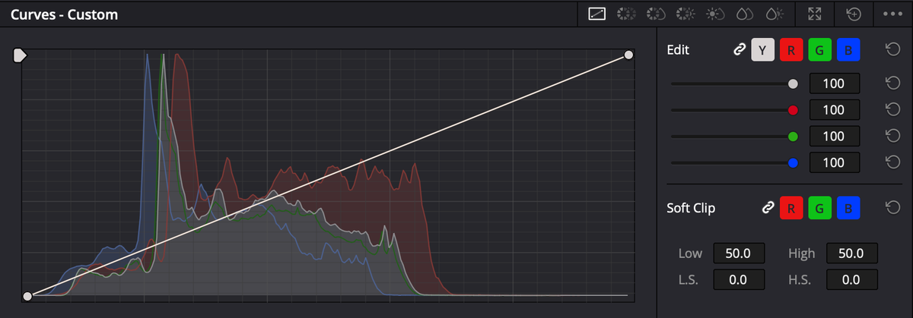

# Curves chi tiết — 7 chế độ

Palette **Curves** — icon thứ 7 trên [hàng icon palette](giao-dien.md#hàng-icon-palette). Chọn chế độ bằng **các icon ở góc trên phải** palette.

*Icon chế độ từ trái sang phải: Custom, Hue vs Hue, Hue vs Sat, Hue vs Lum, Lum vs Sat, Sat vs Sat, Sat vs Lum. Nút mắt xích cạnh Y R G B là nút gang.*

Bản tóm tắt nằm ở [Curves và chỉnh vùng](curves-va-vung.md#curves). Trang này đi từng chế độ, mỗi chế độ một việc cụ thể.

| Chế độ | Trục ngang (chọn cái gì) | Kéo lên/xuống (đổi cái gì) | Mức |
|---|---|---|---|
| **Custom** | Độ sáng | Độ sáng / từng kênh R G B | ★★★ |
| **Hue vs Hue** | Màu | Màu | ★★★ |
| **Hue vs Sat** | Màu | Độ đậm | ★★★ |
| **Hue vs Lum** | Màu | Độ sáng | ★★☆ |
| **Lum vs Sat** | Độ sáng | Độ đậm | ★★☆ |
| **Sat vs Sat** | Độ đậm | Độ đậm | ★☆☆ |
| **Sat vs Lum** | Độ đậm | Độ sáng | ★☆☆ |

> Đọc tên curve như câu hỏi: **"Hue vs Sat"** = chọn theo **màu**, đổi **độ đậm**.

---

## Thao tác chung

Đúng cho mọi chế độ:

| Việc | Cách |
|---|---|
| Thêm điểm | Bấm lên đường cong |
| Thêm điểm **không làm cong** | Giữ `⇧` rồi bấm |
| Xoá điểm | **Chuột phải** vào điểm |
| Thêm điểm đúng màu cần chỉnh | Bấm hoặc kéo chuột **trên Viewer** vào vùng đó |
| Reset cả palette | Nút reset góc trên phải palette |

**Bấm trên Viewer là cách nhanh nhất.** Với các curve Hue và Sat, Resolve đặt **ba điểm**: hai điểm hai bên khoá phạm vi, điểm giữa để kéo.

### Thanh dưới các curve Hue và Sat

| Nút | Làm gì |
|---|---|
| **6 ô màu** (đỏ, vàng, lục, lam, xanh dương, tím) — chỉ ở ba curve **Hue vs …** | Bấm một ô → tự thêm ba điểm quanh màu đó |
| **Bezier** | Đổi điểm thành điểm có tay nắm — uốn mềm hơn |
| **Input / Output** | Ô số của điểm đang chọn — gõ số cho chính xác |

> **Biểu đồ mờ phía sau curve** là histogram của ảnh. Chỗ không có histogram là ảnh **không có** màu đó — kéo ở đó không ra gì.

---

## Custom — tương phản và từng kênh màu

`★★★ Hằng ngày`

**Là gì:** đường chéo từ góc dưới trái (đen) tới góc trên phải (trắng). Đẩy một đoạn lên thì vùng sáng tối đó sáng hơn.

**Dùng khi:** tăng tương phản mềm hơn bánh xe; sửa ám màu chỉ ở vùng sáng hoặc vùng tối.

### Ví dụ 1 — đường chữ S tăng tương phản

1. `⇧`+bấm ba điểm ở 1/4, giữa và 3/4 đường chéo để khoá.
2. Kéo điểm 1/4 **xuống** nhẹ, điểm 3/4 **lên** nhẹ.
3. Xem Waveform: đáy không dồn bệt ở 0, đỉnh không dẹt ở 1023.

> Option menu → **Default Anchors** tự thêm ba điểm chia curve thành 5 đoạn — tiện cho bước 1.

### Ví dụ 2 — vùng sáng ám vàng, vùng tối vẫn đúng

1. Bấm nút kênh **B** (xanh dương) ở bên phải curve — các kênh **tách ra** (bỏ gang).
2. `⇧`+bấm một điểm ở giữa curve B để giữ vùng tối.
3. Kéo đoạn trên của curve B **lên** — vùng sáng bớt vàng.

Ghép lại các kênh: bấm nút **gang** (bên trái các nút kênh).

### Các nút còn lại của Custom

| Nút | Làm gì | Dùng khi |
|---|---|---|
| **Thanh Intensity** (Y R G B) | 100 = hết tác dụng, 0 = không tác dụng | Curve hơi quá — kéo về 70 thay vì sửa lại |
| **Điểm đen** (góc dưới trái) | Kéo **lên** = đen bạc đi. Kéo **sang phải** = đen sâu hơn | Tạo look "phim cũ" đen bạc |
| **Điểm trắng** (góc trên phải) | Kéo **xuống** = trắng xỉn. Kéo **sang trái** = trắng sáng hơn | |
| **Soft Clip — High / High Soft** | Nén mềm vùng sáng gần cháy | Trời bị cháy trắng bệt, mép gắt |
| **Soft Clip — Low / Low Soft** | Nén mềm vùng tối | Vùng tối bị bệt đen |
| `⌥`+kéo điểm | Hít điểm về đường chéo gốc | Muốn trả điểm về trung tính |

> **Đừng kéo thanh High sang trái** trừ khi chắc chắn. Manual cảnh báo: hạ High dù chỉ 1 đơn vị là dữ liệu vùng sáng **bị bỏ vĩnh viễn** từ node đó trở đi — node sau không lấy lại được.

> Hai điểm đặt **quá sát nhau** hoặc cong quá gắt sẽ làm ảnh bị **sọc dải màu**. Uốn nhẹ tay.

---

## Hue vs Hue — đổi màu này thành màu kia

`★★★ Hằng ngày`

**Dùng khi:** một màu lệch nhẹ, hoặc muốn đổi hẳn màu một vật.

### Ví dụ — bầu trời ngả lục lam, muốn xanh dương hơn

1. Node mới (`⌥S`), mở Curves → **Hue vs Hue**.
2. Bấm kéo trên Viewer vào **bầu trời** → ba điểm hiện ở vùng lam.
3. Kéo điểm giữa **lên hoặc xuống một chút** đến khi trời ngả xanh dương. Màu thay đổi ngay khi kéo, cứ nhìn Viewer mà chỉnh.

Manual gợi ý đúng việc này: trời hơi lục lam chỉnh **một chút** là thành xanh dương đậm đà.

### Ví dụ — lá cây lay trong gió

Lá đỏ mùa thu, muốn thành xanh. Qualifier sẽ tạo vùng chọn **nhấp nháy** vì lá rung. Hue vs Hue không có mép vùng chọn nên **không bị nhấp nháy**.

> **Chỉnh nhẹ.** Kéo xa quá là màu vỡ, nhất là với video nén (điện thoại, máy ảnh 8-bit).

---

## Hue vs Sat — đậm/nhạt một màu

`★★★ Hằng ngày` — curve dùng nhiều nhất trong nhóm Hue.

### Ví dụ — da người đỏ sặc

1. Node mới, **Hue vs Sat**.
2. Bấm kéo trên Viewer qua **má** → ba điểm ở vùng đỏ-cam.
3. Kéo điểm giữa **xuống nhẹ** — da bớt đỏ.
4. Kiểm tra Vectorscope: vệt da nằm gần [đường skin tone](scopes.md#vectorscope).

### Ví dụ — trời và nước xanh hơn mà da không đổi

Bấm ô **xanh dương** ở thanh dưới → kéo điểm giữa **lên**. Da nằm ở vùng đỏ-cam nên không bị ảnh hưởng.

### Ví dụ — bớt rối mắt

Cảnh có biển hiệu, áo quần sặc sỡ ở hậu cảnh. Hạ độ đậm **màu không quan trọng**, giữ màu của chủ thể → mắt người xem tự đổ về chủ thể.

---

## Hue vs Lum — sáng/tối một màu

`★★☆ Thường dùng`

### Ví dụ — trời xanh tối lại cho có chiều sâu

1. Node mới, **Hue vs Lum**.
2. Bấm kéo trên Viewer vào trời.
3. Kéo điểm giữa **xuống nhẹ** — trời tối và đậm hơn, mây trắng nổi lên.

### Ví dụ — làm sáng một vật muốn nhấn

Áo vàng của nhân vật hơi tối → bấm ô **vàng**, kéo **lên**.

> **Cẩn thận với video nén.** Manual ghi rõ: curve này **dễ làm lộ nhiễu khối** trên footage nén nặng. Video điện thoại thì chỉ kéo rất nhẹ, soi kỹ ở 100% zoom.

---

## Lum vs Sat — độ đậm theo vùng sáng tối

`★★☆ Thường dùng`

**Trục ngang** là độ sáng: trái = vùng tối, phải = vùng sáng.

### Ví dụ — giảm bão hoà vùng tối

Vừa tăng Color Boost, giờ bóng tối **bị loang màu** trông giả.

1. Node mới, **Lum vs Sat**.
2. Bấm một điểm ở khoảng 1/3 từ trái để giữ vùng trung gian.
3. Kéo đầu **bên trái** curve **xuống** — vùng tối nhạt màu dần, chuyển mượt.

Kết quả: vùng tối sạch, sâu hơn. Vùng trung gian vẫn tươi.

### Ví dụ — vùng sáng bị ám màu

Cửa sổ cháy sáng ngả vàng. Kéo đầu **bên phải** xuống → vùng sáng gần trắng nhạt màu đi, trông tự nhiên hơn.

---

## Sat vs Sat — vibrance tự chế

`★☆☆ Tình huống cụ thể`

**Trục ngang** là độ đậm gốc: trái = chỗ nhạt màu, phải = chỗ đã đậm màu.

### Ví dụ — tăng màu chỗ nhạt, không đụng chỗ đã đậm

Kéo phần **bên trái** lên. Ảnh tươi hơn nhưng áo đỏ vốn đã đậm **không bị sặc thêm**.

### Ví dụ — chỉ hạ chỗ quá sặc

Kéo đầu **bên phải** xuống. Chỉ những gì đậm nhất (biển đèn neon, áo huỳnh quang) dịu lại.

---

## Sat vs Lum — tối lại chỗ đậm màu

`★☆☆ Tình huống cụ thể`

**Trục ngang** là độ đậm, **kéo lên/xuống** là độ sáng. Ngược với Lum vs Sat.

### Ví dụ — trời và biển xanh đậm hơn, kiểu phim

Kéo đầu **bên phải** xuống. Những vùng **đậm màu nhất** (trời, mặt biển) tối lại, xanh đậm hơn. Vùng ít màu như da và tường gần như không đổi.

Manual giải thích: phim nhựa cũng vậy — màu càng đậm càng chặn sáng nhiều.

---

## Curves hay Qualifier?

| | Curves (Hue, Sat) | [Qualifier](curves-va-vung.md#qualifier--hút-màu) |
|---|---|---|
| Mép vùng chỉnh | **Mượt tuyệt đối** — không có mép | Có mép, có thể răng cưa, nhấp nháy |
| Tách rõ ranh giới | Khó — lan sang màu gần | **Dễ** |
| Chỉnh được gì | Một thứ mỗi curve (màu, độ đậm hoặc độ sáng) | Mọi palette: bánh xe, curve, blur |
| Hợp với | Chỉnh nhẹ trên cả ảnh | Chỉnh mạnh một vùng rõ ràng |

**Quy tắc nhanh:** chỉnh **nhẹ** một màu → Curves. Chỉnh **mạnh**, hoặc chỉ một vật trong nhiều vật cùng màu → Qualifier + Window.

> **Nhiều curve trong một node:** các curve đều chọn màu từ **ảnh đầu vào** của node. Đổi áo xanh thành đỏ bằng Hue vs Hue, rồi muốn tăng độ đậm áo bằng Hue vs Sat **cùng node** — vẫn phải chọn vùng **xanh**, không phải đỏ. Dễ nhầm, nên tách sang node mới.
