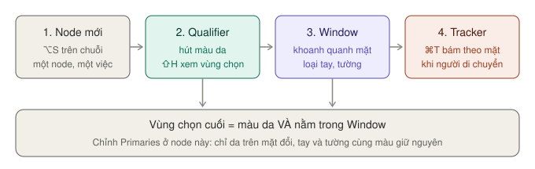
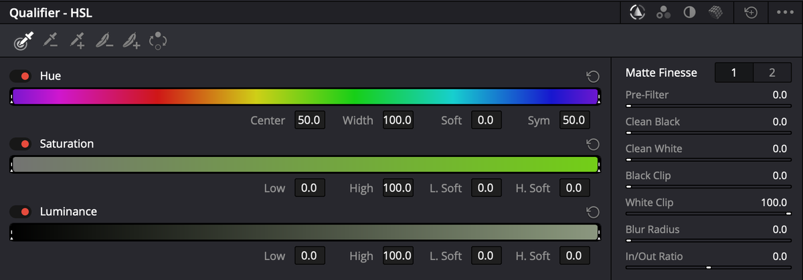
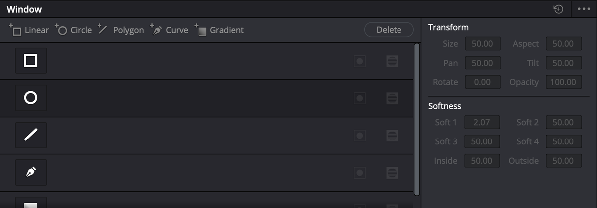
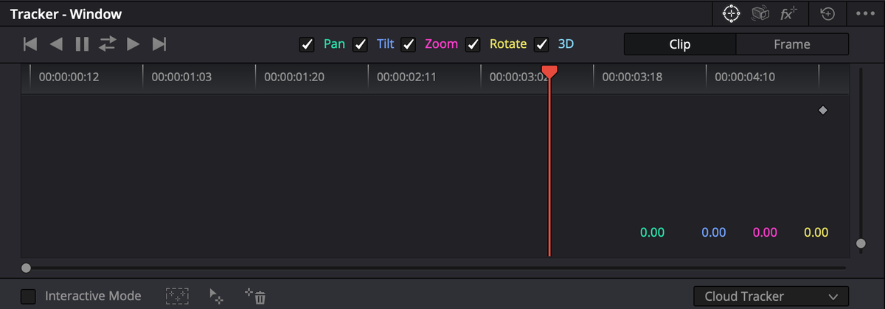

# Curves và chỉnh vùng

## Curves

`★★★ Hằng ngày` · Palette thứ 7 (icon đường cong)

Chọn loại curve bằng các nút ở **đầu palette**.

| Loại | Dùng để | Ví dụ | Mức |
|---|---|---|---|
| **Custom** | Tương phản bằng đường chữ S | Kéo điểm vùng tối xuống, điểm vùng sáng lên | ★★★ |
| **Hue vs Hue** | Đổi **một màu** thành màu khác | Lá vàng → lá xanh, áo đỏ → áo cam | ★★★ |
| **Hue vs Sat** | Tăng/giảm độ đậm của **một màu** | Bớt sặc màu đỏ của da, làm trời xanh đậm hơn | ★★★ |
| **Hue vs Lum** | Sáng/tối **một màu** | Làm trời xanh tối lại cho có chiều sâu | ★★☆ |
| **Lum vs Sat** | Độ đậm theo vùng sáng tối | Bớt màu ở vùng tối để ảnh sạch hơn | ★★☆ |

Đủ 7 chế độ (thêm **Sat vs Sat**, **Sat vs Lum**) và ví dụ từng cái: [Curves chi tiết](curves-chi-tiet.md).

**Cách chọn đúng màu trên Hue curves:** bấm và kéo chuột **trên Viewer** vào vùng màu muốn chỉnh — Resolve tự thêm điểm đúng màu đó trên curve. Rồi kéo điểm lên/xuống.

## Chỉnh riêng một vùng

`★★★ Hằng ngày` — chỉ làm sáng mặt, chỉ đổi màu trời

Hai công cụ, thường dùng chung trong **một node**:

- **Qualifier** — chọn theo **màu**
- **Window** — chọn theo **hình**

Vùng được chọn gọi là **key** (hay matte): ảnh đen trắng, **trắng** là chỗ bị chỉnh, **đen** là chỗ giữ nguyên.

*Qualifier và Window cùng một node: chỉ phần vừa đúng màu vừa nằm trong khung mới bị chỉnh.*

> **Lưu ý:** luôn tạo **node mới** (`⌥S`) trước khi tách vùng. Qualifier hút màu từ ảnh **đi vào** node đó — hút ở node có look đậm thì khó tách hơn hút ở node đầu.

### Qualifier — hút màu

Palette thứ 10 (icon ống hút).

*Qualifier chế độ **HSL**. Bốn icon chế độ ở góc trên phải; hàng ống hút ở đầu cột phải; **Matte Finesse** bên dưới.*

Có 4 chế độ, đổi bằng **4 icon ở góc trên phải** palette (thứ tự: HSL, RGB, LUM, 3D). Mặc định là **HSL**.

| Chế độ | Chọn theo | Dùng khi |
|---|---|---|
| **3D** | Vẽ nét lên vùng màu muốn chọn | **Tách một màu** — da người, trời, áo. Thường sạch nhất, nên thử đầu tiên |
| **HSL** | Hue, Saturation, Luminance riêng từng thanh | 3D không chọn sạch được, hoặc cần chỉnh tay từng thông số |
| **LUM** | Chỉ độ sáng | Tách vùng sáng hoặc vùng tối — ví dụ chỉ làm ấm vùng sáng |
| **RGB** | Kênh R, G, B | Ít dùng |

**Cách làm (chế độ 3D):**
1. Tạo node mới (`⌥S`), mở Qualifier, chọn **3D**.
2. **Kéo một nét** trên Viewer qua vùng muốn chọn (ví dụ má, trán). Nét dài cho key tốt hơn.
3. Chỗ bị chọn thừa: giữ `⌥` rồi kéo nét qua chỗ đó để **trừ** ra (nét đỏ).
4. Bấm `⇧H` để **xem vùng đã chọn** — phần không chọn chuyển xám.
5. Làm mượt bằng **Matte Finesse** ở cuối palette (bảng dưới).
6. `⇧H` lần nữa để thoát xem vùng chọn, rồi chỉnh màu như bình thường — chỉ vùng đó đổi.

> `⌥⇧H` xem vùng chọn dạng **đen trắng** — dễ thấy mép răng cưa nhất.

Mỗi nét bạn vẽ là một dòng trong **danh sách nét** (strokes list) của chế độ 3D: bấm ô màu để tạm tắt nét, bấm thùng rác để xoá.

**Hàng ống hút ở chế độ HSL/RGB/LUM** (đầu cột phải, từ trái sang):

| Ống hút | Làm gì |
|---|---|
| **Picker** | Lấy màu ban đầu. Bấm một điểm hoặc kéo để lấy một vùng. **Luôn dùng cái này trước** |
| **Picker −** / **Picker +** | Bớt / thêm dải màu vào vùng chọn |
| **Feather −** / **Feather +** | Bớt / thêm độ mềm ở mép vùng chọn |
| **Invert** | Đảo vùng chọn |

**Matte Finesse — làm sạch vùng chọn:**

| Thanh | Làm gì | Ví dụ |
|---|---|---|
| **Pre-Filter** | Làm sạch ảnh **trước khi** hút màu | Footage nén nặng, có ô vuông |
| **Clean Black** | Xoá lấm tấm trắng ở phần **không** được chọn | Tường nền bị dính vài đốm |
| **Clean White** | Lấp lỗ thủng ở phần **được** chọn | Mặt bị lủng chỗ bóng |
| **Black Clip** / **White Clip** | Ép phần gần đen thành đen hẳn, gần trắng thành trắng hẳn | Key bị xám mờ |
| **Blur Radius** | Làm mềm mép vùng chọn | Mép da cứng, răng cưa |
| **In/Out Ratio** | Đẩy độ mềm vào trong hay ra ngoài mép | Viền sáng quanh tóc |

**Ví dụ:** áo xanh lá của cô gái ở trang trại hơi gắt. 3D → kéo một nét dọc áo → `⇧H` → **Clean Black 10**, **Blur Radius 5** → thoát `⇧H` → **Saturation 40** ở Primaries.

### Window — khoanh vùng

Palette thứ 11. Manual gọi là **Power Window**.

*Palette Window. Hàng nút thêm hình ở trên; **Transform** và **Softness** bên phải.*

| Hình | Dùng khi | Thêm node có sẵn hình này |
|---|---|---|
| **Linear** (chữ nhật) | Vùng vuông vức: màn hình, cửa sổ | `⌥Q` |
| **Circle** | Khuôn mặt, vignette | `⌥C` |
| **Polygon** | Vùng nhiều góc | `⌥G` |
| **Curve** | Vẽ tự do theo hình dạng | `⌥B` |
| **Gradient** | Chuyển dần — làm tối dần bầu trời | — |

**Cách làm:**
1. Chọn node (hoặc `⌥S` thêm node mới).
2. Mở palette Window → bấm nút hình muốn dùng. Khung hiện trên Viewer.
3. Kéo **tâm** để dời, kéo **điểm trên viền** để đổi cỡ.
4. Kéo **mép mềm** (vòng ngoài) để vùng chuyển mượt.
5. Chỉnh màu — chỉ bên trong khung đổi. Muốn chỉnh bên ngoài: bấm nút **Invert** của khung.

| Nhóm thanh | Có gì |
|---|---|
| **Transform** | **Size**, **Aspect** (méo dẹt), **Pan** (ngang), **Tilt** (dọc), **Rotate**, **Opacity** |
| **Softness** | **Soft 1…4** (độ mềm từng cạnh, tuỳ hình), **Inside** / **Outside** (mềm vào trong / ra ngoài, cho Polygon và Curve) |

Mỗi dòng khung trong danh sách có nút **Invert** và **Mask**. **Mask** biến khung đó thành phần **trừ** khỏi các khung khác — ví dụ khung tròn quanh người, trừ đi khung nhỏ quanh tay.

> **Mẹo:** `⌥H` ẩn/hiện viền khung trên Viewer (ba trạng thái: hiện, ẩn, chỉ hiện trên máy tính). Hữu ích khi muốn nhìn ảnh sạch.

**Qualifier + Window cùng node:** Qualifier chọn màu da, Window khoanh quanh mặt → chỉ da trên mặt bị ảnh hưởng, không lan sang tay hay tường cùng màu.

### Tracker

`★★☆ Thường dùng` · Palette thứ 12

Window đứng yên, người thì di chuyển. Tracker cho window **bám theo**.

*Tracker chế độ **Window**. Hàng nút track trên cùng; ô tick chọn chuyển động; menu **Cloud Tracker** ở góc dưới phải.*

1. Tạo window quanh khuôn mặt. Kéo con trỏ tới khung hình **rõ mặt nhất**.
2. Mở Tracker. Tick đúng chuyển động cần bám: **Pan**, **Tilt**, **Zoom**, **Rotate**, **3D** (phối cảnh).
3. Bấm **Track Forward** (`⌘T`). Resolve tự phân tích tới cuối clip, đường cong hiện trên đồ thị.
4. Bắt đầu từ giữa clip thì bấm thêm **Track Reverse** (`⌥T`), hoặc nút **Track Forward and Back** để làm cả hai chiều một lần.
5. Phát lại xem window có bám không.

| Nút / tuỳ chọn | Làm gì |
|---|---|
| **Track One Frame Reverse / Forward** | Track từng khung — cho đoạn khó |
| **Clip** (mặc định) | Dời window sau khi track → dời **cả đường** track |
| **Frame** | Dời window → tạo **keyframe** tại khung đó. Dùng sửa khung track sai |
| **Cloud Tracker** (mặc định) | Tự tìm điểm bám khắp vùng trong window |
| **Point Tracker** | Bạn tự đặt điểm bám (**Add Tracker**). Dùng khi Cloud trượt |
| **Interactive Mode** | Thêm/xoá điểm bám của Cloud Tracker bằng khung vẽ trên Viewer |

Bám bị trượt: bỏ tick các chuyển động không có (ví dụ **Rotate**, **3D**) rồi track lại — đổi ô tick **sau** khi track không có tác dụng.

> **Magic Mask** (tách người bằng AI) và **IntelliTrack** (tracker AI) là `Studio`.

Menu chế độ ở góc trên phải còn có **Stabilizer** (chống rung — xem [Sizing](palette-khac.md#sizing--reframe-trong-trang-color)) và **FX** (bám cho hiệu ứng Resolve FX).

## Hoàn thiện

### Vignette

`★★☆ Thường dùng`

1. Node cuối: `⌥C` — node mới có sẵn **khung tròn**.
2. Kéo khung rộng ra quanh chủ thể, kéo mép mềm thật rộng (**Soft 1** khoảng 30–50).
3. Bấm **Invert** để chọn phần **bên ngoài**.
4. Mở Primaries, kéo **Gain** xuống nhẹ (ví dụ 0.85).

### Làm nét, làm mờ

`★★☆` · Palette **Blur** (thứ 13)

Thanh **Radius** mặc định **0.5**:
- **Trên 0.5** → làm mờ
- **Dưới 0.5** → làm nét. Video 1080p để khoảng 0.45–0.48 là vừa.

Chi tiết và ví dụ: [Blur](palette-khac.md#blur--làm-mờ-làm-nét-mist).

### Giảm cường độ một node

`★★☆` · Palette **Key** (thứ 14)

**Key Output Gain** về **0.5** → node đó chỉ tác động một nửa.

**Dùng khi:** một bước chỉnh, nhất là LUT, hơi quá tay. Giảm ở đây nhanh hơn chỉnh lại từ đầu.
