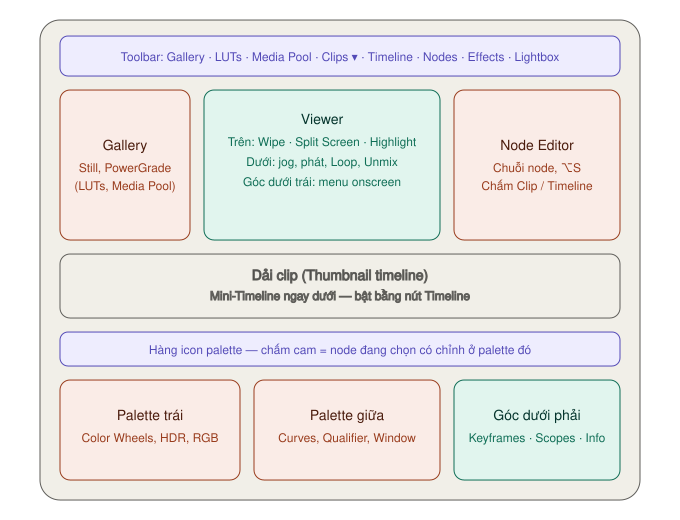
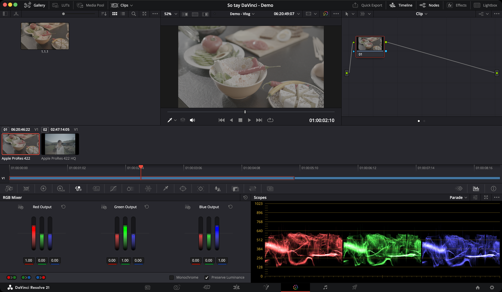

# Giao diện trang Color — từng nút nằm ở đâu

*Ảnh chụp Resolve 21 bản free.*

Manual chia trang Color thành **bảy vùng**: toolbar trên cùng, Gallery, Viewer, Node Editor, dải clip, khu palette, và góc dưới phải (Keyframes · Scopes · Info).

Đổi kích thước: kéo **đường nối dọc** giữa Gallery, Viewer và Node Editor. Lỡ kéo lộn xộn: **Workspace → Reset UI Layout**.

---

## Thanh toolbar trên cùng

Bấm để **bật/tắt** từng vùng.

**Bên trái:** Gallery · LUTs · Media Pool · Clips. **Bên phải:** Quick Export · Timeline · Nodes · Effects · Lightbox.

| Nút | Mở ra | Mức |
|---|---|---|
| **Gallery** | Kho still và grade đã lưu | ★★★ |
| **LUTs** | Trình duyệt LUT, có ảnh xem trước — xem [LUT](lut-va-quan-ly-mau.md#lut-browser) | ★★☆ |
| **Media Pool** | Kho clip. Ở trang Color chủ yếu để kéo clip làm **matte** vào Node Editor | ★☆☆ |
| **Clips** | Dải clip (Thumbnail timeline). Mũi tên **▾** bên phải là menu **lọc clip** | ★★★ |
| **Quick Export** | Xuất nhanh | ★☆☆ |
| **Timeline** | Mini-Timeline — clip dài đúng thời lượng, thấy được nhiều track | ★★☆ |
| **Nodes** | Node Editor | ★★★ |
| **Effects** | Kho Resolve FX (manual ghi là **Open FX**). Nơi lấy **Color Space Transform** | ★★☆ |
| **Lightbox** | Mọi clip dạng lưới ảnh lớn | ★☆☆ |

> **Gallery, LUTs và Media Pool dùng chung một chỗ.** Mở cái này thì cái kia đóng lại.

### Lọc clip — menu ▾ cạnh nút Clips

`★★☆ Thường dùng` — video dài, chỉ muốn thấy những clip cần làm.

Chọn một bộ lọc → dải clip chỉ còn clip khớp. Khi đang lọc, có **gạch cam** dưới nút Clips. Về bình thường: chọn **All Clips**.

| Bộ lọc | Hiện | Dùng khi |
|---|---|---|
| **Ungraded Clips** | Clip **chưa** chỉnh | Soát xem còn sót clip nào không |
| **Graded Clips** | Clip đã chỉnh | Kiểm tra lại một lượt |
| **Flagged Clips** | Clip có cờ (chọn màu cờ) | Đã cắm cờ đỏ các clip cần sửa |
| **Marked Clips** | Clip có marker | Có ghi chú từ trang Edit |
| **Grouped** | Clip thuộc một group | Chỉnh từng cảnh |
| **Common Media Pool Source** | Clip cùng file gốc với clip đang chọn | Phỏng vấn cắt thành nhiều đoạn |
| **Different Frame Rate** | Clip khác frame rate với project | Tìm clip slow motion |

---

## Viewer

### Thanh tiêu đề — trên cùng Viewer

| Nút | Làm gì | Mức |
|---|---|---|
| **Zoom / Fit** | Phóng to theo % hoặc vừa khung (`⇧Z`) | ★★☆ |
| **Chấm tốc độ phát** | Xanh = phát đủ khung. Đỏ = máy không theo kịp | ★★☆ |
| **Tên timeline ▾** | Đổi sang timeline khác trong project | ★☆☆ |
| **Timecode ▾** | Chọn hiện timecode nguồn hay timeline | ★☆☆ |
| **Viewer Guides** | Khung an toàn, đường chia | ★☆☆ |
| **Proxy** | Phát bằng proxy hay file gốc | ★☆☆ |
| **Độ phân giải timeline** | Đổi nhanh preset | ★☆☆ |
| **Bypass Color and Fusion** (`⇧D`) | Tắt toàn bộ grade — so trước/sau. Chuột phải để chọn tắt riêng màu hay Fusion | ★★★ |
| **Expand** | Phóng Viewer chiếm hết phần trên màn hình | ★☆☆ |
| **Option menu** (ba chấm) | Highlight, Split Screen, Wipe Style, xem riêng kênh R/G/B… | ★★☆ |

### Thanh công cụ Viewer — ba nút so sánh

Ngay dưới thanh tiêu đề: **Image Wipe · Split Screen · Highlight**. Bấm nút nào thì **các tuỳ chọn của nó hiện ra bên phải**.

Không thấy hàng này: Option menu → bật **Show Viewer Options**.

#### Image Wipe — so với still

`★★★ Hằng ngày` — khớp màu clip này với clip đã chỉnh.

1. Chọn still trong Gallery.
2. Bấm **Image Wipe**, hoặc `⌘W`, hoặc **bấm đúp** still.
3. Kéo chuột trên Viewer để dời đường chia.

| Kiểu wipe | Dùng khi |
|---|---|
| **Horizontal / Vertical** | Chia đôi trái-phải hoặc trên-dưới. Hay dùng nhất |
| **Diagonal** | Chia chéo. Giữ `⌥` và kéo vòng để xoay đường chia |
| **Mix** | Trộn hai ảnh, kéo để đổi tỉ lệ |
| **Box** | Ảnh nhỏ nằm trong ảnh lớn |
| **Difference** | Chỉ hiện chỗ khác nhau |
| **Venetian Blind / Checkerboard** | Sọc ngang / bàn cờ — soi độ đồng đều màu |

Đảo hai bên wipe: `⌥W`.

#### Split Screen — xem nhiều ảnh một lúc

`★★☆ Thường dùng` · Bật/tắt: `⌥⌘W`

Bấm **Split Screen** rồi chọn chế độ ở menu bên phải:

| Chế độ | Hiện gì | Dùng khi |
|---|---|---|
| **Selected Clips** | Tối đa 16 clip đang chọn | So các clip trong một cảnh |
| **Neighbor Clips** | 2 clip trước, clip hiện tại, clip sau | Kiểm tra clip có lệch tông với hai bên không |
| **Version** | Mọi version của clip | Chọn giữa vài phương án grade |
| **Selected Album** | Clip hiện tại áp thử mọi still trong album | Thử nhiều look. **Bấm đúp** ô nào là áp grade đó |
| **Selected LUTs** | Clip hiện tại áp thử tối đa 16 LUT | Chọn LUT. `⌘`+bấm các LUT trong LUT Browser |
| **Highlight Modes** | 4 ô: ảnh, matte xám, matte đen trắng, difference | Soi vùng chọn Qualifier |

> Khi đang Split Screen thì **không thấy khung Window** trên Viewer. Tắt Split Screen trước khi khoanh vùng.

#### Highlight — xem vùng đang chọn

`★★★ Hằng ngày` khi dùng Qualifier, Window, Magic Mask.

| Kiểu | Phím | Hiện |
|---|---|---|
| **Highlight** | `⇧H` | Vùng chọn giữ màu, phần còn lại xám phẳng |
| **Highlight BW** | `⌥⇧H` | Vùng chọn trắng, còn lại đen — dễ thấy lỗ thủng, mép răng cưa |
| **Difference** | Bấm nút ở bên phải | Chỉ hiện pixel bị node thay đổi |

### Thanh dưới đáy Viewer

| Nút | Làm gì | Mức |
|---|---|---|
| **Jog bar** | Thanh kéo ngay dưới ảnh — tua trong clip | ★★★ |
| **Previous / Next Clip** | Nhảy clip trước/sau (`↑` / `↓`) | ★★★ |
| **Reverse · Stop · Play** | Phát lùi, dừng, phát (`Space`) | ★★★ |
| **Loop** | Phát lặp **trong clip hiện tại** | ★★☆ |
| **Unmix** | Tắt tạm chuyển cảnh, lớp chồng — xem clip "trần" | ★☆☆ |
| **Loa** | Tắt/bật tiếng. Chuột phải để chỉnh âm lượng | ★☆☆ |

**Unmix dùng khi:** clip có fade từ đen, cần chỉnh màu ở mấy khung đang bị fade che.

### Menu onscreen control — góc dưới trái Viewer

Chọn **thứ hiện đè lên ảnh**. Phần lớn tự đổi khi bạn mở palette (mở Window thì khung Window hiện).

| Mục | Hiện |
|---|---|
| **Off** | Không gì cả — nhìn ảnh sạch |
| **Qualifier** | Ống hút chọn màu |
| **Power Window** | Khung Window |
| **Image Wipe** | Kéo đường wipe bằng chuột |
| **Open FX Overlay** | Điều khiển của hiệu ứng trong node |
| **Color Chart** | Lưới để căn bảng màu — dùng với [Color Match](palette-khac.md#color-match) |
| **Annotations** | Công cụ vẽ ghi chú |

> `` ⇧` `` (phím dấu huyền) ẩn/hiện nhanh mọi overlay mà không cần chọn Off.

### Ba chế độ Viewer lớn

Menu **Workspace → Viewer Mode**.

| Chế độ | Phím | Dùng khi |
|---|---|---|
| **Enhanced Viewer** | `⌥F` | Ẩn Gallery và Node Editor, **vẫn giữ palette** — vẽ Window, soi chi tiết |
| **Full Screen Viewer** | `⇧F` | Viewer to hơn nữa, vẫn bật được Node Editor |
| **Cinema Viewer** | `P` | Toàn màn hình, chỉ để xem lại |

---

## Gallery

`★★★ Hằng ngày` · Nút **Gallery** trên toolbar.

| Việc | Cách | Phím |
|---|---|---|
| Lưu grade thành still | Chuột phải Viewer → **Grab Still** | `⌥⌘G` |
| So sánh với still | Bấm đúp still → wipe | `⌘W` |
| Áp grade từ still | Chọn clip → chuột phải still → **Apply Grade** | — |
| Mở danh sách album | Nút **album** ở góc trên trái Gallery | — |
| Lưu vào Memory A–H | Color → Memories → Save Memory | `⌥1` … `⌥8` |
| Áp Memory A–H | Color → Memories → Load Memory | `⌘1` … `⌘8` |

**Album PowerGrade** dùng được ở mọi project — xem [PowerGrade](node.md#powergrade--khung-node-dùng-cho-mọi-project).

**Memories** ẩn mặc định. Bấm nút **Memories** cạnh nút album để hiện.
**Dùng khi:** cả video có 2–3 grade lặp lại (ví dụ góc máy A, góc máy B). Lưu mỗi cái vào một Memory, áp bằng `⌘1`, `⌘2` — không cần mở Gallery.

---

## Dải clip và Mini-Timeline

### Dải clip (Thumbnail timeline)

Mỗi clip một ảnh, **không kể dài ngắn**. Clip đang chọn viền **cam**. `↑` / `↓` chuyển clip.

**Đọc thông tin quanh ảnh:**

| Vị trí | Thấy gì | Nghĩa |
|---|---|---|
| Trên trái | **Số clip** | Có **vòng cầu vồng** quanh số = clip đã chỉnh |
| Trên trái | **Cờ** màu | Clip đã cắm cờ |
| Trên giữa | **Timecode nguồn** | Đỏ = sẽ được cache. Xanh = đã cache xong |
| Trên phải | **Số track** (V1, V2…) | Clip nằm ở track nào |
| Trên phải | **Chấm màu** | Clip có màu clip |
| Dưới trái | **Codec** / tên clip / version | **Bấm đúp** để đổi qua lại ba thứ này |
| Dưới phải | Icon **dấu ngắm** | Clip có node đã track |
| Dưới phải | Icon **mắt xích** | Clip đang link grade với clip đang chọn |

> Bấm đúp dòng chữ dưới ảnh đến khi hiện **tên clip** — dễ tìm clip hơn nhìn codec.

**Chuột phải một clip** — các lệnh hay dùng:

| Lệnh | Làm gì |
|---|---|
| **Apply Grade** | Áp grade của clip này cho các clip đang chọn |
| **Add Into New Group** | Nhóm clip — xem [Group](node.md#group--nhóm-các-clip-cùng-bối-cảnh) |
| **Local Versions → Create New Version** | Tạo phương án grade mới (`⌘Y`) |
| **Shot Match to This Clip** | Tự khớp màu các clip đang chọn theo clip này — xem [Shot Match](palette-khac.md#shot-match--khớp-nhiều-clip-theo-một-clip) |
| **Flags** | Cắm cờ màu |
| **1D LUT / 3D LUT** | Gắn LUT vào clip nguồn — xem [LUT](lut-va-quan-ly-mau.md#ba-chỗ-đặt-lut) |
| **Generate LUT** | Xuất grade thành file LUT |
| **View Clip Details** | Cửa sổ nhỏ thông tin clip |
| **Update All Thumbnails** | Làm mới ảnh thumbnail bị cũ |

### Version — nhiều phương án cho một clip

`★☆☆ Tình huống cụ thể`

Mỗi clip có thể có nhiều grade (version), chỉ **một** được dùng mỗi lúc. Mặc định là **Version 1**.

1. Chọn clip, bấm `⌘Y` → version mới, chỉnh thoải mái.
2. Chuột phải clip → **Local Versions** → chọn version để đổi qua lại.
3. So tất cả cùng lúc: Split Screen → **Version**.

**Dùng khi:** khách hàng chưa quyết ấm hay lạnh — làm cả hai, cho xem rồi chọn.

### Mini-Timeline

Bật bằng nút **Timeline**. Clip dài đúng thời lượng thật, thấy rõ clip nào chồng lên clip nào.

| Thao tác | Kết quả |
|---|---|
| Bấm nhãn track (V1, V2…) | Bật/tắt track. Nhãn trắng = bật, xám = tắt |
| `⌥`+bấm nhãn track | Track vẫn hiện nhưng `↑`/`↓` **bỏ qua** nó (nhãn đỏ) |
| Lăn chuột | Phóng to/thu nhỏ |

**`⌥`+bấm dùng khi:** track V2 toàn chữ và logo, không cần chỉnh màu — bỏ qua cho `↓` nhảy nhanh qua clip thật.

---

## Lightbox

`★☆☆` · Nút **Lightbox** trên toolbar.

Mọi clip xếp thành **lưới ảnh lớn**, đọc từ trái sang phải, trên xuống dưới.

- **Thanh Zoom** góc trên phải: đổi cỡ ảnh.
- Nút **sidebar** góc trên trái: các bộ lọc giống menu lọc clip.
- Nút **Show Color Controls**: hiện palette để chỉnh ngay trong Lightbox.

**Dùng khi:** chỉnh xong cả video, mở Lightbox nhìn tổng thể — clip nào lệch tông lộ ra ngay.

---

## Node Editor

Chi tiết cách dựng node: [Node — dựng chuỗi, copy grade](node.md). Phần này chỉ nói **các nút**.

| Nút / thao tác | Ở đâu | Làm gì |
|---|---|---|
| **Pan** (bàn tay) | Góc trên trái | Kéo để di chuyển vùng node. Phím `H` đổi qua lại |
| **Thanh Zoom** | Trên cùng | Phóng to/thu nhỏ node |
| **Chấm Clip / Timeline** | Trên cùng | Đổi giữa grade **từng clip** và grade **cả timeline**. Clip thuộc group thì có **bốn** chấm |
| **Menu ▾** | Góc trên phải | Chọn chế độ như trên |
| **Option menu** | Góc trên phải | **Show Thumbnails** — tắt ảnh nhỏ cho node gọn lại |
| Kéo chuột giữa | Vùng trống | Di chuyển vùng node |

**Chuột phải vùng trống:**

| Lệnh | Dùng khi |
|---|---|
| **Cleanup Node Graph** | Node lộn xộn — tự xếp gọn |
| **Toggle Display Mode** | Ẩn Viewer, Node Editor chiếm chỗ — chuỗi node dài |
| **Zoom to Window** | Thu cả cây node vừa khung |

**Đọc một node:**

- **Số node** — thứ tự trong cây.
- **Huy hiệu nhỏ** dưới ảnh — palette nào đã dùng trong node này.
- **Đầu vào/ra xanh lá** (trên) = ảnh. **Xanh dương** (dưới) = vùng chọn (key).
- Node **phải nối đủ** từ Source tới Output. Một node lơ lửng là **cả grade bị tắt**.

> **Grade Timeline dùng khi:** muốn một look chung cho **mọi clip** — ví dụ vignette hoặc LUT tông màu. Chấm **Timeline** → chỉnh một lần. Grade từng clip vẫn giữ nguyên ở chế độ Clip.

---

## Hàng icon palette

Hàng icon nằm trên khu palette. Màn hình từ 1920×1080 trở lên chia thành **hai cụm**: trái và giữa. Màn hình nhỏ hơn thì gộp chung.

> **Chấm cam nhỏ trên icon** = node đang chọn có chỉnh sửa ở palette đó. Nhìn là biết node làm gì.

### Cụm trái — màu và tương phản

| # | Palette | Làm gì | Mức | Trang |
|---|---|---|---|---|
| 1 | **Camera Raw** | Chỉnh file RAW từ dữ liệu cảm biến | ★☆☆ | — |
| 2 | **Color Match** | Tự cân theo bảng màu chuẩn quay kèm | ★☆☆ | [Palette khác](palette-khac.md#color-match) |
| 3 | **Color Wheels** (Primaries) | Cân bằng trắng, Lift/Gamma/Gain | ★★★ | [Cân bằng](can-bang.md) |
| 4 | **HDR** | Bánh xe theo từng vùng sáng tối | ★☆☆ | [Palette khác](palette-khac.md#hdr--bánh-xe-theo-vùng-sáng) |
| 5 | **RGB Mixer** | Trộn kênh màu, đen trắng | ★☆☆ | [Palette khác](palette-khac.md#rgb-mixer--đen-trắng-có-chủ-ý) |
| 6 | **Motion Effects** | Chống nhiễu, motion blur | `Studio` | — |

### Cụm giữa — chỉnh chọn lọc và hiệu ứng

| # | Palette | Làm gì | Mức | Trang |
|---|---|---|---|---|
| 7 | **Curves** | Đường cong — 7 chế độ | ★★★ | [Curves chi tiết](curves-chi-tiet.md) |
| 8 | **ColorSlice** | Chỉnh theo 6 dải màu + dải da | ★☆☆ | [Palette khác](palette-khac.md#colorslice--chỉnh-theo-dải-màu) |
| 9 | **Color Warper** | Lưới kéo màu | ★★☆ | [Palette khác](palette-khac.md#color-warper--kéo-màu-này-sang-màu-kia) |
| 10 | **Qualifier** | Hút màu để tách vùng | ★★★ | [Chỉnh vùng](curves-va-vung.md#qualifier--hút-màu) |
| 11 | **Window** | Khoanh vùng theo hình | ★★★ | [Chỉnh vùng](curves-va-vung.md#window--khoanh-vùng) |
| 12 | **Tracker** | Cho vùng bám chuyển động | ★★☆ | [Tracker](curves-va-vung.md#tracker) |
| 13 | **Blur** | Làm mờ, làm nét, Mist | ★★☆ | [Palette khác](palette-khac.md#blur--làm-mờ-làm-nét-mist) |
| 14 | **Key** | Giảm cường độ node, đảo vùng | ★★☆ | [Palette khác](palette-khac.md#key--giảm-cường-độ-node) |
| 15 | **Sizing** | Phóng, dời, xoay khung hình | ★☆☆ | [Palette khác](palette-khac.md#sizing--reframe-trong-trang-color) |
| 16 | **3D** | Stereoscopic 3D — bấm ở bản free không mở bảng riêng | — | — |

Thứ tự trên đã kiểm tra bằng cách bấm từng icon trong Resolve 21 bản free. Tên trên đầu mỗi bảng đổi theo chế độ, ví dụ **Curves - Custom**, **Qualifier - HSL**, **Sizing - Input Sizing**.

Manual còn liệt kê **Magic Mask** (tách người bằng AI) trong cụm giữa. Bản free **không có icon này** trên hàng — Magic Mask là `Studio`, xem [Magic Mask](palette-khac.md#magic-mask).

---

## Góc dưới phải — Keyframes · Scopes · Info

Ba icon **ngoài cùng bên phải** hàng palette. Chỉ hiện một cái một lúc.

### Keyframes

`★☆☆ Tình huống cụ thể` — màu thay đổi **trong** một clip.

Mỗi node là **một track** keyframe. Sizing có track riêng.

| Việc | Cách |
|---|---|
| Keyframe **Dynamic** (chuyển dần, hình thoi) | `⌘[` |
| Keyframe **Static** (đổi tức thì, hình tròn) | `⌘]` |
| Tự tạo keyframe mỗi lần chỉnh | Bật nút **Auto Keyframe** ở đầu track |
| Khoá node khỏi sửa nhầm | Nút **khoá** ở đầu track |

**Ví dụ — mây che nắng giữa clip:**
1. Đặt con trỏ trước lúc tối đi, bấm `⌘[`.
2. Đặt con trỏ sau lúc tối hẳn, bấm `⌘[`, kéo **Gain** lên bù sáng.
3. Phát lại: độ sáng tăng dần đúng lúc mây che.

### Scopes

`★★★ Hằng ngày` — cách đọc: [Scope](scopes.md).

Ô scope góc dưới phải chỉ hiện **một** scope. Muốn xem **bốn scope cùng lúc**: **Workspace → Video Scopes → On** (`⇧⌘W`) mở cửa sổ scope riêng.

### Info

`★☆☆` — chỉ xem, không chỉnh được. Hai tab:

- **Clip Info**: tên file, timecode, độ dài, version, frame rate, độ phân giải, codec.
- **System Info**: số clip, proxy bật hay tắt, chế độ cache, kiểu wipe.

---

## Mẹo bố trí

| Tình huống | Làm gì |
|---|---|
| Cần Viewer to để vẽ Window | `⌥F` Enhanced Viewer |
| Chuỗi node dài, chật | Chuột phải Node Editor → **Toggle Display Mode** |
| Có hai màn hình | **Workspace → Dual Screen → On** — Gallery, Lightbox, Scopes sang màn hình phụ |
| Giao diện bị kéo lộn xộn | **Workspace → Reset UI Layout** |
