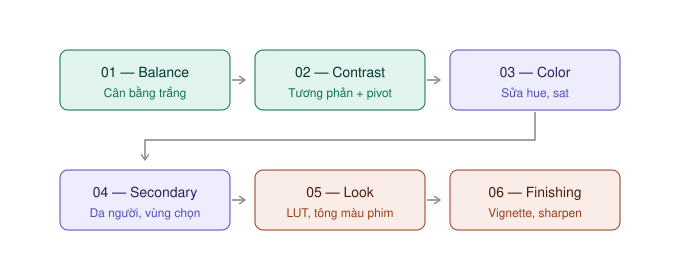

# Node — dựng chuỗi, copy grade

## Node là gì

Mỗi node là **một bước chỉnh**. Ảnh đi từ trái sang phải qua từng node, node sau nhận kết quả của node trước.

Lợi ích: **tắt bật, sắp xếp lại từng bước độc lập**. Nhìn chuỗi node là biết grade làm gì.

## Chuỗi 6 node cơ bản

| Node | Làm gì | Palette |
|---|---|---|
| 01 Balance | Cân bằng trắng, điểm đen, điểm trắng | [Color Wheels](can-bang.md) |
| 02 Contrast | Tương phản, phơi sáng | Color Wheels, Curves |
| 03 Color | Sửa một màu, độ tươi | Curves Hue vs Hue / Sat |
| 04 Secondary | Da người, bầu trời | Qualifier + Window |
| 05 Look | Tông màu, LUT | LUT, Color Warper |
| 06 Finishing | Vignette, làm nét | Window + Blur |

**Dựng:** chọn node có sẵn → bấm `⌥S` năm lần.
**Đặt tên:** chuột phải node → **Change Label** → gõ tên. Node hiển thị khoảng 12 ký tự.
**Lưu dùng lại:** xem [PowerGrade](#powergrade--khung-node-dùng-cho-mọi-project).

### Bốn nguyên tắc

1. **Một node, một việc.** Muốn sửa thêm thì thêm node.
2. **LUT sau khi đã cân bằng** — không bao giờ đặt ở node 01.
3. **Node 01–02 nhìn scope**, không nhìn bằng cảm giác.
4. **Vignette luôn ở cuối**, để không bị các node sau làm lệch.

## Thêm node

| Phím | Làm gì | Mức |
|---|---|---|
| `⌥S` | Thêm node **sau** node đang chọn | ★★★ |
| `⇧S` | Thêm node **trước** node đang chọn | ★★☆ |
| `⌥O` | Node **Outside** — lấy vùng **ngược lại** của node trước | ★★☆ |
| `⌥C` | Thêm node có sẵn **khung tròn** — làm vignette nhanh | ★★☆ |
| `⌥P` | Node song song | ★☆☆ |

**Outside `⌥O` dùng khi:** node trước đã tách da người bằng Qualifier. Bấm `⌥O` → node mới tự nhận **mọi thứ trừ da**. Chỉnh nền mà không đụng người.

## Bật tắt, reset

| Việc | Phím |
|---|---|
| Tắt/bật node đang chọn | `⌘D` |
| Tắt/bật mọi node của clip | `⌥D` |
| Tắt/bật toàn bộ grade và Fusion — so trước/sau | `⇧D` |
| Reset node đang chọn | `⇧Home` |

## Áp grade cho nhiều clip

`★★★ Hằng ngày`

| Cách | Làm thế nào | Dùng khi |
|---|---|---|
| **Click chuột giữa** | Chọn clip đích trên dải clip → click chuột giữa vào clip nguồn | Nhanh nhất |
| **Apply Grade** | Chọn clip đích → chuột phải clip nguồn → **Apply Grade** | Chuột không có nút giữa (trackpad) |
| **Phím `=`** | Copy grade của clip **ngay trước** sang clip đang chọn | Dựng xen kẽ hai góc máy |
| **Phím `−`** | Copy grade của clip **cách hai clip trước** | Như trên |

> Copy grade **ghi đè** grade cũ của clip đích.

### Group — nhóm các clip cùng bối cảnh

Chọn nhiều clip → chuột phải → **Add Into New Group**.

Nhóm có thêm tầng grade **Group Pre-Clip** và **Group Post-Clip**. Chỉnh ở tầng nhóm thì **mọi clip trong nhóm cùng đổi**, mỗi clip vẫn giữ grade riêng ở tầng Clip.

**Dùng khi:** cả cảnh quay trong một phòng, cùng ánh sáng — chỉnh tông chung một lần ở nhóm.

## Gallery — lưu grade

| Việc | Cách |
|---|---|
| Lưu grade hiện tại | `⌥⌘G`, hoặc chuột phải Viewer → **Grab Still** |
| Áp still cho clip | Chọn clip → chuột phải still → **Apply Grade**. Hoặc click chuột giữa still. Hoặc kéo still thả vào Viewer |
| So sánh với still | **Bấm đúp** still → Viewer chia đôi so sánh (wipe). Bật/tắt wipe: `⌘W` |

> Bấm đúp still là để **so sánh**, không phải để áp.

## PowerGrade — khung node dùng cho mọi project

Still thường chỉ nằm trong project hiện tại. **PowerGrade** dùng được ở **mọi project**.

1. Dựng chuỗi 6 node có tên (chưa chỉnh gì cũng được).
2. Grab Still.
3. Trong Gallery, kéo still đó vào album **PowerGrade**.

Từ đó, mở project nào cũng áp được khung 6 node trong một thao tác.
