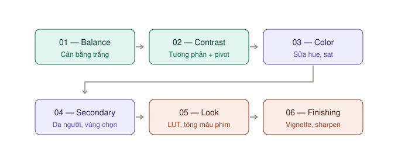
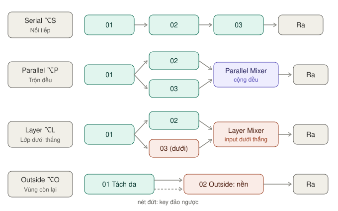

# Node — dựng chuỗi, copy grade

## Node là gì

Mỗi node là **một bước chỉnh**. Ảnh đi từ trái sang phải qua từng node, node sau nhận kết quả của node trước.

Lợi ích: **tắt bật, sắp xếp lại từng bước độc lập**. Nhìn chuỗi node là biết grade làm gì.

Một node có:

| Phần | Ở đâu | Làm gì |
|---|---|---|
| **Số node** | Góc trên trái node | Đánh theo **thứ tự tạo**, không theo vị trí. Xoá node thì các số còn lại đánh lại |
| **Tên (label)** | Dải trên đầu node | Do bạn đặt, ví dụ "Balance" |
| **Ảnh thu nhỏ** | Giữa node | Kết quả của riêng node đó |
| **Icon nhỏ dưới đáy** | Đáy node | Báo node có Window, Qualifier, LUT, Curves… |
| **Đầu vào/ra** | Hai bên node | **Tam giác** là đầu vào, **ô vuông** là đầu ra. Màu **xanh lá** (phía trên) là ảnh RGB, **xanh dương** (phía dưới) là key — vùng chọn |

## Chuỗi 6 node cơ bản

| Node | Làm gì | Palette |
|---|---|---|
| 01 Balance | Cân bằng trắng, điểm đen, điểm trắng | [Primaries](can-bang.md) |
| 02 Contrast | Tương phản, phơi sáng | Primaries, Curves |
| 03 Color | Sửa một màu, độ tươi | Curves Hue vs Hue / Sat |
| 04 Secondary | Da người, bầu trời | Qualifier + Window |
| 05 Look | Tông màu, LUT | LUT, Color Warper |
| 06 Finishing | Vignette, làm nét | Window + Blur |

**Dựng:** chọn node có sẵn → bấm `⌥S` năm lần.
**Đặt tên:** chuột phải node → **Change Label** → gõ tên. Tên dài bị cắt bớt khi hiển thị — đặt ngắn.
**Lưu dùng lại:** xem [PowerGrade](#powergrade--khung-node-dùng-cho-mọi-project).

### Bốn nguyên tắc

1. **Một node, một việc.** Muốn sửa thêm thì thêm node.
2. **LUT sáng tạo sau khi đã cân bằng** — không bao giờ đặt ở node 01. (LUT/CST **kỹ thuật** đưa LOG về Rec.709 thì được đặt đầu chuỗi — xem [LUT](lut-va-quan-ly-mau.md#lut-là-gì).)
3. **Node 01–02 nhìn scope**, không nhìn bằng cảm giác.
4. **Vignette luôn ở cuối**, để không bị các node sau làm lệch.

## Thêm node

| Phím | Làm gì | Mức |
|---|---|---|
| `⌥S` | Thêm node **Serial** (nối tiếp) **sau** node đang chọn | ★★★ |
| `⇧S` | Thêm node Serial **trước** node đang chọn | ★★☆ |
| `⌥K` | Thêm node vào **cuối** chuỗi, dù đang chọn node nào | ★★☆ |
| `⌥C` | Thêm node Serial có sẵn **khung tròn** (Circular window) — làm vignette nhanh | ★★☆ |
| `⌥Q` | Như trên, khung **chữ nhật** (Linear window) | ★☆☆ |
| `⌥G` | Như trên, khung **đa giác** (Polygon window) | ★☆☆ |
| `⌥B` | Như trên, khung **vẽ tự do** (PowerCurve window) | ★☆☆ |
| `⌥O` | Node **Outside** — lấy vùng **ngược lại** của node đang chọn | ★★☆ |
| `⌥P` | Node **Parallel** (song song) | ★☆☆ |
| `⌥L` | Node **Layer** (lớp) | ★☆☆ |

Cũng thêm được bằng chuột phải node → **Add Node** → chọn loại. Chuột phải **vùng trống** của Node Editor → **Add Node** → **Corrector** thì ra một node **chưa nối** — phải tự kéo dây nối vào.

**Outside `⌥O` dùng khi:** node đang chọn đã tách da người bằng Qualifier. Bấm `⌥O` → node mới tự nhận **mọi thứ trừ da**. Chỉnh nền mà không đụng người.

### Serial, Parallel, Layer khác nhau thế nào

`★★☆ Thường dùng`

*Serial chạy lần lượt. Parallel cộng đều các nhánh. Layer cho nhánh ở input dưới thắng chỗ chồng nhau. Outside nhận key đảo ngược.*

| Kiểu | Ảnh vào mỗi node | Kết quả | Dùng khi |
|---|---|---|---|
| **Serial** | Kết quả của node ngay trước | Chỉnh chồng lên nhau | Gần như mọi lúc |
| **Parallel** | **Cùng một ảnh** cho mọi nhánh | **Parallel Mixer** trộn đều các nhánh | Hai chỉnh độc lập trên cùng ảnh gốc, ví dụ chỉnh da và chỉnh trời cùng lấy key từ ảnh chưa đụng |
| **Layer** | Cùng một ảnh cho mọi nhánh | **Layer Mixer**: nhánh nối vào **input thấp hơn** đè lên nhánh trên | Một chỉnh phải **thắng** chỉnh khác, ví dụ look lạnh cho cả ảnh nhưng da giữ tự nhiên |

**Ví dụ Layer:** node 02 làm look xanh lạnh cho cả clip trang trại. Node 03 (nối vào input dưới) tách da cô gái và giữ màu tự nhiên → da thắng look.

> **Mẹo:** chuột phải Layer Mixer → chọn **Composite Mode** (Screen, Multiply…) như chế độ blend trên timeline. Chuột phải Parallel Mixer → **Morph Into Layer Mixer Node** để đổi kiểu mà không dựng lại.

## Sửa chuỗi node

`★★☆ Thường dùng`

| Việc | Cách |
|---|---|
| Xoá node | Chọn node → phím `⌦` (Forward Delete), hoặc chuột phải → **Delete Node**. Hai node hai bên tự nối lại |
| Nối dây | Kéo từ ô vuông đầu ra của node này sang tam giác đầu vào của node kia |
| Cắt dây | Bấm vào dây (dây chuyển **cam**) rồi bấm `⌫`, hoặc chuột phải dây → **Delete Link** |
| Copy một node sang node khác | Giữ `⌥` kéo node nguồn **thả lên** node đích |
| Copy/dán node | Chọn node → `⌘C` → chọn node đích → `⌘V` |
| Dán chọn lọc (chỉ Curves, chỉ Qualifier…) | `⌥V` (**Paste Attributes**) |

> **Lỗi hay gặp:** có một node **không nối dây** vào chuỗi → **cả grade bị tắt**, Viewer hiện ảnh gốc. Tìm node lạc và nối lại hoặc xoá.

## Bật tắt, reset

| Việc | Phím |
|---|---|
| Tắt/bật node đang chọn | `⌘D` |
| Tắt/bật mọi node của clip | `⌥D` |
| Tắt/bật toàn bộ grade và Fusion — so trước/sau | `⇧D` |
| Reset node đang chọn | `⇧Home`, hoặc chuột phải node → **Reset Node Grade** |
| Reset grade, **giữ** các node (giữ khung 6 node có tên) | `⇧⌘Home` |
| Xoá hết grade **và** node của clip | `⌘Home` |

> **Mẹo:** chuột phải nút **Bypass** (`⇧D`) ở thanh tiêu đề Viewer để chọn chỉ tắt Color, chỉ tắt Fusion, hay cả hai.

### Node chạy chậm — Node Cache

`★☆☆ Tình huống cụ thể`

Node nặng (Blur, Noise, Magic Mask) làm phát lại giật:
1. Menu **Playback** → **Render Cache** → **User**.
2. Chuột phải node nặng → **Node Cache** → **On**.

Resolve render trước kết quả node đó ra đĩa. Chỉnh node phía sau vẫn mượt.

## Áp grade cho nhiều clip

`★★★ Hằng ngày`

| Cách | Làm thế nào | Dùng khi |
|---|---|---|
| **Click chuột giữa** | Chọn clip đích trên dải clip (một clip viền cam, nhiều clip viền đỏ) → click chuột giữa vào clip nguồn | Nhanh nhất |
| **Apply Grade** | Chọn clip đích → chuột phải clip nguồn → **Apply Grade** | Chuột không có nút giữa (trackpad) |
| **Phím `=`** | Copy grade của clip **ngay trước** sang clip đang chọn | Dựng xen kẽ hai góc máy |
| **Phím `−`** | Copy grade của clip **cách hai clip trước** | Như trên |
| **Memories** | `⌥1`…`⌥8` lưu grade vào ô A–H. `⌘1`…`⌘8` áp lại | Một grade dùng đi dùng lại trong buổi chỉnh |

> Copy grade **ghi đè** grade cũ của clip đích. Copy mọi thứ **trừ keyframe và dữ liệu tracking**.

**Ví dụ:** 6 clip vlog cùng ánh sáng. Chỉnh xong clip 1 → `⌥1` lưu vào Memory A. Bấm chọn clip 2 đến 6 (`⇧`+bấm) → `⌘1`. Cả 5 clip nhận grade.

> **Mẹo:** `⌥⇧P` xem trước Memory trên clip hiện tại mà chưa áp.

### Group — nhóm các clip cùng bối cảnh

Chọn nhiều clip → chuột phải → **Add Into New Group** → đặt tên → **OK**.

Nhóm có thêm tầng grade **Group Pre-Clip** và **Group Post-Clip**. Chỉnh ở tầng nhóm thì **mọi clip trong nhóm cùng đổi**, mỗi clip vẫn giữ grade riêng ở tầng Clip.

| Tầng | Chạy lúc | Đặt gì |
|---|---|---|
| **Group Pre-Clip** | Đầu tiên | CST/LUT chuyển LOG chung cho cả nhóm |
| **Clip** | Sau Pre-Clip | Sửa riêng từng clip cho khớp nhau |
| **Group Post-Clip** | Sau Clip | Look chung của cảnh |
| **Timeline** | Cuối cùng | Một chỉnh cho **mọi clip** trên timeline: vignette, grain |

Đổi tầng: các **chấm nhỏ** ở đầu Node Editor (hai chấm Clip/Timeline, bốn chấm khi clip thuộc nhóm), hoặc menu thả xuống cạnh đó. Clip trong nhóm có **icon móc xích xanh** ở góc thumbnail.

**Dùng khi:** cả cảnh quay trong một phòng, cùng ánh sáng — chỉnh tông chung một lần ở nhóm.

## Gallery — lưu grade

| Việc | Cách |
|---|---|
| Lưu grade hiện tại | `⌥⌘G`, hoặc chuột phải Viewer → **Grab Still** |
| Áp still cho clip | Chọn clip → chuột phải still → **Apply Grade**. Hoặc click chuột giữa still. Hoặc kéo still thả vào Viewer |
| **Nối thêm** grade của still vào sau grade đang có | Chuột phải still → **Append Node Graph**, hoặc kéo still thả lên một **dây nối** trong Node Editor |
| So sánh với still | **Bấm đúp** still → Viewer chia đôi so sánh (wipe). Bật/tắt wipe: `⌘W` |
| Đặt tên still | Chuột phải still → **Change Label** |

> Bấm đúp still là để **so sánh**, không phải để áp.

Chi tiết giao diện Gallery: [Gallery](giao-dien.md#gallery).

## PowerGrade — khung node dùng cho mọi project

Still thường chỉ nằm trong project hiện tại. **PowerGrade** dùng được ở **mọi project** trong cùng project library.

1. Dựng chuỗi 6 node có tên (chưa chỉnh gì cũng được).
2. Grab Still (`⌥⌘G`).
3. Bấm nút **album** ở góc trên trái Gallery để hiện danh sách album. Album PowerGrade nằm **cuối danh sách**.
4. Kéo still vào album **PowerGrade**.

Từ đó, mở project nào cũng áp được khung 6 node trong một thao tác: chọn clip → chuột phải still PowerGrade → **Apply Grade**.

Thêm album: chuột phải danh sách album → **Add PowerGrade Album**.

### Shared Node — một node, nhiều clip cùng đổi

`★★☆ Thường dùng`

**Là gì:** node được **liên kết** giữa nhiều clip. Sửa ở một clip, mọi clip đổi theo.

**Cách làm:**
1. Chuột phải node → **Save as Shared Node**. Node tự **khoá** (icon ổ khoá) để khỏi sửa nhầm.
2. Ở clip khác: chuột phải Node Editor → **Add Node** → tên Shared Node ở **cuối danh sách**.
3. Muốn sửa: chuột phải node → bỏ **Lock Node**.
4. Muốn tách khỏi liên kết: chuột phải → **Convert to Corrector**.

**Dùng khi:** CST chung cho mọi clip cùng máy — xem [ví dụ](lut-va-quan-ly-mau.md#một-cst-cho-mọi-clip-cùng-máy--shared-node).
