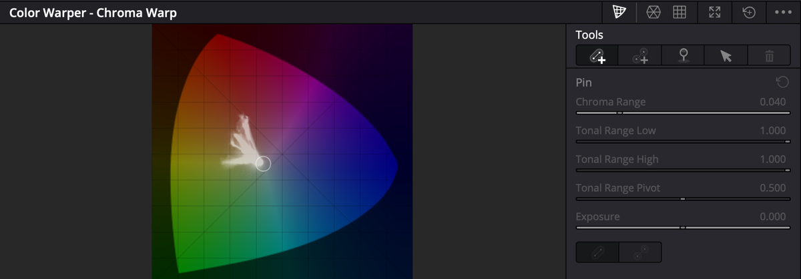
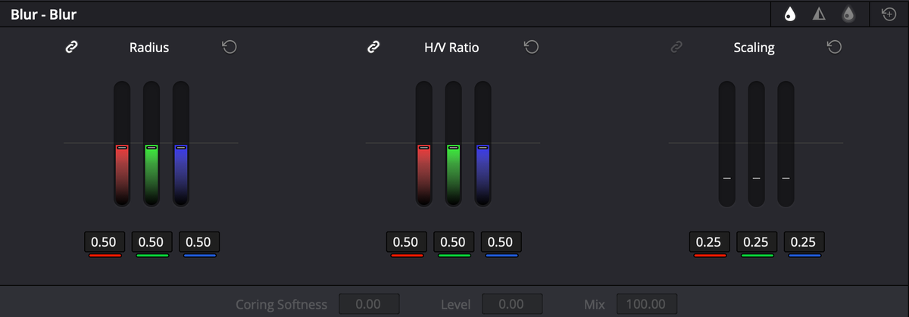
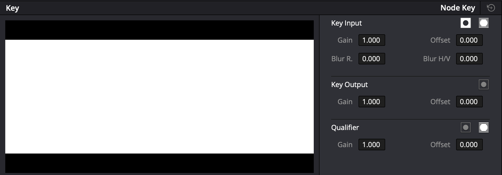
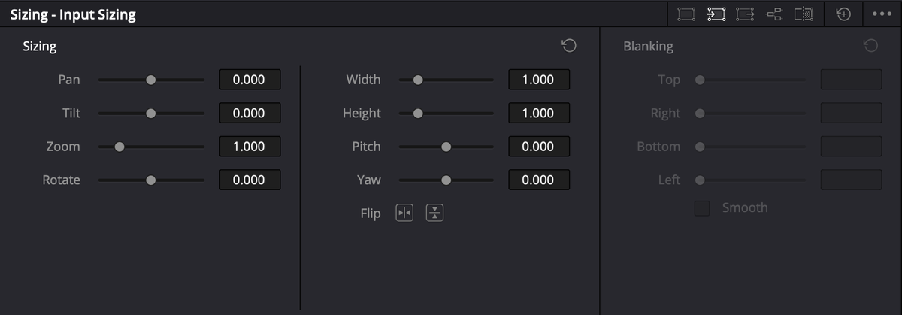
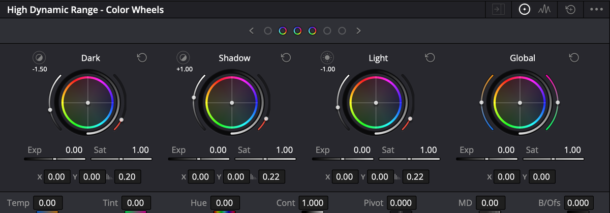
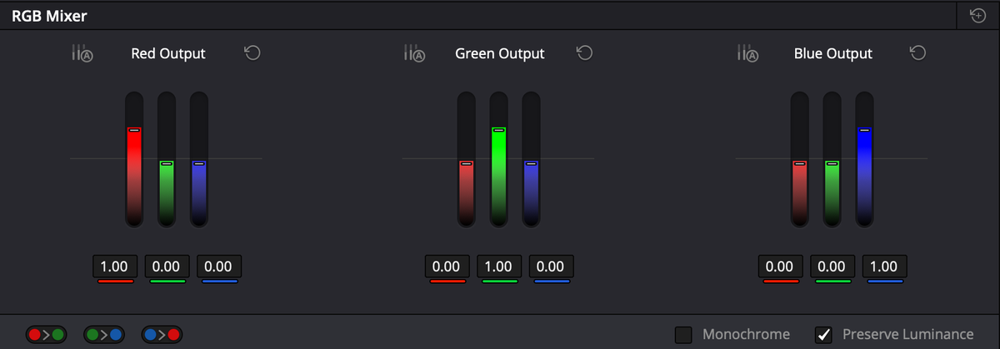
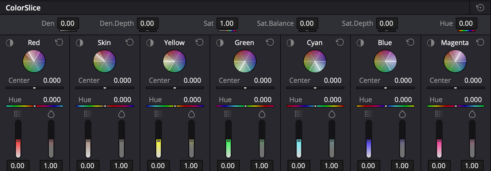
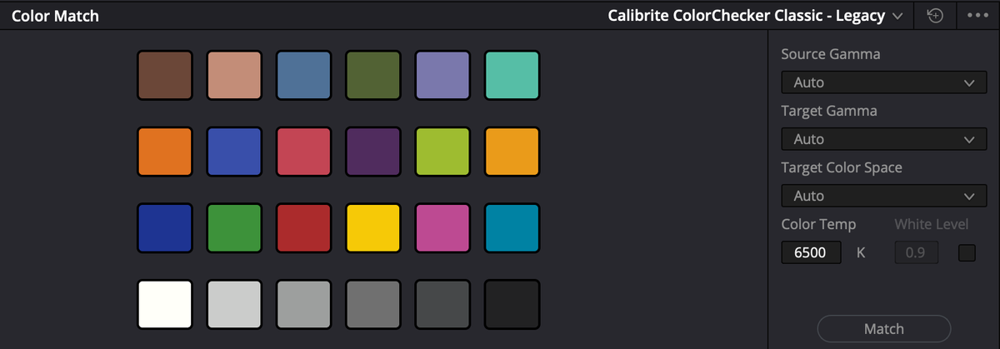

# Các palette khác — mỗi cái một việc

Ngoài Color Wheels, Curves, Qualifier, Window, trang Color còn nhiều palette ít dùng hơn. Mỗi palette dưới đây kèm **một việc thực tế** để nhớ nó dùng vào đâu.

Vị trí từng icon: [hàng icon palette](giao-dien.md#hàng-icon-palette).

| Palette | Một việc | Mức |
|---|---|---|
| [Color Warper](#color-warper--kéo-màu-này-sang-màu-kia) | Đổi màu áo, đẩy trời sang xanh đậm | ★★☆ |
| [Blur](#blur--làm-mờ-làm-nét-mist) | Làm nét nhẹ, làm mềm da, hiệu ứng Mist | ★★☆ |
| [Key](#key--giảm-cường-độ-node) | Giảm độ mạnh một node | ★★☆ |
| [Sizing](#sizing--reframe-trong-trang-color) | Phóng to riêng một clip, lật ảnh | ★☆☆ |
| [HDR](#hdr--bánh-xe-theo-vùng-sáng) | Chỉnh riêng vùng tối, vùng sáng | ★☆☆ |
| [RGB Mixer](#rgb-mixer--đen-trắng-có-chủ-ý) | Đen trắng đẹp hơn kéo Sat về 0 | ★☆☆ |
| [ColorSlice](#colorslice--chỉnh-theo-dải-màu) | Màu đậm kiểu phim, chỉnh riêng dải da | ★☆☆ |
| [Color Match](#color-match) | Tự cân màu theo bảng màu chuẩn | ★☆☆ |
| [Shot Match](#shot-match--khớp-nhiều-clip-theo-một-clip) | Khớp màu cả cảnh theo một clip | ★★☆ |
| [Magic Mask](#magic-mask) | Tách người bằng AI | `Studio` |

---

## Color Warper — kéo màu này sang màu kia

`★★☆ Thường dùng` · Icon thứ 9

**Là gì:** kéo một vùng màu sang màu khác, chuyển mượt sang các màu lân cận. Khác Curves: một lần kéo đổi **hai thứ cùng lúc** (màu và độ đậm).

Có hai chế độ, đổi bằng icon góc trên phải. **Mỗi node chỉ dùng được một chế độ.**

| Chế độ | Cách chỉnh | Dùng khi |
|---|---|---|
| **Chroma Warp** | Kéo nét trên biểu đồ màu | Nhanh, trực quan. Nên dùng trước |
| **Hue-Saturation / Chroma-Luma** | Kéo điểm trên lưới | Cần chỉnh rất cụ thể nhiều màu |

### Công cụ Chroma Warp (cột Tools)

Từ trái sang phải:

| Nút | Làm gì |
|---|---|
| **Add Stroke (Normal)** | Kéo một **dải màu** sang hướng mới — cả dải chuyển theo |
| **Add Stroke (Point to Point)** | Đổi **đúng một màu** sang màu khác, không đi qua màu ở giữa |
| **Add Pin Point** | **Ghim** một màu để nó không bị đổi |
| **Select** | Chọn và kéo nét đã có |
| **Delete** (thùng rác) | Xoá nét hoặc điểm đang chọn |

Thanh bên dưới: **Chroma Range** (rộng hẹp của dải màu), **Tonal Range Low / High / Pivot** (chỉ tác động vùng tối hoặc sáng của màu đó), **Exposure** (làm sáng/tối màu đích).

Trên biểu đồ: kéo **về tâm** = nhạt màu, kéo **ra mép** = đậm màu.

### Ví dụ — áo xanh dương thành áo vàng

1. Node mới (`⌥S`), mở Color Warper → **Chroma Warp**.
2. Bấm **Add Stroke (Point to Point)**.
3. Bấm vào **áo** trên Viewer, giữ chuột, kéo về phía **vàng** trên biểu đồ.
4. Da người bị ám theo: bấm **Add Pin Point**, bấm vào **má** để ghim màu da.

> Ảnh bị ám màu lạ sau khi warp: đặt **Pin Point vào vòng tròn nhỏ ở tâm** biểu đồ. Manual gợi ý cách này để giữ nguyên màu xám trung tính.

**Muốn cả bầu trời đậm hơn** thì dùng **Add Stroke (Normal)**: bấm vào trời, kéo ra mép phía xanh dương.

---

## Blur — làm mờ, làm nét, Mist

`★★☆ Thường dùng` · Icon thứ 13

Ba chế độ, đổi bằng **ba icon góc trên phải**: **Blur · Sharpen · Mist**.

Mỗi thanh có ba cột R G B **gắn liền** (nút mắt xích). Bấm mắt xích để chỉnh riêng từng kênh — hiếm khi cần.

| Chế độ | Thanh chính | Dùng khi |
|---|---|---|
| **Blur** | **Radius**: 0.50 = không đổi. Trên 0.50 = mờ, dưới 0.50 = nét | Làm mờ hậu cảnh trong Window, làm nét nhẹ |
| **Sharpen** | Thêm **Level** và **Coring Softness** — chỉ làm nét chỗ nhiều chi tiết | Làm nét mắt, tóc mà không làm sần da |
| **Mist** | Hạ **Radius** rồi hạ **Mix** | Hiệu ứng kính Pro-Mist: vùng sáng toả mềm, mơ màng |

**H/V Ratio** — 0.50 là đều hai chiều. Lệch đi thì mờ/nét theo một hướng.

### Ví dụ — làm nét mà da không sần

1. Node cuối, mở Blur → **Sharpen**.
2. Kéo **Radius** xuống khoảng **0.45**.
3. Kéo **Level** lên dần: vùng phẳng như da, tường bị loại khỏi làm nét. Chỉ còn mép rõ (mắt, tóc, chữ) được nét.
4. **Coring Softness** lên nhẹ để ranh giới mềm.

Cách làm nét nhanh không cần Sharpen: xem [Làm nét, làm mờ](curves-va-vung.md#làm-nét-làm-mờ).

### Ví dụ — Mist cho cảnh lãng mạn

1. Node mới, Blur → **Mist**.
2. Kéo **Radius** xuống, rồi kéo **Mix** xuống đến khi vùng sáng bắt đầu toả.
3. Quá đà thì tăng **Mix** lại.

> Blur dùng chung được với Qualifier, Window — ví dụ chỉ làm mềm vùng da đã tách.

---

## Key — giảm cường độ node

`★★☆ Thường dùng` · Icon thứ 14

Ô bên trái hiện **vùng chọn** (key) của node: trắng = bị chỉnh, đen = không. Bên phải ba nhóm:

| Nhóm | Thanh | Làm gì |
|---|---|---|
| **Key Input** | Gain, Offset, Blur R., Blur H/V + nút đảo | Chỉnh vùng chọn **nhận từ node trước** |
| **Key Output** | **Gain**, Offset + nút đảo | **Gain = độ mạnh của cả node.** 1.0 = đủ, 0 = không tác dụng |
| **Qualifier** | Gain, Offset + nút đảo | Chỉnh vùng chọn tạo bởi Qualifier, Window **trong node này** |

### Ví dụ — LUT quá gắt

1. Chọn node chứa LUT.
2. Mở Key → **Key Output** → **Gain** gõ **0.6**.
3. Node chỉ còn tác động 60%.

**Dùng khi:** bất kỳ node nào hơi quá tay — LUT, Color Boost, vignette. Nhanh hơn chỉnh lại từng thanh.

> **Node Outside (`⌥O`) chỉ là node thường có nút đảo Key Input bật sẵn.** Tắt nút đó ở palette Key → node lại chỉnh **cùng vùng** với node trước, không phải vùng ngược lại.

---

## Sizing — reframe trong trang Color

`★☆☆ Tình huống cụ thể` · Icon thứ 15

Năm chế độ, đổi bằng **năm icon góc trên phải**:

| Chế độ | Tác động | Dùng khi |
|---|---|---|
| **Edit Sizing** | Giống Inspector của trang Edit — cùng một thông số | Muốn sửa transform đã đặt ở trang Edit |
| **Input Sizing** | Từng clip, **trước** mọi node | Phóng to, căn lại khung từng clip |
| **Output Sizing** | **Cả timeline**, sau mọi node | Thêm viền đen (Blanking) cho cả video |
| **Node Sizing** | Trong một node, có thể giới hạn bằng Window | Hiệu ứng đặc biệt |
| **Reference Sizing** | Dời still khi đang wipe | So sánh khung lệch nhau |

Thanh chính: **Pan** (ngang), **Tilt** (dọc), **Zoom**, **Rotate**, **Width**, **Height**, **Pitch**, **Yaw**, hai nút **Flip** (lật ngang, lật dọc).

### Ví dụ — viền đen điện ảnh cho cả video

1. Sizing → **Output Sizing**.
2. Mục **Blanking**: kéo **Top** và **Bottom** bằng nhau.
3. Tick **Smooth** để mép viền mịn.

Blanking áp **sau cùng**, không bị grade nào làm đổi màu.

> **Lens Correction** (sửa méo ống góc rộng, ở Edit Sizing) chỉ có trong bản `Studio`.

---

## HDR — bánh xe theo vùng sáng

`★☆☆ Tình huống cụ thể` · Icon thứ 4 · Có đầy đủ trong bản **free**

**Là gì:** giống Color Wheels, nhưng chia ảnh thành **nhiều vùng sáng tối nhỏ hơn**. Tên có chữ HDR nhưng dùng tốt cho video thường.

Vùng mặc định, từ tối đến sáng: **Black · Dark · Shadow · Light · Highlight · Specular**, cộng thêm **Global** (cả ảnh). Màn hình chỉ vừa vài bánh xe — dùng mũi tên **‹ ›** và hàng chấm phía trên để chuyển.

Mỗi bánh xe có **Exp** (sáng tối) và **Sat** (độ đậm). Hàng dưới: **Temp, Tint, Hue, Cont, Pivot, MD** (Midtone Detail), **B/Ofs** (Black Offset).

**Khác Color Wheels ở chỗ:** tăng tương phản **không làm tăng độ đậm màu**.

### Ví dụ — mặt người trong bóng râm, trời phía sau vẫn đẹp

1. Node mới, mở HDR.
2. Bánh **Shadow**: kéo **Exp** lên nhẹ — mặt sáng ra.
3. Bánh **Light** giữ nguyên — trời không bị cháy thêm.

Muốn đổi phạm vi từng vùng: bấm icon **Zones** (biểu đồ sóng) góc trên phải.

---

## RGB Mixer — đen trắng có chủ ý

`★☆☆ Tình huống cụ thể` · Icon thứ 5

**Là gì:** trộn kênh màu này vào kênh khác. Ba nhóm **Red / Green / Blue Output**, mỗi nhóm ba thanh, dải −2.00 tới +2.00.

Phía dưới: ba nút **đổi chỗ kênh** (R↔G, G↔B, B↔R), ô **Monochrome**, ô **Preserve Luminance**.

### Ví dụ — ảnh đen trắng

1. Node mới, mở RGB Mixer, tick **Monochrome**.
2. Mặc định khoảng R 0.21 · G 0.71 · B 0.07 — giống hệt kéo Saturation về 0.
3. Đổi tỉ lệ để ra chất đen trắng khác:

| Muốn | Kéo |
|---|---|
| Vật màu đỏ, cam (da, môi) sáng hơn | **Red** lên |
| Trời xanh tối lại, mây nổi | **Blue** xuống |
| Da tối, cứng, kiểu kim loại (ví dụ trong manual) | **Blue** lên, Red và Green xuống |

Nguyên tắc: kênh nào kéo lên thì **vật mang màu đó sáng hơn** trong ảnh đen trắng.

> **Preserve Luminance** bật thì đổi một kênh, hai kênh kia tự bù — độ sáng tổng không đổi.

---

## ColorSlice — chỉnh theo dải màu

`★☆☆ Tình huống cụ thể` · Icon thứ 8

**Là gì:** chia màu thành **7 dải**: **Red, Skin, Yellow, Green, Cyan, Blue, Magenta**. Mỗi dải chỉnh riêng, chuyển tiếp mượt giữa các dải.

**Điểm khác:** tăng độ đậm theo kiểu **in phim** — màu đậm hơn thì **tối đi**, không sáng loè như thanh Saturation thường.

| Vị trí | Thanh | Làm gì |
|---|---|---|
| Hàng trên (cả ảnh) | **Den**, **Den.Depth** | Độ dày màu — màu đậm tối đi |
| | **Sat**, **Sat.Balance**, **Sat.Depth** | Độ đậm kiểu in |
| | **Hue** | Xoay màu toàn ảnh |
| Mỗi dải | **Center** | Dời tâm dải màu |
| | **Hue** | Xoay màu trong dải |
| | Hai cột dọc | **Density** và **Saturation** của dải |
| | Icon nửa tròn đầu dải | **Giữ chuột** để xem dải đó chọn những gì |

### Ví dụ — da người tươi mà không đỏ

1. Node mới, mở ColorSlice.
2. Giữ chuột vào icon nửa tròn của dải **Skin** — xem vùng da đã được chọn.
3. Kéo **Center** của Skin đến khi da được chọn nhiều nhất.
4. Chỉnh **Hue** và cột Saturation của Skin.

---

## Color Match

`★☆☆ Tình huống cụ thể` · Icon thứ 2

**Là gì:** quay kèm một **bảng màu chuẩn** (ColorChecker, SpyderCheckr…), Resolve đọc bảng và tự cân màu.

**Dùng khi:** có quay bảng màu ở đầu mỗi cảnh. Không có bảng thì palette này vô dụng.

1. Chọn clip có bảng màu.
2. Chọn loại bảng ở menu góc trên phải palette.
3. Đặt **Source Gamma** (gamma lúc quay), **Target Gamma**, **Target Color Space**.
4. Menu onscreen góc dưới trái Viewer → **Color Chart**. Kéo **bốn góc** lưới cho khớp các ô màu trên bảng.
5. Bấm **Match**.

**Color Temp** mặc định 6500K — giảm là ấm hơn, tăng là lạnh hơn.

> Bảng phải **sáng đều**, không ô nào bị cháy. Ô trắng nên nằm khoảng 70–95% trên Waveform.

### Shot Match — khớp nhiều clip theo một clip

`★★☆ Thường dùng` — không cần bảng màu.

1. Bấm nút **A** (Auto Color, `⌥⇧C`) trên từng clip liên quan trước — manual khuyên làm bước này.
2. `⌘`+bấm chọn các clip cần khớp trên dải clip.
3. Chuột phải **clip mẫu** → **Shot Match to This Clip**.

Kết quả là một chỉnh sửa **ẩn**, nằm cuối node đang chọn — không hiện trên thanh nào. Muốn bỏ thì reset node.

**Dùng khi:** phỏng vấn hai máy, màu lệch nhau. Cho ra điểm khởi đầu, chỉnh tay tiếp.

---

## Magic Mask

`Studio`

**Là gì:** AI tự tách **người hoặc vật** — bấm vào chủ thể là có vùng chọn, tự bám theo chuyển động. Tách được cả từng phần: mặt, tóc, áo.

Manual ghi rõ Magic Mask v2 là **Studio Version Only**. Bản free không có icon này trên hàng palette.

**Thay thế ở bản free:** [Qualifier + Window + Tracker](curves-va-vung.md#chỉnh-riêng-một-vùng) — chậm hơn nhưng làm được phần lớn việc.

---

## Motion Effects

`Studio` · Icon thứ 6

Chống nhiễu (**Temporal NR**, **Spatial NR**) và motion blur nhân tạo. Manual ghi palette này **chỉ có ở bản Studio**.
