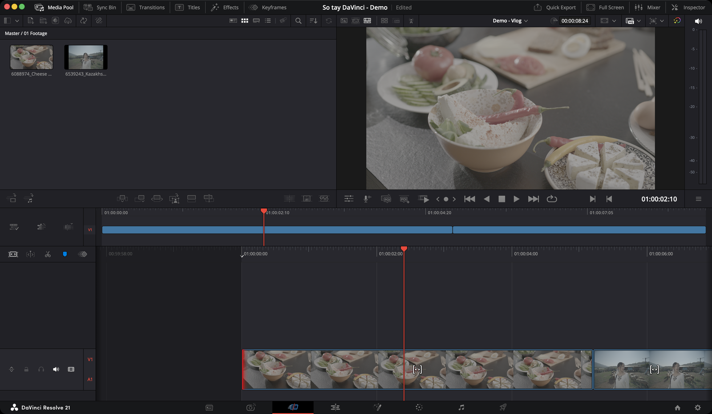

# Cut — dựng nhanh

> **Một câu:** trang Cut là trang dựng được thiết kế cho **tốc độ** — ít nút hơn, nhiều thao tác tự động hơn, hợp với video ngắn và deadline gấp.

## Nên dùng Cut hay Edit?

Cả hai dùng **chung một timeline**. Dựng ở Cut rồi sang Edit sửa tiếp được, và ngược lại. Nên đây không phải lựa chọn một lần — bạn đổi qua lại bất cứ lúc nào.

| Dùng **Cut** khi | Dùng **Edit** khi |
|---|---|
| Vlog, video mạng xã hội, tin nhanh | Phim ngắn, MV, dự án dài |
| Cần ra bản nháp trong vài chục phút | Cần căn chỉnh từng khung hình |
| Một màn hình laptop nhỏ | Có màn hình to hoặc hai màn hình |
| Dựng một mạch, ít lớp hình chồng | Nhiều track, nhiều hiệu ứng, keyframe |

Nhiều người dựng thô ở Cut cho nhanh, rồi sang Edit để hoàn thiện.

## Điều quan trọng nhất cần hiểu: luật Track 1

Đây là thứ làm trang Cut khác hoàn toàn trang Edit. Hiểu được điều này thì mọi thao tác khác trở nên dễ đoán.

**Track 1 là xương sống.** Đặt cảnh chính ở đây (người nói, hành động chính — gọi là *A-roll*).
Mọi thay đổi trên Track 1 **tự động dồn** phần phía sau:

- Xoá một clip → phần sau tự dồn lên lấp chỗ trống
- Chèn thêm clip → phần sau tự lùi ra nhường chỗ
- Kéo dài/thu ngắn clip → phần sau tự xê dịch theo

**Track 2 trở lên là lớp phủ.** Đặt cảnh minh hoạ ở đây (*B-roll*), chữ, logo.
Thay đổi ở đây **chỉ ảnh hưởng clip đó**, không đụng gì khác, và khoảng trống được giữ nguyên.

**Clip trên Track 2 bám theo Track 1.** Khi Track 1 dồn, clip phía trên tự dịch theo để vẫn khớp với cảnh bên dưới.

> **Ví dụ:** Bạn dựng vlog. Lời nói đặt ở Track 1. Cảnh minh hoạ quán cà phê đặt ở Track 2, phía trên đoạn bạn nói về quán. Giờ bạn xoá một câu nói thừa ở đầu video — Track 1 dồn lên, và cảnh quán cà phê ở Track 2 tự dịch theo, vẫn nằm đúng trên đoạn nói về quán.

Hình trên track cao hơn **che** hình track thấp hơn. Muốn lộ người nói ra thì để trống một khoảng ở Track 2.

## Tính năng hay dùng nhất

Xếp theo mức độ bạn sẽ đụng tới:

| Mức | Tính năng | Dùng để |
|---|---|---|
| ★★★ | [Đặt điểm vào/ra `I` `O`](dung-clip.md#1-chọn-đoạn-cần-lấy) | Chọn đoạn cần lấy trong clip |
| ★★★ | [Append](dung-clip.md#append) | Nối clip vào cuối — cách dựng thô nhanh nhất |
| ★★★ | [Smart Insert](dung-clip.md#smart-insert) | Chèn clip vào giữa mà không cần căn chính xác |
| ★★★ | [Place On Top](dung-clip.md#place-on-top) | Đặt B-roll, chữ lên trên |
| ★★★ | [Kéo mép để trim](trim.md#kéo-mép-clip) | Cắt bớt đầu/đuôi clip |
| ★★★ | [Cắt tại con trỏ `⌘\`](trim.md#cắt-đôi-clip) | Chia đôi clip |
| ★★☆ | [Source Tape](source-tape.md#source-tape) | Xem toàn bộ footage như một cuộn băng |
| ★★☆ | [Close Up](dung-clip.md#close-up) | Tạo cảnh cận từ cảnh rộng |
| ★★☆ | [Ripple Overwrite](dung-clip.md#ripple-overwrite) | Thay một cảnh bằng cảnh khác |
| ★★☆ | [Tools trong Viewer](tools.md) | Phóng to, crop, tốc độ, chống rung |
| ★★☆ | [Quick Export](kiem-tra-va-xuat.md#quick-export) | Xuất nhanh không cần sang Deliver |
| ★☆☆ | [Boring Detector](kiem-tra-va-xuat.md#boring-detector) | Soát cảnh quá dài, flash frame |
| ★☆☆ | [Fast Review](source-tape.md#fast-review) | Tua nhanh thông minh qua footage dài |
| ★☆☆ | [Sync Bin](source-tape.md#sync-bin) | Dựng nhiều máy quay |
| ★☆☆ | [Source Overwrite](dung-clip.md#source-overwrite) | Chèn góc máy khác theo timecode |

★★★ dùng ở hầu như mọi video · ★★☆ dùng thường xuyên · ★☆☆ dùng trong tình huống cụ thể

## Một lượt dựng vlog bằng trang Cut

Ví dụ thực tế: dựng vlog 5 phút từ 30 clip điện thoại.

1. **Nạp:** kéo cả thư mục footage vào Media Pool.
2. **Xem lướt:** bấm nút **Source Tape** (nút thứ 2 góc trên trái Viewer). 30 clip nối thành một cuộn.
3. **Lấy đoạn dùng được:** tua bằng `J` `K` `L`. Gặp đoạn hay thì `I` ở đầu, `O` ở cuối, rồi bấm **Append** (nút thứ 2 dưới đáy Media Pool). Lặp lại cho hết cuộn.
4. **Xem lại:** bấm `Q` để Viewer chuyển sang Timeline, xem bản thô.
5. **Sắp xếp:** kéo clip ở **timeline trên** (tầng nhỏ) để đổi thứ tự — vì tầng này luôn hiện cả video nên kéo xa bao nhiêu cũng được.
6. **Cắt gọn:** ở **timeline dưới**, kéo mép clip để bỏ phần thừa. Track 1 tự dồn.
7. **Thêm B-roll:** chọn cảnh minh hoạ, đặt `I` `O`, đặt con trỏ ở chỗ muốn phủ, bấm **Place On Top**.
8. **Soát nhịp:** bật **Boring Detector** xem có cảnh nào lê thê.
9. **Xuất:** **Quick Export** góc trên phải → chọn **YouTube**.

## Các trang con

* [Giao diện — từng nút nằm ở đâu](giao-dien.md)
* [Đưa clip xuống timeline — 6 nút edit](dung-clip.md)
* [Source Tape, Fast Review, Sync Bin](source-tape.md)
* [Trim, cắt, đánh dấu](trim.md)
* [Tools trong Viewer — phóng to, crop, tốc độ](tools.md)
* [Boring Detector và Quick Export](kiem-tra-va-xuat.md)
