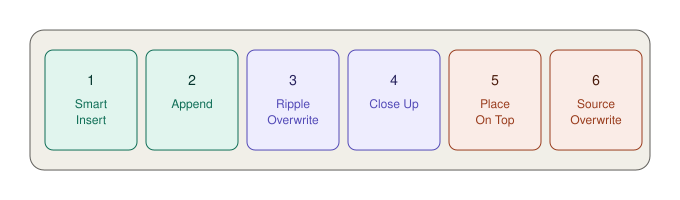

# Đưa clip xuống timeline — 6 nút edit

Mọi kiểu edit đều theo cùng **ba bước**: chọn đoạn → chọn chỗ → bấm nút. Nút khác nhau chỉ ở chỗ clip được đặt vào đâu.

## 1. Chọn đoạn cần lấy

`★★★ Hằng ngày`

Một clip thường dài hơn nhiều so với đoạn bạn dùng. Đặt **điểm vào** (In) và **điểm ra** (Out) để chỉ lấy đúng đoạn cần.

**Ba chỗ đặt được:**

| Ở đâu | Cách làm |
|---|---|
| **Thumbnail trong Media Pool** | Rê chuột ngang thumbnail, đến đầu đoạn bấm `I`, đến cuối bấm `O`. Không cần mở clip |
| **Viewer** | Bấm đúp clip để mở, tua tới chỗ cần, bấm `I` và `O` (hoặc hai nút Mark In/Out dưới đáy Viewer) |
| **Source Tape** | Tua cuộn băng, bấm `I` `O` — xem [Source Tape](source-tape.md) |

Xoá cả hai điểm: `⌥X`.

> **Không đặt `I` `O` thì sao?** Resolve lấy nguyên cả clip.

## 2. Chọn track đích

Bấm vào **đầu track** muốn đặt clip vào. Track được chọn sẽ sáng lên. Hoặc bấm số track ở **bên trái timeline trên**.

Phần lớn trường hợp để Track 1. Riêng nút **Place On Top** thì bỏ qua lựa chọn này.

## 3. Bấm nút edit

**Sáu nút nằm ở đáy Media Pool**, từ trái sang phải:

Xong mỗi lần edit, bấm `Q` để xem lại trên timeline, `Q` lần nữa để quay về chọn clip tiếp.

---

## Smart Indicator — cái tam giác nhỏ trên thước thời gian

Một số nút không cần bạn chỉ định chính xác vị trí. Resolve **đoán** chỗ bạn muốn dựa vào vị trí con trỏ, rồi hiện một **icon nhỏ trên thước thời gian** đánh dấu chỗ nó định đặt clip.

Đứng yên vài giây, icon đó nhấp nháy lên xuống và điểm cắt sẽ sáng **xanh lá**. Nếu sáng **đỏ** nghĩa là clip đã hết, không kéo thêm được.

> Nhìn Smart Indicator trước khi bấm nút. Nó đang chỉ đâu thì clip vào đó.

---

## Smart Insert

`★★★ Hằng ngày` · Nút số 1

**Là gì:** chèn clip vào **điểm cắt gần con trỏ nhất**, đẩy phần sau ra nhường chỗ.

**Dùng khi:** muốn chèn thêm một cảnh vào giữa hai cảnh có sẵn mà không muốn căn con trỏ chính xác từng khung.

**Cách làm:**
1. Đặt `I` `O` cho clip mới.
2. Đặt con trỏ **đâu đó gần** điểm cắt muốn chèn vào — không cần chính xác.
3. Nhìn Smart Indicator xác nhận vị trí.
4. Bấm **Smart Insert**.

**Lưu ý:** nó **chỉ chèn được vào điểm cắt có sẵn**, không chèn vào giữa một clip. Muốn chèn vào giữa clip thì dùng `F9` (Insert thường).

**Ví dụ:** vlog đang có cảnh "ra sân bay" rồi "lên máy bay". Bạn muốn chèn cảnh "làm thủ tục" vào giữa. Đặt con trỏ gần chỗ nối hai cảnh đó, bấm Smart Insert.

---

## Append

`★★★ Hằng ngày` · Nút số 2

**Là gì:** nối clip vào **cuối timeline**. Vị trí con trỏ không quan trọng.

**Dùng khi:** dựng thô từ đầu đến cuối. Đây là cách nhanh nhất để có bản nháp đầu tiên.

**Cách làm:**
1. Đặt `I` `O`.
2. Bấm **Append** (hoặc `⇧F12`).
3. Lặp lại cho clip tiếp theo.

**Ví dụ:** bạn có 30 clip theo thứ tự thời gian. Mở Source Tape, xem từ đầu, gặp đoạn hay thì `I` `O` rồi Append. Hết cuộn là có bản thô theo đúng thứ tự.

---

## Ripple Overwrite

`★★☆ Thường dùng` · Nút số 3

**Là gì:** **thay** clip dưới con trỏ bằng clip mới. Nếu clip mới dài hơn hay ngắn hơn, timeline tự co giãn theo.

**Dùng khi:** muốn đổi một cảnh sang cảnh khác — take tốt hơn, góc đẹp hơn.

**Cách làm:**
1. Đặt `I` `O` cho clip mới.
2. Đặt con trỏ lên clip cần thay trên timeline.
3. Bấm **Ripple Overwrite** (hoặc `⇧F10`).

**Thay một khoảng thay vì nguyên clip:** đặt `I` `O` **trên timeline** quanh khoảng cần thay (có thể vắt qua nhiều clip). Ripple Overwrite sẽ thay đúng khoảng đó.

**Ví dụ:** câu nói ở take 2 bị vấp. Bạn tìm được take 4 nói trơn tru hơn nhưng dài hơn 1 giây. Ripple Overwrite thay take 2 bằng take 4, phần sau tự lùi 1 giây.

**So với `F11` (Replace):** Replace giữ nguyên độ dài, cắt bớt clip mới nếu dài hơn. Ripple Overwrite thì để clip mới giữ độ dài của nó.

---

## Close Up

`★★☆ Thường dùng` · Nút số 4

**Là gì:** đưa clip vào timeline dưới dạng **phóng to khoảng 150%**, và **tự nhận diện khuôn mặt** để đưa mặt vào giữa khung.

**Dùng khi:** chỉ quay một góc rộng (ví dụ quay phỏng vấn bằng một máy), muốn có cảnh cận xen kẽ cho đỡ chán.

**Cách làm:**
1. Đặt `I` `O` cho đoạn muốn làm cảnh cận. Thường là chính clip đang ở Track 1.
2. Đặt con trỏ ở chỗ muốn cảnh cận bắt đầu (hoặc đặt `I` trên timeline).
3. Bấm **Close Up**.

**Chất lượng:** đẹp nhất khi footage **lớn hơn** timeline — quay 4K dựng timeline 1080p thì phóng 150% vẫn nét hoàn toàn. Quay 1080p dựng 1080p thì sẽ hơi mềm.

**Ví dụ:** phỏng vấn 3 phút một góc máy. Cứ khoảng 20 giây chèn một đoạn Close Up khi nhân vật nói câu quan trọng — người xem có cảm giác như có hai máy quay.

---

## Place On Top

`★★★ Hằng ngày` · Nút số 5

**Là gì:** đặt clip lên **track trống cao nhất**. Có clip ở track 1, 2, 3 thì nó tự vào track 4. Không quan tâm bạn chọn track nào.

**Dùng khi:** thêm B-roll, chữ, logo, hình minh hoạ phủ lên trên.

**Clip được đặt ở đâu theo chiều thời gian:**

| Tình huống | Clip bắt đầu tại |
|---|---|
| Con trỏ cách điểm cắt **trong vòng 5 khung** | Điểm cắt đó (theo Smart Indicator) |
| Con trỏ ở xa điểm cắt | Đúng vị trí con trỏ |
| Có đặt `I` trên timeline | Điểm `I` đó |
| Chỉ đặt `O` trên timeline | Clip **kết thúc** tại `O` (tính lùi) |

**Ví dụ:** đang nói về món phở, muốn hiện cảnh bát phở. Chọn clip bát phở, đặt `I` `O`, đặt con trỏ ở chữ "phở", bấm Place On Top.

---

## Source Overwrite

`★☆☆ Tình huống cụ thể` · Nút số 6

**Là gì:** chèn **góc máy khác** vào đúng khoảnh khắc tương ứng, dựa trên **timecode trùng nhau**.

**Điều kiện:** các máy quay phải được đồng bộ timecode lúc quay. Không có timecode trùng thì nút này **không làm gì**.

**Dùng khi:** quay nhiều máy cùng lúc (talkshow, sự kiện, nấu ăn) có đồng bộ timecode.

**Cách làm:**
1. Trên timeline, đặt `I` `O` quanh khoảnh khắc muốn chuyển sang góc khác.
2. Trong Media Pool chọn clip của máy kia. **Không** đặt `I` `O` cho nó — nếu có rồi thì `⌥X` xoá.
3. Bấm **Source Overwrite**.

Resolve tự lấy đúng đoạn có cùng timecode, đặt lên track trên, khớp từng khung.

**Ví dụ:** chương trình nấu ăn, máy A quay toàn cảnh, máy B quay cận tay. Đến đoạn đầu bếp thái ớt, đặt `I` `O` trên timeline, chọn clip máy B, bấm Source Overwrite — có ngay cảnh cận tay thái ớt khớp chính xác.

---

## Overwrite — không có nút nhưng có phím

`★★☆ Thường dùng` · Phím `F10`

**Là gì:** ghi đè clip mới lên chỗ đang có, **không đẩy gì cả**. Timeline giữ nguyên độ dài.

**Dùng khi:** muốn thay một khoảng cố định mà không làm xê dịch nhịp phía sau — ví dụ đã dựng khớp nhạc rồi.

---

## Kéo thả trực tiếp

`★★★ Hằng ngày`

Kéo clip từ Media Pool hoặc Viewer thả thẳng xuống timeline (tầng trên hay tầng dưới đều được). Kết quả tuỳ **chỗ thả** và **thả nhanh hay chậm**:

| Bạn làm | Kết quả |
|---|---|
| Thả vào timeline trống, hoặc sát mép trái/phải ngoài cùng | **Append** — thành clip đầu tiên, hoặc nối vào cuối |
| Thả lên một clip **ngay lập tức** (cả clip cũ sáng lên) | **Ripple Overwrite** — thay nguyên clip cũ, timeline co giãn theo |
| Thả lên một clip nhưng **dừng lại một chút** (vùng sáng co lại bằng độ dài clip mới) | **Overwrite** — ghi đè một khoảng, chia clip cũ làm hai, timeline giữ nguyên độ dài |
| Thả vào **vùng xám phía trên** track cao nhất | Tạo track hình mới |

> **Mẹo:** nhìn vùng sáng trên clip đích trước khi thả. Sáng **cả clip** là thay nguyên clip. Sáng **một phần** là ghi đè một khoảng.

## Chỉ lấy hình, hoặc chỉ lấy tiếng

`★★☆ Thường dùng`

Bên trái **timeline trên** có hai icon: **Audio Only** và **Video Only**. Bật một cái thì mọi kiểu edit sau đó chỉ đưa phần đó xuống. Bấm lại để tắt, quay về lấy cả hai.

**Dùng khi:**
- Lấy tiếng gió, tiếng đường phố từ một clip khác lót cho cảnh → bật **Audio Only**
- Lấy hình đẹp nhưng tiếng có người nói chen → bật **Video Only**

> Nhớ **tắt** sau khi dùng. Quên tắt là lần edit sau chỉ có hình mà không có tiếng, rất dễ không để ý.

## Bảng tóm tắt

| Bạn muốn | Dùng |
|---|---|
| Dựng thô từ đầu đến cuối | **Append** |
| Chèn cảnh vào giữa hai cảnh | **Smart Insert** |
| Đổi một cảnh sang take khác | **Ripple Overwrite** |
| Đổi cảnh nhưng không xê dịch gì | `F10` Overwrite |
| Thêm B-roll, chữ phủ lên | **Place On Top** |
| Có cảnh cận từ cảnh rộng | **Close Up** |
| Chuyển sang góc máy khác | **Source Overwrite** |
