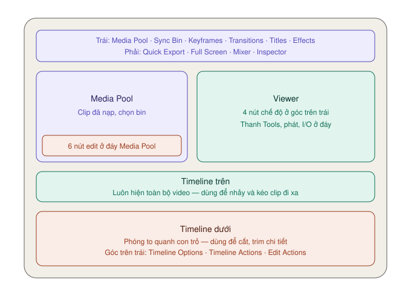

# Giao diện trang Cut — từng nút nằm ở đâu

Mặc định trang Cut chỉ có **ba vùng**: Media Pool (trái), Viewer (phải), Timeline (dưới). Ít hơn trang Edit — đó là chủ ý.

Đổi kích thước: kéo **đường nối dọc** giữa Media Pool và Viewer, hoặc kéo **tay nắm ở góc trên phải Timeline** lên xuống.

---

## Thanh toolbar trên cùng

### Bên trái — các tab thay thế cho Media Pool

Bấm tab nào thì vùng Media Pool **đổi thành** nội dung tab đó. Chỉ hiện một cái một lúc.

| Tab | Mở ra | Mức |
|---|---|---|
| **Media Pool** | Kho clip | ★★★ |
| **Sync Bin** | Các góc máy quay cùng lúc, xếp theo timecode | ★☆☆ |
| **Keyframes** | Bảng chỉnh keyframe | ★★☆ |
| **Transitions** | Kho chuyển cảnh | ★★☆ |
| **Titles** | Kho mẫu chữ | ★★★ |
| **Effects** | Kho hiệu ứng | ★★☆ |

**Dùng khi:** muốn thêm chuyển cảnh → bấm **Transitions**, kéo một kiểu thả vào điểm cắt trên timeline. Xong bấm lại **Media Pool** để quay về chọn clip.

### Bên phải

| Nút | Làm gì | Mức |
|---|---|---|
| **Quick Export** | Xuất nhanh — xem [Quick Export](kiem-tra-va-xuat.md#quick-export) | ★★☆ |
| **Full Screen** | Viewer toàn màn hình | ★★☆ |
| **Mixer** | Bảng trộn âm thanh từng track | ★☆☆ |
| **Inspector** | Thông số chi tiết của clip đang chọn | ★★☆ |

---

## Viewer

Trang Cut chỉ có **một** Viewer (trang Edit có hai). Nó tự đổi giữa xem clip nguồn và xem timeline.

### Bốn nút chế độ — góc trên trái Viewer

Từ trái sang phải:

| # | Chế độ | Xem gì | Vào bằng cách |
|---|---|---|---|
| 1 | **Source Clip** | Một clip nguồn | Bấm đúp clip trong Media Pool |
| 2 | **Source Tape** | Mọi clip trong bin nối thành một cuộn | Bấm nút này |
| 3 | **Timeline** | Bản dựng | Bấm nút này, hoặc `Q` |
| 4 | **Multi Source** | Mọi góc máy cùng lúc | Khi dùng Sync Bin |

> **Phím `Q` dùng nhiều nhất trang này:** nó đảo Viewer qua lại giữa nguồn và timeline. Chọn đoạn → edit xuống → `Q` xem lại → `Q` quay về chọn đoạn tiếp.

### Góc trên phải Viewer

**Menu độ phân giải timeline** — đổi nhanh giữa các preset (1080p, 4K, dọc 9:16…). Chọn **Custom** để mở Timeline Settings đầy đủ.

**Nút Bypass Color Grades and Fusion** (`⇧D`) — tắt tạm mọi chỉnh màu và hiệu ứng Fusion.
**Dùng khi:** máy yếu, phát bị giật. Tắt đi để dựng cho mượt, xong bật lại. Chuột phải nút này để chọn tắt riêng màu hay riêng Fusion.

### Thanh dưới đáy Viewer — từ trái sang phải

| Nút | Làm gì | Mức |
|---|---|---|
| **Tools** | Mở thanh công cụ phóng to, crop, tốc độ, chống rung — xem [Tools](tools.md) | ★★☆ |
| **Voiceover** | Thu giọng thẳng vào timeline | ★☆☆ |
| **Fast Review** | Tua nhanh thông minh — xem [Fast Review](source-tape.md#fast-review) | ★☆☆ |
| **Jog** | Kéo để dò từng khung | ★★☆ |
| **↑ Previous Edit** | Nhảy về điểm cắt trước (`↑`) | ★★★ |
| **■ Stop / ▶ Play** | `Space` | ★★★ |
| **↓ Next Edit** | Nhảy tới điểm cắt sau (`↓`) | ★★★ |
| **Loop** | Phát lặp (`⌘/`) | ★☆☆ |
| **Mark In / Out** | Đặt điểm vào/ra (`I` / `O`) | ★★★ |
| **Timecode** | Vị trí con trỏ | — |

**Mẹo xem lướt:** giữ phím `C` rồi rê chuột trên Viewer là tua theo chuột, không cần bấm.

### Đồng hồ âm thanh — cạnh phải Viewer

| Màu | Nghĩa |
|---|---|
| Xanh lá | An toàn |
| Vàng | Gần chạm ngưỡng |
| Đỏ | Quá to, có thể bị rè |

Nút loa trên đầu đồng hồ để tắt/bật tiếng.

---

## Timeline hai tầng

Đây là thứ đặc trưng nhất của trang Cut.

### Timeline trên
- **Luôn hiện toàn bộ video**, dù dài 2 phút hay 2 tiếng.
- Bấm bất kỳ đâu trên thước thời gian để nhảy tới đó.
- **Kéo clip ở đây được** — rất tiện để đưa một cảnh từ cuối video lên đầu.
- Dãy số nhỏ bên trái: bấm để chọn track đích.

### Timeline dưới
- **Phóng to quanh con trỏ.** Mức phóng to cố định, không chỉnh được.
- Nơi cắt, trim chi tiết.
- Kéo clip từ tầng dưới lên tầng trên (và ngược lại) để dời xa.

> **Vì sao hay:** ở trang Edit bạn phải liên tục zoom vào zoom ra. Ở trang Cut thì không bao giờ — tầng trên là bản đồ, tầng dưới là kính lúp.

### Nút ở đầu mỗi track

Từ trái sang phải: **phóng to track · khoá · tắt tiếng · tắt hình**.

| Nút | Dùng khi |
|---|---|
| **Khoá** | Đã dựng xong nhạc nền, khoá lại để không lỡ tay kéo lệch. Clip bị khoá hiện chấm lốm đốm |
| **Tắt tiếng** | Nghe riêng các track khác |
| **Tắt hình** | Ẩn track chữ để xem rõ hình bên dưới. Track tắt hiện nút màu cam, clip mờ đi |

### Thêm track
- Kéo clip thả vào **vùng xám phía trên** track cao nhất → tự tạo track hình mới.
- Kéo clip tiếng thả vào **vùng xám phía dưới** → tự tạo track tiếng mới.
- Hoặc chuột phải đầu track → **Add Video Track**.

---

## Ba menu ở góc trên trái timeline

Trong bản 21, các tuỳ chọn timeline được gom vào **ba icon menu**. Bấm vào để xổ danh sách.

### 1. Timeline Options — cách hiển thị và chế độ

| Mục | Làm gì | Mức |
|---|---|---|
| **Ripple On** | Bật/tắt tự dồn ở Track 1 | ★★☆ |
| **Snap** | Nam châm hít clip (`N`) | ★★★ |
| **Trim to Audio** | Phóng to dạng sóng khi trim — dễ cắt đúng giữa hai từ | ★★☆ |
| **Trim with Safe Edit** | Chặn trim lỡ tay đè lên clip bên cạnh | ★★☆ |
| **Display Clip Names** | Hiện tên clip | ★☆☆ |
| **Viewer Background** | Nền Viewer: caro, đen, xám, đỏ cảnh báo | ★☆☆ |
| **Set Default Transition** | Chọn kiểu, độ dài chuyển cảnh mặc định | ★★☆ |
| **Fixed Playhead** | Con trỏ đứng yên, timeline trượt bên dưới | ★☆☆ |
| **Boring Detector** | Soát cảnh quá dài/quá ngắn | ★☆☆ |

### 2. Timeline Actions — thêm và sửa hàng loạt

| Mục | Làm gì | Mức |
|---|---|---|
| **Add Video / Audio / Subtitle Track** | Thêm track | ★★☆ |
| **Split Clips** | Cắt đôi clip tại con trỏ | ★★★ |
| **Join Match Edit Clips** | Nối lại hai nửa của một clip đã cắt | ★☆☆ |
| **Add Marker** | Đánh dấu (`M`) | ★★☆ |
| **Set Color and Add Marker** | Đánh dấu có màu và ghi chú | ★☆☆ |
| **Add Dissolve to All Edits** | Chuyển cảnh mờ cho **mọi** điểm cắt | ★☆☆ |
| **Clear Transition from All Edits** | Xoá mọi chuyển cảnh | ★☆☆ |
| **Create Subtitles from Audio** | Tự tạo phụ đề | `Studio` |
| **Detect Scene Cuts** | Tự cắt video đã dựng thành từng cảnh | `Studio` |
| **Audio Assistant**, **Voice Convert** | Mix tiếng bằng AI, đổi giọng | `Studio` |

### 3. Edit Actions — sửa clip

| Mục | Làm gì | Mức |
|---|---|---|
| **Trim Start to Playhead** | Bỏ phần clip **trước** con trỏ | ★★★ |
| **Trim End to Playhead** | Bỏ phần clip **sau** con trỏ | ★★★ |
| **Resync Clip** | Sửa clip bị lệch tiếng với hình | ★☆☆ |

> **Trim Start/End to Playhead là cách cắt nhanh nhất:** đặt con trỏ đúng chỗ muốn bắt đầu, chọn Trim Start to Playhead — xong. Không cần kéo mép.

---

## Giao diện tự đổi khi làm video dọc

Mở timeline dọc (9:16), Resolve **tự xếp lại giao diện** để Viewer dọc hiện to hơn — ở cả trang Cut, Edit và Color. Mở lại timeline ngang thì tự quay về.

Tắt tính năng này: **Preferences → User → UI Settings → Use optimized UI layouts for vertical video**.
