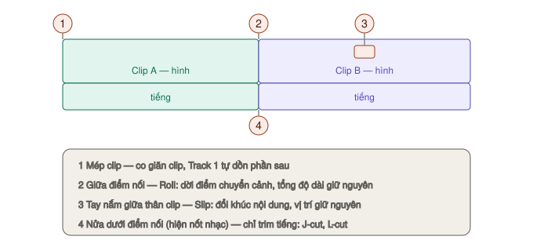
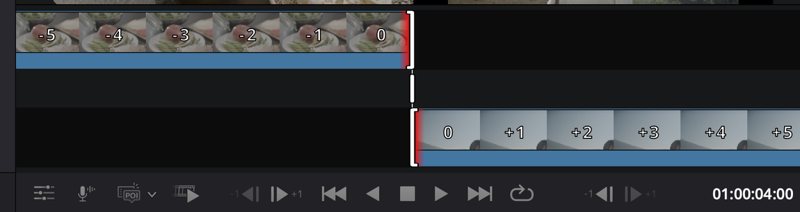

# Trim, cắt, đánh dấu

Trim là **sửa độ dài và vị trí** của clip đã nằm trên timeline. Trang Cut không có chế độ trim riêng — **chuột tự đổi hình** tuỳ chỗ bạn rê tới, và mỗi hình là một kiểu trim.

> Nhớ lại [luật Track 1](README.md#điều-quan-trọng-nhất-cần-hiểu-luật-track-1): trim trên Track 1 thì phần sau **tự dồn**. Trim trên Track 2+ thì **chỉ clip đó** thay đổi.

---

## Bốn kiểu trim bằng chuột

### Kéo mép clip

`★★★ Hằng ngày`

**Rê tới:** sát **mép trái hoặc mép phải** của clip → chuột đổi thành icon co giãn.

**Kéo:** làm clip dài ra hoặc ngắn lại.

**Kết quả:** trên Track 1 phần sau tự dồn theo. Trong lúc kéo có **ô nhỏ hiện số khung** đã dịch và độ dài mới. Tiếng cũng phát theo để bạn nghe được mình đang cắt ở đâu.

**Dùng khi:** bỏ phần thừa ở đầu hoặc đuôi clip — đoạn bạn đứng chuẩn bị trước khi nói, đoạn quay máy chưa kịp tắt.

### Kéo điểm nối giữa hai clip (Roll)

`★★☆ Thường dùng`

**Rê tới:** **chính giữa** chỗ nối hai clip.

**Kéo:** dời điểm chuyển cảnh sang trái hoặc phải. Clip trước dài ra bao nhiêu thì clip sau ngắn đi bấy nhiêu.

**Kết quả:** **tổng độ dài timeline không đổi**. Một lớp phủ trắng cho thấy còn bao nhiêu footage dư để kéo.

**Dùng khi:** chuyển cảnh sớm hoặc muộn hơn một chút cho khớp nhịp — ví dụ khớp đúng nhịp trống của nhạc, mà không muốn làm xê dịch phần phía sau.

### Kéo tay nắm giữa clip (Slip)

`★★☆ Thường dùng`

**Rê tới:** **chính giữa thân clip** — có một tay nắm nhỏ ở đó.

**Kéo:** **đổi đoạn nội dung** hiển thị trong clip mà không đổi vị trí hay độ dài clip.

**Kết quả:** clip vẫn nằm đúng chỗ, dài đúng như cũ, nhưng giờ hiện một khúc sớm hơn hoặc muộn hơn của footage gốc.

**Dùng khi:** độ dài clip đã khớp nhạc hoàn hảo nhưng nội dung bên trong chưa đẹp — ví dụ khoảnh khắc nhân vật cười xảy ra hơi muộn, slip sớm lên một chút.

> Chọn nhiều clip rồi slip được cùng lúc.

### Trim riêng phần tiếng (J-cut, L-cut)

`★★☆ Thường dùng`

**Là gì:** cho tiếng của clip này **lấn sang** hình của clip kia.

- **J-cut** — nghe tiếng cảnh sau *trước khi* thấy hình. Ví dụ: nghe tiếng sóng biển khi hình vẫn còn trong xe.
- **L-cut** — hình đã chuyển nhưng tiếng cảnh trước *vẫn còn*. Ví dụ: người phỏng vấn hỏi xong, hình chuyển sang người trả lời đang lắng nghe, tiếng câu hỏi vẫn chạy nốt.

**Cách làm:**
1. Phóng to track: bấm icon **Enlarge Track** ở đầu track. Không bắt buộc nhưng dễ thấy hơn nhiều.
2. Rê chuột vào **nửa dưới** (phần dạng sóng) tại điểm nối, đến khi icon trim hiện **nốt nhạc** bên cạnh.
3. Kéo — chỉ phần tiếng xê dịch, hình đứng yên.

**Vì sao nên dùng:** cắt thẳng cả hình lẫn tiếng cùng lúc tạo cảm giác giật cục. J-cut và L-cut làm chuyển cảnh mượt và tự nhiên hơn hẳn — đây là thứ phân biệt video nghiệp dư với video chuyên nghiệp.

---

## Trim Start / End to Playhead

`★★★ Hằng ngày` — cách trim nhanh nhất

**Là gì:** cắt (hoặc kéo dài) đầu hoặc đuôi clip **đúng tới vị trí con trỏ**.

**Cách làm:**
1. Đặt con trỏ đúng khung muốn clip bắt đầu (hoặc kết thúc).
2. Bấm icon **Edit Actions** ở góc trên trái timeline.
3. Chọn **Trim Start to Playhead** (bỏ phần trước con trỏ) hoặc **Trim End to Playhead** (bỏ phần sau con trỏ).

**Vì sao nhanh:** không phải canh chuột vào mép clip, không sợ kéo lố. Tua tới đâu cắt tới đó.

> Nó cũng **kéo dài** được: nếu con trỏ nằm ngoài clip nhưng footage gốc còn dư, clip sẽ dài ra tới con trỏ.

---

## Trim Editor — trim chính xác từng khung

*Dải trên là clip trước, dải dưới là clip sau; tay nắm trắng để roll.*

`★☆☆ Tình huống cụ thể`

**Mở:** **bấm đúp** vào điểm nối giữa hai clip.

Viewer chuyển thành hai dải phim: **clip trước ở trên**, **clip sau ở dưới**, có số khung trên từng ô.

| Kéo | Làm gì |
|---|---|
| Bên trái tay nắm **dải trên** | Trim điểm ra của clip trước |
| Bên phải tay nắm **dải dưới** | Trim điểm vào của clip sau |
| **Tay nắm trắng** giữa hai dải | Roll — dời điểm nối |

Hai nút hai bên cụm nút phát dưới Viewer cho phép dịch **từng khung một**.

**Dùng khi:** cần cắt đúng khoảnh khắc — đúng lúc cửa đóng, đúng nhịp nhạc, đúng lúc bóng chạm tay.

---

## Cắt đôi clip

`★★★ Hằng ngày`

Đặt con trỏ tại khung muốn cắt, rồi chọn một trong:

| Cách | |
|---|---|
| `⌘\` | Split Clip |
| `⌘B` | Timeline → Razor |
| Icon **cái kéo** | Ở bên trái cụm nút timeline |
| Chuột phải **đầu con trỏ** | Menu tròn hiện ra → **Split** |
| Menu **Edit Actions** | → Split |

**Dùng khi:** muốn xoá một đoạn giữa clip, chèn cảnh khác vào giữa, hoặc áp hiệu ứng cho riêng một nửa.

**Nối lại hai nửa:** menu **Timeline Actions → Join Match Edit Clips**.

---

## Kéo clip để sắp xếp lại

`★★★ Hằng ngày`

| Kéo clip và | Kết quả |
|---|---|
| Thả vào **điểm nối** giữa hai clip khác | Clip chuyển tới đó, timeline tự sắp lại |
| Thả **ngay lên** một clip trên Track 1 | Thay clip đó (Ripple Overwrite) |
| Thả lên clip và **dừng lại một chút** | Ghi đè một khoảng (Overwrite) |
| Thả **vắt qua mép** một clip bên cạnh | Ghi đè lên phần mép đó |

> Dừng lâu quá thì Ripple Overwrite thành Overwrite. Muốn thay nguyên clip thì thả nhanh.

**Kéo xa:** kéo clip từ **timeline dưới** thả lên **timeline trên** — tầng trên hiện cả video nên đưa cảnh từ phút 8 về phút 1 chỉ một lần kéo.

**Ripple trên Track 2+:** mặc định chỉ Track 1 tự dồn. Muốn Track 2+ cũng dồn (khi bên dưới không có gì ở Track 1): bật **Ripple On** ở menu **Timeline Options**.

---

## Copy, cắt, dán

| Phím | Làm gì |
|---|---|
| `⌘C` | Copy — clip vẫn ở chỗ cũ |
| `⌘X` | Cut — xoá khỏi chỗ cũ, Track 1 tự dồn lấp chỗ |
| `⌘V` | Dán tại con trỏ, **cùng track** đã copy, ghi đè lên chỗ đó |

---

## Xoá, tắt, câm clip

| Muốn | Cách | Mức |
|---|---|---|
| **Xoá** clip | Chọn → `Delete`. Trên Track 1 phần sau tự dồn | ★★★ |
| **Tắt hình** nhưng giữ clip | Chọn → `D`. Clip mờ đi, tiếng vẫn chạy | ★★☆ |
| **Câm tiếng** nhưng giữ clip | Chuột phải → **Mute**. Hiện icon loa gạch | ★★☆ |

**Tắt thay vì xoá khi:** chưa chắc có dùng hay không. Tắt đi xem thử, đổi ý thì bật lại.

**Xoá một khoảng:** đặt `I` `O` trên timeline rồi `Delete` — chỉ khoảng đó bị xoá.

---

## Nam châm (Snapping)

`★★★ Hằng ngày` · Phím `N`

Khi bật, mép clip, marker và con trỏ **hít vào nhau**. Một **đường trắng** hiện ra chỉ hai mép đang dính.

**Tắt tạm trong lúc kéo:** đang giữ chuột kéo clip, bấm `N` — chỉ tắt cho lần kéo đó, thả chuột ra là bật lại.

**Dùng khi tắt:** cần dịch clip vài khung mà nam châm cứ kéo về chỗ cũ.

---

## Hai tuỳ chọn trim nên bật

Trong menu **Timeline Options**:

**Trim to Audio** `★★☆` — khi trim, **dạng sóng phóng to** ra. Thấy rõ khoảng lặng giữa hai từ để cắt đúng chỗ, không cắt mất nửa chữ.

**Trim with Safe Edit** `★★☆` — chặn trim lỡ tay **đè lên clip bên cạnh**. Nên bật khi mới học.

---

## Đánh dấu (Marker)

`★★☆ Thường dùng`

Đánh dấu khoảnh khắc cần nhớ: chỗ cần sửa, nhịp nhạc, ý tưởng cắt khác.

| Việc | Cách |
|---|---|
| Thêm marker | `M`, hoặc icon marker ở đầu timeline |
| Thêm marker có màu và ghi chú | **Timeline Actions → Set Color and Add Marker** |
| Sửa tên, ghi chú, màu | Bấm đúp marker, hoặc đứng ở marker bấm `M` lần nữa |
| Nhảy giữa các marker | `⇧↑` / `⇧↓` |
| Dời marker | Kéo trên thước thời gian |
| Xoá marker | Chọn → `Delete`, hoặc đứng ở marker bấm `⌥M` |

Marker có ghi chú hiện một **chấm** nhỏ. Ghi chú hiện chồng lên Viewer khi con trỏ đi qua.

**Dùng khi:** nghe nhạc một lượt, bấm `M` theo mỗi nhịp mạnh. Sau đó cắt cảnh khớp vào các marker — nam châm sẽ hít vào chúng.

---

## Chọn nhiều clip

| Muốn chọn | Cách |
|---|---|
| Một clip | Bấm |
| Một dãy liền nhau | Bấm clip đầu, `⇧` + bấm clip cuối |
| Rải rác | `⌘` + bấm từng clip |
| Bằng khung | Kéo khung từ chỗ trống bao quanh các clip |
| Bỏ chọn tất cả | Bấm chỗ trống, hoặc `⌘⇧A` |
