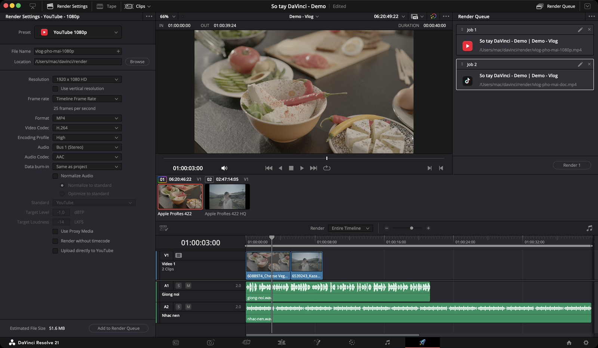

# Deliver — xuất file

> **Một câu:** trang Deliver biến timeline đã dựng thành file video, file tiếng hoặc chuỗi ảnh — và cho xếp nhiều phiên bản vào hàng đợi để render một lượt.

Trang cuối. Đơn giản nhưng sai ở đây thì công sức cả dự án đổ sông.

## Deliver hay Quick Export?

Không phải lúc nào cũng cần sang Deliver. **File → Quick Export** xuất bằng preset trong một bước, ở mọi trang.

| Dùng **Quick Export** khi | Sang **Deliver** khi |
|---|---|
| Bản nháp, video ngắn đăng ngay | Bản cuối, cần kiểm soát bitrate |
| Một phiên bản | Nhiều phiên bản một lượt |
| Preset có sẵn là đủ | Cần burn phụ đề, codec đặc biệt, xuất từng clip |

## Luồng làm việc: trái sang phải

1. **Render Settings** (trái) — chọn preset, đặt tên file, thư mục, thông số.
2. **Timeline** (giữa dưới) — chọn xuất cả timeline hay một đoạn.
3. **Add to Render Queue** — thiết lập thành một job ở **Render Queue** (phải).
4. Lặp lại 1–3 nếu cần nhiều phiên bản.
5. **Render All**.

## Tính năng hay dùng nhất

| Mức | Tính năng | Dùng để |
|---|---|---|
| ★★★ | [Chọn preset](giao-dien.md#1-preset) | Điền sẵn thông số cho YouTube, TikTok, master… |
| ★★★ | [Preset YouTube](preset-theo-nen-tang.md#youtube) | Xuất bản đăng YouTube |
| ★★★ | [Preset TikTok + Use vertical resolution](preset-theo-nen-tang.md#tiktok-reels-shorts--video-dọc) | Xuất video dọc |
| ★★★ | [Format và Codec](cai-dat-xuat.md#format-và-codec) | Chọn MP4/H.264, ProRes… |
| ★★★ | [Frame rate](cai-dat-xuat.md#frame-rate) | Giữ khớp timeline để không giật |
| ★★★ | [Quality — bitrate](cai-dat-xuat.md#quality--chọn-bitrate) | Cân giữa độ nét và dung lượng |
| ★★★ | [Nhiều job, một lượt render](render-queue-va-loi.md#nhiều-job-một-lượt-render) | Xuất nhiều phiên bản cùng lúc |
| ★★☆ | [Xuất một đoạn](render-queue-va-loi.md#xuất-một-đoạn) | Chỉ xuất khoảng giữa `I` và `O` |
| ★★☆ | [Subtitle Settings](cai-dat-xuat.md#subtitle-settings) | Burn phụ đề hoặc xuất file SRT |
| ★★☆ | [Audio Normalization](cai-dat-xuat.md#audio-normalization) | Đưa độ to về chuẩn nền tảng |
| ★★☆ | [Tự tạo preset](preset-theo-nen-tang.md#tự-tạo-preset) | Lưu thiết lập hay dùng |
| ★★☆ | [Quick Export](render-queue-va-loi.md#quick-export) | Xuất nhanh từ mọi trang |
| ★★☆ | [Master lưu trữ](preset-theo-nen-tang.md#master-lưu-trữ--prores-hoặc-dnxhr) | Bản ProRes/DNxHR chất lượng cao |
| ★★☆ | [Chapters from Markers](cai-dat-xuat.md#chapters-from-markers) | Marker thành chương trong video |
| ★☆☆ | [Single clip / Individual clips](giao-dien.md#3-render--single-clip-hay-individual-clips) | Xuất từng clip riêng cho người khác dựng |
| ★☆☆ | [Advanced Settings](cai-dat-xuat.md#advanced-settings--những-ô-đáng-biết) | Data levels, color space tag, burn-in… |
| ★☆☆ | [Chỉ xuất tiếng](preset-theo-nen-tang.md#chỉ-xuất-tiếng) | File WAV, MP3 cho podcast, nhạc |
| ★☆☆ | [Ảnh tĩnh, chuỗi ảnh](preset-theo-nen-tang.md#ảnh-tĩnh-và-chuỗi-ảnh) | Ảnh bìa, chuỗi ảnh cho VFX |
| `Studio` | [Remote Rendering](render-queue-va-loi.md#remote-rendering) | Render trên máy khác trong mạng |

★★★ dùng ở hầu như mọi video · ★★☆ dùng thường xuyên · ★☆☆ dùng trong tình huống cụ thể

## Một lượt xuất YouTube và bản dọc

Ví dụ thực tế: vlog đã dựng xong. Project có hai timeline — **Vlog** (ngang 1920×1080) và **Vlog doc** (dọc 1080×1920, làm theo [Luồng: video dọc](../../03-luong/video-doc.md)). Cần xuất cả hai trong một lần render.

**Job 1 — bản YouTube:**
1. Sang trang **Deliver**. Ở đầu Viewer, chọn timeline **Vlog**.
2. Ô **Preset** → **YouTube** → **1080p**.
3. **File Name**: `vlog-pho-1080p`. **Location**: thư mục `render`.
4. Tick **Normalize Audio** (Standard: YouTube).
5. Menu **Render** trên timeline: **Entire Timeline**.
6. **Add to Render Queue**.

**Job 2 — bản dọc:**
1. Ở đầu Viewer, đổi sang timeline **Vlog doc**.
2. Ô **Preset** → **TikTok** → **1080p**.
3. Tick **Use vertical resolution**. Nhìn Viewer: hình đứng dọc, không viền đen.
4. **File Name**: `vlog-pho-doc`. Cùng thư mục.
5. **Add to Render Queue**.

**Render:**
1. Menu ba chấm của Render Queue → **Show Job Details**, liếc lại: Job 1 là 1920×1080, Job 2 là 1080×1920.
2. Bấm nút render ở đáy Render Queue. Nút phải ghi **Render All**; nếu ghi **Render 1** là đang chọn một job và chỉ job đó được render.
3. Xong: chuột phải từng job → **Reveal in Finder**, mở file xem thử đầu, giữa, cuối.

Cần phụ đề dính vào bản dọc? Job 2 chọn **Custom Export** thay vì TikTok để bật [Subtitle Settings](cai-dat-xuat.md#subtitle-settings).

## Kiểm tra trước khi render

1. **Đúng timeline** — tên timeline ở đầu Viewer.
2. **Khoảng xuất** — menu Render là **Entire Timeline** (trừ khi cố ý xuất một đoạn). Liếc ô **DURATION**.
3. **Frame rate** khớp timeline.
4. **Có tiếng** — Export Audio đã tick, Output Track là bus chính.
5. **Không còn clip offline** — ở trang Edit không có clip đỏ. Resolve cũng sẽ cảnh báo khi Add to Render Queue.
6. **Không còn chữ đè thừa** — Data burn-in là None ở bản cuối.
7. **Track đang bật** — không lỡ tắt track chữ, track nhạc ở timeline Deliver.
8. **Tên file không trùng** bản cũ, và thư mục đích **đủ chỗ** (xem Estimated File Size).
9. **Video dọc** — đã tick Use vertical resolution.

## Giới hạn bản free

Xuất tối đa **4K UHD (3840×2160) ở 60 fps**, màu 8-bit. Lớn hơn cần `Studio`. Preset **IMF** và **Remote Rendering** cũng là `Studio`. Xem [Free và Studio](../../01-bat-dau/free-vs-studio.md).

## Các trang con

* [Giao diện — từng vùng làm gì](giao-dien.md)
* [Cài đặt xuất — tab Video, Audio, File](cai-dat-xuat.md)
* [Preset theo nền tảng — YouTube, TikTok, master, tiếng, ảnh](preset-theo-nen-tang.md)
* [Render Queue, Quick Export và lỗi khi xuất](render-queue-va-loi.md)
