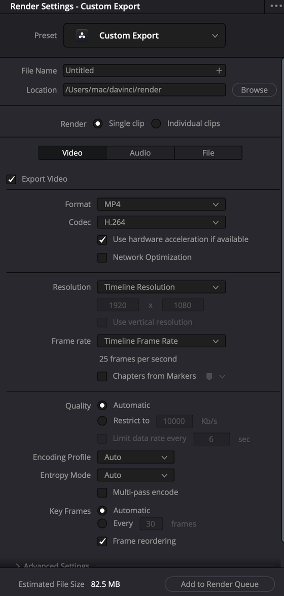

# Cài đặt xuất — tab Video, Audio, File

Ba tab nằm giữa panel Render Settings khi bạn chọn preset **Custom Export**. Trang này giải thích từng ô để bạn biết **nên đổi gì, nên để yên gì**.

Chọn preset mạng xã hội (YouTube, TikTok…) thì panel đổi sang **dạng gọn** — một danh sách ngắn, không có tab. Những ô trong dạng gọn trùng tên với ô ở đây nên vẫn tra được. Xem [Giao diện → Panel có hai dạng](giao-dien.md#panel-có-hai-dạng--tuỳ-preset).

---

## Tab Video

*Chọn Custom Export thì mọi ô trong ba tab mới mở khoá.*

### Export Video

`★★★ Hằng ngày`

Ô tick đầu tab. Bỏ tick thì **không xuất hình** — chỉ còn tiếng. Đây là cách xuất riêng tiếng khi không muốn dùng preset Audio Only.

### Format và Codec

`★★★ Hằng ngày`

**Format** là "vỏ" file (đuôi file). **Codec** là cách nén hình bên trong.

| Format | Codec hay đi kèm | Dùng khi |
|---|---|---|
| **MP4** | H.264, H.265 | Đăng mạng xã hội, gửi khách xem. Mở được ở mọi nơi |
| **QuickTime** (`.mov`) | H.264, H.265, Apple ProRes, DNxHR | Lưu trữ, gửi đi chỉnh tiếp |
| **MXF OP1A** / **MXF OP-Atom** | DNxHD, DNxHR | Gửi cho người dựng bằng Avid |
| **MKV** | — | File cho trình phát trên máy tính, máy chủ phim tại nhà. Ít dùng |
| **TIFF**, **PNG**, **JPEG**, **HEIF**, **DPX**, **EXR** | — | Ảnh tĩnh. Xuất cả timeline thì ra chuỗi ảnh (mỗi khung một file) |
| **GIF**, **WebP** | — | Ảnh động cho web |
| **WAVE** (ở tab Audio) | Linear PCM | Chỉ xuất tiếng |

**Chọn codec nào:**

| Codec | Ưu | Nhược |
|---|---|---|
| **H.264** | Phổ thông nhất, máy nào cũng mở được | File lớn hơn H.265 ở cùng chất lượng |
| **H.265** | Nhẹ hơn H.264 khoảng 30% | Máy cũ, phần mềm cũ khó mở |
| **Apple ProRes** | Chất lượng cao, dựng tiếp mượt | File rất nặng |
| **DNxHR** | Tương đương ProRes, hợp với Avid và Windows | File rất nặng |

> **Không chắc thì chọn MP4 + H.264.** Đó là lựa chọn ít rủi ro nhất cho mọi nơi nhận file.

### Use hardware acceleration if available

`★★★ Hằng ngày`

**Là gì:** dùng bộ mã hoá phần cứng (chip chuyên nén video) thay cho CPU. Hiện khi chọn MP4, hoặc QuickTime với H.264 / H.265.

**Dùng khi:** gần như luôn tick nếu ô này có — render nhanh hơn nhiều.

Manual (trang 4200) chỉ nói tới **QuickSync** của Intel và **NVENC** của card NVIDIA, không nhắc tới Mac. Trên Mac, bộ mã hoá của chip Apple có được dùng ở bản free hay không thì manual không ghi rõ.

**Cách tự kiểm tra:**
1. Đặt In/Out quanh 10 giây trên timeline, chọn **In/Out Range**.
2. Render một lần có tick, một lần bỏ tick, cùng codec H.265.
3. Xem thời gian render của từng job trong Render Queue. Chênh nhau rõ là phần cứng đang chạy.

Bỏ tick chỉ khi file xuất ra bị lỗi hình — xem [Render xong mà file lỗi](render-queue-va-loi.md#render-xong-mà-file-lỗi).

### Network Optimization

`★☆☆ Tình huống cụ thể`

Có trong giao diện khi chọn H.264, nhưng manual không mô tả ô này. Để mặc định.

### Resolution

`★★★ Hằng ngày`

Mặc định **Timeline Resolution** — tự lấy theo timeline đang xuất. Để như vậy là đúng trong phần lớn trường hợp.

Đổi khi:

- Muốn xuất bản **nhỏ hơn** để gửi duyệt (timeline 4K, xuất 1920×1080).
- Đã [hạ timeline resolution cho máy nhẹ](../../04-tham-khao/hieu-nang.md) lúc dựng, giờ cần trả lại 3840×2160 khi xuất.

Ô **Use vertical resolution** ngay dưới: tick để **đổi chiều rộng và chiều cao** — 1920×1080 thành 1080×1920. Dùng cho video dọc. Xem [Preset → TikTok, Reels](preset-theo-nen-tang.md#tiktok-reels-shorts--video-dọc).

### Frame rate

`★★★ Hằng ngày`

Mặc định **Timeline Frame Rate**. **Luôn để khớp timeline.**

Đổi frame rate ở đây chỉ đổi **thông tin ghi trong file** (ví dụ chọn giữa 23.976 và 24), không phải cách để biến video 25 fps thành 30 fps. Đổi sai gây giật hình. Muốn đổi frame rate thật thì phải đổi từ lúc tạo timeline.

### Chapters from Markers

`★★☆ Thường dùng`

Chỉ có với **MP4** và **QuickTime**. Biến **marker** trên timeline thành **chương** trong file — trình phát hiện danh sách chương để nhảy tới.

**Cách làm:**
1. Ở trang Edit, đặt marker (`M`) tại đầu mỗi chương. Bấm đúp marker, gõ tên chương vào ô **Name**.
2. Mọi marker chương phải **cùng một màu**.
3. Ở Deliver, tick **Chapters from Markers**, chọn màu đó ở menu bên cạnh.

**Ví dụ:** video hướng dẫn 20 phút có 5 phần. Đặt 5 marker xanh dương ở đầu mỗi phần, đặt tên "Giới thiệu", "Chuẩn bị"… Người xem bấm vào danh sách chương là nhảy đúng phần cần.

### Quality — chọn bitrate

`★★★ Hằng ngày`

Bitrate là lượng dữ liệu cho mỗi giây video. Cao thì nét nhưng nặng.

Hai cách:

- **Automatic** — Resolve tự tính. Nhanh gọn, hợp khi không cần kiểm soát dung lượng.
- **Restrict to … Kb/s** — bạn tự đặt mức tối đa. Dùng khi cần dung lượng cụ thể.

Mức tham khảo khi đăng YouTube:

| Độ phân giải | Bitrate |
|---|---|
| 1080p 24–30 fps | 15.000 Kb/s |
| 1080p 60 fps | 20.000 Kb/s |
| 4K 24–30 fps | 45.000 Kb/s |
| 4K 60 fps | 65.000 Kb/s |

Đặt cao hơn mức này gần như không cải thiện gì mà file phình to, vì YouTube sẽ nén lại hết.

Video dọc 1080×1920 dùng cùng mức với 1080p. Bản gửi khách duyệt hạ xuống 5.000–8.000 Kb/s là đủ xem.

> **Đọc ô Estimated File Size** ở đáy panel sau khi đổi bitrate. Nó cho biết ngay file sẽ nặng bao nhiêu.

### Encoding Profile, Entropy Mode, Key Frames

`★☆☆ Tình huống cụ thể` — để mặc định

| Ô | Làm gì | Đặt gì |
|---|---|---|
| **Encoding Profile** | Mức nén. Với H.264: **High** cho HD, **Base** cho điện thoại cũ. Với H.265: **Main** (8-bit), **Main10** (10-bit), **Main 4:2:2 10** (10-bit, màu 4:2:2) | **Auto** |
| **Entropy Mode** | Thuật toán nén. **CABAC** đẹp hơn ở cùng bitrate, **CAVLC** nhẹ máy hơn | **Auto** |
| **Multi-pass encode** | Nén nhiều lượt — chất lượng tốt hơn, render chậm hơn | Tắt, trừ khi cần bản đẹp nhất ở bitrate thấp |
| **Key Frames** | Khoảng cách giữa các khung khoá | **Automatic** |
| **Frame reordering** | Dùng B-frame để nén tốt hơn. Tắt thì render nhanh hơn nhưng xấu hơn | Bật (mặc định) |
| **Use Constant Bit Rate** | Ép bitrate cố định suốt file, thay vì lúc nhiều lúc ít theo cảnh | Tắt, trừ khi nơi nhận yêu cầu CBR |

Theo manual (trang 4201), **Multi-pass encode**, **Key Frames** và **Frame reordering** dành cho **QuickTime** H.264 / H.265. Chọn MP4 mà không thấy mấy ô này là bình thường.

### Advanced Settings — những ô đáng biết

Bấm **Advanced Settings** ở cuối tab Video để mở thêm. Phần lớn để mặc định. Những ô dưới đây đáng biết:

| Ô | Làm gì | Mức |
|---|---|---|
| **Data Levels** | **Auto** (mặc định) tự chọn theo codec. **Video** hoặc **Full** ép mọi clip theo một dải mức sáng | ★☆☆ |
| **Retain sub-black and super-white data** | Giữ phần tối hơn đen chuẩn, sáng hơn trắng chuẩn thay vì cắt bỏ. Tắt thì Resolve cắt để file qua kiểm định kỹ thuật | ★☆☆ |
| **Color Space Tag** / **Gamma Tag** | Gắn thông tin không gian màu vào file. Mặc định **Same as Project** | ★☆☆ |
| **Data burn-in** | **Same as Project** giữ chữ đè (timecode, tên clip) đã bật ở Workspace → Data Burn-In. **None** tắt hết | ★☆☆ |
| **Bypass re-encode when possible** | Chép thẳng hình từ file gốc, không nén lại — chỉ khi codec giống file gốc và clip chưa chỉnh gì | ★☆☆ |
| **Use optimized media** | Render từ optimized media cho nhanh | ★☆☆ |
| **Use proxy media** | Render từ proxy cho nhanh | ★☆☆ |
| **Use render cached images** | Render từ cache cho nhanh | ★☆☆ |
| **Force sizing to highest quality** | Ép bộ lọc phóng to/thu nhỏ đẹp nhất khi xuất | ★★☆ |
| **Force debayer res to highest quality** | Ép giải mã RAW ở chất lượng cao nhất khi xuất | ★★☆ |
| **Render All Video Tracks** | (Single clip) Bỏ tick rồi chọn track cần bỏ ở menu **Disable** bên cạnh. Chỉ áp cho job này | ★☆☆ |
| **Enable flat pass** | **Off** (mặc định) xuất có màu đã chỉnh. **Always On** bỏ chỉnh màu mọi clip. **With clip settings** chỉ bỏ ở clip được đánh dấu flat pass | ★☆☆ |
| **Render at Source Resolution** | (Individual clips) mỗi clip giữ độ phân giải gốc | ★☆☆ |
| **Add X frame handles** | (Individual clips) thêm khung thừa đầu/đuôi mỗi clip | ★☆☆ |

**Ba ô "Use … media" và chất lượng:** optimized media, proxy, cache thường ở chất lượng thấp hơn bản xuất. Bật mấy ô này thì render nhanh nhưng **có thể xấu đi**. Với bản cuối, để **tắt** cả ba để Resolve render từ footage gốc.

**Data Levels:** gần như luôn để **Auto**. Chỉ chọn **Full** khi gửi file cho phần mềm VFX đọc dải full, và người nhận phải biết đặt phần mềm của họ đọc đúng dải. Sai một bên là hình nhạt hoặc đậm bất thường.

**Color Space Tag:** để **Same as Project**. Nếu bạn dùng Color Management, Resolve gắn theo Output Color Space trong Project Settings. Xem [LOG sang Rec.709](../../03-luong/log-sang-rec709.md).

> **Ví dụ Data burn-in:** bạn bật timecode đè lên hình để khách ghi chú "sửa ở 00:01:12". Khi xuất bản cuối nhớ chọn **None**, không thì timecode dính vào bản đăng.

### Subtitle Settings

`★★☆ Thường dùng`

Nằm ở **cuối tab Video**. Tick **Export Subtitle** rồi chọn kiểu ở menu **Format**:

| Kiểu | Kết quả | Dùng khi |
|---|---|---|
| **Burn into video** | Phụ đề **dính chết** vào hình. Không tắt được | TikTok, Reels, Shorts — các nền tảng này không đọc file phụ đề rời |
| **As a separate file** | Xuất file phụ đề riêng. Chọn định dạng ở **Export As**: SRT, WebVTT, IMSC1, DFXP | YouTube — tải SRT lên riêng, người xem tự bật/tắt |
| **As embedded captions** | Nhúng phụ đề vào file. Chỉ hỗ trợ MXF OP1A và QuickTime | Giao cho đài truyền hình |

Với **As a separate file**, tick chọn track phụ đề cần xuất ở mục **Include the following subtitle tracks in the export**. Có phụ đề tiếng Việt và tiếng Anh ở hai track thì tick cả hai — ra hai file.

> **Burn into video chỉ xuất track phụ đề đang được chọn.** Có nhiều track thì kiểm tra track nào đang bật ở timeline trước khi render.

---

## Tab Audio

`★★★ Hằng ngày`

| Ô | Làm gì | Đặt gì cho video mạng |
|---|---|---|
| **Export Audio** | Có xuất tiếng hay không | **Tick** |
| **Codec** | Cách nén tiếng | **AAC** |
| **Sample Rate** | Số mẫu mỗi giây, tính bằng Hz | **48000** |
| **Bit Rate Strategy** | (AAC) Cách phân bitrate: **Constant**, **Average**, **Variable Bit Rate Constrained**, **Variable** | Để mặc định |
| **Data Rate** | Bitrate tiếng | **320 Kb/s** |
| **Bit Depth** | Độ sâu bit | 16 |
| **Output Track 1** | Bus nào được xuất | **Bus 1** (bus chính, stereo) |

Tick **Export Audio** — nghe thì hiển nhiên, nhưng đây là lỗi hay gặp khi dùng preset lạ.

**Bốn codec tiếng** (manual trang 4206):

| Codec | Là gì | Dùng khi |
|---|---|---|
| **Linear PCM** | Không nén, nguyên vẹn. **Mặc định** khi tự đặt | Bản lưu trữ, gửi đi mix tiếp |
| **AAC** | Nén, nhẹ. **Chỉ có trên macOS** | Video đăng mạng |
| **IEEE Float** | Không nén, số thực 32-bit, không lo vượt trần khi xử lý tiếp | Gửi cho phòng tiếng |
| **MP3** | Nén, mở được ở mọi nơi | Podcast, file nghe thử |

Chọn **Variable Bit Rate** ở Bit Rate Strategy thì ô **Data Rate** đổi thành ô **Quality** với năm mức, đổi giữa nhanh và đẹp.

**Codec cho bản lưu trữ:** chọn **Linear PCM** — không nén, chất lượng tiếng nguyên vẹn. Preset ProRes mặc định dùng Linear PCM 16-bit.

Hai ô tick ít dùng ở cuối: **Render one track per channel** (mỗi kênh thành một track riêng, vẫn giữ nhóm 2.0, 5.1) và **Render as discrete audio tracks** (mỗi kênh một track, không còn thông tin vị trí trái phải). Cả hai `★☆☆`, chỉ dùng khi phòng tiếng yêu cầu.

### Output Track — chọn bus

Menu **Output Track 1** chọn bus (Main hoặc Submix) nào được ghi vào file. Nút `+` bên phải thêm track tiếng thứ hai.

**Dùng khi:** cần file có hai track tiếng — track 1 là bản mix đủ, track 2 chỉ có nhạc và tiếng nền (không lời) để sau này lồng tiếng thứ tiếng khác.

### Audio Normalization

`★★☆ Thường dùng`

Tick để Resolve **tự chỉnh độ to** của bản xuất theo một chuẩn.

| Ô | Làm gì |
|---|---|
| **Normalize to Standard** | Kéo độ to (loudness) hoặc đỉnh (peak) về chuẩn |
| **Optimize to Standard** | Vừa đạt độ to chuẩn, vừa giữ đỉnh dưới ngưỡng |
| **Standard** | Chọn chuẩn cần đạt |
| **Target Level** | Mức đích, tính bằng dBFS |

Preset YouTube có sẵn ô **Normalize Audio**. Tick vào thì **Standard** đặt sẵn là **YouTube**, **Target Level** -1.0 dBTP, **Target Loudness** -14 LKFS.

> Chỉnh độ to ngay từ lúc mix vẫn tốt hơn — xem [Fairlight → Mức to cuối cùng](../fairlight/loudness-va-xuat.md#mức-to-cuối-cùng). Normalization lúc xuất là lưới an toàn.

---

## Tab File

| Ô | Làm gì | Mức |
|---|---|---|
| **Filename uses** | **Use Custom Filename** — tên tự gõ vào ô **Custom name**. **Use Timeline Name** — lấy tên timeline (Single clip). **Use Source Filename** — lấy tên file gốc (Individual clips) | ★★☆ |
| **File suffix** | Thêm chữ vào cuối tên file | ★☆☆ |
| **Use unique filenames** | (Individual clips, khi đặt tên tự gõ) thêm số track và số clip vào tên để không file nào đè file nào | ★☆☆ |
| **Use filename digits** | Số chữ số đánh số khi xuất chuỗi ảnh. Mặc định 8 | ★☆☆ |
| **Start timeline timecode at** | (Single clip) timecode bắt đầu ghi vào file | ★☆☆ |
| **Place clips in separate folders** | (Individual clips) mỗi clip một thư mục | ★☆☆ |
| **Render speed** | Giới hạn tốc độ render. Mặc định **Maximum** | ★☆☆ |
| **Disk space currently used** / **after render** | Dung lượng ổ đích hiện tại và sau khi render | ★★☆ |

**Biến trong tên file:** ở ô tên có thể chèn biến như `%scene_%shot_%take`. Clip có metadata cảnh 12, shot A, take 3 sẽ ra tên `12_A_3`. Hữu ích khi xuất Individual clips.

**Render speed:** chỉ hạ khi ổ đích là ổ mạng dùng chung và render làm nghẽn máy người khác. Máy cá nhân để **Maximum**.

> **Resolve ghi đè file trùng tên mà không hỏi lại từng file.** Lúc Add to Render Queue có thể hiện cảnh báo *"This render may overwrite existing clips in this folder"* — đọc kỹ trước khi bấm Yes. Xuất nhiều phiên bản thì đặt tên khác nhau (ví dụ thêm `_v2`, `_doc`).

---

## Single clip và Individual clips khác nhau thế nào

| | Single clip | Individual clips |
|---|---|---|
| **Số file** | Một | Bằng số clip trong khoảng chọn |
| **Timecode** | Theo **Start timeline timecode at** | Giữ timecode của từng file gốc |
| **Frame rate** | Mọi clip đổi về frame rate timeline | Mỗi clip giữ frame rate riêng |
| **Hiệu ứng timeline** | Luôn được "nướng" vào | Tuỳ ô **Render Timeline Effects** |
| **Xuất nửa clip** | Được | **Không** — `I` `O` tự bắt vào mép clip |
| **Lưu thành preset dùng cho Quick Export** | Được | Không |

---

## Giới hạn bản free

Theo bảng so sánh của Blackmagic, bản free xuất tối đa **4K UHD (3840×2160) ở 60 fps**. Giới hạn màu 8-bit và việc H.265 10-bit (**Main10**) có dùng được ở bản free trên Mac hay không thì manual không ghi — thử render rồi xem thông tin file để chắc. Lớn hơn cần `Studio`. Preset **IMF** cũng là `Studio`. Xem [Free và Studio](../../01-bat-dau/free-vs-studio.md).
