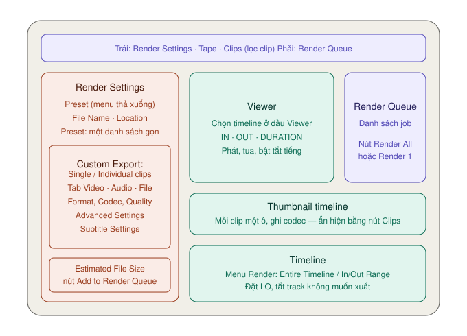

# Giao diện trang Deliver — từng vùng làm gì

Trang Deliver có **năm vùng**: Render Settings (trái), Viewer (giữa trên), Thumbnail timeline và Timeline (giữa dưới), Render Queue (phải). Thứ tự làm việc cũng đi từ trái sang phải: đặt thông số → chọn khoảng xuất → đưa vào hàng đợi → render.

---

## Thanh toolbar trên cùng

### Bên trái

| Nút | Làm gì | Mức |
|---|---|---|
| **Delivery full/half height** | Cho panel Render Settings cao hết màn hình, timeline hẹp lại | ★☆☆ |
| **Render Settings** | Ẩn/hiện panel thiết lập xuất | ★★★ |
| **Tape** | Chuyển sang chế độ xuất ra băng. Cần đầu băng thật — người làm video mạng không dùng | ★☆☆ |
| **Clips** | Ẩn/hiện Thumbnail timeline | ★★☆ |
| **Mũi tên cạnh Clips** | Lọc Thumbnail timeline (Timeline Filter) | ★☆☆ |

### Bên phải

| Nút | Làm gì | Mức |
|---|---|---|
| **Render Queue** | Ẩn/hiện hàng đợi render | ★★★ |
| **Render Queue full/half height** | Cho Render Queue cao hết màn hình | ★☆☆ |

> **Lỡ bấm Tape?** Viewer đổi sang nút điều khiển băng và Render Settings bị khoá. Bấm lại **Tape** để quay về xuất file.

---

## Panel Render Settings

Đây là nơi bạn ở lâu nhất. Từ trên xuống dưới:

### 1. Preset

`★★★ Hằng ngày`

Ở bản 21, preset nằm trong **một menu thả xuống** (ô **Preset**) ở đầu panel, không còn là hàng icon. Chọn preset thì Resolve điền sẵn thông số và **khoá** những ô preset đó không cần.

| Nhóm | Preset |
|---|---|
| Tự chỉnh | **Custom Export** — mở khoá mọi thông số |
| Mạng xã hội | **YouTube** (720p/1080p/1440p/2160p), **Vimeo** (720p/1080p/2160p), **TikTok** (720p/1080p), **Dropbox** (720p/1080p/2160p) — kèm tuỳ chọn tải lên thẳng |
| Bản master | **H.264 Master**, **H.265 Master**, **ProRes 422 HQ** (manual gọi là *ProRes Master*) |
| Gửi sang phần mềm khác | **Final Cut Pro 7**, **Final Cut Pro X**, **Premiere XML**, **AVID AAF**, **Pro Tools** |
| Khác | **Audio Only**, **Presentations** (Blackmagic Cloud), **HyperDeck**, **IMF - Generic** `Studio` |

Chi tiết từng preset và cách tự tạo preset: [Preset theo nền tảng](preset-theo-nen-tang.md).

### 2. File Name và Location

| Ô | Làm gì |
|---|---|
| **File Name** | Tên file sẽ xuất. Nút `+` bên phải thêm biến tự điền (tên timeline, ngày…) |
| **Location** | Thư mục đích. Bấm **Browse** để chọn |

Chưa chọn Location mà bấm Add to Render Queue thì Resolve sẽ hỏi thư mục lúc đó.

### Panel có hai dạng — tuỳ preset

Phần dưới File Name và Location **trông khác hẳn** tuỳ bạn chọn preset nào. Đây là chỗ hay làm người mới bối rối khi đọc hướng dẫn cũ.

| Bạn chọn | Panel hiện | Tiêu đề panel |
|---|---|---|
| Preset mạng xã hội (YouTube, Vimeo, TikTok, Dropbox) | **Một danh sách gọn**, không có tab, không có Single/Individual clips | *Render Settings - YouTube - 1080p* |
| **Custom Export** và các preset master | Nút **Render: Single clip / Individual clips** và ba tab **Video · Audio · File** | *Render Settings - Custom Export* |

**Dạng gọn của preset YouTube**, từ trên xuống: Resolution (1920 x 1080 HD) → **Use vertical resolution** → Frame rate (Timeline Frame Rate) → Format (MP4) → Video Codec (H.264) → Encoding Profile (High) → Audio (Bus 1 (Stereo)) → Audio Codec (AAC) → Data burn-in (Same as project) → **Normalize Audio** → **Use Proxy Media** → **Render without timecode** → **Upload directly to YouTube**.

Dạng gọn đủ cho phần lớn video đăng mạng. Cần chỉnh bitrate, phụ đề hay Advanced Settings thì chuyển sang **Custom Export**.

### 3. Render — Single clip hay Individual clips

`★★★ Hằng ngày` cho Single clip · `★☆☆ Tình huống cụ thể` cho Individual clips

Chỉ hiện ở dạng **Custom Export** (và các preset không phải mạng xã hội). Preset mạng xã hội luôn xuất Single clip.

| Lựa chọn | Kết quả | Dùng khi |
|---|---|---|
| **Single clip** | Cả khoảng chọn thành **một file**. Mặc định | Gần như mọi lúc: đăng mạng, gửi khách, lưu master |
| **Individual clips** | **Mỗi clip** trên timeline thành một file riêng | Giao footage đã chỉnh màu cho người khác dựng tiếp, gửi cảnh cho người làm VFX |

Đổi lựa chọn này thì danh sách thông số bên dưới cũng đổi. Ví dụ **Render at Source Resolution** chỉ hiện khi chọn Individual clips.

> **Single clip bị mờ, không chọn được?** Thumbnail timeline đang bị lọc (có gạch cam dưới nút **Clips**). Mở menu cạnh Clips, chọn **All Clips** để bỏ lọc.

### 4. Ba tab Video · Audio · File

Chỉ có ở dạng Custom Export. Toàn bộ thông số chi tiết: [Cài đặt xuất](cai-dat-xuat.md).

### 5. Đáy panel

| Mục | Làm gì |
|---|---|
| **Estimated File Size** | Ước lượng dung lượng file với thông số hiện tại. Liếc qua trước khi render để khỏi bất ngờ |
| **Add to Render Queue** | Đưa thiết lập hiện tại thành một job trong Render Queue |

### Menu ba chấm của Render Settings

Góc trên phải panel. Những mục hay dùng:

| Mục | Làm gì | Mức |
|---|---|---|
| **Save as New Preset** | Lưu thiết lập thành preset riêng | ★★☆ |
| **Update Preset** / **Delete Preset** | Sửa, xoá preset tự tạo | ★☆☆ |
| **Import Preset** / **Export Preset** | Nhập, xuất preset dạng file `.xml` để dùng ở máy khác | ★☆☆ |
| **Create Additional Output** | Thêm một đầu ra nữa trong cùng job | ★☆☆ |

---

## Viewer

Viewer cho thấy **đúng hình sẽ được xuất** với thông số hiện tại.

### Thanh đầu Viewer

| Mục | Làm gì | Mức |
|---|---|---|
| **Tỉ lệ zoom** (66%…) | Phóng to, thu nhỏ hình trong Viewer | ★☆☆ |
| **Tên timeline** + mũi tên | **Đổi timeline cần xuất** — quan trọng khi project có nhiều timeline | ★★★ |
| **Timecode** | Vị trí con trỏ | — |
| **Menu ba chấm** | Tuỳ chọn Viewer, gồm **Updates During Renders** | ★☆☆ |

**Updates During Renders** chọn tắt, giảm hoặc bật việc cập nhật hình trên Viewer lúc đang render. Tắt đi thì render nhanh hơn, nhất là trên máy yếu.

### Ô IN · OUT · DURATION

Ngay dưới thanh đầu. Cho biết khoảng đang chọn để xuất bắt đầu, kết thúc ở đâu và dài bao nhiêu. Liếc ô **DURATION** là biết mình có lỡ chọn thiếu hay không.

### Thanh dưới Viewer

Nút phát, tua, lặp như các trang khác. Nút **loa** bật/tắt tiếng; **chuột phải** vào loa để kéo mức âm lượng.

Giữ `C` rồi rê chuột trên Viewer để tua lướt.

Xem toàn màn hình: **Workspace → Viewer Mode → Cinema Viewer**.

---

## Thumbnail timeline

Hàng ô hình nhỏ, mỗi ô một clip — giống trang Color. Dưới mỗi ô có **tên codec** của clip nguồn.

| Thao tác | Kết quả |
|---|---|
| Chuột phải ô → **Render This Clip** | Chọn đúng clip đó để xuất |
| Chuột phải ô → **Mark In** / **Mark Out** | Đặt đầu/cuối khoảng xuất theo clip |
| Chuột phải ô → **Versions** | Chọn phiên bản màu sẽ được xuất |

Ẩn/hiện bằng nút **Clips** trên toolbar.

---

## Timeline

Timeline thu gọn, dùng để **chọn khoảng xuất** chứ không phải để dựng.

### Thanh trên Timeline

| Mục | Làm gì | Mức |
|---|---|---|
| **Render** (menu) | **Entire Timeline** — xuất cả timeline. **In/Out Range** — chỉ xuất khoảng giữa `I` và `O` | ★★★ |
| **Thanh trượt zoom** | Phóng to, thu nhỏ timeline | ★☆☆ |

Thu cả timeline vừa khung: `⇧Z`.

### Đầu track

Mỗi track có nút **tắt track**. Track bị tắt sẽ **không được xuất**.

**Dùng khi:** cần bản không chữ. Chữ nằm ở V3 thì tắt V3, xuất ra bản sạch để gửi đi dịch phụ đề.

Chi tiết cách chọn khoảng xuất: [Render Queue → Xuất một đoạn](render-queue-va-loi.md#xuất-một-đoạn).

---

## Render Queue

Danh sách các job chờ render. Mỗi job là một thẻ: tên job (**Job 1**, **Job 2**…), icon preset, *tên project | tên timeline*, và đường dẫn file sẽ xuất.

| Chỗ | Làm gì |
|---|---|
| **Biểu tượng bút chì** trên job | Mở lại thiết lập của job để sửa |
| **Dấu X** góc trên phải job | Xoá job khỏi hàng đợi |
| **Nút render** (đáy panel) | Bắt đầu render. Không chọn job nào thì nút ghi **Render All**; chọn một job thì ghi **Render 1** — chỉ render job đó. Đang render thì nút thành **Stop Render** |
| **Menu ba chấm** (góc trên phải) | Show Job Details, Show All Projects, Review Before Upload, Clear Rendered, Clear All |
| **Chuột phải job** | Clear Render Status, Reveal in Finder, Reveal in Media Storage |

Cách dùng đầy đủ: [Render Queue và lỗi khi xuất](render-queue-va-loi.md).

---

## Nếu đang ở album của trang Photo

Bấm sang Deliver khi đang mở một album ảnh, trang này đổi sang **giao diện riêng cho ảnh tĩnh**. Xem [Photo → Xuất từ trang Deliver](../photo/xuat-anh.md#xuất-từ-trang-deliver).
