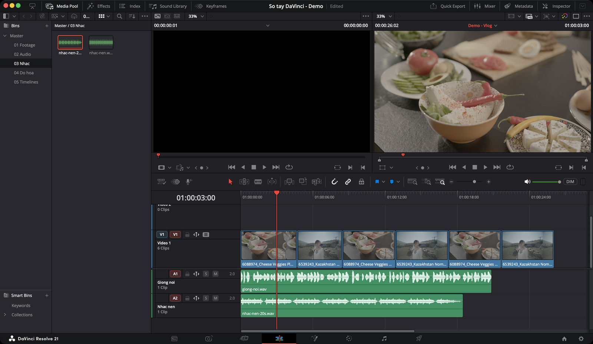
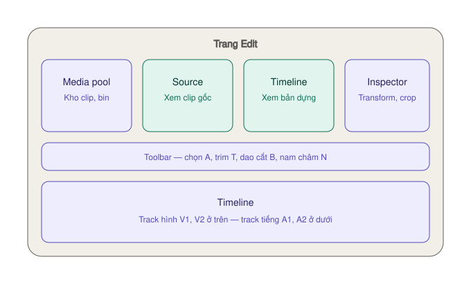

# Edit — dựng chi tiết

> **Một câu:** trang dựng chính của Resolve. Nhiều track, kiểm soát từng khung hình, nơi bạn sẽ ở lâu nhất.

## Khác trang Cut ở đâu

| | Cut | Edit |
|---|---|---|
| Viewer | Một | **Hai**: Source (trái) và Timeline (phải) |
| Timeline | Hai tầng, không zoom | Một tầng, **zoom tự do** |
| Track 1 | **Tự dồn** khi xoá, chèn | **Không tự dồn** — tuỳ phím bạn dùng |
| Track hình và tiếng | Gộp chung | **Tách riêng**: V1, V2… ở trên, A1, A2… ở dưới |
| Hợp với | Video ngắn, dựng thô | Dự án dài, nhiều lớp, hoàn thiện |

Cả hai dùng **chung một timeline**. Dựng thô ở Cut rồi sang Edit hoàn thiện là cách làm rất phổ biến.

## Điều quan trọng nhất cần hiểu: xoá có hai kiểu

Ở trang Edit, timeline **không tự dồn**. Kết quả phụ thuộc vào phím bạn bấm:

| Phím | Tên | Kết quả |
|---|---|---|
| `Delete` | Lift | Xoá clip, **để lại khoảng trống** |
| `Fn` + `Delete` | Ripple Delete | Xoá clip, **phần sau dồn lên** lấp chỗ trống |

Hầu hết thời gian bạn muốn **Ripple Delete**. Quên `Fn` là timeline đầy lỗ đen.

> Bàn phím Mac không có phím Forward Delete riêng — `Fn` + `Delete` chính là Forward Delete.

## Tính năng hay dùng

| Mức | Tính năng | Dùng để |
|---|---|---|
| ★★★ | [Đặt `I` `O` + chèn bằng `F9` `F10`](dung-va-cat.md#đưa-clip-xuống-timeline) | Đưa đoạn cần lấy xuống timeline |
| ★★★ | [Place On Top `F12`, Append `⇧F12`](dung-va-cat.md#bảy-kiểu-edit) | B-roll phủ lên, nối vào cuối |
| ★★★ | [Chọn track đích](giao-dien.md#destination--chọn-track-đích) | Quyết định clip vào track nào |
| ★★★ | [Cắt `⌘B`, xoá dồn `Fn+Delete`](dung-va-cat.md#cắt-và-xoá) | Bỏ phần thừa |
| ★★★ | [Kéo mép clip, chế độ Trim `T`](dung-va-cat.md#trim--sửa-độ-dài) | Chỉnh độ dài, điểm chuyển cảnh |
| ★★★ | [Trim tới con trỏ `⇧[` `⇧]`](dung-va-cat.md#trim-tới-con-trỏ) | Cắt đầu/đuôi clip không cần kéo chuột |
| ★★★ | [Nam châm `N`, zoom `⇧Z`](giao-dien.md#nhóm-4--khoá-và-hít) | Nối clip khít, đi lại nhanh trên timeline |
| ★★★ | [Inspector: Zoom, Position, Crop](inspector.md) | Phóng to, dời, cắt khung |
| ★★★ | [Text+](chu-va-hieu-ung.md#chữ--text-text) | Chữ, tiêu đề |
| ★★★ | [Phụ đề](phu-de.md) | Gõ, nhập `.srt`, in vào hình hoặc xuất file |
| ★★★ | [Chuyển cảnh `⌘T`](chu-va-hieu-ung.md#chuyển-cảnh) | Cross Dissolve ở điểm cắt |
| ★★★ | [Volume, fade tiếng ngay trên timeline](dung-va-cat.md#tiếng-ngay-trên-timeline) | Cân tiếng nhanh không cần sang Fairlight |
| ★★★ | [Nhân bản timeline](timeline-nang-cao.md#nhân-bản-timeline--giữ-phiên-bản) | Giữ bản cũ trước khi sửa lớn |
| ★★☆ | [Replace `F11`, Ripple Overwrite `⇧F10`](dung-va-cat.md#replace--f11) | Thay cảnh, giữ nhịp |
| ★★☆ | [Dựng ba điểm](dung-va-cat.md#dựng-ba-điểm--three-point-editing) | Lấp đúng khoảng trống, kết thúc đúng nhịp |
| ★★☆ | [Slip, Slide, Roll](dung-va-cat.md#trim--sửa-độ-dài) | Chỉnh nội dung và điểm nối, giữ tổng độ dài |
| ★★☆ | [Keyframe](chu-va-hieu-ung.md#keyframe--cho-mọi-thứ-chuyển-động) | Cho chữ, hình chuyển động |
| ★★☆ | [Retime `⌘R`, speed ramp](inspector.md#tốc-độ--retime) | Slow motion, tua nhanh |
| ★★☆ | [Freeze Frame `⇧R`](timeline-nang-cao.md#freeze-frame--dừng-hình) | Dừng hình |
| ★★☆ | [Compound Clip](timeline-nang-cao.md#compound-clip--gộp-nhiều-clip-thành-một) | Gộp nhiều clip thành một khối |
| ★★☆ | [Adjustment Clip](chu-va-hieu-ung.md#adjustment-clip) | Áp một hiệu ứng cho nhiều clip |
| ★★☆ | [J-cut, L-cut](dung-va-cat.md#j-cut-và-l-cut) | Chuyển cảnh mượt, chuyên nghiệp |
| ★★☆ | [Marker `M`](dung-va-cat.md#marker) | Đánh dấu nhịp nhạc, chỗ cần sửa |
| ★☆☆ | [Multicam](timeline-nang-cao.md#multicam--dựng-nhiều-góc-máy) | Dựng phỏng vấn, podcast nhiều máy |
| ★☆☆ | [Edit Index](timeline-nang-cao.md#edit-index--danh-sách-mọi-điểm-cắt) | Soát vết cắt thừa, clip mất file |
| ★☆☆ | [Dynamic Trim `W`](dung-va-cat.md#trim-khi-đang-phát--dynamic-trim) | Trim trong lúc phát |
| `Studio` | [Create Subtitles from Audio](phu-de.md#create-subtitles-from-audio--ai-tự-tạo) | AI tự gõ phụ đề |
| `Studio` | Multicam SmartSwitch | AI tự chọn góc máy theo người nói |

## Ví dụ: dựng một video giới thiệu món ăn 60 giây

1. **Tạo timeline:** chuột phải clip trong Media Pool → **Create Timeline Using Selected Clips**.
2. **Lấy đoạn:** bấm đúp clip, xem ở Viewer trái, `I` đầu đoạn, `O` cuối đoạn, `F10` đặt xuống. Lặp lại.
3. **Bỏ thừa:** đặt con trỏ, `⌘B` cắt, chọn đoạn thừa, `Fn+Delete`.
4. **Nhạc:** kéo file nhạc xuống track **A2**. Bấm `M` theo mỗi nhịp mạnh.
5. **Khớp nhịp:** bật nam châm `N`, kéo các điểm cắt hít vào marker.
6. **Chữ:** **Effects → Titles → Text+** kéo lên track **V2**, gõ tên món ở Inspector.
7. **Chuyển cảnh:** chọn điểm cắt giữa hai cảnh, `⌘T`.
8. **Kết thúc:** chọn mép cuối clip hình cuối cùng, `⌘T` — hình mờ dần ra đen. Rê chuột lên clip nhạc, kéo **tay nắm fade** ở góc trên phải vào trong để nhạc nhỏ dần.
9. **Xem lại cả video:** `⇧Z` thu timeline vừa khung, `Space` phát.

## Các trang con

* [Giao diện — các nút hay dùng](giao-dien.md)
* [Đưa clip xuống, cắt, trim, tiếng](dung-va-cat.md)
* [Inspector — phóng to, crop, tốc độ](inspector.md)
* [Chữ, chuyển cảnh, keyframe](chu-va-hieu-ung.md)
* [Phụ đề — subtitle track](phu-de.md)
* [Timeline nâng cao — phiên bản, compound, multicam](timeline-nang-cao.md)
