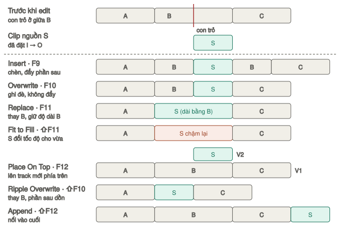
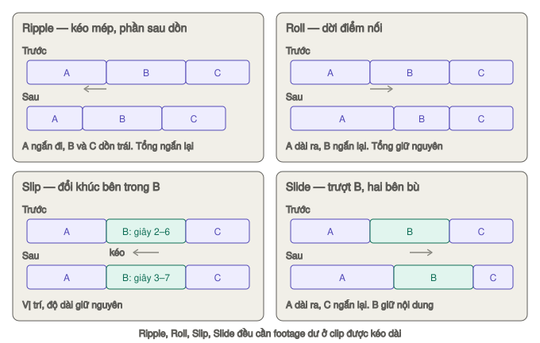
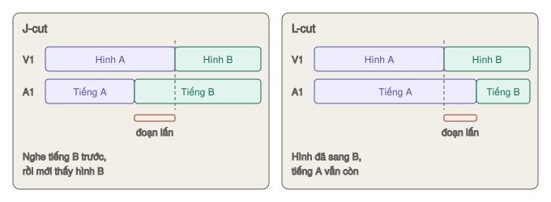

# Đưa clip xuống, cắt, trim, tiếng

Trang này đi theo thứ tự bạn làm: **đưa clip xuống → cắt bỏ phần thừa → trim cho khít → cân tiếng**.

> Nhớ luật của trang Edit: timeline **không tự dồn**. Có dồn hay không là do **phím bạn bấm** và **chế độ** đang bật (`A` hay `T`).

---

## Đưa clip xuống timeline

`★★★ Hằng ngày`

### Ba bước cơ bản

1. **Chọn đoạn:** bấm đúp clip trong Media Pool — nó mở ở **Viewer Source** (trái). Tua tới đầu đoạn cần lấy, bấm `I`. Tới cuối đoạn, bấm `O`.
2. **Chọn track đích:** ô **xanh** V1/A1 (track của clip nguồn) cắm vào track nào thì clip đi xuống track đó. Kéo ô xanh sang track khác, hoặc bấm `⌥2` để cắm hình vào V2. Xem [Destination](giao-dien.md#destination--chọn-track-đích).
3. **Chọn vị trí:** đặt con trỏ timeline ở chỗ muốn clip bắt đầu, rồi bấm phím edit.

Đặt `I` `O` sai: `⌥X` xoá cả hai, đặt lại.

### Bảy kiểu edit

| Phím | Kiểu | Kết quả | Timeline dài ra? | Mức |
|---|---|---|---|---|
| `F9` | **Insert** | Chèn vào, **đẩy** phần sau ra | Có | ★★★ |
| `F10` | **Overwrite** | **Ghi đè** lên chỗ đang có | Không | ★★★ |
| `F11` | **Replace** | **Thay** clip dưới con trỏ, khớp đúng khung | Không | ★★☆ |
| `⇧F11` | **Fit to Fill** | **Co giãn tốc độ** clip cho vừa khoảng trống | Không | ★☆☆ |
| `F12` | **Place On Top** | Đặt lên **track trống phía trên** | Không | ★★★ |
| `⇧F10` | **Ripple Overwrite** | Thay clip bằng clip **dài/ngắn khác**, phần sau dồn theo | Tuỳ | ★★☆ |
| `⇧F12` | **Append** | Nối vào **cuối** timeline | Có | ★★★ |

Cả bảy cũng có trong menu **Edit**, và trong lớp phủ hiện ra khi **kéo clip lên Viewer Timeline**.

*Cùng một timeline A–B–C, con trỏ ở giữa B, clip nguồn S. Mỗi hàng là kết quả sau một kiểu edit. Riêng Fit to Fill: đã đặt `I` `O` quanh B trên timeline.*

> Insert, Overwrite, Place On Top, Ripple Overwrite, Append đưa được **nhiều clip cùng lúc** (chọn nhiều clip trong Media Pool rồi bấm phím). Replace và Fit to Fill chỉ lấy **clip đầu tiên**.

### Insert — `F9`

`★★★ Hằng ngày`

**Là gì:** chèn clip vào **tại con trỏ**. Mọi thứ phía sau bị đẩy lùi đúng bằng độ dài clip mới.

**Dùng khi:** thêm một cảnh vào giữa đoạn đã dựng mà không muốn mất gì.

**Ví dụ:** đã dựng xong vlog, muốn chèn cảnh quán cà phê giữa hai đoạn nói. Đặt con trỏ ở điểm nối → `F9`.

**Lưu ý:** con trỏ đặt **giữa một clip** thì clip đó bị **cắt đôi**, clip mới chen vào giữa.

### Overwrite — `F10`

`★★★ Hằng ngày`

**Là gì:** đặt clip vào và **đè lên** bất cứ thứ gì đang ở đó. Không đẩy gì.

**Dùng khi:** dựng thô liên tục — sau mỗi lần `F10`, con trỏ tự nhảy tới **cuối clip vừa đặt**, sẵn sàng cho clip tiếp. Hoặc đặt vào chỗ trống đã chừa sẵn.

> Kéo thả clip từ Media Pool xuống timeline cũng là **Overwrite**.

### Replace — `F11`

`★★☆ Thường dùng`

**Là gì:** thay clip dưới con trỏ bằng clip ở Viewer Source. Độ dài **giữ nguyên** bằng clip cũ. **Khung ở con trỏ Source khớp đúng khung ở con trỏ Timeline**.

**Không cần đặt `I` `O`.**

**Cách làm:**
1. Đặt con trỏ timeline vào clip muốn thay, ở **khung có hành động cần khớp**.
2. Mở clip mới ở Viewer Source, tua tới **đúng khoảnh khắc tương ứng**.
3. Bấm `F11`.

**Dùng khi:** thay một take bằng take khác cùng hành động. Hoặc đặt tiếng động khớp đúng khung hình.

**Ví dụ:** cảnh mở cửa ở take 2 tay bị rung. Đặt con trỏ timeline đúng khung tay chạm tay nắm. Ở Source mở take 3, tua tới khung tay chạm tay nắm. `F11` — take 3 thay vào, khớp nhịp hoàn hảo.

### Fit to Fill — `⇧F11`

`★☆☆ Tình huống cụ thể`

**Là gì:** kiểu edit duy nhất dùng **đủ bốn điểm** và **tự đổi tốc độ** clip. Đoạn nguồn `I`→`O` bị kéo giãn hoặc nén lại cho vừa khít đoạn `I`→`O` trên timeline.

**Cách làm:**
1. Trên timeline: đặt `I` `O` quanh khoảng cần lấp. Hoặc không đặt gì, để con trỏ nằm trong một khoảng trống — Resolve lấy độ dài khoảng trống đó.
2. Ở Source: đặt `I` `O`.
3. `⇧F11`.

**Kết quả:** clip có **badge tốc độ** trên timeline. Không dồn timeline.

**Dùng khi:** còn đúng 3 giây trống để lấp nhưng cảnh đẹp chỉ dài 2,5 giây — chậm đi một chút người xem không nhận ra.

### Place On Top — `F12`

`★★★ Hằng ngày`

**Là gì:** đặt hình lên **trên track hình cao nhất** đang có clip ở chỗ đó, tiếng xuống **dưới track tiếng thấp nhất**. **Bỏ qua track đích**, thiếu track thì tự tạo track mới.

**Dùng khi:** B-roll phủ lên đoạn nói, logo, chữ, ảnh chèn — mà không phải chọn track.

**Ví dụ:** đang nói về món phở, muốn hiện cảnh cận tô phở 3 giây. Đặt con trỏ chỗ bắt đầu, mở cảnh tô phở ở Source với `I` `O` dài 3 giây → `F12`. Tiếng nói bên dưới vẫn nguyên.

### Ripple Overwrite — `⇧F10`

`★★☆ Thường dùng`

**Là gì:** thay **cả clip** trên timeline bằng clip mới có **độ dài khác**. Phần sau tự dồn tới hoặc lùi lại cho vừa.

**Cách làm:**
1. Đặt con trỏ timeline vào clip muốn thay — vị trí nào trong clip cũng được.
2. `⌥X` để chắc chắn timeline **không có** `I` `O`.
3. Ở Source đặt `I` `O` cho đoạn mới.
4. `⇧F10`.

**Dùng khi:** cảnh 5 giây cũ cần thay bằng cảnh 3 giây — không muốn để lỗ 2 giây, cũng không muốn tự kéo cả phần sau.

### Append — `⇧F12`

`★★★ Hằng ngày`

**Là gì:** nối clip vào **cuối timeline**, con trỏ ở đâu cũng không quan trọng.

**Dùng khi:** dựng thô theo thứ tự quay. Chọn nhiều clip trong Media Pool (theo thứ tự sắp xếp) rồi `⇧F12` — nối liền một mạch.

### Kéo thả

`★★★ Hằng ngày`

| Kéo | Kết quả |
|---|---|
| Từ Media Pool hoặc Source xuống timeline | **Overwrite** tại chỗ thả |
| Giữ `⌘⇧` khi kéo xuống | **Insert** — chen vào, đẩy phần sau |
| Giữ `⌥` khi kéo từ Media Pool | **Chỉ lấy hình** |
| Giữ `⇧` khi kéo từ Media Pool | **Chỉ lấy tiếng** |
| Từ Viewer Source: kéo từ **icon phim** hoặc **icon sóng âm** hiện ở đáy hình | Chỉ hình / chỉ tiếng |
| Thả vào **vùng xám trên** track hình cao nhất | Tạo track mới |
| Kéo lên **Viewer Timeline**, thả vào một ô | Edit đúng kiểu ô đó |

> Kéo thả nhanh nhưng khó chính xác bằng phím. Quen tay rồi thì `I` `O` + `F10` nhanh hơn nhiều.

### Chỉ lấy hình, hoặc chỉ lấy tiếng

`★★☆ Thường dùng`

| Cách | Giữ lựa chọn bao lâu |
|---|---|
| Menu **Video / Audio** dưới Viewer Source → chọn **Video Only** hoặc **Audio Only** | Tới khi bạn đổi lại |
| Bấm ô **xanh** A1 (hoặc V1) ở cột nguồn cho tắt | Tới khi bạn bật lại |
| `⌥` kéo (chỉ hình), `⇧` kéo (chỉ tiếng) | Chỉ lần kéo đó |

**Ví dụ:** lấy cảnh đường phố làm B-roll nhưng tiếng xe ồn → Video Only rồi `F12`.

### Đưa nhiều clip một lúc

Chuột phải các clip đã chọn trong Media Pool:

| Lệnh | Làm gì |
|---|---|
| **Insert Selected Clips to Timeline** | Chèn tất cả, theo thứ tự sắp xếp của Media Pool |
| **Append Selected Clips to Timeline** | Nối tất cả vào cuối |
| **Insert Selected Clips to Timeline With Handles** | Chèn, chừa sẵn phần dư hai đầu để thêm chuyển cảnh. Chọn tất cả rồi `⌘T` là có montage |

---

## Dựng ba điểm — three-point editing

`★★☆ Thường dùng`

**Là gì:** bạn chỉ cần đặt **ba điểm** trong bốn điểm (`I` `O` ở Source, `I` `O` ở Timeline). Resolve tự tính điểm thứ tư.

**Luật:**

| Bạn đặt | Resolve làm |
|---|---|
| `I` `O` ở Source, không đặt gì ở Timeline | Con trỏ timeline là điểm vào |
| `I` `O` ở Source + `I` ở Timeline | Clip bắt đầu tại `I` timeline |
| `I` `O` ở Source + chỉ `O` ở Timeline | Clip **kết thúc** đúng `O` timeline — tính lùi (backtime) |
| `I` `O` ở Timeline + `I` ở Source | Lấy đủ độ dài timeline, bắt đầu từ `I` nguồn |
| `I` `O` ở Timeline + chỉ `O` ở Source | Tính lùi: khung `O` nguồn rơi đúng `O` timeline |
| Đủ cả bốn điểm | Độ dài theo timeline. Muốn clip **co giãn** cho khít thì dùng Fit to Fill |

Không có `I` ở Source thì lấy từ khung đầu clip. Không có `O` thì lấy tới hết clip.

**Ví dụ backtime:** muốn cảnh pháo hoa **kết thúc đúng** lúc nhạc dứt. Đặt `O` trên timeline ở nhịp cuối. Ở Source đặt `I` `O` quanh đoạn pháo hoa. `F10` — clip được đặt lùi sao cho khung cuối rơi đúng nhịp.

**Phím đặt điểm trên timeline nhanh:**

| Phím | Làm gì |
|---|---|
| `X` | Đặt `I` `O` ôm đúng **clip (hoặc khoảng trống) dưới con trỏ** |
| `⇧A` | Đặt `I` `O` ôm các **clip đang chọn** |
| `⌥I` / `⌥O` / `⌥X` | Xoá `I` / `O` / cả hai |
| `⇧I` / `⇧O` | Nhảy con trỏ tới `I` / `O` |

**Ví dụ:** có khoảng trống 4 giây cần lấp. Đặt con trỏ vào khoảng trống → `X` → mở clip ở Source, đặt `I` → `F10`. Clip lấp đúng 4 giây.

> Bật **View → Show Preview Marks** để thấy trước điểm thứ tư Resolve tự tính.

---

## Cắt và xoá

`★★★ Hằng ngày`

### Cắt

| Việc | Cách |
|---|---|
| Cắt clip tại con trỏ | `⌘\` (Split Clip) hoặc `⌘B` (Razor) |
| Cắt bằng chuột, nhiều chỗ liên tiếp | `B` (Blade), bấm lên clip. Xong bấm `A` |
| Nối lại hai nửa vừa cắt | Bấm vào đường cắt (đường **chấm chấm** — gọi là *through edit*) → `Delete` |

`⌘\` cắt **mọi track có ô đỏ Destination sáng** tại con trỏ. Có chọn clip trước khi cắt thì sau khi cắt nửa đầu vẫn được chọn. Chỉ muốn cắt một track: `⌥`-bấm ô đỏ của track đó (các track khác tắt), hoặc dùng `B` bấm đúng clip đó. Xem [Destination](giao-dien.md#destination--chọn-track-đích).

### Xoá

| Việc | Cách |
|---|---|
| Xoá, **để lại khoảng trống** (Lift) | Chọn clip → `Delete` |
| Xoá, **phần sau dồn lên** (Ripple Delete) | Chọn clip → `Fn` + `Delete` |
| Xoá một đoạn giữa clip | Đặt `I` `O` trên timeline quanh đoạn đó → `Fn` + `Delete` |
| Xoá khoảng trống lỡ để lại | Bấm vào khoảng trống (nó sáng lên) → `Delete`. Phần sau dồn lên |
| Xoá **mọi** khoảng trống | **Edit → Delete Gaps**. Chỉ xét các track có ô đỏ sáng |
| Tìm khoảng trống quá nhỏ khó thấy | `⌥⌘;` (trước) / `⌥⌘'` (sau) |
| Tắt clip mà không xoá | Chọn → `D`. Clip mờ đi, không phát, không xuất. `D` lần nữa để bật |

> Bàn phím Mac không có phím Forward Delete riêng — `Fn` + `Delete` chính là Forward Delete.

**Cách bỏ đoạn vấp trong câu nói** — dùng nhiều nhất khi dựng vlog:
1. Đặt con trỏ đầu đoạn vấp → `⌘B`.
2. Đặt con trỏ cuối đoạn vấp → `⌘B`.
3. Bấm chọn khúc ở giữa → `Fn` + `Delete`.

**Cách nhanh hơn:** đặt `I` đầu đoạn vấp, `O` cuối đoạn vấp → `Fn` + `Delete`. Một bước thay vì ba.

### Cắt, chép, dán

| Phím | Làm gì |
|---|---|
| `⌘C` / `⌘V` | Chép / dán tại con trỏ (đè lên chỗ đó) |
| `⌘⇧V` | **Paste Insert** — dán và đẩy phần sau |
| `⌘X` | Cắt ra, để lại khoảng trống |
| `⌘⇧X` | Cắt ra, phần sau dồn lên |

Dán sang track khác: `⌥`-click vùng trống trên track đó trước khi `⌘V`.

### Dời, đổi chỗ clip

| Muốn | Cách |
|---|---|
| Dời clip | Kéo, ở chế độ `A` |
| Dời từng khung | Chọn clip → `,` (lùi) hoặc `.` (tiến). `⇧,` `⇧.` dời 5 khung |
| Dời đúng số khung | Chọn clip, gõ `+10` rồi `Return` — tiến 10 khung. `-10` để lùi |
| **Đổi chỗ** hai clip, không để lỗ | Giữ `⌘⇧` rồi kéo clip sang trước/sau clip kia |
| Đổi độ dài chính xác | Chọn clip → `⌘D`, gõ độ dài |

---

## Trim — sửa độ dài

`★★★ Hằng ngày`

### Tóm tắt nhanh

| Muốn | Chế độ | Kéo vào |
|---|---|---|
| Ngắn/dài clip, **để lại** khoảng trống hoặc đè lên clip bên | Selection `A` | Mép clip |
| Ngắn/dài clip, **phần sau dồn theo** (Ripple) | Trim `T` | Mép clip |
| Dời điểm chuyển cảnh, tổng độ dài giữ nguyên (Roll) | `A` hoặc `T` | Chính giữa điểm nối |
| Đổi khúc nội dung bên trong, giữ vị trí (Slip) | Trim `T` | **Nửa trên** thân clip |
| Dời clip, hai clip bên co giãn bù (Slide) | Trim `T` | **Thanh tên** ở nửa dưới thân clip |

> Mới học thì dựng ở chế độ **Trim `T`** — kéo mép clip là phần sau tự dồn, không bao giờ để lại lỗ đen.

*Bốn kiểu trim. Ripple đổi tổng độ dài. Roll, Slip, Slide giữ nguyên tổng độ dài.*

Khi trim, **Viewer Timeline chia ô** để bạn so khung:

| Kiểu trim | Viewer hiện |
|---|---|
| Ripple, Roll | **2 ô**: khung cuối clip trước, khung đầu clip sau |
| Slip, Slide | **4 ô**: hai ô giữa là khung đầu/cuối clip đang sửa, hai ô ngoài là clip hai bên |

Giữ `⇧` trong lúc kéo để tạm chỉ xem một khung. Tắt hẳn: bỏ tick **View → Enable Multiview Edit Preview**.

**Gõ số thay vì kéo:** đã chọn điểm nối hoặc clip, gõ `+12` rồi `Return` là dịch tới 12 khung. `-1.` (dấu chấm = `00`) là lùi 1 giây tròn.

### Ripple — kéo mép, phần sau dồn theo

`★★★ Hằng ngày`

**Rê tới:** mép trái hoặc phải của clip, ở chế độ `T`.

**Kết quả:** clip ngắn/dài ra, mọi clip phía sau dời theo — cả trên các track khác nếu track đó bật Sync Lock. **Tổng độ dài timeline thay đổi.**

**Ví dụ:** clip lời dài 8 giây, 1 giây cuối là tiếng thở. Bấm `T`, kéo mép phải vào 1 giây (nhìn ô số `-00:00:01:00` hiện cạnh chuột). Clip còn 7 giây, mọi thứ sau đó lùi lên 1 giây, nhạc trên A2 lùi theo vì Sync Lock bật.

**Dùng khi:** bỏ đoạn thừa đầu hoặc đuôi một câu nói.

### Roll — dời điểm nối

`★★☆ Thường dùng`

**Rê tới:** **chính giữa** điểm nối hai clip. Chế độ `A` hay `T` đều được.

**Kết quả:** clip trước dài ra bao nhiêu thì clip sau ngắn đi bấy nhiêu. **Tổng độ dài không đổi.**

**Dùng khi:** chuyển cảnh sớm/muộn vài khung cho khớp nhịp, không làm xê dịch phần sau.

**Ví dụ:** cảnh đĩa phô mai chuyển sang cảnh rau muộn 6 khung so với nhịp trống. Rê tới giữa điểm nối, kéo sang trái 6 khung. Clip phô mai ngắn đi 6 khung, clip rau dài ra 6 khung, cảnh sau đó đứng yên.

> Roll cần **footage dư** ở clip được kéo dài. Clip đã dùng tới khung cuối của file gốc thì không kéo dài thêm được.

### Slip — đổi nội dung bên trong

`★★☆ Thường dùng`

**Rê tới:** **nửa trên, giữa thân clip**, ở chế độ `T`.

**Kết quả:** clip đứng yên, độ dài như cũ, nhưng hiện **khúc sớm hơn hoặc muộn hơn** của footage gốc. Một khung nét đứt cho thấy footage còn dư bao nhiêu.

**Dùng khi:** độ dài đã khớp nhạc, nhưng khoảnh khắc đẹp nhất rơi hơi muộn — slip sớm lên.

**Ví dụ:** cảnh cô gái quay lại cười dài 3 giây trên timeline, nhưng nụ cười rơi vào giây thứ 3,5 của đoạn đang dùng. Slip sang trái 1 giây — đoạn hiện giờ là giây 1–4 của file gốc thay vì 0–3, nụ cười vào đúng giữa cảnh. Vị trí và độ dài clip không đổi.

> Slip cũng làm được **không cần chế độ `T`**: bấm đúp clip trên timeline để mở nó ở Viewer Source, rồi `⇧`-kéo trên thanh jog.

### Slide — dời clip, hai bên bù

`★☆☆ Tình huống cụ thể`

**Rê tới:** **thanh tên clip** ở nửa dưới, ở chế độ `T`.

**Kết quả:** clip giữ nguyên nội dung, nhưng trượt sang trái/phải. Clip bên trái ngắn đi, clip bên phải dài ra (hoặc ngược lại). Tổng độ dài không đổi.

**Dùng khi:** một cảnh chèn ngắn cần xuất hiện sớm hơn nửa giây, mà không muốn tự trim hai clip hai bên.

### Trim bằng bàn phím

`★★☆ Thường dùng` — chính xác tới từng khung

**Bước 1 — chọn:**

| Phím | Chọn gì |
|---|---|
| `V` | **Điểm nối** gần con trỏ nhất |
| `U` | Đảo giữa **nửa trái / giữa / nửa phải** của điểm nối (ripple bên nào hay roll) |
| `⇧V` | **Clip** dưới con trỏ |
| `⌥U` | Đảo giữa **hình + tiếng / chỉ hình / chỉ tiếng** |
| `↑` `↓` | Nhảy tới điểm nối trước/sau, giữ kiểu chọn |
| `S` | Khi chọn clip ở chế độ `T`: đảo giữa **Slip** và **Slide** |
| `⌥E` / `⇧E` | Chọn điểm nối gần nhất **chỉ phần hình** / **chỉ phần tiếng** |
| `⌘`-bấm điểm nối | Chọn thêm nhiều điểm nối, trim một lần |
| `⌘⇧A` | Bỏ chọn tất cả |

**Bước 2 — dịch:** `,` `.` từng khung, `⇧,` `⇧.` mỗi lần 5 khung. Hoặc gõ `+5` / `-5` rồi `Return`.

**Bước 3 — xem lại:** `/` phát quanh chỗ vừa sửa (vài giây trước và sau).

**Ví dụ — bỏ 8 khung im lặng đầu câu:** bấm `T` → `V` → `U` cho tới khi chọn nửa phải điểm nối → gõ `+8` → `Return`.

**Trim trong lúc phát lặp** — cách chỉnh nhịp cắt chính xác nhất:

1. `V` chọn điểm nối, `U` chọn nửa cần sửa.
2. `⌘/` bật phát lặp.
3. `/` — Resolve phát lặp đi lặp lại quanh điểm nối.
4. Trong lúc phát, bấm `,` `.` (1 khung) hoặc `⇧,` `⇧.` (5 khung). Vòng lặp chạy lại ngay để bạn xem kết quả.
5. `K` để dừng, `⌘/` để tắt lặp.

> Độ dài trước/sau khi phát quanh (pre-roll, post-roll) và số khung của `⇧,` `⇧.` đổi ở **Preferences → User → Editing**.

### Trim tới con trỏ

`★★★ Hằng ngày` — cách trim nhanh nhất

| Phím | Làm gì |
|---|---|
| `⇧[` | Cắt **đầu** clip dưới con trỏ tới đúng con trỏ (**Trim Start**) |
| `⇧]` | Cắt **đuôi** clip dưới con trỏ tới đúng con trỏ (**Trim End**) |
| `⌘⇧[` / `⌘⇧]` | Như trên nhưng **luôn dồn** timeline, ở chế độ nào cũng vậy |
| `E` | Kéo điểm nối đang chọn tới con trỏ (Extend) |

Ở chế độ `A`, `⇧[` `⇧]` để lại khoảng trống. Ở chế độ `T` thì dồn.

Cả bốn phím tác động **mọi clip dưới con trỏ** trên các track có **ô đỏ Destination sáng**. Muốn chỉ cắt clip lời ở A1 mà không cắt nhạc ở A2: tắt ô đỏ A2 trước.

**Không cần chọn trước.** Tua tới chỗ câu nói bắt đầu → `⌘⇧[` — xong.

### Precision Trim Editor — bấm đúp điểm nối

`★☆☆ Tình huống cụ thể`

**Mở:** **bấm đúp** vào điểm nối. Viewer chuyển thành hai dải phim: clip trước ở trên, clip sau ở dưới, có số khung từng ô. Trim xong tự quay về như cũ.

| Kéo | Làm gì |
|---|---|
| Bên trái tay nắm dải trên | Trim điểm ra của clip trước |
| Bên phải tay nắm dải dưới | Trim điểm vào của clip sau |
| Tay nắm trắng giữa hai dải | Roll — dời điểm nối |

Giống [Trim Editor trang Cut](../cut/trim.md#trim-editor--trim-chính-xác-từng-khung). Không thích nó chiếm Viewer: **Preferences → User → Editing** → bỏ tick **Automatically switch to single viewer mode when opening trim editor**.

### Trim khi đang phát — Dynamic Trim

`★☆☆ Tình huống cụ thể`

**Cách nhanh (Quick Trim):** chọn điểm nối hoặc clip → giữ `⌘` và bấm `L` (tiến) hoặc `J` (lùi). Điểm nối dịch theo trong lúc phát, có tiếng.

**Cách đầy đủ:**
1. Chọn điểm nối (`V`), hoặc không chọn gì — Resolve tự chọn điểm gần con trỏ nhất.
2. Bấm `W`. Nút Dynamic Trim và con trỏ chuyển **vàng**.
3. `A` để resize/roll, `T` để ripple. Với clip: `S` đổi slip/slide.
4. `J` `K` `L` để trim. Bấm `L` hoặc `J` nhiều lần để nhanh hơn, `K` để dừng. Giữ `K` rồi gõ `J`/`L` để trim từng khung; giữ `K`+`L` để trim chậm.
5. `Space` — trong chế độ này **không phát tiếp** mà **phát quanh** chỗ vừa trim để bạn xem lại.
6. `W` để thoát.

> **Lỗi hay gặp:** quên tắt `W`. Lúc đó `J` `K` `L` vẫn trim clip đang chọn thay vì phát timeline. Thấy con trỏ **vàng** là biết. Muốn phát mà chưa thoát: `⌘⇧A` bỏ chọn hết.

**Dùng khi:** cắt theo cảm giác — nghe nhạc chạy rồi dừng đúng lúc muốn cắt.

---

## J-cut và L-cut

`★★☆ Thường dùng` — làm chuyển cảnh mượt như phim

Cho **tiếng** của một cảnh lấn sang **hình** của cảnh kế bên:

- **L-cut:** hình đã chuyển, tiếng cảnh trước vẫn còn.
- **J-cut:** nghe tiếng cảnh sau trước khi thấy hình.

*Tên gọi theo hình chữ trên timeline: J-cut tiếng thò sang trái, L-cut tiếng thò sang phải.*

**Cách làm (roll riêng phần tiếng):**
1. Giữ `⌥` rồi bấm vào **chính giữa điểm nối của phần tiếng** — chỉ phần tiếng được chọn, hình đứng yên.
2. Kéo sang trái (J-cut) hoặc phải (L-cut). Tổng độ dài không đổi.

Cần clip có **footage dư**: L-cut cần tiếng dư ở đuôi clip trước, J-cut cần tiếng dư ở đầu clip sau.

**Cách bằng phím:** `V` chọn điểm nối → `⌥U` cho tới khi chỉ chọn tiếng → `,` `.` dịch từng khung.

**Ví dụ:** phỏng vấn — cho câu trả lời bắt đầu nghe được khi hình vẫn còn ở người hỏi (J-cut). Người xem có cảm giác cuộc trò chuyện liền mạch.

---

## Marker

`★★☆ Thường dùng`

**Marker** đánh dấu **một khung**. Có chọn clip thì marker gắn vào **clip** (đi theo clip khi dời). Không chọn clip nào thì marker nằm trên **thước thời gian**.

| Việc | Cách |
|---|---|
| Thêm marker | `M`, hoặc nút **Marker** trên thanh công cụ |
| Thêm marker và mở ngay ô ghi chú | `⌘M`, hoặc bấm `M` hai lần. Đang phát thì tạm dừng cho bạn gõ |
| Sửa marker | Bấm đúp marker, hoặc chọn rồi `⇧M` |
| Nhảy marker trước / sau | `⇧↑` / `⇧↓` |
| Đổi màu | Mũi tên cạnh nút Marker, hoặc trong ô sửa marker |
| Xoá một marker | Đặt con trỏ ngay marker → `⌥M`. Hoặc bấm chọn marker → `Delete`. Hoặc bấm đúp → **Delete** |
| Xoá mọi marker | Chọn clip → mũi tên cạnh nút **Marker** → **Clear All**. Không chọn clip nào thì xoá marker trên thước |
| Marker có độ dài | Ở Viewer Source, đặt `I` `O` → chuột phải thanh jog → **Convert In and Out to Duration Marker** |
| Xem danh sách mọi marker | **Index → Markers**. Bấm đúp một dòng là nhảy tới |

Ô sửa marker có **Name**, **Notes**, **Color**, **Keyword**, **Duration**.

**Dùng nhiều nhất để khớp nhạc:** phát nhạc, bấm `M` theo mỗi nhịp mạnh. Bật `N`, kéo điểm cắt hít vào marker.

**Dùng thứ hai:** ghi chú chỗ cần sửa — marker **đỏ** = lỗi tiếng, **xanh** = cần thay cảnh. Cuối buổi mở Index → Markers đi từng cái.

> Marker trên timeline có thể thành **chương** (chapter) trong file xuất: ở [Deliver](../deliver/cai-dat-xuat.md#chapters-from-markers), chọn định dạng MP4 hoặc QuickTime, tick **Chapters from Markers** và chọn màu marker dùng làm chương.

---

## Tiếng ngay trên timeline

`★★★ Hằng ngày` — cân tiếng nhanh không cần sang Fairlight

| Việc | Cách |
|---|---|
| To/nhỏ cả clip | Kéo **đường ngang** giữa clip tiếng lên/xuống |
| To/nhỏ theo thời gian | `⌥` + click lên đường ngang để thêm keyframe, rồi kéo |
| Chỉ kéo keyframe theo một chiều | Giữ `⇧` khi kéo keyframe |
| Chuyển mượt hơn giữa hai mức | Chuột phải keyframe → **Ease In and Out** |
| Xoá keyframe | Chọn → `Delete` |
| Fade in / fade out | Rê chuột lên clip tiếng, kéo **tay nắm** ở hai góc trên vào trong |
| Tách hẳn tiếng khỏi hình | Chọn clip → chuột phải → bỏ tick **Link**, hoặc `⌥⌘L` |
| Nối lại hình và tiếng | `⌘`-click chọn cả hai → `⌥⌘L`. Icon dây xích hiện trước tên clip |

Track tiếng quá thấp, khó thấy đường volume? Kéo **đường ranh giữa các track** ở cột đầu track để nới rộng.

**Nhạc nền nhỏ lại khi có lời nói:** ở clip nhạc, `⌥` + click tạo 4 keyframe quanh đoạn có lời, kéo hai keyframe giữa xuống khoảng −10 dB.

> Có nhiều đoạn lời thì dùng **Ducker** ở Fairlight thay vì đặt keyframe tay — xem [Ducker](../fairlight/mixer-va-track-fx.md#ducker--nhạc-tự-nhỏ-khi-có-lời).
