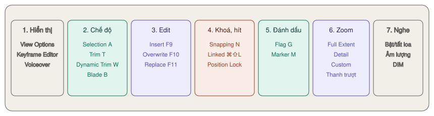

# Giao diện trang Edit — các nút hay dùng

Trang Edit có **ba vùng**: kho (Media Pool, Effects, Index) bên trái, **hai Viewer** ở trên, Timeline ở dưới. Nhiều nút hơn trang Cut — nhưng chỉ khoảng một nửa là bạn dùng hằng ngày.

Đổi kích thước: kéo **đường nối** giữa hai vùng bất kỳ. Lỡ kéo rối: **Workspace → Reset UI Layout**.

---

## Hàng nút panel — hai góc trên

Hàng nút trên cùng **bật/tắt** từng panel. Bấm lần nữa là ẩn đi.

### Góc trên trái

| Nút | Mở ra | Mức |
|---|---|---|
| **Nút chiều cao** (icon nhỏ sát mép trái) | Cho Media Pool/Effects/Index **cao hết màn hình** (hiện được hai cái cùng lúc) hoặc **nửa trên** (timeline rộng hết bề ngang) | ★☆☆ |
| **Media Pool** | Kho clip, timeline | ★★★ |
| **Effects** | Chuyển cảnh, chữ, generator, hiệu ứng — xem [Chữ, chuyển cảnh, keyframe](chu-va-hieu-ung.md) | ★★★ |
| **Index** | Ba tab: **Edit Index**, **Tracks**, **Markers** — xem [Edit Index](timeline-nang-cao.md#edit-index--danh-sách-mọi-điểm-cắt) | ★★☆ |
| **Sound Library** | Thư viện hiệu ứng âm thanh đã đăng ký | ★☆☆ |
| **Keyframes** | Bảng **Keyframe và Curve Editor** | ★★☆ |

### Góc trên phải

| Nút | Mở ra | Mức |
|---|---|---|
| **Quick Export** | Xuất nhanh không qua Deliver — xem [Quick Export](../cut/kiem-tra-va-xuat.md#quick-export) | ★★☆ |
| **Mixer** | Bảng trộn âm từng track. Menu ⋯ của nó đổi sang **Meters** (chỉ xem đồng hồ) | ★★☆ |
| **Metadata** | Thông tin clip đang chọn: tên file, codec, độ phân giải… | ★☆☆ |
| **Inspector** | Thông số clip đang chọn — xem [Inspector](inspector.md) | ★★★ |

Hay bật nhất: **Media Pool**, **Effects**, **Inspector**.

> **Màn hình nhỏ:** mở Inspector làm hai Viewer dồn sang trái, có khi Viewer Source bị ẩn. Tắt Effects và Index khi không dùng để timeline rộng hết màn hình.

**Phím chuyển focus nhanh** (bấm xong thì phím tắt chung tác động vào panel đó):

| Phím | Panel |
|---|---|
| `⌘1` / `⌘2` | Danh sách bin / Clip trong bin |
| `⌘3` | Viewer Source |
| `⌘4` | Timeline |
| `⌘5` | Viewer Timeline |
| `⌘6` | Effects |
| `⌘7` | Edit Index |
| `⌘9` | Inspector |
| `Q` | Đảo qua lại Viewer Source và Viewer Timeline |

---

## Hai Viewer

| Viewer | Hiện gì | Mở bằng |
|---|---|---|
| **Source** (trái) | Clip nguồn bạn đang chọn đoạn | Bấm đúp clip trong Media Pool, hoặc chọn clip rồi `Return` |
| **Timeline** (phải) | Bản dựng tại vị trí con trỏ | Luôn hiện |

Đặt `I` `O` ở **Source**, rồi bấm `F9`/`F10` để đưa xuống timeline. Chi tiết ở [Đưa clip xuống](dung-va-cat.md#đưa-clip-xuống-timeline).

Viewer đang được chọn có **tên màu cam** ở thanh trên. Bấm `Q` để đổi qua lại.

Muốn một Viewer to cho dễ nhìn: menu **Workspace → Single Viewer Mode**. Viewer duy nhất sẽ tự hiện clip nguồn hoặc timeline tuỳ bạn đang bấm vào đâu.

> **Live Media Preview** (bật sẵn): rê chuột trên thumbnail trong Media Pool là Viewer Source hiện theo. Tắt nó trong menu ⋯ của Viewer Source nếu thấy rối mắt — khi đó phải bấm đúp clip mới mở.

### Thanh trên mỗi Viewer — từ trái sang phải

| Nút | Làm gì | Mức |
|---|---|---|
| **Menu zoom** (`Fit`, 50%, 100%…) | Phóng hình trong Viewer. Lăn chuột cũng được | ★☆☆ |
| **Ô thời lượng** | Source: độ dài clip, hoặc đoạn `I`→`O`. Timeline: độ dài cả timeline | ★★☆ |
| **Tên clip / tên timeline** | Bấm vào là menu xổ: Source → **10 clip mở gần nhất**; Timeline → **đổi sang timeline khác** | ★★★ |
| **Ô timecode** (góc phải) | Vị trí con trỏ. Chuột phải để đổi sang số khung | ★☆☆ |
| **Menu ⋯** | Tuỳ chọn Viewer — xem bảng dưới | ★☆☆ |

**Riêng Viewer Timeline:**

| Nút | Làm gì | Mức |
|---|---|---|
| **Bypass Color Grades and Fusion Effects** | Tắt tạm chỉnh màu và Fusion. Máy yếu, phát giật thì bấm. Mũi tên bên cạnh chọn tắt riêng màu hay riêng Fusion | ★★☆ |
| **Safe Area** (góc trên phải) | Hiện khung an toàn — kiểm tra chữ có sát mép không | ★☆☆ |

**Menu ⋯ — những mục đáng biết:**

| Mục | Làm gì |
|---|---|
| **Gang Viewers** | Con trỏ hai Viewer chạy cùng nhau — khớp một khoảnh khắc nguồn với nhịp trên timeline |
| **Show Timecode Toolbar** | Thanh hiện timecode `I`, `O` và độ dài |
| **Show Zoomed / Full Clip Audio Waveform** (Source) | Dạng sóng tiếng đè lên đáy hình — dễ tìm chỗ bắt đầu câu nói |
| **Show All Video Frames** | Máy yếu: bật thì ưu tiên đủ khung hình (tiếng bị méo), tắt thì ưu tiên tiếng (bỏ khung) |
| **Previous / Next Clip**, **Previous / Next Timeline** | Nhảy clip hoặc timeline kế tiếp |

### Thanh dưới đáy Viewer — từ trái sang phải

| Nút | Ở đâu | Làm gì | Mức |
|---|---|---|---|
| **Source Viewer Mode** | Source | Đổi Viewer sang **Source**, **Audio Track** (chỉ xem dạng sóng), **Multicam**, **Annotations** (vẽ ghi chú lên hình) | ★☆☆ |
| **Video / Audio insert** | Source | Chọn lấy **cả hình và tiếng**, **chỉ hình** hay **chỉ tiếng** khi edit xuống | ★★☆ |
| **Transform Mode** | Timeline | Bật khung kéo trên hình: **Transform**, **Crop**, **Dynamic Zoom**, **OpenFX Overlay**, **Fusion Overlay**, **Annotations**. Smart Reframe trong danh sách là `Studio` | ★★★ |
| **Jog** | Cả hai | Kéo trái phải để dò từng khung | ★☆☆ |
| **Về đầu · Lùi · Dừng · Phát · Về cuối** | Cả hai | Nút phát. Phím `J` `K` `L`, `Space` | ★★★ |
| **Loop** | Cả hai | Phát lặp (`⌘/`) | ★☆☆ |
| **Match Frame** | Cả hai | Ở Timeline: mở **clip gốc** của clip dưới con trỏ vào Viewer Source, đúng khung đó. Ở Source: nhảy con trỏ timeline tới chỗ khung nguồn đang hiện | ★★☆ |
| **In / Out** | Cả hai | Đặt điểm vào/ra (`I` / `O`) | ★★★ |

**Mẹo xem lướt:** giữ phím `C` rồi rê chuột trên Viewer là tua theo chuột.

**Kéo clip lên Viewer Timeline** → hiện **lớp phủ bảy ô**: Insert, Overwrite, Replace, Fit to Fill, Place On Top, Ripple Overwrite, Append at End. Thả vào ô nào là edit kiểu đó. Thả vào vùng trống to bên trái = Overwrite.

> **Xem toàn màn hình:** chọn Viewer rồi **Workspace → Viewer Mode → Cinema Viewer** (`P`). Bấm `P` lần nữa để thoát.

---

## Thanh công cụ trên timeline

Từ trái sang phải.

### Nhóm 1 — hiển thị

| Nút | Làm gì | Mức |
|---|---|---|
| **Timeline View Options** | Đổi cách timeline trông — xem [mục riêng](#timeline-view-options--đổi-cách-timeline-hiện) | ★★☆ |
| **Keyframe Editor** | Hiện keyframe ngay dưới clip trên timeline | ★★☆ |
| **Voiceover** | Thu giọng thẳng vào timeline — cách dùng giống [Voiceover trang Cut](../cut/tools.md#voiceover--thu-giọng-thẳng-vào-timeline) | ★☆☆ |

### Nhóm 2 — bốn chế độ chuột

Mỗi lúc chỉ một chế độ. Nút đang bật sáng màu.

#### Selection Mode — `A`

`★★★ Hằng ngày`

**Là gì:** con trỏ mũi tên, chế độ mặc định.

**Làm được:** chọn, kéo clip đi chỗ khác, kéo mép để ngắn/dài clip, kéo điểm nối (roll).

**Quy tắc:** kéo mép clip ngắn lại → **để lại khoảng trống**. Kéo dài ra → **đè lên** clip bên cạnh. Phần sau không dồn theo.

**Dùng khi:** sắp xếp clip, đặt B-roll, chữ, nhạc lên các track trên.

#### Trim Edit Mode — `T`

`★★★ Hằng ngày`

**Là gì:** chế độ sửa độ dài **mà phần sau tự dồn theo** (ripple).

**Làm được:** ripple, roll, **slip**, **slide** — tuỳ bạn bấm vào đâu trên clip. Chi tiết ở [Trim](dung-va-cat.md#trim--sửa-độ-dài).

**Khác Selection ở chỗ:** quét chuột chọn vùng thì chọn **điểm nối** chứ không chọn clip.

> Đang ở chế độ này, **giữ** `A` để tạm dùng Selection. Nhả phím là quay về Trim. Ngược lại cũng vậy.

#### Dynamic Trim Mode — `W`

`★☆☆ Tình huống cụ thể`

**Là gì:** trim **trong lúc phát**. Chọn điểm nối, bật `W`, rồi dùng `J` `K` `L` — điểm nối di chuyển theo nhịp phát.

**Dấu hiệu đang bật:** nút trên thanh công cụ và con trỏ timeline chuyển **vàng**.

**Dùng khi:** muốn cảm nhận nhịp cắt bằng tai và mắt — cắt theo nhạc, theo hơi thở của câu thoại.

Tắt bằng `W` lần nữa. Chi tiết: [Trim khi đang phát](dung-va-cat.md#trim-khi-đang-phát--dynamic-trim).

#### Blade Edit Mode — `B`

`★★☆ Thường dùng`

**Là gì:** con trỏ hình **lưỡi dao**. Bấm lên clip ở đâu là cắt ở đó.

**Dùng khi:** cần cắt nhiều chỗ liên tiếp. Cắt một chỗ thì nhanh hơn là đặt con trỏ rồi `⌘\` mà không phải đổi chế độ.

> Cắt xong nhớ bấm `A` để về Selection — quên là bấm nhầm thêm một vết cắt.

### Nhóm 3 — ba nút edit

| Nút | Phím | Làm gì | Mức |
|---|---|---|---|
| **Insert Clip** | `F9` | Chèn clip đang mở ở Viewer Source vào, **đẩy** phần sau | ★★★ |
| **Overwrite Clip** | `F10` | **Ghi đè** lên chỗ đang có | ★★★ |
| **Replace Clip** | `F11` | **Thay** clip dưới con trỏ, giữ nguyên độ dài | ★★☆ |

Còn bốn kiểu edit nữa không có nút: Fit to Fill, Place On Top, Ripple Overwrite, Append. Xem đủ cả bảy ở [Đưa clip xuống](dung-va-cat.md#đưa-clip-xuống-timeline).

### Nhóm 4 — khoá và hít

#### Snapping — `N`

`★★★ Hằng ngày`

**Là gì:** nam châm. Mép clip, marker và con trỏ **hít vào nhau** khi kéo tới gần.

**Dùng khi:** bật gần như luôn luôn — nối clip sát nhau không hở khung nào.

**Tắt tạm:** đang kéo clip mà bấm `N` là tắt nam châm cho lần kéo đó. Thả chuột xong nó tự trở về như cũ. Tiện khi cần đặt clip lệch marker một hai khung.

#### Linked Selection — `⌘⇧L`

`★★☆ Thường dùng`

**Là gì:** bật thì bấm phần hình là **chọn luôn phần tiếng** đi kèm. Tắt thì chọn riêng.

**Dùng khi:** tắt để kéo lệch tiếng so với hình, xoá riêng tiếng hiện trường.

> **Không cần tắt hẳn:** giữ `⌥` khi bấm clip là tạm chọn riêng hình hoặc riêng tiếng.

#### Position Lock

`★☆☆ Tình huống cụ thể`

**Là gì:** khoá vị trí mọi clip. Không kéo dịch được, không có thao tác nào làm dồn timeline.

**Vẫn làm được:** Replace, slip, roll, thêm hiệu ứng, chỉnh Inspector.

**Dấu hiệu:** icon khoá ở mọi đầu track chuyển **đỏ**.

**Dùng khi:** đã chốt bản dựng, chỉ còn sửa màu, chữ — sợ lỡ tay làm lệch tiếng với hình.

> Khoá vị trí cho **một track**: giữ `⌘` rồi bấm icon khoá ở đầu track đó.

### Nhóm 5 — đánh dấu

| Nút | Phím | Làm gì | Mức |
|---|---|---|---|
| **Flag** + mũi tên màu | `G` | Cắm cờ cho **cả clip**. Mọi clip dùng chung file gốc đều được cắm theo | ★☆☆ |
| **Marker** + mũi tên màu | `M` | Đánh dấu **một khung**. Không chọn clip nào thì marker nằm trên thước thời gian | ★★☆ |

Mũi tên bên cạnh mỗi nút: chọn màu, hoặc xoá hết cờ/marker của clip đang chọn. Chi tiết ở [Marker](dung-va-cat.md#marker) và [Flag, màu clip](timeline-nang-cao.md#flag-màu-clip-màu-track).

### Nhóm 6 — zoom

| Nút | Phím | Làm gì | Mức |
|---|---|---|---|
| **Full Extent Zoom** | `⇧Z` | Thu cả timeline vừa khung. Bấm `⇧Z` lần nữa là **quay lại mức zoom cũ** | ★★★ |
| **Detail Zoom** | — | Phóng sát vào con trỏ, tới mức từng khung | ★★☆ |
| **Custom Zoom** | — | Dùng mức zoom của thanh trượt bên cạnh | ★☆☆ |
| **Thanh trượt zoom** | `⌘=` `⌘−` | Phóng to, thu nhỏ quanh con trỏ | ★★★ |

> **Cách đi lại nhanh nhất trên timeline dài:** `⇧Z` xem toàn cảnh → bấm chỗ cần tới → `⇧Z` phóng lại đúng mức cũ ở chỗ mới.

**Lăn chuột trên timeline:**

| Giữ phím | Lăn chuột làm gì |
|---|---|
| — | Cuộn lên xuống giữa các track |
| `⌥` | Zoom vào/ra |
| `⌘` | Cuộn trái phải theo thời gian |
| `⇧` | Đổi chiều cao mọi track hình (hoặc tiếng, tuỳ chuột đang ở vùng nào) |

**Phím `C` trên timeline:** con trỏ nhảy tới đúng chỗ chuột đang đứng — không cần với lên thước thời gian.

### Nhóm 7 — nghe (ngoài cùng bên phải)

| Nút | Làm gì |
|---|---|
| **Loa** | Bật/tắt tiếng phát |
| **Thanh âm lượng** | Âm lượng **bạn nghe**. Không đổi âm lượng file xuất |
| **DIM** | Hạ nhỏ tạm thời — để nói chuyện mà không phải kéo thanh âm lượng |

---

## Track

### Nút ở đầu mỗi track — từ trái sang phải

| Nút | Có ở | Làm gì | Mức |
|---|---|---|---|
| **Dải màu** sát mép trái | Mọi track | Màu track. Chuột phải → **Change Track Color** | ★☆☆ |
| **Ô V1 / A1 đỏ** — Destination | Mọi track | Chọn **track đích**: clip edit xuống sẽ vào track có ô đỏ sáng | ★★★ |
| **Ô xanh** cạnh ô đỏ — Source | Chỉ khi có clip ở Viewer Source | Track của clip nguồn. Kéo ô xanh sang track khác để đổi chỗ đích | ★★☆ |
| **Khoá** | Mọi track | Không sửa, dời được clip trên track. Track hiện lưới xám | ★★☆ |
| **Sync Lock** (icon `<|>`) | Mọi track | Track có bật sẽ **dồn theo** khi bạn ripple ở track khác. Tắt = track đứng yên | ★★☆ |
| **Tắt track** (icon cuộn phim) | Track hình | Ẩn cả track: không hiện ở Viewer, không có ở trang Color, **không xuất** | ★★☆ |
| **S** — Solo | Track tiếng | Chỉ nghe track này. Bật nhiều Solo để nghe vài track | ★★☆ |
| **M** — Mute | Track tiếng | Tắt tiếng track | ★★★ |
| **2.0**, **1.0**, **5.1** | Track tiếng | Kiểu kênh: stereo, mono, 5.1 | ★☆☆ |

Bên dưới hàng nút là **tên track** (bấm để đổi tên, ví dụ `Lời`, `Nhạc`, `SFX`) và **số clip** trên track.

### Destination — chọn track đích

`★★★ Hằng ngày`

**Là gì:** ô đỏ ở đầu track. Mọi lệnh `F9`, `F10`, `F11`, Fit to Fill, Ripple Overwrite đều đưa clip vào **track có ô đỏ sáng**.

**Cách đổi:**

| Muốn | Cách |
|---|---|
| Đổi track hình đích | Bấm ô đỏ của track đó, hoặc `⌥1`…`⌥8` |
| Đổi track tiếng đích | `⌘⌥1`…`⌘⌥8` |
| Dời lên/xuống một track | `⌘⇧↑` `⌘⇧↓` (hình), `⌘⌥↑` `⌘⌥↓` (tiếng) |
| Chỉ lấy hình, bỏ tiếng | Bấm ô đỏ của track tiếng cho **tắt** (không sáng). Bấm lần nữa để bật |
| Lỡ chỉnh rối | **Timeline → Source Track Selector → Reset Track Selectors** |

**Ví dụ:** muốn đặt B-roll lên V2 mà không lấy tiếng gió hiện trường — bấm ô **V2**, tắt ô **A1**, rồi `F10`.

### Sync Lock — track nào được dồn theo

`★★☆ Thường dùng`

**Là gì:** icon `<|>` ở đầu track. Khi bạn ripple delete, insert, trim ở chế độ `T` — mọi track có **Sync Lock bật** sẽ dồn theo để giữ khớp hình tiếng.

**Dùng khi:** muốn nhạc nền **đứng yên** trong lúc bạn cắt bớt lời nói ở track khác → tắt Sync Lock track nhạc.

> Manual gọi nút này ở chỗ khác là **Auto Select**. Phím: `⌥F1`…`⌥F8` (track hình), `⌘⌥F1`…`⌘⌥F8` (track tiếng). `⇧`-click một nút để bật/tắt cả loạt.

**Cảnh báo:** tắt Sync Lock rồi ripple là cách nhanh nhất làm **lệch tiếng với hình** ở phần sau. Bật lại ngay khi xong.

### Khoá track

| Cách | Làm gì |
|---|---|
| Bấm icon khoá | Khoá một track |
| `⇧`-click icon khoá | Khoá/mở **mọi** track |
| `⌥⇧1`…`⌥⇧8` | Khoá track hình V1–V8 |
| `⌥⇧F1`…`⌥⇧F8` | Khoá track tiếng A1–A8 |

> **Bấm rồi kéo dọc** qua nhiều đầu track: bật/tắt cùng một nút cho cả loạt — ví dụ kéo icon khoá từ A1 xuống A3 là khoá cả ba track tiếng.

### Dùng track thế nào cho gọn

| Muốn | Bấm |
|---|---|
| Không lỡ tay kéo lệch nhạc đã khớp | Khoá track tiếng nhạc |
| Xem hình bên dưới lớp chữ | Tắt hình track chữ |
| Nghe riêng giọng nói | Solo track lời |
| Xuất bản không chữ | Tắt track chữ rồi xuất |

### Thêm, xoá, sắp xếp track

Chuột phải vào **đầu track**:

| Lệnh | Làm gì |
|---|---|
| **Add Track** | Thêm một track — track hình thêm **phía trên**, track tiếng thêm **phía dưới** track bạn bấm |
| **Add Tracks…** | Thêm nhiều track một lúc, chọn vị trí |
| **Add Subtitle Track** | Thêm track phụ đề — xem [Phụ đề](phu-de.md) |
| **Delete Track** | Xoá track (**xoá luôn clip trên đó**) |
| **Delete Empty Tracks** | Xoá mọi track trống |
| **Move Track Up / Down** | Đổi thứ tự track, clip đi theo |
| **Change Track Color** | Đổi màu |

**Thêm track nhanh hơn:** kéo clip thả vào **vùng xám trên track hình cao nhất** (hoặc dưới track tiếng thấp nhất) → track mới tự tạo.

**Nới track:** kéo **mép trên** đầu track hình (mép dưới với track tiếng). Kéo **đường ngang giữa** vùng hình và vùng tiếng để chia lại chỗ.

---

## Timeline View Options — đổi cách timeline hiện

`★★☆ Thường dùng`

Bấm **nút đầu tiên** bên trái thanh công cụ timeline.

| Nhóm | Lựa chọn | Dùng khi |
|---|---|---|
| **Timeline View Options** | **Stacked Timelines** — mở nhiều timeline dạng tab, xếp chồng | So hai bản dựng, chép clip từ timeline này sang timeline kia |
| | **Subtitle Tracks** — hiện/ẩn vùng track phụ đề | Ẩn cho gọn. Phụ đề vẫn hiện ở Viewer |
| | **Audio Waveforms** — hiện/ẩn dạng sóng | Tắt khi máy chậm. Track tiếng thu nhỏ lại |
| **Thumbnail View Options** | **Filmstrip** — dải khung hình dọc clip | Tìm cảnh bằng mắt |
| | **Thumbnail** — ảnh đầu và cuối clip | Mặc định, gọn |
| | **None** — chỉ thanh màu | Timeline dài, nhiều clip |
| **Viewer Background** | Caro, Đen, Xám, Đỏ cảnh báo | Thấy rõ chỗ nào là hình trong suốt |
| **Fixed Playhead** | Con trỏ đứng yên, timeline trượt bên dưới như trang Cut | Thích kiểu trang Cut |
| **Audio View Options** | Dạng sóng giữa/đáy, đầy track, có viền | Dễ đọc dạng sóng khi cắt lời |
| **Thanh trượt** | Chiều cao mọi track hình / mọi track tiếng | Track tiếng cao lên để thấy đường volume |

**Mở nhiều timeline dạng tab:** bật Stacked Timelines → thanh tab hiện trên timeline. Mở timeline khác từ Media Pool là mở thành tab mới. Chuột phải tab có **Duplicate Timeline**, **Rename**, **Find Timeline in Media Pool**.

---

## Các tuỳ chọn ẩn trong menu

| Menu | Làm gì | Mức |
|---|---|---|
| **Timeline → Audio Scrubbing** (`⇧S`) | Tắt tiếng rè rè khi kéo con trỏ | ★★☆ |
| **Timeline → Selection Follows Playhead** | Clip dưới con trỏ tự được chọn khi di chuyển | ★☆☆ |
| **View → Show Preview Marks** | Hiện điểm vào/ra mà Resolve tự tính khi [dựng ba điểm](dung-va-cat.md#dựng-ba-điểm--three-point-editing) | ★☆☆ |
| **View → Zoom Around Mouse Pointer** | `⌥` + lăn chuột zoom quanh chuột thay vì quanh con trỏ | ★☆☆ |
| **Workspace → Video Scopes** (`⌘⇧W`) | Mở biểu đồ màu ngay ở trang Edit | ★☆☆ |
| **Edit → History → Open History Window** | Xem lịch sử, quay về nhiều bước một lúc | ★☆☆ |

**Hoàn tác:** `⌘Z` / `⌘⇧Z`. Trang Media, Edit, Fairlight dùng **chung một chuỗi hoàn tác**. Đóng project là mất lịch sử hoàn tác.
