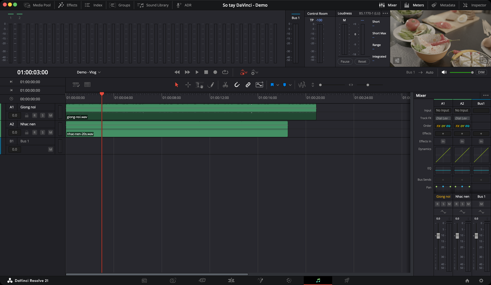

# Fairlight — âm thanh

> **Một câu:** trang Fairlight là nơi mix âm thanh. Khán giả bỏ qua được hình xấu, nhưng tiếng tệ là họ tắt video.

## Khi nào sang Fairlight?

Fairlight dùng **chung timeline** với Cut và Edit. Chỉnh ở đây thì quay về Edit vẫn thấy, và ngược lại.

Phần lớn việc cân tiếng cơ bản làm ngay ở [trang Edit](../edit/dung-va-cat.md#tiếng-ngay-trên-timeline) được. Sang Fairlight khi cần nhiều hơn thế:

| Làm ở **Edit** khi | Sang **Fairlight** khi |
|---|---|
| Chỉ cần kéo to nhỏ từng clip, thêm fade | Cần **làm sạch giọng**: ồn nền, tiếng "s" chói, ù điện |
| Video ngắn, một giọng, một bản nhạc | Có nhiều track lời, nhạc, tiếng động cần cân với nhau |
| Chưa quan tâm độ to tổng | Cần đạt **độ to chuẩn** cho YouTube trước khi xuất |
| | Cần **thu giọng** có kiểm soát: chọn input, nghe lại, nhiều take |

Điều khác lớn nhất so với Edit: ở Fairlight mỗi track có **một cột trong Mixer**. Cột đó có sẵn EQ, nén, hiệu ứng và fader. Mọi chỉnh ở cột này áp cho **cả track**, không phải một clip.

> **Clip hay track?** Chỉnh **clip** khi chỉ một đoạn có vấn đề (một câu nói nhỏ, một chỗ có tiếng còi). Chỉnh **track** khi cả track cần cùng một xử lý (cả giọng cần EQ, cả nhạc cần nhỏ khi có lời).

## Tính năng hay dùng nhất

| Mức | Tính năng | Dùng để |
|---|---|---|
| ★★★ | [Normalize Audio Levels](mixer-va-track-fx.md#normalize--cân-đều-các-clip) | Các clip to nhỏ đều nhau. Làm **đầu tiên** |
| ★★★ | [Dialogue Leveler](mixer-va-track-fx.md#dialogue-leveler--giọng-đều-không-cần-chỉnh-tay) | Giọng lúc to lúc nhỏ thành đều |
| ★★★ | [Ducker](mixer-va-track-fx.md#ducker--nhạc-tự-nhỏ-khi-có-lời) | Nhạc nền tự nhỏ khi có người nói |
| ★★★ | [Fader và Mixer](mixer-va-track-fx.md#cột-kênh-trong-mixer) | Cân to nhỏ giữa các track |
| ★★★ | [Loudness meter](loudness-va-xuat.md#loudness-meter--đo-độ-to-cảm-nhận) | Biết bản mix đã đủ to cho YouTube chưa |
| ★★★ | [Clip gain và fade](thu-am-va-chinh-clip.md#clip-gain--to-nhỏ-từng-clip) | Sửa to nhỏ từng đoạn, làm mềm đầu cuối |
| ★★☆ | [Noise Reduction](lam-sach-giong.md#noise-reduction--giảm-ồn-nền) | Giảm tiếng quạt, điều hoà, tiếng xì |
| ★★☆ | [EQ cho giọng](lam-sach-giong.md#eq--3-thao-tác-cho-giọng-nói) | Giọng rõ hơn, bớt ù, bớt đục |
| ★★☆ | [De-Esser](lam-sach-giong.md#de-esser--bớt-tiếng-s-chói) | Bớt tiếng "s", "x" chói tai |
| ★★☆ | [Compressor](lam-sach-giong.md#dynamics--nén-chặn-cổng) | Giọng chắc, đều hơn |
| ★★☆ | [Limiter trên Bus](loudness-va-xuat.md#limiter-trên-bus--chặn-trần) | Chặn trần, không bao giờ bị rè |
| ★★☆ | [Thu giọng đọc](thu-am-va-chinh-clip.md#thu-giọng-đọc-trên-fairlight) | Thu voiceover thẳng vào timeline |
| ★☆☆ | [De-Hummer](lam-sach-giong.md#de-hummer--bỏ-tiếng-ù-điện) | Bỏ tiếng ù điện 50/60 Hz |
| ★☆☆ | [Dialogue Processor](lam-sach-giong.md#dialogue-processor--gói-xử-lý-giọng) | Sáu bước xử lý giọng trong một hiệu ứng |
| ★☆☆ | [Automation](thu-am-va-chinh-clip.md#automation--to-nhỏ-theo-thời-gian-cho-cả-track) | To nhỏ theo thời gian cho cả track |
| ★☆☆ | [Bus](mixer-va-track-fx.md#bus--track-tổng) | Gom nhiều track để xử lý một lần |

★★★ dùng ở hầu như mọi video · ★★☆ dùng thường xuyên · ★☆☆ dùng trong tình huống cụ thể

> `Studio`: **Voice Isolation** (tách giọng bằng AI), **Dialogue Separator**, **Music Remixer**, **Remove Silence**, **Voice Convert**. Bản free vẫn có đủ Dialogue Leveler, Ducker, Noise Reduction.

## Một lượt cân tiếng vlog

Ví dụ thực tế: vlog 5 phút, lời nói ở track A1, nhạc nền ở track A2. Đã dựng xong ở Edit.

1. **Đặt tên track:** bấm vào tên track ở đầu track, gõ "Giọng" cho A1, "Nhạc" cho A2. Tên này hiện cả trong Mixer.
2. **Cân đều lời:** chọn hết clip ở A1 → chuột phải → **Normalize Audio Levels** → **Set Level: Relative**. Xem [Normalize](mixer-va-track-fx.md#normalize--cân-đều-các-clip).
3. **Làm giọng đều:** bấm nút **Mixer** góc trên phải. Ở cột A1, mục **Track FX**, bật **Dialogue Leveler**, tick **Lift Soft Dialogue**.
4. **Làm sạch nếu cần:** nghe thấy tiếng quạt → kéo **Noise Reduction** từ panel **Effects** thả lên đầu track A1. Xem [Làm sạch giọng](lam-sach-giong.md).
5. **EQ giọng:** bấm đúp ô **EQ** ở cột A1. Cắt dưới 80 Hz, nâng nhẹ quanh 3–5 kHz.
6. **Nhạc tự nhỏ:** ở cột A2, bật **Ducker**, **Source** chọn track Giọng. Để **Duck Amount** khoảng 3–5 dB.
7. **Cân hai fader:** phát thử, kéo fader A2 xuống tới khi nhạc nằm dưới lời. Đừng đụng fader A1 nhiều.
8. **Chặn trần:** ở cột **Bus 1** (cột cuối Mixer), bấm **+** ở mục **Effects** → chọn **Limiter**, đặt **Ceiling** −1 dB.
9. **Đo độ to:** bấm **Meters**, đặt Loudness meter về chuẩn **YouTube**, phát cả video. Số **Integrated** nên quanh −14 LUFS. Xem [Loudness và xuất](loudness-va-xuat.md).
10. **Xuất:** sang [trang Deliver](../deliver/cai-dat-xuat.md#tab-audio).

## Các trang con

* [Giao diện — từng nút nằm ở đâu](giao-dien.md)
* [Mixer, Track FX, Normalize, Ducker, Bus](mixer-va-track-fx.md)
* [Làm sạch giọng — Fairlight FX cho lời nói](lam-sach-giong.md)
* [Thu âm, clip gain, fade, automation](thu-am-va-chinh-clip.md)
* [Loudness và kiểm tra trước khi xuất](loudness-va-xuat.md)
