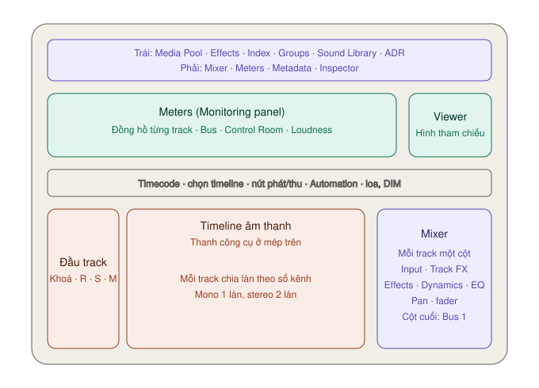

# Giao diện trang Fairlight — từng nút nằm ở đâu

Mặc định trang Fairlight có **ba vùng lớn**: **Meters** (dải đồng hồ trên cùng, kèm Viewer nhỏ), **Timeline** (giữa) và **Mixer** (bên phải timeline). Timeline không đóng được. Các vùng khác bật tắt bằng thanh toolbar trên cùng.

Đổi chiều cao vùng Meters: kéo **mép dưới** của nó.

---

## Thanh toolbar trên cùng

### Bên trái — các bảng mở thêm

| Nút | Mở ra | Mức |
|---|---|---|
| **Media Pool** | Kho clip, để kéo clip tiếng xuống timeline | ★★☆ |
| **Effects** | Kho hiệu ứng âm thanh: **Fairlight FX** có sẵn, cộng plugin AU/VST nếu máy có cài | ★★★ |
| **Index** | Ba tab **Edit Index** (danh sách clip), **Tracks** (quản lý track), **Markers** (danh sách marker) | ★☆☆ |
| **Groups** | Danh sách nhóm track, để chỉnh nhiều track cùng lúc | ★☆☆ |
| **Sound Library** | Tìm, nghe thử và kéo tiếng động từ thư viện âm thanh vào timeline | ★☆☆ |
| **ADR** | Bảng thu thoại lại theo danh sách câu: List, Record, Setup | ★☆☆ |

**Dùng khi:** muốn làm sạch giọng → bấm **Effects**, kéo **Noise Reduction** thả lên clip hoặc đầu track. Xem [Làm sạch giọng](lam-sach-giong.md).

> **Sound Library:** từ bảng này tải được bộ **Fairlight sound library** miễn phí, hơn 500 tiếng động (bước chân, va chạm, tiếng môi trường).

### Bên phải

| Nút | Làm gì | Mức |
|---|---|---|
| **Mixer** | Bảng trộn: mỗi track một cột, nằm bên phải timeline | ★★★ |
| **Meters** | Dải đồng hồ và Viewer nhỏ trên cùng | ★★★ |
| **Metadata** | Thông tin của clip | ★☆☆ |
| **Inspector** | Thông số clip hoặc track đang chọn | ★★★ |

---

## Meters — dải đồng hồ trên cùng

Từ trái sang phải:

| Nhóm | Hiện gì |
|---|---|
| **Đồng hồ từng track** | Mỗi track một cụm, đánh số theo track. Mono một cột, stereo hai cột |
| **Bus** | Tổng của các track đổ vào bus đó. Mặc định có **Bus 1** |
| **Control Room** | Mức ra loa của bus đang nghe, đo theo dBFS. Số **TP** trên đầu là đỉnh true peak |
| **Loudness** | Độ to cảm nhận, đo theo LUFS: **Short**, **Short Max**, **Range**, **Integrated** |
| **Viewer** | Hình tại vị trí con trỏ, để mix khớp hình |

Màu trên đồng hồ: **xanh lá** thấp đến vừa, **vàng** khá cao, **đỏ** rất cao.

Chuột phải vào vùng đồng hồ để chọn hiển thị **một hàng hay hai hàng**, **cột hẹp hay rộng** — tiện khi có nhiều track.

Cách đọc Loudness meter: xem [Loudness và xuất](loudness-va-xuat.md#loudness-meter--đo-độ-to-cảm-nhận).

### Viewer

- Kéo **mép trái hoặc mép dưới** để đổi kích thước.
- Nút **góc dưới phải** tách Viewer ra cửa sổ nổi.
- Xem toàn màn hình: `⌘F` (Cinema Viewer). Tiện khi soát tiếng khớp môi.
- Tắt hẳn Viewer: **Workspace → Fairlight Viewer**.

---

## Thanh phát — ngay trên timeline

| Thành phần | Làm gì | Mức |
|---|---|---|
| **Timecode lớn** (trái) | Vị trí con trỏ | — |
| **Range In / Out** | Điểm đầu, điểm cuối và độ dài vùng chọn | ★☆☆ |
| **Menu chọn timeline** | Đổi sang timeline khác trong project | ★★☆ |
| **Fast Reverse · Fast Forward · Play · Stop** | Tua lùi, tua tới, phát, dừng (`Space`) | ★★★ |
| **Record** | Thu âm vào track đã bật **R** — xem [Thu giọng](thu-am-va-chinh-clip.md#thu-giọng-đọc-trên-fairlight) | ★★☆ |
| **Loop** | Phát lặp | ★☆☆ |
| **Toggle Automation** | Bật ghi và phát automation | ★☆☆ |
| **Automation toolbar** | Mở thanh công cụ ghi automation | ★☆☆ |
| **Bus 1 → Auto** | Đang nghe bus nào, ra bộ loa nào. **Auto** nghĩa là tự ra loa hoặc tai nghe của máy | ★☆☆ |
| **Loa** (phải) | Tắt/bật tiếng ra. Chuyển **đỏ** khi đang tắt | ★★☆ |
| **Thanh trượt** | Âm lượng nghe — **chỉ đổi mức ra loa, không đổi bản mix** | ★★☆ |
| **DIM** | Hạ nhỏ tạm thời để nói chuyện. Thanh trượt chuyển **vàng** khi bật | ★☆☆ |

> **Nghe nhỏ quá thì vặn đâu?** Vặn thanh trượt cạnh nút loa, hoặc âm lượng máy. **Đừng** kéo fader track lên chỉ vì tai nghe nhỏ — làm vậy là đổi bản mix.

---

## Thanh công cụ timeline

Nằm ngay dưới thanh phát. Từ trái sang phải:

| Nút | Làm gì | Mức |
|---|---|---|
| **Timeline View Options** | Cách hiển thị track, sóng âm, cách cuộn | ★★☆ |
| **Grid View Options** | Lưới tham chiếu, bắt theo timecode hoặc nhịp nhạc | ★☆☆ |
| **Pointer Mode** | Chế độ mặc định: chọn, kéo, kéo mép clip | ★★★ |
| **Range Mode** | Chọn một **khoảng** trên một hay nhiều clip để sửa riêng khoảng đó | ★★☆ |
| **Focus Mode** | Con trỏ đổi tuỳ vị trí: nửa trên sóng âm là chọn khoảng, nửa dưới là kéo clip, sát đường gain là chỉnh gain | ★★☆ |
| **Pencil** | Vẽ automation. Chỉ hiện khi bật automation | ★☆☆ |
| **Razor** | Cắt mọi clip trên track chưa khoá tại con trỏ | ★★★ |
| **Snapping** | Nam châm: điểm đầu cuối clip, marker, con trỏ hít vào nhau | ★★★ |
| **Linked Selection** | Chọn hình thì chọn luôn tiếng đi kèm | ★★☆ |
| **Automation Follows Edit** | Automation đi theo clip khi cắt dán. Chỉ hiện khi bật automation | ★☆☆ |
| **Flag** | Gắn cờ màu cho clip | ★☆☆ |
| **Add Marker** | Đánh dấu. Có clip đang chọn thì gắn vào clip, không thì gắn lên thước thời gian | ★★☆ |
| **Transient Detection** | Dò các điểm bật âm (tiếng gõ, tiếng trống) trên track | ★☆☆ |
| **Thanh trượt dọc / ngang** | Phóng to chiều cao track / chiều ngang timeline | ★★★ |

**Smart Zoom:** chọn một track rồi bấm `⌘⌥E` — track phóng to chiếm cả timeline. Bấm lại để trở về.

Phóng to **sóng âm** (không đổi âm lượng, chỉ để nhìn rõ): giữ `⌘⌥` rồi lăn chuột.

### Timeline View Options — mục hay dùng

| Mục | Làm gì | Mức |
|---|---|---|
| **Video Tracks** | Hiện track hình để tham chiếu khi mix | ★★☆ |
| **Full Waveforms** | Sóng âm chiếm hết chiều cao clip | ★☆☆ |
| **Waveform Borders** | Viền tối quanh sóng âm cho dễ nhìn | ★☆☆ |
| **Gain Line** | Hiện đường gain trên clip — kéo lên xuống để chỉnh to nhỏ | ★★★ |
| **Jump to Clip / Fade / Marker / Transient** | Phím `↑` `↓` nhảy theo clip, fade, marker hoặc transient | ★☆☆ |
| **Fixed Playhead** | Con trỏ đứng yên, timeline trượt bên dưới | ★☆☆ |

---

## Đầu track

Mỗi track có một đầu track bên trái. Trong [ảnh chụp trang Fairlight](../../assets/img/page-fairlight.png), A1 là "Giong noi", A2 là "Nhac nen":

| Thành phần | Làm gì | Mức |
|---|---|---|
| **Số và tên track** | Bấm vào tên để đổi tên — ví dụ "Giọng", "Nhạc", "SFX". Tên này hiện cả trong Mixer | ★★★ |
| **Loại track** | Mono, stereo, 5.1... Track stereo có hai làn | ★☆☆ |
| **Ô số dB** | Mức fader tại con trỏ. Kéo lên xuống ngay trên ô này được | ★★☆ |
| **Khoá** | Khoá track, không sửa được clip | ★★☆ |
| **R** (Arm) | Bật thu âm vào track này | ★★☆ |
| **S** (Solo) | Chỉ nghe track này | ★★★ |
| **M** (Mute) | Tắt tiếng track | ★★★ |
| **Đồng hồ nhỏ** | Mức tiếng của track khi phát | ★★☆ |

> **Cẩn thận:** **Solo** và **Mute** ảnh hưởng cả lúc **xuất file**. Quên tắt Solo là bản xuất chỉ còn đúng track đó.

Chuột phải đầu track:
- **Change Track Color** — đổi màu track, màu đi theo cả Mixer và đồng hồ.
- **Lock Track Height To** — cố định chiều cao track: Micro, Mini, Medium, Large...
- **Change Track Type To** — đổi mono sang stereo và ngược lại.

Khi bật automation, bus cũng hiện thành một hàng trên timeline (ví dụ **B1 Bus 1**), chỉ có nút **M**.

**Thêm track:** kéo clip thả vào **vùng trống dưới track cuối cùng** → tự tạo track mới đúng số kênh của clip.

---

## Mixer

Mỗi track trên timeline là **một cột** (channel strip) trong Mixer. Các cột bus nằm sau cùng — mặc định là **Bus 1**, nơi mọi track đổ vào.

Từ trên xuống, mỗi cột có: **Input · Track FX · Order · Effects · Effects In · Dynamics · EQ · Bus Sends · Pan · tên track · R S M · Automation · fader**.

Chi tiết từng mục: xem [Mixer và Track FX](mixer-va-track-fx.md#cột-kênh-trong-mixer).

Menu **ba chấm** góc trên phải Mixer:
- **Full Track Mixer / Small Track Mixer** — cột to dễ bấm, hay cột nhỏ để thấy nhiều track.
- **Show Labels** — hiện tên các mục ở mép trái Mixer. Nên bật khi mới học.
- Bật tắt từng mục trong cột, ví dụ **Track FX**, và chọn Track FX nào hiện trong **Visible Track FX**.

---

## Inspector

Bấm **Inspector** góc trên phải. Ba tab:

| Tab | Chứa |
|---|---|
| **Audio** | Volume, Pan, Dialogue Leveler, Pitch, Speed Change, EQ của clip — hoặc Track FX khi đang ở chế độ track |
| **Effects** | Các hiệu ứng đã gắn vào clip hoặc track |
| **File** | Thông tin file, metadata, cấu hình kênh tiếng |

Khi bấm đúp vào crossfade, Inspector hiện thêm tab **Transition**.

**Clip Mode và Track Mode** — hai nút trên đầu Inspector:
- Chọn clip → Inspector ở **Clip Mode**, tên clip hiện trên đầu. Chỉnh gì cũng chỉ áp cho clip đó.
- Bấm **Track Mode** → chỉnh áp cho **cả track** (giống chỉnh trong Mixer). Tên track hiện trên đầu.

> Nhìn tên trên đầu Inspector trước khi chỉnh. Là tên clip thì đang sửa clip, là tên track thì đang sửa cả track.

Chỉnh mịn một thanh trượt: giữ `⌥` hoặc `⇧` rồi kéo trong ô số.
