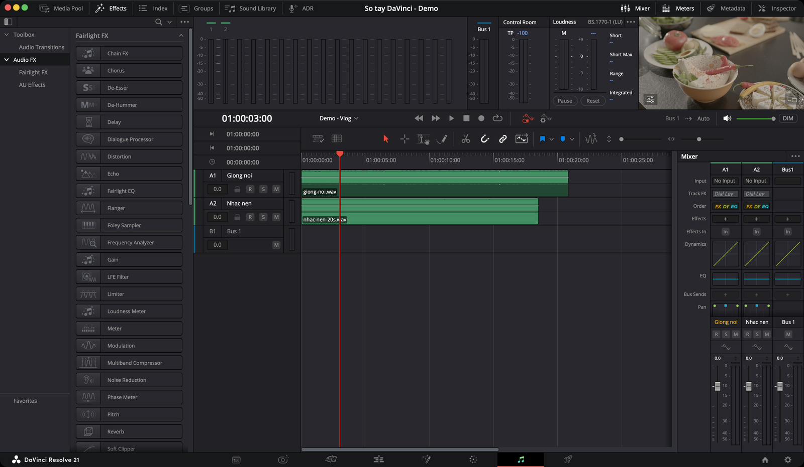

# Làm sạch giọng — Fairlight FX cho lời nói

**Fairlight FX** là bộ hiệu ứng âm thanh có sẵn trong Resolve, dùng được ở bản free, ở cả trang Edit và Fairlight.

## Gắn hiệu ứng ở đâu

Bấm **Effects** góc trên trái. Danh sách hiệu ứng nằm ở **Audio FX → Fairlight FX**, xếp theo vần. Plugin AU của máy (nếu có) nằm ở **AU Effects**. **Toolbox → Audio Transitions** là các kiểu crossfade.

Rê chuột sang mép phải tên hiệu ứng, bấm **ngôi sao** để đưa vào **Favorites**. Hiệu ứng yêu thích cũng hiện đầu danh sách khi bấm **+** trong Mixer.

| Gắn vào | Cách làm | Dùng khi |
|---|---|---|
| **Một clip** | Panel **Effects** → kéo hiệu ứng thả lên clip | Chỉ một đoạn bị ồn, bị ù |
| **Nhiều clip** | Chọn các clip → kéo hiệu ứng thả lên một clip trong số đó | Vài đoạn cùng vấn đề |
| **Cả track** | Kéo thả lên **đầu track**, hoặc bấm **+** ở mục **Effects** trong Mixer | Cả track cùng một mic, cùng một vấn đề |

Clip có hiệu ứng hiện một **huy hiệu nhỏ** bên trái tên clip.

**Chỉnh hiệu ứng:**
- Của clip: chọn clip → **Inspector → tab Effects**.
- Của track: rê chuột lên tên hiệu ứng trong Mixer → bấm nút mở bảng chỉnh.

> **Đặt Noise Reduction lên đầu chuỗi.** Manual khuyên khử ồn trước tiên, để các bước sau (nén, EQ) không làm to tiếng ồn lên trước khi nó bị lọc.

### Nút chung của mọi Fairlight FX

Trên đầu bảng chỉnh của hiệu ứng nào cũng có:

| Nút | Làm gì |
|---|---|
| **Preset** | Chọn cài đặt có sẵn, hoặc bấm **+** để lưu cài đặt của bạn |
| **A / B** | Lưu hai cách chỉnh, bấm qua lại để so cái nào nghe hay hơn |
| **Reset** | Về mặc định |
| **Bypass** | Tắt tạm hiệu ứng để nghe bản gốc |

Nhiều hiệu ứng có ô **Listen to … Only** — chỉ nghe **phần đang bị bỏ đi**. Nghe thấy cả tiếng nói trong đó là đang lọc quá tay.

## Bảng tóm tắt

| Vấn đề | Hiệu ứng | Mức |
|---|---|---|
| Tiếng quạt, điều hoà, tiếng xì đều đều | [Noise Reduction](#noise-reduction--giảm-ồn-nền) | ★★☆ |
| Giọng đục, ù, nghe không rõ chữ | [EQ](#eq--3-thao-tác-cho-giọng-nói) | ★★☆ |
| Tiếng "s", "x" chói tai | [De-Esser](#de-esser--bớt-tiếng-s-chói) | ★★☆ |
| Giọng lúc to lúc nhỏ, thiếu chắc | [Compressor](#dynamics--nén-chặn-cổng) | ★★☆ |
| Tiếng ù điện trầm, đều | [De-Hummer](#de-hummer--bỏ-tiếng-ù-điện) | ★☆☆ |
| Muốn một hiệu ứng làm nhiều việc cho giọng | [Dialogue Processor](#dialogue-processor--gói-xử-lý-giọng) | ★☆☆ |
| Muốn EQ và nén gọn trong một bảng | [Vocal Channel](#vocal-channel--eq-và-nén-gọn-cho-giọng) | ★☆☆ |
| Ồn lớn, ồn không đều (quán ăn, công trường) | **Voice Isolation** | `Studio` |

> Noise Reduction **của âm thanh** ở Fairlight dùng được ở bản free. Noise Reduction **của hình** ở trang Color mới là `Studio`.

---

## Noise Reduction — giảm ồn nền

`★★☆ Thường dùng`

**Là gì:** giảm tiếng ồn nền. Đồ thị hiện phổ âm thanh, lớp **tím** phủ lên là phần đang bị coi là ồn.

**Dùng khi:** nền có tiếng quạt, điều hoà, tiếng xì của mic — loại ồn **đều**, chạy suốt.

**Cách làm:**
1. Kéo **Noise Reduction** thả lên clip hoặc đầu track.
2. Mở bảng chỉnh, thử ba preset có sẵn: **De-Hiss** (tiếng xì), **De-Rumble** (tiếng ầm trầm), **De-Rumble and Hiss** (cả hai).
3. Tick **Listen to Noise Only**, phát thử. Nghe thấy tiếng nói lẫn trong đó là đang lọc quá tay.
4. Bỏ tick, chỉnh tiếp:

| Thanh | Làm gì |
|---|---|
| **Threshold** | Bản thu càng ồn so với giọng thì càng cần tăng |
| **Sensitivity** | Tăng là lọc mạnh hơn, nhưng dễ ăn vào giọng |
| **Dry/Wet** | Tỷ lệ bản gốc và bản đã lọc. 100% là chỉ còn bản đã lọc |
| **Level** | Bù lại mức to bị hụt sau khi lọc, từ −6 đến +18 dB |

**Mẹo:** nghe hai đồng hồ hai bên đồ thị — bên trái mức vào, bên phải mức ra. Chênh nhau nhiều là đang mất nhiều tín hiệu.

**Ví dụ:** quay trong phòng có điều hoà. Gắn Noise Reduction lên track lời, chọn **De-Hiss**, kéo **Dry/Wet** xuống khoảng 70–80% nếu giọng nghe bị "ống" — giữ lại một chút tiếng thật cho tự nhiên.

---

## EQ — 3 thao tác cho giọng nói

`★★☆ Thường dùng`

**Là gì:** tăng giảm từng dải tần. Có ba chỗ chỉnh EQ:

| Ở đâu | Áp cho | Số dải |
|---|---|---|
| **Inspector → tab Audio → Equalizer** (chọn clip) | Một clip | 4 |
| **Mục EQ trong cột Mixer** (bấm đúp) | Cả track | 6 |
| Fairlight FX **Fairlight EQ** | Clip hoặc track | 6 |

Mỗi dải có loại lọc (**Bell**, **Lo-Shelf**, **Hi-Shelf**, **Notch**; dải ngoài cùng có thêm **Hi-Pass** / **Lo-Pass**), **Frequency**, **Gain**, và **Q** (độ rộng dải — chỉ có khi chọn Bell).

**Cách làm cho giọng nói** — chỉnh ít thôi, mỗi lần 2–3 dB:

1. **Cắt dưới 80 Hz** — dải ngoài cùng bên trái, chọn **Hi-Pass**, đặt khoảng 80 Hz. Bỏ tiếng ù, gió, bàn rung.
2. **Hạ nhẹ 200–400 Hz** — một dải **Bell**, Gain âm vài dB. Bớt cảm giác đục.
3. **Nâng nhẹ 3–5 kHz** — một dải **Bell**, Gain dương vài dB. Chữ rõ hơn.

Kéo trực tiếp các **chấm đánh số** trên đồ thị cũng được.

> Nghe bằng tai nghe tốt. EQ nghe trên loa laptop thường nâng quá tay ở dải cao.

### EQ Matcher — giọng hai mic nghe giống nhau

`★☆☆ Tình huống cụ thể`

Khi một đoạn thu bằng mic khác (ví dụ thu bổ sung ở nhà), nghe "khác màu" với phần còn lại:

1. Chuột phải clip mẫu → **Clip Operations → EQ Matching → Capture EQ Profile**.
2. Chuột phải clip cần chỉnh → **Clip Operations → EQ Matching** → **Apply to Clip EQ** (chỉ clip đó) hoặc **Apply to Track EQ** (cả track).

---

## De-Esser — bớt tiếng "s" chói

`★★☆ Thường dùng`

**Là gì:** hạ riêng tiếng xì của âm "s", "x", "ch".

**Dùng khi:** giọng nghe chói, rít ở các chữ có "s" — hay gặp khi mic sát miệng hoặc sau khi đã nâng dải cao bằng EQ.

**Cách làm:**
1. Gắn **De-Esser** lên track lời.
2. Tick **Listen to Ess Only**, xoay **Target Frequency** tới khi nghe rõ nhất tiếng "s". Tiếng "s" thường nằm khoảng **5–8 kHz**.
3. Bỏ tick, tăng **Amount** tới khi hết chói nhưng chưa bị ngọng.

| Mục | Lựa chọn |
|---|---|
| **Range** | **Narrow Band** · **Wide Band** · **All High Frequency** (xử lý mọi thứ trên tần số đích) |
| **Reaction Time** | **Slow** · **Medium** · **Fast** — phản ứng chậm hay nhanh |

---

## De-Hummer — bỏ tiếng ù điện

`★☆☆ Tình huống cụ thể`

**Là gì:** bỏ tiếng ù trầm, đều do nhiễu điện (dây cáp, nối đất kém).

**Dùng khi:** nghe thấy tiếng "ừmmm" trầm chạy suốt, nhất là khi cắm mic vào máy đang sạc.

**Cách làm:**
1. Gắn **De-Hummer** lên clip hoặc track.
2. **Frequency:** chọn **50 Hz** (điện lưới Việt Nam là 50 Hz) hoặc 60 Hz.
3. Tick **Listen to Hum only** để nghe phần đang bị bỏ đi.
4. Tăng **Amount** tới khi hết ù.
5. **Slope:** 0 tập trung vào tần số gốc, 0.5 xử lý đều các hoạ âm, 1.0 nghiêng về hoạ âm cao.

---

## Dialogue Processor — gói xử lý giọng

`★☆☆ Tình huống cụ thể`

**Là gì:** sáu bước xử lý giọng gói trong một hiệu ứng, mỗi bước chỉ vài nút.

| Phần | Làm gì | Gợi ý từ manual |
|---|---|---|
| **De-Rumble** | Cắt tiếng ầm trầm (lọc high-pass, 40–235 Hz) | 40–50 Hz an toàn cho đa số mic |
| **De-Pop** | Bớt tiếng bụp khi nói chữ "p", "b" sát mic (50–200 Hz) | — |
| **De-Ess** | Bớt tiếng "s" (700–9000 Hz) | Giọng nam và nữ thường khoảng 6–7 kHz |
| **Compressor** | Nén cho giọng đều, chắc. **Threshold** −40 đến −8 dB, **Fast/Slow** | — |
| **Expander** | Hạ phần nhỏ (tiếng nền giữa các câu) | — |
| **Excite** | Thêm độ sáng cho giọng bị tối, chọn **Female/Male** | Dùng nhẹ tay |

**Dùng khi:** muốn xử lý giọng nhanh trong một bảng, không muốn gắn nhiều hiệu ứng rời.

---

## Vocal Channel — EQ và nén gọn cho giọng

`★☆☆ Tình huống cụ thể`

**Là gì:** ba phần trong một hiệu ứng: **High Pass** (tắt sẵn, phải bật), **EQ** ba dải, **Compressor**.

Mặc định của Compressor: **Threshold** −25 dB, **Ratio** 1.5:1, **Reaction** 0.10. Có **Gain** để bù mức sau khi nén.

---

## Dynamics — nén, chặn, cổng

`★★☆ Thường dùng`

**Là gì:** mỗi cột Mixer có sẵn một bộ **Dynamics**. Bấm đúp vào ô đồ thị **Dynamics** trong cột để mở. Bấm một lần để bật/tắt.

Ba phần, dùng riêng hay chung đều được:

| Phần | Làm gì | Dùng khi |
|---|---|---|
| **Expander / Gate** | Hạ hoặc tắt hẳn phần nhỏ hơn ngưỡng | Hạ tiếng nền trong khoảng lặng giữa các câu |
| **Compressor** | Ép chỗ to xuống gần chỗ nhỏ | Giọng chắc, đều, nổi hơn trong bản mix |
| **Limiter** | Chặn cứng không cho vượt ngưỡng | Chặn đỉnh đột ngột |

**Make Up Gain** ở trên cùng: nâng mức lên lại sau khi nén làm nhỏ đi.

### Compressor

| Thanh | Làm gì | Mặc định |
|---|---|---|
| **Threshold** | Mức bắt đầu nén | −15 dB |
| **Ratio** | Nén mạnh cỡ nào. 3:1 nghĩa là vượt ngưỡng 3 dB thì chỉ ra 1 dB | 2.0:1 |
| **Knee** | Chuyển vào nén mượt hay đột ngột | — |
| **Attack** | Bắt đầu nén nhanh cỡ nào | 1.4 ms |
| **Release** | Thôi nén nhanh cỡ nào | 93 ms |

Manual gợi ý **Ratio 2.5:1 đến 3:1** cho lời thoại.

**Cách làm cho giọng:**
1. Bật **Compressor**, Ratio 3:1.
2. Phát đoạn nói to nhất, hạ **Threshold** tới khi chỉ những chỗ to nhất bị nén.
3. Nâng **Make Up Gain** bù lại phần bị nhỏ đi.

> Nén quá tay làm giọng mất tự nhiên, tiếng nền to lên trong khoảng lặng. Bật tắt Dynamics để so trước sau.

### Limiter và Expander/Gate — mặc định

| Phần | Threshold | Attack | Release |
|---|---|---|---|
| **Limiter** | −21 dB | 0.71 ms | 90 ms |
| **Expander** | −35 dB | 1.4 ms | 93 ms |
| **Gate** | — | 1.4 ms | 93 ms (Range mặc định 18 dB) |

Chặn trần cho cả bản mix thì dùng Fairlight FX **Limiter** trên Bus — xem [Limiter trên Bus](loudness-va-xuat.md#limiter-trên-bus--chặn-trần).

---

## Các hiệu ứng khác trong Fairlight FX

| Hiệu ứng | Làm gì | Mức |
|---|---|---|
| **Reverb** | Thêm tiếng vang không gian. Có preset Cathedral, Concert Hall, Studio | ★☆☆ |
| **Chain FX** | Ghép tối đa 6 hiệu ứng thành một chuỗi, lưu thành preset | ★☆☆ |
| **Multiband Compressor** | Nén riêng từng dải tần | ★☆☆ |
| **Meter** | Một đồng hồ to cho riêng một track hoặc bus | ★☆☆ |
| **Pitch** | Đổi cao độ | ★☆☆ |
| **Delay**, **Echo**, **Chorus**, **Flanger**, **Distortion** | Hiệu ứng sáng tạo | ★☆☆ |
