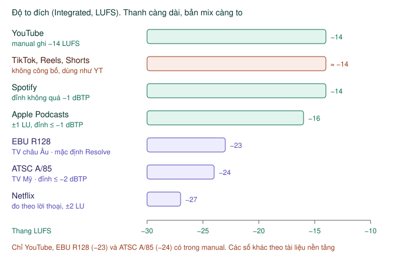
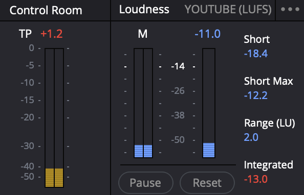

# Loudness và kiểm tra trước khi xuất

Bước cuối của mix: bản mix **đủ to** so với chuẩn nền tảng, và **không bao giờ vượt trần**. Hai thứ này đo bằng hai đồng hồ khác nhau.

| Câu hỏi | Xem đồng hồ | Đơn vị |
|---|---|---|
| Có bị rè, vượt trần không? | **Control Room** — số **TP** (true peak) | dBFS |
| Nghe có đủ to như video khác không? | **Loudness** — số **Integrated** | LUFS |

Bật cả hai: nút **Meters** góc trên phải.

---

## Mức to cuối cùng

`★★★ Hằng ngày`

| Thứ | Mức |
|---|---|
| Lời thoại | khoảng −12 dB trên đồng hồ track |
| Nhạc nền dưới lời | khoảng −20 đến −25 dB |
| Đỉnh tổng — không được vượt | −1 dBTP |
| Độ to tổng cho YouTube (**Integrated**) | khoảng −14 LUFS |

Con số −14 LUFS cho YouTube có trong manual. Hai mức lời và nhạc là điểm xuất phát hay dùng, không phải quy định — tai bạn quyết định cuối cùng.

### Mức đích theo nền tảng

`★★☆ Thường dùng`

**Là gì:** mỗi nơi phát có một mức độ to đích, đo bằng số **Integrated** (độ to trung bình cả bài, đơn vị LUFS; LKFS là cùng một thứ, tên gọi khác). Bản mix to hơn đích thì nền tảng tự vặn nhỏ xuống; nhỏ hơn thì nghe yếu so với video khác.

*Thanh càng dài, bản mix càng to. Video lên mạng xã hội nằm quanh −14; truyền hình và Netflix nhỏ hơn nhiều.*

| Nơi phát | Integrated | Đỉnh (true peak) | Nguồn |
|---|---|---|---|
| **YouTube** | −14 LUFS | ≤ −1 dBTP | Manual trang 4140 (số −14) |
| **TikTok, Reels, Shorts** | không công bố, dùng −14 như YouTube | ≤ −1 dBTP | Thói quen phổ biến |
| **Spotify** (podcast, nhạc) | −14 LUFS | ≤ −1 dBTP | Tài liệu Spotify |
| **Apple Podcasts** | −16 LUFS, ±1 | ≤ −1 dBTP | Tài liệu Apple |
| **EBU R128** (TV châu Âu) | −23 LUFS — **mặc định của Resolve** | ≤ −1 dBTP | Manual trang 4135, 4140 |
| **ATSC A/85** (TV Mỹ) | −24 LUFS | ≤ −2 dBTP | Có trong danh sách chuẩn của meter |
| **Netflix** | −27 LUFS, ±2, đo theo lời thoại | ≤ −2 dBTP | Tài liệu Netflix |

**Cách làm:**
1. Chọn chuẩn đúng nơi phát trong menu **ba chấm** của Loudness meter — xem [Đặt chuẩn YouTube](#đặt-chuẩn-youtube).
2. Phát cả video từ đầu, đọc số **Integrated**.
3. Lệch quá 1 LU (1 đơn vị độ to, bằng 1 dB) so với đích thì chỉnh fader Bus 1 hoặc Input Level của Limiter, đo lại.

**Ví dụ:** cùng một vlog, bản YouTube đo được −14,3 LUFS là đạt. Gửi bản đó cho đài truyền hình theo EBU R128 thì phải hạ khoảng 9 dB, xuống −23 LUFS.

> **Lưu ý:** chỉ YouTube, EBU R128 và ATSC A/85 lấy từ manual. Số của Spotify, Apple Podcasts, Netflix lấy từ tài liệu của từng nền tảng và có thể đổi theo thời gian.

---

## Loudness meter — đo độ to cảm nhận

*Integrated −13,0 màu đỏ: to hơn chuẩn YouTube −14. TP +1,2 đỏ ở Control Room báo đỉnh vượt 0 dB, cần hạ bớt hoặc thêm Limiter.*

`★★★ Hằng ngày`

**Là gì:** đồng hồ ngoài cùng bên phải của dải Meters. Không đo đỉnh sóng mà đo **độ to tai người cảm nhận**, theo đơn vị LUFS. Đây là thứ YouTube, Netflix, đài truyền hình dùng để quy định độ to.

LUFS luôn là số âm: −14 to hơn −23.

**Các ô số:**

| Ô | Nghĩa | Dùng để |
|---|---|---|
| **M** (cột đồng hồ) | Độ to tức thời, khung 400 ms | Nhìn chỗ nào bỗng to vọt |
| **Short** | Độ to trung bình khoảng 3 giây gần nhất | Theo dõi khi đang phát |
| **Short Max** | Mức Short cao nhất | Soát đoạn to nhất |
| **Range (LU)** | Chênh lệch giữa đoạn nhỏ và đoạn to | Bản mix có quá "nhấp nhô" không |
| **Integrated** | Độ to **trung bình của cả phần đã phát** | **Con số chính** để so với chuẩn |

Màu của số **Integrated**: **xanh dương** là nhỏ hơn chuẩn, **vàng** là trong chuẩn, **đỏ** là to hơn chuẩn.

### Đặt chuẩn YouTube

Mặc định meter đo theo **BS.1770-1**, tiêu đề hiện `BS.1770-1 (LU)`. Làm video cho YouTube thì đổi:

1. Bấm menu **ba chấm** góc trên phải Loudness meter.
2. Chọn **YOUTUBE**. Tiêu đề đổi thành `YOUTUBE (LUFS)`, vạch −14 nằm giữa thang. Danh sách còn có **BS.1770-4**, **ATSC A/85**, **EBU R128**, **NETFLIX**, **DISNEY 2.0**, **Apple ASAF**...
3. Tick **Absolute Scale** để meter hiện số LUFS thật (−14) thay vì số tương đối (0).

> **Tương đối và tuyệt đối:** mặc định meter hiện **thang tương đối** — số **0** nghĩa là "đúng chuẩn đang chọn". Bật **Absolute Scale** thì thấy luôn số LUFS.

**Đặt mức đích cho cả project:** **Project Settings → Fairlight → Audio Metering → Target Loudness level**. Mặc định −23 LUFS. Đặt −14 thì vạch "0" trên meter dời về −14 LUFS.

Cùng chỗ đó có **Loudness Scale**: **EBU +9** (thang −18 đến +9, mặc định) hoặc **EBU +18** (−36 đến +18, nhìn được dải rộng hơn). Video thông thường giữ mặc định.

> **Lưu ý:** đồng hồ của từng track mặc định đo **sau fader** — kéo fader xuống 10 dB thì đồng hồ cũng tụt 10 dB. Muốn thấy mức gốc của file, tick **Pre fader metering on tracks** ở cùng trang Audio Metering (manual trang 4139).

### Đo cả video

Số **Integrated** chỉ tính **phần bạn đã phát**. Muốn đo cả video:

1. Đưa con trỏ về đầu timeline.
2. Bấm **Reset** dưới Loudness meter. Nút bên trái đổi thành **Start**: bấm **Start** để bắt đầu đo.
3. Phát từ đầu đến cuối, không tua.
4. Đọc số **Integrated** lúc kết thúc.

Bấm **Pause** để tạm dừng đo, bấm lại để đo tiếp.

> **Lock Metering to Transport** (trong menu ba chấm): bật thì mỗi lần nhảy con trỏ sang chỗ khác, kết quả tự xoá. Tiện khi soát từng đoạn. Tắt đi khi muốn đo cộng dồn.

### Xem đường độ to theo thời gian

`★☆☆ Tình huống cụ thể`

**Là gì:** **Loudness History** vẽ đường độ to của bus tổng ngay trên timeline, nhìn là biết đoạn nào to quá, nhỏ quá. Đường **Integrated** đổi màu xanh dương / vàng / đỏ giống ô số Integrated.

**Cách làm** (manual trang 4138):
1. Bấm nút **automation** trên thanh công cụ timeline.
2. Mở **Index**, bấm **con mắt** cạnh bus chính để hiện bus đó thành một track trên timeline.
3. Kéo track bus cao lên cho đủ chỗ. Ở đầu track, bật **Loudness History**, tick các đường muốn xem: **Integrated**, **Momentary**, **Short Term**.

Chỉ bus chính đầu tiên (Bus 1, manual gọi là **Main 1**) có Loudness History.

### Đo nhanh không cần phát

`★★☆ Thường dùng`

Chuột phải một clip trên timeline → **Analyze Audio Level** → chọn chuẩn đo → bấm phân tích. Kết quả hiện cạnh mức đích của chuẩn đó.

**Dùng khi:** muốn biết một file nhạc, hoặc một bản mix đã bounce ra, to cỡ nào mà không phải ngồi nghe hết.

---

## Control Room — đỉnh true peak

`★★★ Hằng ngày`

Đồng hồ màu **vàng mù tạt**, cạnh Loudness meter. Hiện tổng của bus đang nghe (mặc định **Bus 1**), đo đỉnh theo dBFS.

Số **TP** trên đầu là **true peak** — đỉnh thật, tính cả đỉnh nằm giữa hai mẫu số. Giữ số này **dưới −1**.

> Đỉnh vượt 0 là bị rè khi xuất. Nén sang AAC hay MP3 còn làm đỉnh nhích lên thêm, nên chừa khoảng 1 dB.

---

## Limiter trên Bus — chặn trần

`★★☆ Thường dùng`

**Là gì:** Fairlight FX **Limiter** chặn mọi đỉnh vượt ngưỡng. Đây là limiter **true peak**, nhìn trước 64 mẫu nên chặn mượt.

**Dùng khi:** luôn đặt ở **Bus 1** trước khi xuất, như một lớp bảo hiểm.

**Cách làm:**
1. Mở **Mixer**, tìm cột **Bus 1** (cột cuối).
2. Bấm **+** ở mục **Effects** → chọn **Limiter**.
3. Đặt **Ceiling** −1 dB.
4. Phát đoạn to nhất. Nhìn **Reduction Meter** — chỉ nên nhích nhẹ ở các đỉnh.

| Thanh | Làm gì |
|---|---|
| **Input Level** | Đẩy mức vào, −18 đến +18 dB. Nút **Soft** cho chặn mềm hơn |
| **Ceiling** | Ngưỡng chặn. 0 dB là không chặn gì |
| **Release** | Thôi chặn nhanh hay chậm, 0.01 đến 1000 ms |
| **Sidechain** | Ô chọn nguồn cạnh **Listen**: cho track khác điều khiển việc chặn. Ít dùng, Ducker dễ hơn | 
| **Reduction Meter** | Đang bị chặn bao nhiêu |

> **Limiter không thay được việc cân mix.** Nếu Reduction Meter nhảy liên tục vài dB, bản mix đang quá to — hạ fader các track xuống thay vì để limiter ép.

**Bản mix nhỏ quá (Integrated dưới −14 nhiều)?** Tăng **Input Level** của Limiter từng chút, đo lại Integrated. Giữ Ceiling −1 dB.

---

## Kiểm tra trước khi sang Deliver

`★★★ Hằng ngày`

| Kiểm tra | Ở đâu |
|---|---|
| Không track nào đang bật **Solo** | Nút **S** ở đầu track. Solo và Mute ảnh hưởng cả file xuất |
| Không track nào bị **Mute** nhầm | Nút **M** ở đầu track |
| **TP** trên Control Room dưới −1 | Dải Meters |
| **Integrated** quanh −14 LUFS (YouTube) | Loudness meter, đo cả video từ đầu |
| Nhạc không lấn lời ở mọi đoạn | Nghe lại bằng tai nghe, rồi bằng loa điện thoại |
| Thanh âm lượng nghe (cạnh nút loa) và nút **DIM** | Chỉ ảnh hưởng tiếng ra loa, không ảnh hưởng file xuất — nhưng nhớ trả về để nghe đúng |

Xong thì sang trang Deliver, xem [Tab Audio](../deliver/cai-dat-xuat.md#tab-audio) để chọn codec và bitrate tiếng.

> **Nghe trên điện thoại:** phần lớn người xem nghe bằng loa điện thoại. Lời rõ trên loa điện thoại thì gần như chắc chắn rõ ở mọi nơi.
