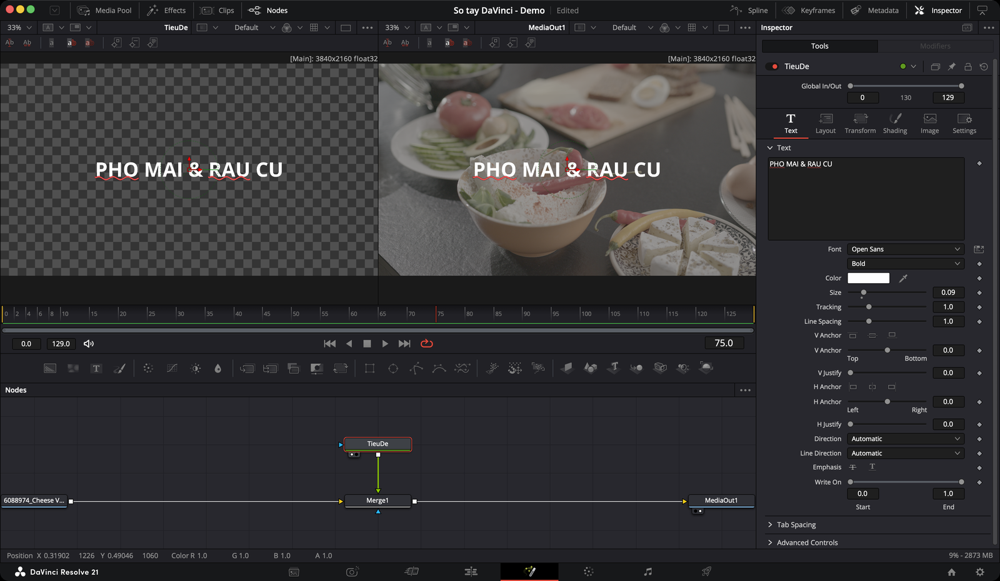
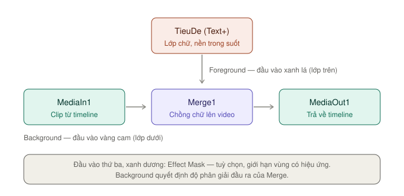

# Fusion — chữ động, ghép hình, hiệu ứng

> **Một câu:** trang Fusion là nơi làm hiệu ứng bằng **node** — chữ chuyển động, ghép nhiều lớp hình, tách phông xanh, gắn chữ bám theo vật đang chuyển động.

Ảnh trên là một comp thật: clip món ăn đi vào node **MediaIn**, node chữ **Text+** (đặt tên `TieuDe`) chồng lên bằng node **Merge**, kết quả đi ra **MediaOut1**. Viewer trái xem riêng lớp chữ trên nền caro (caro = trong suốt), Viewer phải xem kết quả cuối.

Đây là trang khó nhất của Resolve. Nhưng để làm chữ động và ghép hình đơn giản, bạn chỉ cần khoảng **năm node**.

## Fusion làm việc thế nào

**Fusion làm trên từng clip.** Quan hệ giữa trang Edit và trang Fusion giống quan hệ giữa trang Edit và trang Color: mỗi clip có bản chỉnh màu riêng, và mỗi clip cũng có **comp Fusion** riêng.

Cách vào:

1. Ở trang Edit hoặc Cut, đặt con trỏ lên clip cần làm.
2. Bấm nút trang **Fusion** ở dải nút dưới cùng (icon đũa phép).
3. Clip hiện ra thành node **MediaIn1** nối thẳng vào **MediaOut1**. Mọi thứ bạn thêm nằm giữa hai node này.

Chỉ clip **trên cùng đang nhìn thấy** được đưa vào Fusion. Clip ở track dưới bị che thì bị bỏ qua.

Làm xong, quay lại trang Edit dựng tiếp bình thường. Comp Fusion **dính theo clip** — bạn cắt, kéo, trim clip thế nào thì hiệu ứng đi theo thế đó. Clip có comp Fusion hiện một **badge nhỏ** cạnh tên trên timeline.

> **Thứ tự xử lý:** Fusion đứng **trước** Color. Viewer ở trang Fusion hiện hình **chưa chỉnh màu**. Đừng hoảng khi thấy hình xám nhạt ở đây nếu bạn đã chỉnh màu ở trang Color.

---

## Khi nào cần Fusion, khi nào không

Fusion nặng máy và phát chậm hơn trang Edit nhiều. Đừng dùng nó cho việc trang Edit đã làm được.

| Bạn muốn | Làm ở đâu |
|---|---|
| Chữ tĩnh, tiêu đề đơn giản, phụ đề tay | [Trang Edit](../edit/chu-va-hieu-ung.md) — Text hoặc Text+ |
| Phóng to, dời, xoay, crop một clip | [Inspector trang Edit](../edit/inspector.md) |
| Chuyển cảnh mờ, đẩy, trượt | Transition có sẵn ở trang Edit |
| Hình trong hình (picture-in-picture) hai lớp | Trang Edit, chỉnh Zoom/Position |
| Chữ chạy từng ký tự, chữ trên đường cong, viền và bóng nhiều lớp | **Fusion** |
| Ghép từ ba lớp hình trở lên | **Fusion** |
| Tách phông xanh lá, xanh dương | **Fusion** (Delta Keyer) |
| Gắn chữ, logo bám theo vật chuyển động | **Fusion** (Tracker) |
| Thay biển hiệu, màn hình điện thoại trong cảnh | **Fusion** (Planar Tracker) |
| Che, làm mờ một vùng có hình dạng tuỳ ý | **Fusion** (Polygon) |

> **Quy tắc ngón tay cái:** việc gì có thể làm trong 30 giây ở trang Edit thì làm ở trang Edit. Sang Fusion khi trang Edit không làm được, hoặc cần quá nhiều track chồng nhau.

---

## Tính năng hay dùng nhất

| Mức | Tính năng | Dùng để |
|---|---|---|
| ★★★ | [Thêm node bằng `⇧Space`](node-co-ban.md#thêm-node) | Gõ tên node, Enter — cách nhanh nhất |
| ★★★ | [Merge](node-co-ban.md#merge--ghép-hai-lớp) | Chồng lớp này lên lớp kia |
| ★★★ | [Text+](chu-dong.md) | Chữ có viền, bóng, chữ chạy |
| ★★★ | [Xem node trên Viewer `1` `2`](node-co-ban.md#xem-node-trên-viewer) | Kiểm tra từng bước của chuỗi node |
| ★★★ | [Keyframe trong Inspector](keyframe-va-spline.md#keyframe-trong-inspector) | Cho mọi thứ chuyển động |
| ★★☆ | [Transform](node-co-ban.md#transform) | Dời, xoay, phóng to một lớp |
| ★★☆ | [Background](node-co-ban.md#background) | Nền màu, nền gradient, lớp màu đặc |
| ★★☆ | [Rectangle, Ellipse, Polygon](mask-tracker-keyer.md#mask-là-gì) | Che hoặc khoanh một vùng |
| ★★☆ | [Delta Keyer](mask-tracker-keyer.md#delta-keyer--tách-phông-xanh) | Tách phông xanh |
| ★★☆ | [Tracker](mask-tracker-keyer.md#tracker--bám-một-điểm) | Gắn chữ, hình bám theo vật |
| ★★☆ | [Spline Editor — làm chuyển động mượt](keyframe-va-spline.md#làm-chuyển-động-mượt) | Easing, chậm dần, nhanh dần |
| ★★☆ | [Tắt tạm node `⌘P`](node-co-ban.md#xoá-tắt-tạm-khoá-node) | So sánh trước và sau |
| ★☆☆ | [Planar Tracker](mask-tracker-keyer.md#planar-tracker--bám-mặt-phẳng) | Thay biển hiệu, màn hình |
| ★☆☆ | [Follower](chu-dong.md#follower--chữ-hiện-lần-lượt) | Hiệu ứng chạy lần lượt từng ký tự |
| ★☆☆ | [Fusion Clip](node-co-ban.md#fusion-clip-và-fusion-composition) | Đưa nhiều track từ Edit vào một comp |
| ★☆☆ | [Lưu thành Fusion Title](chu-dong.md#lưu-thành-fusion-title-dùng-lại-ở-trang-edit) | Dùng lại mẫu chữ ở trang Edit |
| `Studio` | Magic Mask | Tách người, vật bằng AI — bản free dùng Polygon |

★★★ dùng ở hầu như mọi comp · ★★☆ dùng thường xuyên · ★☆☆ dùng trong tình huống cụ thể

---

## Ví dụ: tiêu đề trượt vào trên video

Làm đúng comp như ảnh đầu trang: chữ **PHO MAI & RAU CU** trượt từ ngoài khung vào giữa trong 1 giây.

**1. Mở clip trong Fusion.** Ở trang Edit, đặt con trỏ lên clip món ăn. Bấm sang trang **Fusion**. Bạn thấy `MediaIn1 → MediaOut1`.

**2. Thêm chữ.** Bấm vào **khoảng trống** trong Node Editor để bỏ chọn mọi node. Bấm `⇧Space`, gõ `text+`, Enter. Một node **Text1** đứng riêng, chưa nối với gì.

> Vì sao bỏ chọn trước? Khi đang chọn một node, node mới sẽ tự **nối ngay sau** node đó. Muốn node đứng riêng thì bỏ chọn trước.

**3. Ghép chữ lên video.** Kéo từ **ô vuông output** của Text1 thả lên **ô vuông output** của MediaIn1. Fusion tự tạo **Merge1**: video vào đầu vào Background (đường vàng), chữ vào Foreground (đường xanh lá).

**4. Xem kết quả.** Chọn **MediaOut1**, bấm `2` để xem ở Viewer phải. Chọn **Text1**, bấm `1` để xem riêng chữ ở Viewer trái.

**5. Gõ chữ.** Chọn Text1. Ở Inspector, tab **Text**: gõ vào ô chữ, chọn **Font** `Open Sans`, kiểu `Bold`, kéo **Size** khoảng `0.09`.

**6. Đặt tên node cho dễ nhớ.** Bấm vào thanh tên **Text1** ở đầu Inspector, bấm `F2`, gõ `TieuDe`, Enter.

**7. Keyframe điểm cuối.** Kéo con trỏ tới **khung 30** (1 giây ở 30 fps). Sang tab **Layout**, bấm nút **keyframe** (hình thoi xám) bên phải **Center**. Nút chuyển màu cam — đã có keyframe ở vị trí chữ nằm giữa.

**8. Keyframe điểm đầu.** Kéo con trỏ về **khung 0**. Kéo **Center X** xuống khoảng `-0.5` để chữ ra ngoài mép trái. Keyframe thứ hai tự được tạo.

**9. Làm mượt.** Bấm **Spline** trên thanh trên cùng. Chọn hai điểm keyframe, bấm `⇧S` (Smooth) để chữ chậm dần khi về chỗ.

**10. Xem lại.** Bấm `Space`. Chữ trượt vào rồi dừng giữa khung. Quay về trang Edit — clip đã có tiêu đề.

> **Nhanh hơn nữa:** nếu chỉ cần chữ chạy kiểu này, thử Text+ ngay ở trang Edit với keyframe trong Inspector. Sang Fusion khi bạn cần thêm lớp: bóng, viền, nhiều dòng chạy lệch nhau, chữ bám vật.

---

## Các trang con

* [Giao diện — từng vùng nằm ở đâu](giao-dien.md)
* [Node cơ bản — MediaIn, Merge, Transform, Background](node-co-ban.md)
* [Chữ động với Text+](chu-dong.md)
* [Mask, Tracker, Delta Keyer](mask-tracker-keyer.md)
* [Keyframe và Spline — làm chuyển động](keyframe-va-spline.md)

---

**Học sâu hơn:** Blackmagic có hai cuốn miễn phí riêng cho Fusion, xem [Tài liệu tham khảo](../../04-tham-khao/nguon.md).
