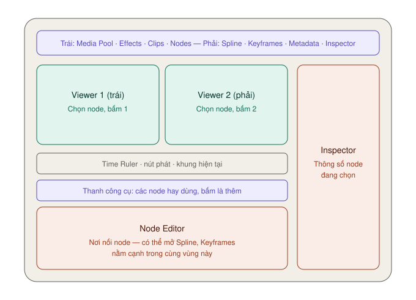

# Giao diện trang Fusion — từng vùng nằm ở đâu

Mở hết mọi thứ thì trang Fusion có bốn vùng chính: **Viewer** ở trên, **vùng làm việc** (Node Editor) ở dưới, **Inspector** bên phải, **Effects Library** bên trái (chung chỗ với Media Pool).

Nhưng làm hằng ngày bạn chỉ cần **ba thứ**: Viewer, Node Editor, Inspector. Đóng bớt những panel còn lại cho rộng chỗ.

Đổi kích thước: kéo **đường viền** giữa hai panel. Viewer và vùng làm việc tỉ lệ nghịch nhau — vùng này to thì vùng kia nhỏ.

---

## Thanh trên cùng

Thanh nút ở mép trên dùng để **bật/tắt panel**. Chuột phải vào thanh để chọn hiện hay ẩn chữ bên cạnh icon.

### Bên trái

| Nút | Mở ra | Mức |
|---|---|---|
| **Full Height** (nút đầu tiên) | Cho Media Pool / Effects Library cao hết màn hình | ★☆☆ |
| **Media Pool** | Kho clip. Kéo clip vào Node Editor để thêm một node MediaIn mới | ★★☆ |
| **Effects** | Effects Library — mọi node của Fusion | ★★☆ |
| **Clips** | Dải thumbnail các clip trên timeline, nằm dưới Node Editor | ★★☆ |
| **Nodes** | Node Editor | ★★★ |

### Bên phải

| Nút | Mở ra | Mức |
|---|---|---|
| **Spline** | Spline Editor — chỉnh đường cong chuyển động | ★★☆ |
| **Keyframes** | Keyframes Editor — chỉnh thời điểm keyframe, độ dài clip và hiệu ứng | ★★☆ |
| **Metadata** | Xem, sửa metadata của clip | ★☆☆ |
| **Inspector** | Thông số node đang chọn | ★★★ |
| **Inspector Height** (nút cuối) | Inspector cao nửa màn hình hoặc hết màn hình | ★☆☆ |

> **Bố cục dọc:** **Workspace → Layout Presets** có vài bố cục đặt Node Editor dọc, để chừa nhiều chỗ ngang cho Spline và Keyframes. Về mặc định: **Workspace → Layout Presets → Fusion Presets → Default**.

---

## Viewer

`★★★ Hằng ngày`

**Là gì:** khung xem hình. Có **một hoặc hai** Viewer, đổi bằng nút **Viewer** ở góc phải thanh tiêu đề Viewer.

**Điểm khác các trang khác:** mỗi Viewer xem **output của một node bạn chọn**, không phải lúc nào cũng xem kết quả cuối.

**Dùng khi:** bên trái xem node đang chỉnh (ví dụ Delta Keyer), bên phải xem kết quả cuối (MediaOut). Chỉnh bên này, thấy ngay ảnh hưởng bên kia.

### Đưa node lên Viewer

| Cách | Làm gì |
|---|---|
| Chọn node, bấm `1` hoặc `2` | `1` = Viewer trái, `2` = Viewer phải. Bấm lại lần nữa để gỡ ra |
| Rê chuột lên node | Hiện hai **chấm tròn nhỏ** ở góc dưới trái node. Bấm chấm trái hoặc phải |
| Kéo node thả lên Viewer | Tiện khi dùng bút tablet |
| Chuột phải node → **View On** | Chọn Left View / Right View / None |

Node đang được xem luôn hiện chấm tròn **trắng** ở dưới.

Mới mở trang Fusion: **MediaOut1** thường đã nằm sẵn ở Viewer 2.

Xoá hình khỏi Viewer: bấm vào Viewer đó rồi bấm phím `` ` `` (phím bên trái số 1).

### Phóng to, di chuyển trong Viewer

| Thao tác | Cách |
|---|---|
| Phóng to / thu nhỏ | `=` / `-`, hoặc giữ `⌘` + cuộn chuột, hoặc `⌘` + hai ngón trên trackpad |
| Vừa khít khung | `F` |
| 100% / 200% | `⌘1` / `⌘2` |
| Di chuyển hình | Kéo hai ngón trên trackpad, hoặc giữ `⇧⌘` rồi kéo |

### Thanh tiêu đề Viewer

| Nút | Làm gì | Mức |
|---|---|---|
| **Menu zoom** (ví dụ `33%`) | Chọn tỉ lệ, hoặc **Fit** | ★★☆ |
| **Tên node** ở giữa | Cho biết Viewer đang xem node nào | ★★★ |
| **Color / Alpha** | Đổi xem hình màu và xem kênh alpha. Phím `C` và `A` | ★★☆ |
| **Split Wipe** | So sánh hai node trong cùng Viewer (`/`). `,` và `.` để xem riêng bộ đệm A hoặc B | ★☆☆ |
| **SubView** | Ô phụ: kính lúp, histogram, waveform, vectorscope… | ★☆☆ |
| **Viewer LUT** | Xem thử qua LUT mà không áp thật vào hình | ★☆☆ |
| **ROI** | Chỉ render một vùng nhỏ cho nhanh | ★☆☆ |
| **Menu `...`** | Có **Checker Underlay** — nền caro để thấy chỗ trong suốt | ★☆☆ |

> **Kênh alpha là gì:** lớp "độ trong suốt" đi kèm hình. Trắng = đặc, đen = trong suốt hoàn toàn, xám = nửa trong. Khi tách phông xanh, bấm `A` để xem alpha — chỗ nào lẽ ra phải trắng mà lốm đốm xám là chỗ đó key chưa sạch.

Chọn node **Text+** thì một thanh công cụ chữ hiện thêm trên Viewer — xem [Chữ động](chu-dong.md#gõ-chữ-ngay-trên-viewer).

---

## Time Ruler và nút phát

Nằm ngay dưới Viewer.

**Hai vạch vàng** trên Time Ruler là điểm In và Out của clip trên timeline. Fusion chỉ hiện và render khung **giữa hai vạch** này. Phần ngoài là phần thừa đầu đuôi của clip gốc.

**Con trỏ** màu đỏ. **Vạch xanh lá** ở đáy Time Ruler = các khung đã cache, phát được mượt.

| Phím | Làm gì |
|---|---|
| `Space` | Phát / dừng |
| `J` `K` `L` | Phát lùi / dừng / phát tới |
| `←` `→` | Lùi / tới 1 khung |
| `⇧←` `⇧→` | Về khung đầu / cuối của clip |
| `⌘←` `⌘→` | Về điểm đầu / cuối vùng render |
| `⌥[` `⌥]` | Nhảy tới keyframe trước / sau |

Hai ô số bên trái nút phát là **vùng render** (đầu, cuối). Ô số bên phải là **khung hiện tại** — gõ số vào đó để nhảy tới khung đó.

**Thu hẹp vùng render để phát nhanh hơn:** giữ `⌘` rồi kéo một khoảng trên Time Ruler. Chỉ ảnh hưởng xem thử, **không** cắt clip trên timeline. Chuột phải Time Ruler → **Auto Render Range** để trả lại như cũ.

> **Máy chậm, phát giật:** Fusion không đảm bảo phát đúng tốc độ thực. Chuột phải vùng nút phát để bật **Proxy** hoặc **Auto Proxy** (giảm độ phân giải lúc xem). Khi xuất file luôn dùng chất lượng cao nhất, không bị ảnh hưởng.

Nút **loa** bên trái nút phát để bật/tắt tiếng. Dạng sóng âm thanh cũng hiện trong Keyframes Editor để căn chuyển động theo nhạc.

---

## Thanh công cụ dưới Time Ruler

`★★★ Hằng ngày`

**Là gì:** một hàng icon các node hay dùng nhất. Rê chuột lên icon để xem tên.

**Cách dùng:**
- **Đang chọn một node** → bấm icon: node mới được **nối ngay sau** node đó.
- **Không chọn node nào** → bấm icon: node mới **đứng riêng**, chưa nối.
- **Kéo icon thả lên đường nối** giữa hai node: chèn vào giữa.
- **Kéo icon thả lên Viewer**: chèn sau node đang xem trên Viewer đó.

**Các nhóm, từ trái sang phải:**

| Nhóm | Node | Dùng để |
|---|---|---|
| Tạo hình, chữ, vẽ | **Background**, **FastNoise**, **Text+**, **Paint** | Nền màu, nhiễu, chữ, vẽ tay |
| Màu, mờ | **ColorCorrector**, **ColorCurves**, **HueCurves**, **BrightnessContrast**, **Blur** | Chỉnh màu từng lớp, làm mờ |
| Ghép, biến đổi | **Merge**, **ChannelBooleans**, **MatteControl**, **Resize**, **Transform** | Ghép lớp, xử lý alpha, dời xoay phóng |
| Mask | **Rectangle**, **Ellipse**, **Polygon**, **BSpline** | Khoanh vùng |
| Hạt | **pEmitter**, **pMerge**, **pRender** | Hệ hạt (bụi, tuyết, tia lửa) |
| 3D | **ImagePlane3D**, **Shape3D**, **Text3D**, **Merge3D**, **Camera3D**, **SpotLight**, **Renderer3D** | Dựng cảnh 3D |

Người mới chỉ cần ba nhóm đầu và nhóm Mask.

> **Transform khác Resize:** Transform dời, xoay, phóng to mà **không đổi độ phân giải** — phóng to lại vẫn nét như gốc. Resize **đổi hẳn** độ phân giải. Muốn phóng to thu nhỏ một lớp, dùng Transform.

---

## Node Editor

`★★★ Hằng ngày`

**Là gì:** nơi bạn nối các node thành chuỗi. Đọc chuỗi node như đọc sơ đồ: hình chảy từ node này sang node kia theo hướng mũi tên. Chi tiết ở [Node cơ bản](node-co-ban.md).

| Thao tác | Cách |
|---|---|
| Di chuyển khung nhìn | Kéo hai ngón trên trackpad, hoặc giữ `⇧⌘` rồi kéo |
| Phóng to / thu nhỏ | Giữ `⌘` + cuộn chuột, hoặc `⌘` + hai ngón |
| Về kích thước mặc định | `⌘1` (khi Node Editor đang được chọn) |
| Bật/tắt bản đồ thu nhỏ (Navigator) | `V` |
| Chọn mọi node | `⌘A` |

**Thanh trạng thái** ở góc dưới trái: rê chuột lên một node để xem tên, độ phân giải, độ sâu màu. Khi phát, nó hiện tốc độ khung thực tế. Góc dưới phải hiện **phần trăm RAM cache** đã dùng.

> **Phím tắt phụ thuộc panel đang được chọn.** `⌘1` trong Viewer là zoom 100%, trong Node Editor là về cỡ mặc định. Bấm vào panel trước rồi mới bấm phím.

---

## Inspector

`★★★ Hằng ngày`

**Là gì:** bảng thông số của node đang chọn. Chọn node nào, Inspector hiện thông số node đó.

Inspector có hai trang ở trên cùng: **Tools** (thông số node) và **Modifiers** (phần mở rộng gắn thêm vào thông số, ví dụ Follower cho chữ).

### Thanh tên node — đầu Inspector

Từ trái sang phải:

| Nút | Làm gì | Mức |
|---|---|---|
| **Công tắc** bên trái tên | Bật/tắt node — giống `⌘P` | ★★☆ |
| **Tên node** | Bấm vào rồi `F2` để đổi tên | ★★☆ |
| **Màu** | Tô màu node cho dễ tìm (16 màu) | ★☆☆ |
| **Versions** | Lưu tới 6 phiên bản thông số để so sánh | ★☆☆ |
| **Pin** | Ghim node lại, vẫn hiện dù đã chọn node khác | ★★☆ |
| **Lock** | Khoá, không cho sửa | ★☆☆ |
| **Reset** (nút cuối) | Trả mọi thông số node về mặc định | ★★☆ |

### Các tab

Dưới thanh tên là một hàng **tab dạng icon**. Ví dụ Text+ có **Text, Layout, Transform, Shading, Image, Settings**. Merge có **Merge, Channels, Settings**.

Tab **Settings** có ở hầu hết node. Trong đó có thanh **Blend** — kéo về 0 là node không còn tác dụng, về 1 là tác dụng đủ. Tiện để giảm nhẹ một hiệu ứng.

### Chỉnh thanh trượt

- Bấm vào **rãnh** hai bên tay nắm để tăng/giảm từng nấc. Giữ `⌘` để nấc nhỏ hơn, giữ `⇧` để nấc lớn hơn.
- Gõ số vượt giới hạn thanh trượt được — thanh tự nới rộng.
- Thông số đã đổi khỏi mặc định có **chấm tròn nhỏ** bên dưới. Bấm chấm đó để trả về mặc định.
- Hình thoi nhỏ bên phải mỗi thông số là nút **keyframe** — xem [Keyframe và Spline](keyframe-va-spline.md#keyframe-trong-inspector).

---

## Keyframes Editor và Spline Editor

Hai panel này mở **cạnh Node Editor**, trong cùng vùng dưới. Bật bằng nút **Keyframes** và **Spline** ở thanh trên.

| Panel | Dùng để | Mức |
|---|---|---|
| **Keyframes** | Xem mỗi node như một thanh trên timeline nhỏ. Dời keyframe, trim độ dài clip và hiệu ứng | ★★☆ |
| **Spline** | Xem chuyển động dạng đường cong. Làm chậm dần, nhanh dần | ★★☆ |

Chi tiết: [Keyframe và Spline](keyframe-va-spline.md).

---

## Effects Library

`★★☆ Thường dùng`

**Là gì:** kho **mọi** node của Fusion — nhiều hơn hẳn thanh công cụ. Mở bằng nút **Effects** ở thanh trên.

| Mục | Có gì |
|---|---|
| **Tools** | Mọi node, chia theo nhóm: 3D, Blur, Composite, Filter, Mask, Particles, Tracking… |
| **Open FX** | Hiệu ứng ResolveFX và plugin bên thứ ba |
| **Templates** | Mẫu dựng sẵn: Lens Flares, Backgrounds, Particles, Shaders, "How to"… |
| **LUTs** | LUT cài sẵn — thêm vào thành node FileLUT |

**Cách dùng:** giống thanh công cụ. Bấm vào node là thêm sau node đang chọn, kéo thả lên đường nối là chèn vào giữa. Rê chuột lên tên node để xem mô tả ngắn.

> Biết tên node rồi thì `⇧Space` nhanh hơn mở Effects Library. Xem [Thêm node](node-co-ban.md#thêm-node).

---

## Clips — dải thumbnail

`★★☆ Thường dùng`

**Là gì:** dải ảnh nhỏ của **mọi clip trên timeline**, hiện dưới Node Editor. Ẩn mặc định, bật bằng nút **Clips**.

**Dùng khi:** chuyển sang làm Fusion cho clip khác mà không cần quay về trang Edit. Bấm thumbnail là nhảy tới comp của clip đó. Clip đang mở có viền cam.

**Chuột phải thumbnail:**

| Mục | Làm gì |
|---|---|
| **Create New Composition** | Tạo thêm một phiên bản comp mới cho clip — giữ bản cũ để so sánh |
| *Tên phiên bản* → **Load / Delete / Rename** | Chuyển qua lại, xoá, đổi tên phiên bản |
| **Reset Current Composition** | Xoá hết, về lại `MediaIn1 → MediaOut1` |

---

## Media Pool trong trang Fusion

Kéo clip từ Media Pool vào **khoảng trống** của Node Editor → thành một node **MediaIn** mới, đứng riêng.

Kéo clip thả lên **đường nối** giữa hai node → Fusion tự tạo **Merge** và đặt clip đó làm lớp trên.

Cần nhập file mới ngay tại đây: chuột phải Media Pool → **Import Media**, hoặc kéo file từ Finder vào.

---

## Hoàn tác

`⌘Z` hoàn tác, `⇧⌘Z` làm lại. Không giới hạn số bước, nhưng lịch sử bị xoá khi đóng project.
