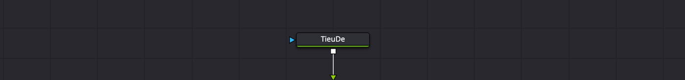

# Node cơ bản — MediaIn, Merge, Transform, Background

Hiểu được cách node nối với nhau là hiểu 80% trang Fusion. Phần còn lại chỉ là học thêm từng loại node.

---

## Node là gì

Mỗi **node** làm **một việc**: làm mờ, chỉnh màu, tạo chữ, ghép hai hình… Bạn nối các node thành chuỗi, hình chảy từ node này sang node kia theo mũi tên.

Nếu bạn quen trang Edit: mỗi node giống **một lớp** hoặc **một hiệu ứng** trên clip. Khác ở chỗ bạn thấy rõ thứ tự xử lý, và có thể **rẽ nhánh** — dùng một hình cho hai việc khác nhau rồi ghép lại.

Nếu bạn quen trang Color: cách nghĩ giống hệt node màu, chỉ là nhiều loại node hơn.

**Vị trí node trên màn hình không quan trọng.** Chỉ có **đường nối** quyết định thứ tự. Node nối vào **đầu vào** của node đang chọn gọi là *upstream* (phía trước), node nhận **đầu ra** của nó là *downstream* (phía sau).

> **Đặt tên node:** khi có nhiều node cùng loại, Fusion tự đánh số: `Merge1`, `Merge2`, `Text1`… Đổi tên cho dễ nhớ: bấm vào thanh tên node ở đầu Inspector rồi bấm `F2`.

---

## MediaIn và MediaOut

`★★★ Hằng ngày`

Mở một clip trong Fusion, bạn luôn thấy sẵn hai node:

| Node | Nghĩa |
|---|---|
| **MediaIn1** | Hình **từ timeline đi vào**. Chính là clip bạn đang đứng trên ở trang Edit |
| **MediaOut1** | Hình **trả về timeline**, rồi đi tiếp sang trang Color |

Mọi thứ bạn thêm nằm **giữa** hai node này. Thứ gì không nối được tới MediaOut1 thì **không xuất hiện** trên video.

**Thêm clip khác vào comp:** kéo clip từ Media Pool vào Node Editor → thành **MediaIn2**, **MediaIn3**… Mỗi MediaIn là một nguồn hình.

**Độ phân giải:** một clip đưa vào từ timeline giữ **độ phân giải gốc của file**, không phải độ phân giải timeline. Quay 4K dựng timeline 1080p thì trong Fusion bạn vẫn làm việc ở 4K.

---

## Đầu vào và đầu ra

Mỗi node có các **ô nhỏ có màu** quanh viền:

- **Mũi tên** = đầu vào. Có thể có nhiều.
- **Ô vuông** = đầu ra. Luôn chỉ có **một**.

Rê chuột lên một ô để xem tên ở thanh trạng thái góc dưới trái. Đợi thêm chút sẽ hiện tooltip ngay trên node.

**Màu đầu vào cho biết nó dùng để làm gì:**

| Màu | Tên | Dùng để |
|---|---|---|
| Vàng | **Background** / đầu vào chính | Hình chính đi vào node. Trên Merge là **lớp dưới** |
| Xanh lá | **Foreground** | Trên Merge là **lớp trên** |
| Xanh dương | **Effect Mask** | Nối mask vào để **giới hạn vùng** node có tác dụng |
| Xám | **Garbage Matte** | Trên keyer: loại bỏ chân đèn, micro lọt vào phông xanh |
| Trắng | **Solid Matte** | Trên keyer: lấp lỗ thủng trong alpha |

Hầu hết node có một đầu vào chính và một đầu vào **Effect Mask** xanh dương.

*Ảnh chụp thật trong Resolve 21: video vào mũi tên **vàng** bên trái (Background), chữ `TieuDe` vào mũi tên **xanh lá** phía trên (Foreground), mũi tên **xanh dương** phía dưới để cắm mask.*

> Manual có chỗ gọi đầu vào Background của Merge là *orange*. Trên màn hình bản 21 nó hiện **vàng** — cùng màu với đầu vào Background của Tracker.

Rê chuột lên một node: mọi đường nối của nó sáng lên **theo màu đầu vào** mà chúng cắm vào. Nhìn vậy là biết ngay hình nào đang là lớp trên, lớp dưới.

---

## Thêm node

`★★★ Hằng ngày`

**Luật chung cho mọi cách thêm:**

- Đang chọn **đúng một** node → node mới **tự nối ngay sau** nó.
- **Không chọn** node nào, hoặc chọn nhiều node → node mới **đứng riêng**, chưa nối.

**Năm cách thêm, nhanh nhất trước:**

| Cách | Làm gì | Mức |
|---|---|---|
| **`⇧Space`** | Mở hộp **Select Tool**. Gõ vài chữ của tên node, `↑` `↓` chọn, `Return` | ★★★ |
| **Thanh công cụ** dưới Time Ruler | Bấm icon | ★★★ |
| **Effects Library** | Bấm vào node trong danh sách | ★★☆ |
| **Chuột phải node** → **Insert Tool** | Chèn ngay sau node đó | ★☆☆ |
| **Chuột phải khoảng trống** → **Add Tool** | Thêm node đứng riêng | ★☆☆ |

**`⇧Space` là cách đáng học nhất.** Không nhớ tên chính xác thì gõ từ khoá chung như `keyer`, `blur` để xem danh sách gợi ý. Hộp này **nhớ chữ bạn gõ lần trước** — muốn thêm hai Blur liền nhau, lần thứ hai chỉ cần `⇧Space` rồi `Return`.

**Thay node này bằng node khác:** chuột phải node → **Replace Tool**, hoặc kéo icon từ thanh công cụ **thả đè lên** node cũ rồi bấm OK. Thông số trùng tên được giữ lại.

> **Node không chịu nối?** Không phải node nào cũng nối được với nhau. Node 2D (Blur, Merge, Text+) không nối thẳng được vào node 3D (Merge3D). Nếu thêm mà không tự nối thì kiểm tra loại node.

---

## Nối, ngắt, chèn node

`★★★ Hằng ngày`

| Muốn | Cách |
|---|---|
| **Nối** hai node | Kéo từ ô vuông đầu ra của node trước, thả lên **thân** node sau. Fusion chọn đầu vào trống đầu tiên |
| Nối vào **đúng đầu vào** mong muốn | Kéo thả thẳng lên mũi tên đầu vào đó. Hoặc giữ `⌥` khi thả lên thân node → hiện menu chọn đầu vào theo tên |
| **Ngắt** một đường nối | Rê chuột lên đường nối — nó chia hai nửa. Bấm vào **nửa phía đầu vào** (nửa sáng xanh) |
| Nối lại sang node khác | Kéo một nửa đường nối, thả lên đầu vào/đầu ra khác |
| **Chèn** node đứng riêng vào giữa hai node | Giữ `⇧`, kéo node thả lên đường nối, thả chuột rồi mới thả `⇧` |
| **Tách** node ra khỏi chuỗi | Giữ `⇧`, kéo node ra chỗ khác. Hai node hai bên tự nối lại với nhau |
| Chèn node **mới** vào giữa | Kéo icon từ thanh công cụ hoặc Effects Library thả lên đường nối |
| **Rẽ nhánh** | Kéo từ cùng một đầu ra tới nhiều node. Một đầu ra nối được bao nhiêu nơi cũng được; một đầu vào chỉ nhận **một** đường |

**Hai mẹo tự tạo Merge — dùng rất nhiều:**

1. **Kéo đầu ra node lớp trên, thả lên đầu ra node lớp dưới.** Fusion tự tạo một Merge, lớp kéo đi thành Foreground, lớp được thả lên thành Background.
2. **Kéo clip từ Media Pool hoặc một generator từ Effects Library thả lên đường nối.** Fusion tự tạo Merge, clip mới thành lớp trên.

> **Đường nối gọn hơn:** chuột phải khoảng trống → **Options → Orthogonal Pipes** để đường nối gấp góc vuông thay vì chéo. Bấm `⌥` lên đường nối để thêm một điểm gấp (router).

---

## Xem node trên Viewer

`★★★ Hằng ngày`

**Là gì:** đưa đầu ra của một node bất kỳ lên Viewer để xem hình **tại bước đó**.

**Cách làm:** chọn node, bấm `1` (Viewer trái) hoặc `2` (Viewer phải). Bấm lại để gỡ.

**Dùng khi:** comp ra kết quả lạ. Đi ngược từ MediaOut về đầu chuỗi, xem từng node một, tìm node đầu tiên cho hình sai.

> **Xem một node, chỉnh một node khác.** Viewer hiện node đã gán bằng `1`/`2`, còn Inspector hiện node **đang chọn**. Hai thứ này độc lập. Ví dụ: gán Merge lên Viewer để thấy kết quả, rồi chọn Text+ để chỉnh chữ — bạn thấy ngay chữ thay đổi trong bối cảnh video.

---

## Xoá, tắt tạm, khoá node

| Việc | Phím | Ghi chú | Mức |
|---|---|---|---|
| **Xoá** | `Delete` | Node trước và sau tự nối lại với nhau | ★★★ |
| **Tắt tạm** (Pass Through) | `⌘P` | Hình đi xuyên qua như không có node. Giống công tắc ở thanh tên trong Inspector | ★★☆ |
| **Khoá** | `⌘L` | Không cho sửa thông số | ★☆☆ |
| **Đảo Background và Foreground** | `⌘T` | Trên Merge. Đường nối đứng yên, chỉ màu đầu vào đổi | ★★☆ |
| **Ngừng cập nhật** | `⌘U` | Node giữ hình cũ, không render lại. Tiện khi comp quá nặng | ★☆☆ |

Các lệnh này cũng có trong menu chuột phải node → **Modes**. Node đang ở chế độ nào sẽ có **huy hiệu nhỏ** trên thân.

**Node đứng riêng không sao cả.** Node không nối tới MediaOut thì bị bỏ qua khi render, nhưng vẫn được lưu. Để một node thử nghiệm đứng bên cạnh để dùng sau là bình thường.

**Copy node:** `⌘C`, `⌘V` như thường. `⌘X` để cắt.

---

## Merge — ghép hai lớp

`★★★ Hằng ngày`

**Là gì:** node ghép **hai hình thành một** — hình Foreground đặt lên trên hình Background. Đây là node bạn dùng nhiều nhất.

**Dùng khi:** chồng chữ lên video, chèn logo, ghép người đã tách phông lên cảnh mới, ghép bất cứ hai lớp nào.

**Ba đầu vào:**

| Đầu vào | Màu | Nối gì |
|---|---|---|
| **Background** | Vàng cam | Lớp **dưới** — thường là video gốc |
| **Foreground** | Xanh lá | Lớp **trên** — chữ, logo, người đã tách phông. Phải **có alpha** (chỗ trong suốt), nếu không sẽ che kín lớp dưới |
| **Effect Mask** | Xanh dương | Tuỳ chọn — chỉ ghép trong một vùng |

**Background quyết định độ phân giải đầu ra.** Ghép một logo 500×500 lên video 4K thì kết quả là 4K. Ghép ngược lại thì kết quả chỉ còn 500×500 — lỗi rất hay gặp.

**Kéo nhanh thả lên thân Merge** thì đường đầu tiên vào Background, đường thứ hai vào Foreground, đường thứ ba vào Effect Mask. Thêm Merge bằng thanh công cụ khi đang chọn một node thì node đó luôn vào **Background**.

> **Lỗi số một của người mới:** nối ngược Background và Foreground — video che mất chữ. Sửa: chọn Merge, bấm `⌘T`.

### Thông số Merge trong Inspector

Merge có ba tab: **Merge**, **Channels**, **Settings**. Tab **Merge**:

| Thông số | Làm gì | Mức |
|---|---|---|
| **Center X / Y** | Vị trí lớp trên. Mặc định `0.5, 0.5` = giữa khung | ★★★ |
| **Size** | Phóng to, thu nhỏ lớp trên. `1.0` = đúng cỡ gốc | ★★★ |
| **Angle** | Xoay lớp trên | ★★☆ |
| **Flip** | Lật ngang, lật dọc lớp trên | ★☆☆ |
| **Apply Mode** | Cách hoà trộn: **Normal** (mặc định), **Screen**, **Multiply**, **Overlay**… | ★★☆ |
| **Blend** | Độ đậm lớp trên. `0` = biến mất | ★★★ |
| **Operator** | Mặc định **Over** (trên). Thường không cần đổi | ★☆☆ |
| **Subtractive / Additive** | Sửa viền tối hoặc viền sáng quanh lớp trên | ★☆☆ |
| **Edges** | Xử lý mép khi lớp trên bị dời ra khỏi khung | ★☆☆ |

**Merge tự có Center, Size, Angle** — nên với việc dời, phóng to lớp trên đơn giản, bạn **không cần** thêm node Transform.

**Ví dụ — logo góc màn hình:** kéo file logo PNG từ Finder vào Node Editor, thả lên đường nối giữa MediaIn1 và MediaOut1. Fusion tự tạo Merge. Chọn Merge, kéo **Size** xuống `0.3`, chỉnh **Center** về `0.88, 0.88`, **Blend** `0.8` cho logo hơi mờ.

**Ví dụ — ánh sáng lens flare:** lớp tia sáng trên nền đen. Đổi **Apply Mode** sang **Screen** — phần đen biến mất, chỉ còn phần sáng.

**Ghép nhiều lớp:** nối các Merge nối tiếp nhau. Kết quả Merge này làm Background cho Merge sau. Không mất chất lượng khi xâu chuỗi nhiều Merge.

---

## Transform

`★★☆ Thường dùng`

**Là gì:** dời, xoay, phóng to, lật một hình.

**Dùng khi:**
- Cần biến đổi hình **trước khi** nó tới Merge (ví dụ: xoay, rồi làm mờ, rồi mới ghép).
- Muốn di chuyển **cả nhóm lớp** cùng lúc: đặt một Transform sau Merge cuối cùng của nhóm.
- Muốn tạo nền lặp vô tận (xem Edges bên dưới).

**Thông số chính** (tab **Controls**):

| Thông số | Làm gì |
|---|---|
| **Center X / Y** | Vị trí. `0.5, 0.5` = giữa |
| **Pivot X / Y** | Tâm xoay và tâm phóng |
| **Size** | Phóng to, thu nhỏ |
| **Angle** | Xoay. Tăng = xoay ngược chiều kim đồng hồ |
| **Flip Horizontally / Vertically** | Lật ngang, lật dọc |
| **Edges** | Mép lộ ra khi dời hình: **Canvas** (trong suốt), **Wrap** (lặp), **Duplicate** (kéo dài mép), **Mirror** (soi gương) |

**Ưu điểm lớn:** Transform **không đổi độ phân giải**. Thu nhỏ 50% ở Transform này rồi phóng lại 200% ở Transform sau, hình vẫn nét như gốc — vì các Transform liền nhau được **gộp lại** tính một lần.

> **Ví dụ — nền chạy vô tận:** một ảnh texture, thêm Transform, chọn **Edges → Wrap**, keyframe **Center X** từ `0.5` đến `1.5`. Hình trượt ngang và tự lặp, không bao giờ lộ mép.

So với **Transform trong Inspector trang Edit**: cái ở trang Edit chỉ tác động lên cả clip. Transform node đặt được ở **bất kỳ đâu** trong chuỗi, cho **từng lớp riêng**.

---

## Background

`★★☆ Thường dùng`

**Là gì:** node **tự tạo hình**: màu đặc, gradient, hoặc trong suốt. Không cần clip nào đi vào.

**Dùng khi:**
- Tạo **thanh nền** sau chữ (lower third): Background màu đen + mask Rectangle bo góc + Merge lên video.
- Tạo nền màu cho comp chỉ có chữ và đồ hoạ.
- Làm một lớp màu để hoà trộn với video (ví dụ phủ một lớp cam nhẹ, Apply Mode Overlay).

**Tab Color — mục Type:**

| Type | Kết quả |
|---|---|
| **Solid Color** (mặc định) | Một màu |
| **Horizontal** | Gradient hai màu ngang |
| **Vertical** | Gradient hai màu dọc |
| **Four Corner** | Gradient bốn màu ở bốn góc |
| **Gradient** | Gradient tuỳ ý: Linear, Reflect, Square, Cross, Radial, Angle. Thêm điểm màu bằng cách bấm vào đáy thanh gradient |

Muốn nền **trong suốt** (ví dụ để vẽ bằng Paint lên trên rồi ghép): kéo **alpha** của màu về 0.

**Ví dụ — thanh lower third:**
1. Bỏ chọn mọi node. Thêm **Background**, màu đen, alpha `0.7`.
2. Chọn Background, thêm **Rectangle** từ thanh công cụ — nó tự nối vào đầu vào mask xanh dương.
3. Kéo Rectangle thành thanh dài ở 1/3 dưới khung. **Corner Radius** để bo góc.
4. Kéo đầu ra Background thả lên đầu ra MediaIn1 → tự tạo Merge.
5. Thêm Text+, kéo đầu ra thả lên đầu ra Merge vừa tạo → Merge thứ hai, chữ nằm trên thanh nền.

---

## Fusion Clip và Fusion Composition

`★☆☆ Tình huống cụ thể`

Có nhiều cách đưa hình vào Fusion. Chọn theo việc bạn cần:

| Cách | Làm thế nào | Dùng khi |
|---|---|---|
| **Một clip** | Đặt con trỏ lên clip ở trang Edit, sang trang Fusion | Hiệu ứng trên một clip — cách thường dùng nhất |
| **Fusion Clip** | Ở trang Edit chọn **nhiều clip chồng nhau**, chuột phải → **New Fusion Clip** | Đã xếp sẵn nhiều lớp trên timeline (phông xanh ở V2, nền ở V1, logo ở V3), muốn ghép tất cả trong một comp |
| **Fusion Composition** trống | Trang Edit → Effects Library → **Effects → Fusion Composition**, kéo xuống timeline | Làm đồ hoạ, intro từ con số 0, không cần clip |
| **Fusion Composition** trong bin | Chuột phải trong bin Media Pool → **New Fusion Composition**, đặt tên, độ dài, fps | Làm tiêu đề dùng cho nhiều timeline |
| **Referenced Composition** | Chọn clip, chuột phải → **Create Referenced Fusion Composition** | Một comp dùng chung cho nhiều clip — sửa một chỗ, mọi clip đổi theo |

**Fusion Clip** tự xếp sẵn các MediaIn nối qua chuỗi **Merge** đúng thứ tự track. Clip ở track **dưới** cùng nằm ở **trên** cùng trong Node Editor, nhưng Background/Foreground vẫn đúng.

> **Lưu ý độ phân giải:** Fusion Clip đưa mọi clip về **độ phân giải timeline**. Hai clip 4K trong timeline 1080p thành 1080p. Muốn giữ 4K: chỉ đưa một clip vào từ timeline, clip còn lại kéo từ Media Pool vào.

**Fusion Composition trống** chỉ có một node **MediaOut1**, không có MediaIn. Bạn tự thêm Background, Text+ hoặc clip từ Media Pool.

**Mở lại comp:** bấm đúp Fusion Composition trong bin, hoặc chuột phải → **Open in Fusion Page**.

**Xoá hết làm lại:** chuột phải clip trên timeline trang Edit → **Reset Fusion Composition**. Chọn nhiều clip để reset cùng lúc.

**Mẹo tách phông xanh không cần Merge:** chỉ thêm **Delta Keyer** giữa MediaIn1 và MediaOut1. Alpha được truyền ra timeline — clip ở trang Edit có chỗ trong suốt, bạn đặt clip nền ở track dưới là xong. Xem [Delta Keyer](mask-tracker-keyer.md#delta-keyer--tách-phông-xanh).

---

## Lỗi hay gặp

| Triệu chứng | Nguyên nhân | Sửa |
|---|---|---|
| Video che mất chữ | Nối ngược Background / Foreground | Chọn Merge, `⌘T` |
| Kết quả bị nhỏ, mờ, sai khung | Lớp nhỏ đang nằm ở **Background** của Merge | Đảo đầu vào, Background phải là video |
| Thêm node mà không thấy gì | Node chưa nối tới MediaOut, hoặc Viewer đang xem node khác | Kiểm tra đường nối, bấm `2` trên MediaOut |
| Hình đen hoàn toàn sau khi nối mask | Nối mask vào MediaIn **trước khi** vẽ hình | Ngắt mask, vẽ xong hình rồi mới nối — xem [Mask](mask-tracker-keyer.md#gắn-mask-vào-đâu) |
| Node mới tự nối vào chỗ không muốn | Đang chọn một node khi thêm | Bấm khoảng trống để bỏ chọn trước |
| Màu ở Fusion khác màu ở trang Edit | Fusion đứng trước Color, xem hình chưa chỉnh màu | Bình thường. Bật **Viewer LUT** nếu cần xem gần đúng |
