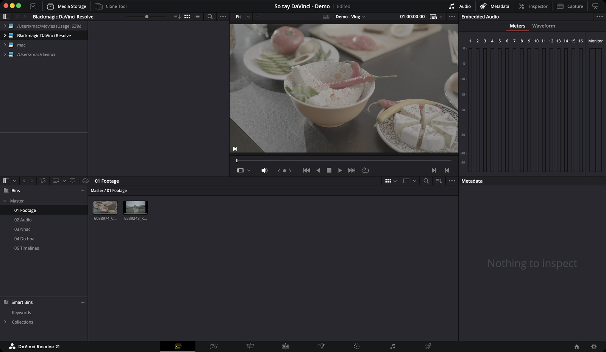

# Media — nạp và tổ chức

Trang đầu tiên. Nơi footage đi vào project.

Khác với phần mềm khác dùng hộp thoại Import, Resolve dành hẳn một trang cho việc này — vì ở dự án lớn, nạp và sắp xếp media là cả một công đoạn.

**Dùng khi:** đầu mỗi dự án, và mỗi lần có footage mới. Dựng vlog nhỏ thì có thể bỏ qua trang này, nạp thẳng ở trang Cut.

> **Resolve không copy file vào project.** Nó chỉ ghi lại đường dẫn tới file trên ổ. Vì vậy hãy copy footage về ổ nhanh, đặt đúng chỗ **trước khi** nạp. Đổi tên hay dời file sau khi nạp là clip bị offline.

---

## Trang Media làm được gì

| Việc | Mức | Đọc ở |
|---|---|---|
| Duyệt ổ, xem thử clip trước khi nạp | ★★★ Hằng ngày | [Media Storage](media-storage.md) |
| Nạp file, nạp cả thư mục thành bin | ★★★ Hằng ngày | [Nạp media](nap-media.md) |
| Chia bin, tìm clip, đổi tên hiển thị | ★★★ Hằng ngày | [Media Pool](media-pool.md), [Bin](bin.md) |
| Nối lại clip bị offline (đỏ) | ★★☆ Thường dùng | [Media offline](nap-media.md#media-offline--khi-clip-hiện-đỏ) |
| Đồng bộ tiếng thu rời với hình | ★★☆ Thường dùng | [Đồng bộ tiếng](nap-media.md#đồng-bộ-tiếng-thu-rời-với-hình) |
| Tạo proxy / optimized media cho máy yếu | ★★☆ Thường dùng | [Proxy và Optimized Media](nap-media.md#proxy-và-optimized-media) |
| Sửa clip đọc sai fps, tiếng một bên tai | ★★☆ Thường dùng | [Clip Attributes](clip-attributes.md) |
| Gõ keyword, scene, take, chấm sao | ★★☆ Thường dùng | [Metadata Editor](metadata.md) |
| Backup thẻ nhớ có kiểm tra checksum | ★★☆ Thường dùng | [Clone Tool](clone-tool.md) |
| Lọc clip tự động theo điều kiện | ★☆☆ Tình huống cụ thể | [Smart Bin](bin.md#3-smart-bin) |
| Dùng chung clip cho mọi project | ★☆☆ Tình huống cụ thể | [Power Bin](bin.md#2-power-bin) |
| Cắt video đã dựng thành từng cảnh | ★☆☆ Tình huống cụ thể | [Scene Cut Detection](nap-media.md#cắt-video-đã-dựng-thành-từng-cảnh) |
| Tìm clip bằng AI, chép lời, đọc bảng clapper | `Studio` | [Media Pool](media-pool.md#tìm-clip), [Metadata](metadata.md#metadata-bằng-ai) |

---

## Năm vùng của trang Media

Mặc định trang chia làm năm vùng:

| Vùng | Vị trí | Dùng để | Mức |
|---|---|---|---|
| **Media Storage** | Trên trái | Duyệt ổ cứng, xem clip **trước khi** nạp | ★★★ |
| **Viewer** | Trên phải | Xem clip, đặt điểm vào/ra | ★★★ |
| **Audio Panel** | Dưới Viewer | Đồng hồ đo tiếng, hoặc dạng sóng để đồng bộ | ★★☆ |
| **Metadata Editor** | Phải | Thông tin clip, nơi gõ ghi chú | ★★☆ |
| **Media Pool** | Dưới | Kho clip của project | ★★★ |

Thêm hai panel bật khi cần: **Inspector** (chỉnh clip trước khi dựng) và **Clone Tool** (copy thẻ nhớ có kiểm tra).

Từng nút của từng vùng: xem [Giao diện trang Media](giao-dien.md).

## Thanh Interface Toolbar

Nằm **trên cùng trang Media**. Tám nút, kể từ trái sang phải — đây là thứ bạn bấm để bật tắt từng vùng:

| # | Nút | Làm gì | Mức |
|---|---|---|---|
| 1 | **Media Storage full/half height** | Cho Media Storage chiếm hết chiều cao màn hình, đổi lại Media Pool bị thu nhỏ | ★☆☆ |
| 2 | **Media Storage** | Ẩn/hiện Media Storage. Ẩn đi thì Viewer rộng ra | ★★☆ |
| 3 | **Clone Tool** | Ẩn/hiện công cụ copy thẻ nhớ | ★★☆ |
| 4 | **Audio Panel** | Ẩn/hiện panel âm thanh | ★★☆ |
| 5 | **Metadata** | Ẩn/hiện Metadata Editor | ★★☆ |
| 6 | **Inspector** | Ẩn/hiện Inspector | ★★☆ |
| 7 | **Capture** | Chuyển Viewer và Audio Panel sang chế độ thu từ đầu băng | ★☆☆ |
| 8 | **Audio/Metadata full/half height** | Cho Audio Panel hoặc Metadata chiếm hết chiều cao | ★☆☆ |

**Ví dụ:** đang gõ keyword cho 100 clip, cần Metadata Editor dài hơn → bấm nút 8. Xong việc nạp, cần Viewer to để xem kỹ → bấm nút 2 ẩn Media Storage.

Đổi kích thước vùng: kéo đường viền giữa hai panel bất kỳ. Về bố cục gốc: **Workspace → Reset UI Layout**.

> Bảng đầy đủ từng nút của mọi vùng: [Giao diện trang Media](giao-dien.md#interface-toolbar--dải-nút-trên-cùng).

---

## Quy trình 5 bước cho người mới

Một buổi đổ footage điển hình, từ thẻ nhớ tới lúc sẵn sàng dựng:

| Bước | Làm gì | Ở đâu |
|---|---|---|
| 1 | **Backup thẻ nhớ** ra ổ cứng, có kiểm tra checksum | [Clone Tool](clone-tool.md) |
| 2 | **Tạo bin** cho từng loại: footage, audio, nhạc, đồ hoạ | [Bin](bin.md) |
| 3 | **Nạp media** từ ổ backup vào đúng bin. Gặp hộp thoại đổi frame rate thì đọc kỹ | [Nạp media](nap-media.md) |
| 4 | **Xem và gắn nhãn**: đánh dấu take tốt, gõ keyword | [Metadata](metadata.md) |
| 5 | **Sửa clip đọc sai** (fps, tiếng một bên tai) | [Clip Attributes](clip-attributes.md) |

**Ví dụ — một buổi quay phỏng vấn:** Clone thẻ máy A và thẻ máy thu tiếng ra hai ổ. Tạo bin `01_Phong-van`, `02_B-roll`, `03_Audio`. Nạp từng thư mục vào đúng bin. Chạy **Auto Sync Audio** để ghép tiếng. Gõ keyword tên nhân vật. Sửa clip nào tiếng chỉ ra một tai.

> **Dự án nhỏ (vlog, dưới 30 clip):** bỏ qua bước 4. Kéo thư mục footage vào Media Pool là đủ, sang trang Cut dựng luôn.

---

## Mẹo: bật chỉ báo focus

`★☆☆ Tình huống cụ thể`

Mặc định **tắt**. Khi bật, panel đang nhận phím tắt sẽ có viền cam ở cạnh trên — rất hữu ích khi bạn bấm phím mà không hiểu sao nó tác động nhầm chỗ.

Bật ở: **DaVinci Resolve → Preferences → User → UI Settings → Show focus indicators in the user interface**.

---

## Dùng hai màn hình

`★☆☆ Tình huống cụ thể`

**Workspace → Dual Screen → On**.

Màn chính giữ Media Storage và Media Pool. Màn phụ hiện Viewer to, Audio Panel, Metadata Editor và **bộ scope đầy đủ** — tiện để soi chất lượng footage ngay lúc nạp.

Đổi chiều: **Workspace → Primary Display → Display 1 / Display 2**.

Màn hình siêu rộng một cái cũng dùng được chế độ này, Resolve tự chia đôi.

Màn phụ chỉ đổi được kích thước các vùng, không sắp xếp lại được.

> **Chỉ một màn hình mà muốn bin to?** Chuột phải bin → **Open As New Window**. Cửa sổ bin kéo ra đâu cũng được. Xem [Media Pool](media-pool.md#mở-bin-ra-cửa-sổ-riêng).

---

## Các trang con

* [Giao diện — từng nút nằm ở đâu](giao-dien.md)
* [Media Storage — duyệt ổ cứng](media-storage.md)
* [Media Pool — kho clip](media-pool.md)
* [Bin, Power Bin, Smart Bin](bin.md)
* [Nạp media vào project](nap-media.md)
* [Metadata Editor](metadata.md)
* [Clip Attributes — sửa thông số clip](clip-attributes.md)
* [Clone Tool — backup thẻ nhớ](clone-tool.md)
