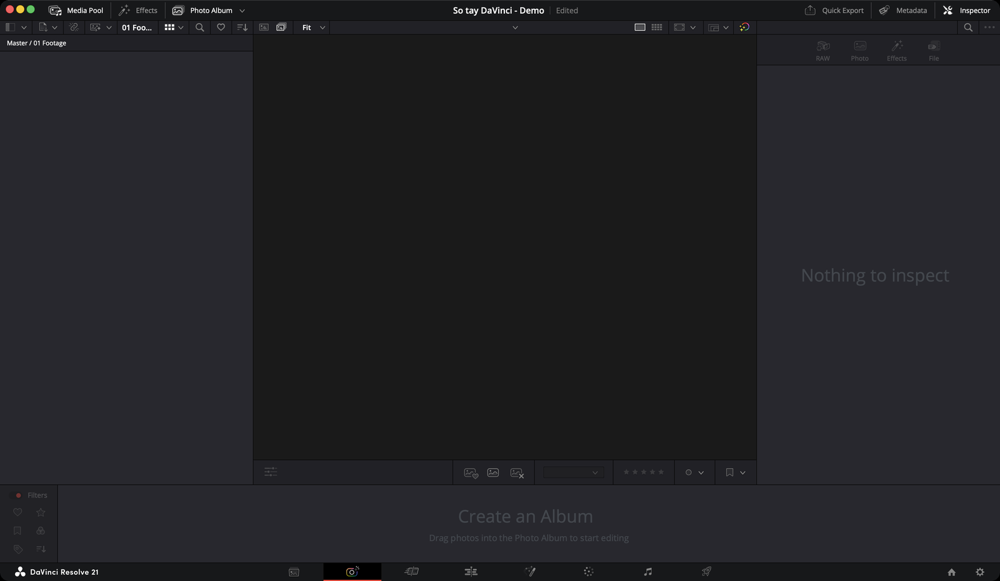
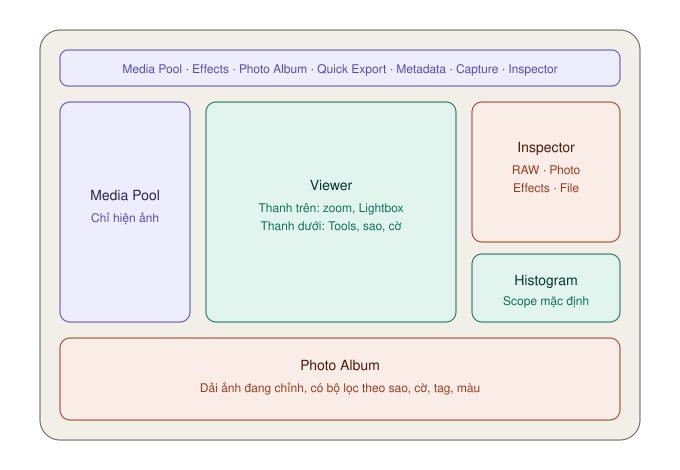

# Photo — chỉnh ảnh tĩnh

> **Một câu:** trang Photo là phần mềm chỉnh ảnh nằm ngay trong Resolve — giống Lightroom, nhưng ảnh chỉnh xong đưa thẳng sang video được.

Trang mới từ bản 21, nằm **thứ 2** trên dãy icon (icon máy ảnh).

## Khi nào dùng trang Photo

| Dùng **Photo** khi | Dùng trang khác khi |
|---|---|
| Chỉnh ảnh RAW từ máy ảnh | Ảnh chỉ là một phần nhỏ trong video → chỉnh luôn ở trang [Color](../color/README.md) |
| Lọc, chấm sao, chọn ảnh từ cả buổi chụp | Cần retouch, xoá vật thể → Photoshop |
| Muốn ảnh và video cùng một tông màu | Xử lý hàng nghìn ảnh mỗi tuần → Lightroom nhanh hơn |
| Chụp sản phẩm cắm máy trực tiếp | |

## Ba điều cần hiểu trước

### 1. Mọi chỉnh sửa đều không phá huỷ

File ảnh gốc **không bao giờ bị đụng tới**. Mọi thay đổi lưu trong project Resolve. Chỉnh hỏng thì reset, file gốc vẫn nguyên.

### 2. Album là trung tâm

**Photo Album** với trang Photo giống như **timeline** với trang Edit. Bạn đưa ảnh vào album rồi mới chỉnh, lọc, xuất.

Khác timeline ở chỗ: album **không có thứ tự trước sau**, **không có độ phân giải hay frame rate cố định** — mỗi ảnh giữ nguyên kích thước gốc.

### 3. Chỉnh một ảnh = chỉnh ở mọi album

Nếu một ảnh nằm trong hai album, chỉnh ở album này thì album kia **cũng đổi theo**. Muốn có hai phiên bản khác nhau của cùng một ảnh, dùng [Versions](nap-va-album.md#versions--nhiều-phiên-bản-của-một-ảnh).

## Tính năng hay dùng nhất

| Mức | Tính năng | Dùng để |
|---|---|---|
| ★★★ | [Tab RAW — cân bằng trắng, phơi sáng](chinh-anh.md#tab-raw--chỉnh-từ-dữ-liệu-gốc) | Chỉnh ảnh RAW từ dữ liệu cảm biến |
| ★★★ | [Tab Photo — Adjustments](chinh-anh.md#tab-photo--adjustments) | Chỉnh màu, tương phản cho mọi loại ảnh |
| ★★★ | [Chấm sao, gắn cờ](nap-va-album.md#chấm-sao-gắn-tag-gắn-cờ) | Lọc ảnh đẹp từ cả buổi chụp |
| ★★★ | [Crop](chinh-anh.md#crop) | Cắt khung, đổi tỉ lệ |
| ★★★ | [Quick Export](xuat-anh.md#quick-export) | Xuất JPG, PNG |
| ★★☆ | [Copy chỉnh sửa sang ảnh khác](chinh-anh.md#áp-cùng-chỉnh-sửa-cho-nhiều-ảnh) | Chỉnh một ảnh, áp cho cả loạt |
| ★★☆ | [Lightbox](giao-dien.md#lightbox--xem-cả-album-cùng-lúc) | Xem cả album cùng lúc, chỉnh một ảnh thấy cả loạt đổi theo |
| ★★☆ | [Auto Balance](chinh-anh.md#auto-balance--bắt-đầu-từ-đây) | Cân bằng tự động một nút |
| ★★☆ | [Versions](nap-va-album.md#versions--nhiều-phiên-bản-của-một-ảnh) | Thử nhiều kiểu chỉnh trên cùng một ảnh |
| ★★☆ | [Effects](hieu-ung.md) | Thêm hiệu ứng: grain, vignette, glow |
| ★★☆ | [Đưa album sang trang Color](xuat-anh.md#đưa-album-sang-trang-color) | Dùng toàn bộ công cụ chỉnh màu điện ảnh |
| ★☆☆ | [Tạo LUT từ ảnh đã chỉnh](chinh-anh.md#lưu-tông-màu-thành-lut) | Mang tông màu sang video |
| `Studio` | Capture — chụp cắm máy, IntelliSearch, CineFocus, Film Look Creator | |

## Ví dụ: chỉnh một ảnh RAW Canon từ đầu đến cuối

Tình huống thực tế: bạn có file `IMG_7912.CR3` chụp ngoài trời, hơi tối, ám xanh.

1. **Nạp:** mở trang Photo, nút **Import Media** trên đầu Media Pool, chọn file.
2. **Tạo album:** chuột phải trong Media Pool → **New Photo Album**. Chuột phải ảnh → **Add Photo(s) to Album**.
3. **Mở Inspector:** nút **Inspector** góc trên phải → tab **RAW** (sáng lên vì đây là file RAW).
4. **Cân bằng trắng:** **White Balance** → chọn **Daylight** (chụp ngoài trời nắng). Vẫn ám xanh thì kéo **Color Temp** lên thêm vài trăm Kelvin.
5. **Phơi sáng:** **Exposure** từ `0` lên `+0.7`. Trời bị cháy thì kéo **Highlights** xuống `-40`. Vùng tối mất chi tiết thì kéo **Shadows** lên `+25`.
6. **Màu:** **Color Boost** lên `+15` cho những chỗ màu nhạt tươi hơn mà da người không bị quá đà.
7. **Độ nét:** **Midtone Detail** lên `+10`.
8. **Cắt khung:** nút **Tools** dưới đáy Viewer → **Crop** → **Aspect Ratio** chọn `4:5` (khung Instagram).
9. **Xuất:** nút **Quick Export** trên toolbar → chọn **JPEG** → **Export**.

Từ bước 3 tới 7 là toàn bộ việc cân bằng và chỉnh sáng — đều nằm trong một tab duy nhất.

## Các trang con

* [Giao diện — từng nút nằm ở đâu](giao-dien.md)
* [Nạp ảnh, album, chấm sao, versions](nap-va-album.md)
* [Chỉnh ảnh — tab RAW, tab Photo, Tools](chinh-anh.md)
* [Hiệu ứng ảnh](hieu-ung.md)
* [Xuất ảnh, đưa sang trang Color](xuat-anh.md)
