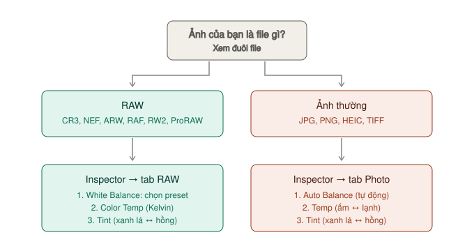

# Chỉnh ảnh — tab RAW, tab Photo, Tools

Mọi thanh chỉnh ảnh nằm ở **hai chỗ**:

- **Inspector** (nút góc trên phải) — các thanh trượt, chỉnh bằng số
- **Tools** (nút góc dưới trái Viewer) — kéo trực tiếp trên ảnh

Inspector có **bốn tab** ở trên cùng: **RAW · Photo · Effects · File**.

| Tab | Chứa gì | Khi nào sáng |
|---|---|---|
| **RAW** | Chỉnh từ dữ liệu cảm biến gốc | Chỉ khi ảnh là file RAW. JPG/PNG thì tab này xám |
| **Photo** | Xoay, crop, màu, tương phản | Mọi ảnh |
| **Effects** | Thông số hiệu ứng đã áp | Chỉ khi ảnh có hiệu ứng |
| **File** | Thông tin, metadata | Mọi ảnh |

---

## Cân bằng trắng chỉnh ở đâu?

**Ảnh RAW** → **Inspector → tab RAW** → mục **White Balance**, **Color Temp**, **Tint**.
**Ảnh JPG, PNG, HEIC** → **Inspector → tab Photo** → mục **Adjustments** → **Auto Balance**, **Temp**, **Tint**.

Ảnh RAW thì **luôn chỉnh ở tab RAW trước**. Lý do: tab RAW chỉnh trên dữ liệu cảm biến **trước khi** thành ảnh màu, nên giữ được nhiều thông tin hơn hẳn. Tab Photo chỉnh **sau khi** ảnh đã thành hình, dư địa ít hơn.

---

## Tab RAW — chỉnh từ dữ liệu gốc

`★★★ Hằng ngày` với ảnh RAW

> Manual khuyên: với ảnh RAW, đây là **cách được ưu tiên** để chỉnh phơi sáng và màu, vì nó dùng dữ liệu cảm biến thuần và được tinh chỉnh riêng cho từng hãng máy.

### Nhóm 1 — Giải mã

| Thanh | Làm gì | Đặt gì |
|---|---|---|
| **Decode Quality** | Giải mã ảnh ở độ phân giải Full, Half, Quarter | Máy yếu thì để **Half** khi chỉnh. Xuất luôn dùng chất lượng thật |
| **Color Space** | Không gian màu để chỉnh và xuất | Để mặc định trừ khi bạn biết mình đang làm gì |
| **Gamma** | Đường cong gamma | Như trên |

### Nhóm 2 — Cân bằng trắng

| Thanh | Làm gì | Kéo thế nào |
|---|---|---|
| **White Balance** | Chọn **preset** theo ánh sáng lúc chụp. Chọn xong, Temp và Tint tự nhảy theo | Xem bảng preset bên dưới |
| **Color Temp** | Nhiệt độ màu, đơn vị **Kelvin** | Ảnh **ám xanh** (lạnh) → kéo **lên**. Ảnh **ám cam** (nóng) → kéo **xuống** |
| **Tint** | Trục **xanh lá ↔ hồng tím** | Ảnh **ám xanh lá** (đèn huỳnh quang) → kéo **lên**. Ảnh **ám hồng** → kéo **xuống** |

**Preset White Balance:**

| Preset | Chọn khi chụp dưới |
|---|---|
| **As Shot** | Giữ đúng cài đặt máy lúc chụp — mặc định |
| **Daylight** | Nắng trực tiếp ban ngày |
| **Cloudy** | Trời âm u |
| **Shade** | Bóng râm |
| **Tungsten** | Đèn sợi đốt vàng, đèn trong nhà |
| **Fluorescent** | Đèn huỳnh quang, đèn tuýp |
| **Flash** | Đèn flash |

**Cách làm nhanh nhất:** chọn preset gần đúng nhất trước, rồi tinh chỉnh **Color Temp** và **Tint** bằng mắt.

**Cách làm chính xác nhất:** tìm trong ảnh một vật **đáng lẽ màu trắng hoặc xám** (tường trắng, áo trắng, bê tông), chỉnh Temp và Tint đến khi vật đó trông trung tính — không ngả màu nào.

### Nhóm 3 — Sáng tối

| Thanh | Làm gì | Dải giá trị | Mặc định |
|---|---|---|---|
| **Exposure** | Phơi sáng, tính theo **stop** | −5 tới +5 | 0 |
| **Highlights** | Kéo **xuống** để cứu vùng sáng bị cháy | −100 tới +100 | 0 |
| **Shadows** | Kéo **lên** để lấy lại chi tiết vùng tối | −100 tới +100 | 0 |
| **Lift** | Điểm đen. Kéo lên làm vùng tối xám đi, kéo xuống làm đen sâu hơn | −100 tới +100 | 0 |
| **Gain** | Điểm trắng. Kéo lên làm vùng sáng sáng hơn | −100 tới +100 | 0 |
| **Contrast** | Tương phản. Kéo lên thì tối tối hơn, sáng sáng hơn, trung gian giữ nguyên | −100 tới +100 | 0 |

> **Không sợ kéo quá tay.** Manual ghi rõ: kéo Exposure làm ảnh vượt mức trắng thì dữ liệu **vẫn được giữ nguyên**, kéo lại là lấy lại được.

### Nhóm 4 — Màu và chi tiết

| Thanh | Làm gì | Dải giá trị | Mặc định |
|---|---|---|---|
| **Color Boost** | Tăng độ tươi ở **những chỗ còn nhạt màu**, không đụng chỗ đã đậm — giống **Vibrance** của Lightroom | −100 tới +100 | 0 |
| **Saturation** | Tăng/giảm độ đậm của **mọi màu** đều nhau | −100 tới +100 | 0 |
| **Midtone Detail** | Độ nét cảm nhận ở vùng nhiều chi tiết — giống **Clarity**. Số âm làm mềm da | −100 tới +100 | 0 |
| **Sharpness** | Làm nét lúc giải mã | 0 tới 100 | **10** |
| **Noise Reduction** | Giảm nhiễu. Ảnh ISO cao hoặc chụp tối cần | — | — |

**Color Boost hay Saturation?** Gần như luôn chọn **Color Boost**. Saturation làm da người bị cam đỏ trước khi phần còn lại đủ tươi. Color Boost tránh được chuyện đó vì nó chừa những màu đã đậm.

### Thứ tự kéo các thanh trong tab RAW

1. **White Balance** — chọn preset
2. **Color Temp**, **Tint** — tinh chỉnh
3. **Exposure** — cho tổng thể đủ sáng
4. **Highlights** — cứu trời, cứu vùng cháy
5. **Shadows** — lấy lại vùng tối
6. **Contrast** — tạo chiều sâu
7. **Color Boost** — cho màu tươi
8. **Midtone Detail** — độ nét

Cân bằng trắng **trước** phơi sáng, vì ảnh ám màu sẽ đánh lừa mắt khi đánh giá độ sáng.

### Reset riêng tab RAW

Menu **ba chấm** góc trên phải Inspector → **Reset Camera Raw**.

---

## Tab Photo — Adjustments

`★★★ Hằng ngày` — với mọi ảnh

Tab này có bốn nhóm: **Source Transform · Source Cropping · Looks · Adjustments**. Phần chỉnh màu nằm ở **Adjustments**.

### Auto Balance — bắt đầu từ đây

`★★☆ Thường dùng`

**Một nút**, tự cân lại dải sáng và cân bằng trắng bằng machine learning.

**Dùng khi:** không biết bắt đầu từ đâu. Bấm Auto Balance, xem kết quả, rồi chỉnh tiếp bằng tay. Thường là điểm khởi đầu tốt hơn ảnh gốc.

### Các thanh trong Adjustments

| Thanh | Kéo sang phải | Kéo sang trái | Mặc định |
|---|---|---|---|
| **Temp** | Ấm hơn, ngả cam | Lạnh hơn, ngả xanh dương | 0 |
| **Tint** | Ngả hồng tím — sửa ánh đèn huỳnh quang | Ngả xanh lá | 0 |
| **Lift** | Vùng tối sáng lên, tương phản giảm | Vùng tối đen sâu hơn | — |
| **Gamma** | Cả ảnh sáng hơn | Cả ảnh tối hơn | — |
| **Gain** | Vùng sáng sáng hơn, dễ cháy | Vùng sáng tối đi | — |
| **Contrast** | Tương phản tăng quanh điểm Pivot | Tương phản giảm | — |
| **Pivot** | Dời tâm tương phản lên vùng sáng | Dời tâm xuống vùng tối | — |
| **Midtone Details** | Nét hơn ở vùng nhiều chi tiết | Mềm vùng ít chi tiết — mịn da | 0 |
| **Shadows** | Lấy lại chi tiết vùng tối | Vùng tối tối hơn | 0 |
| **Highlights** | Vùng sáng sáng hơn | Cứu vùng cháy | 0 |
| **Saturation** | Đậm hơn (100 = gấp đôi) | Nhạt hơn (0 = đen trắng) | **50** |
| **Hue** | Xoay mọi màu theo vòng màu | Xoay ngược | **50** |

> **Bẫy hay gặp:** **Saturation** ở tab Photo **mặc định là 50**, không phải 0. Muốn ảnh đen trắng thì kéo về **0**. Còn Saturation ở tab RAW mặc định là 0 và chạy từ −100. Hai thanh cùng tên nhưng thang khác nhau.

### Pivot dùng khi nào

Ảnh **tối** mà tăng Contrast → vùng tối bị bệt đen. Hạ **Pivot** xuống trước rồi mới tăng Contrast.
Ảnh **sáng** mà tăng Contrast → vùng tối không đủ đậm. Nâng **Pivot** lên.

### Looks — tông màu có sẵn

Mục **Looks → Type**: chọn một tông màu preset từ danh sách. Để **Default (Original)** là không dùng.

Chọn look xong vẫn chỉnh tiếp được bằng các thanh Adjustments.

### Source Transform

Zoom, Position, Rotation, Pitch, Yaw, Flip — giống hệt [Transform ở trang Cut](../cut/tools.md#transform--phóng-to-dời-xoay).

**Dùng nhiều nhất:** **Rotation Angle** để chỉnh đường chân trời bị nghiêng. Phím tắt xoay 90°: `⌘[` / `⌘]`.

### Source Cropping

| Thanh | Làm gì |
|---|---|
| **Ratio** | Tỉ lệ khung. **As Shot** là giữ tỉ lệ máy |
| **Lock Aspect Ratio** | Tick để crop vẫn giữ đúng tỉ lệ đã chọn |
| **Crop Left / Right / Top / Bottom** | Cắt bao nhiêu pixel mỗi cạnh |

Crop bằng số ở đây, hoặc kéo trực tiếp bằng [Tools → Crop](#crop).

### Reset tab Photo

`⌘R` (Inspector phải đang được chọn), hoặc menu ba chấm → **Reset Photo**.

---

## Tools — chỉnh trực tiếp trên Viewer

Bấm **Tools** ở **góc dưới trái Viewer**. Ba nhóm hiện ra: **Transform · Crop · Looks**, cộng **Effects Overlay**.

Mỗi nhóm có nút **Toggle** ngoài cùng trái (bật/tắt không mất chỉnh sửa) và **Reset** ngoài cùng phải.

> **Quan trọng:** khi đang mở Tools, Viewer vẫn hiện **khung ảnh gốc** bên dưới lưới để bạn căn. Transform và Crop chỉ **áp vào ảnh khi bạn đóng thanh Tools lại**.

### Transform

`★★☆ Thường dùng`

| Kéo | Làm gì |
|---|---|
| Trong khung | Dời ảnh |
| Góc chéo | Phóng to giữ tỉ lệ |
| Cạnh | Kéo giãn một chiều |
| Tay nắm giữa | Xoay |

Nút **Zoom Link** (ổ khoá): bật để phóng to giữ đúng tỉ lệ ảnh.

### Crop

`★★★ Hằng ngày`

| Điều khiển | Làm gì |
|---|---|
| **Aspect Ratio** | Chọn tỉ lệ có sẵn hoặc tự đặt. Mặc định **As Shot** |
| **Lock Aspect Ratio** (ổ khoá) | Khoá tỉ lệ khi kéo crop. Mở khoá để crop tự do |
| Tay nắm mỗi cạnh trên Viewer | Kéo để cắt cạnh đó |

**Tỉ lệ hay dùng:**

| Tỉ lệ | Dùng cho |
|---|---|
| **1:1** | Ảnh đại diện, lưới Instagram cũ |
| **4:5** | Bài đăng Instagram dọc — chiếm nhiều diện tích màn hình nhất |
| **9:16** | Story, Reels, TikTok |
| **3:2** | In ảnh, tỉ lệ gốc máy ảnh full-frame |
| **16:9** | Thumbnail YouTube, hình nền |

### Looks

| Điều khiển | Làm gì |
|---|---|
| **Auto Balance** | Tự cân bằng — giống nút trong tab Photo |
| **Look Selector** | Chọn tông màu preset |

---

## Áp cùng chỉnh sửa cho nhiều ảnh

`★★☆ Thường dùng` — chỉnh một ảnh, áp cho cả loạt cùng buổi chụp

### Cách 1 — Click chuột giữa (nhanh nhất)

1. Trong album, **chọn những ảnh muốn nhận chỉnh sửa**.
2. **Click chuột giữa** vào ảnh đã chỉnh xong.

Xong. Lưu ý:
- **Không** copy hiệu ứng.
- **Có** copy thiết lập RAW, nhưng chỉ khi các ảnh **cùng loại RAW** (cùng là CR3 với nhau chẳng hạn).

### Cách 2 — Paste Attributes (chọn được copy gì)

1. Chọn ảnh đã chỉnh → `⌘C`.
2. Chọn các ảnh muốn nhận.
3. `⌥V` (hoặc chuột phải → **Paste Attributes**).
4. Tick những thứ muốn dán → **Apply**.

Muốn dán cả **hiệu ứng**: tick ô **Plugins** trong mục Photo Attributes.

### Gỡ bớt chỉnh sửa

Chọn ảnh → chuột phải → **Remove Attributes** → tick thứ muốn gỡ → **Apply**.

---

## Lưu tông màu thành LUT

`★☆☆ Tình huống cụ thể`

**Dùng khi:** chỉnh được một tông ảnh ưng ý, muốn áp đúng tông đó cho **video** hoặc cho project khác.

**Tạo LUT:**
1. Chuột phải ảnh trong album → **Generate LUT**.
2. Chọn **33 Point Cube** — loại tương thích rộng nhất.
3. Nạp lại LUT đó vào Resolve để dùng.

> Chỉ thiết lập ở **tab Photo** được lưu vào LUT. Thiết lập **tab RAW** và **hiệu ứng** thì **không**.

**Áp LUT có sẵn cho ảnh:** chuột phải thumbnail ảnh → **LUT** → chọn.

---

## Reset

Menu **ba chấm** góc trên phải Inspector:

| Lệnh | Phím | Làm gì |
|---|---|---|
| **Reset Photo** | `⌘R` | Bỏ mọi chỉnh sửa ở tab Photo |
| **Remove All Photo Effects** | `⇧R` | Gỡ mọi hiệu ứng |
| **Reset Camera Raw** | — | Bỏ mọi chỉnh sửa ở tab RAW |
| **Remove and Reset All** | `⌘⇧R` | Đưa ảnh về nguyên gốc hoàn toàn |

Các phím tắt chỉ chạy khi **Inspector đang được chọn** — bấm vào Inspector trước.

---

## Cần nhiều công cụ hơn?

Tab RAW và tab Photo đủ cho phần lớn ảnh. Khi cần chỉnh **riêng một vùng** (chỉ làm sáng mặt, chỉ đổi màu trời), đưa album sang trang **Color** để dùng node, Qualifier, Power Window — xem [Đưa album sang trang Color](xuat-anh.md#đưa-album-sang-trang-color).
