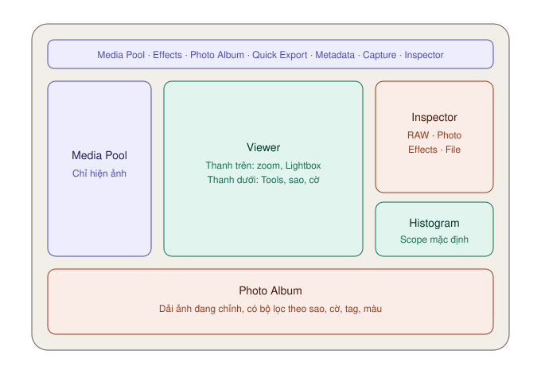
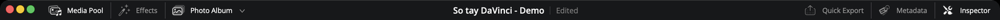
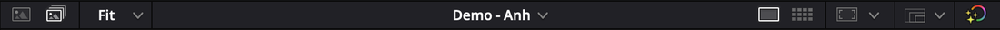
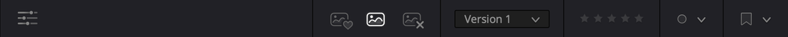

# Giao diện trang Photo — từng nút nằm ở đâu

*Toolbar trên cùng, Media Pool bên trái, Viewer ở giữa, Inspector bên phải, dải Photo Album ở đáy.*

---

## Thanh toolbar trên cùng

*Trái: Media Pool, Effects, Photo Album. Phải: Quick Export, Metadata, Inspector. Bản Studio có thêm nút Capture.*

Bảy nút, từ trái sang phải:

| # | Nút | Làm gì | Mức |
|---|---|---|---|
| 1 | **Media Pool** | Ẩn/hiện kho ảnh. Ở trang này **chỉ hiện ảnh tĩnh** — video, tiếng, timeline đều bị ẩn | ★★★ |
| 2 | **Effects Library** | Ẩn/hiện kho hiệu ứng ảnh | ★★☆ |
| 3 | **Photo Album** | Mở dải album ở đáy màn hình | ★★★ |
| 4 | **Quick Export** | Xuất ảnh nhanh — xem [Xuất ảnh](xuat-anh.md) | ★★★ |
| 5 | **Metadata** | Thông tin và ghi chú của ảnh. Mở **ở cùng chỗ với Inspector** | ★☆☆ |
| 6 | **Capture** | Chụp cắm máy trực tiếp | `Studio` |
| 7 | **Inspector** | Toàn bộ thanh chỉnh ảnh, cả RAW lẫn ảnh thường — xem [Chỉnh ảnh](chinh-anh.md) | ★★★ |

> **Mẹo:** màn hình nhỏ thì tắt **Media Pool** và **Effects Library** khi đang chỉnh. Viewer to ra, soi chi tiết dễ hơn.

---

## Thanh trên của Viewer

*Chọn nguồn xem, mức zoom, Single View hay Lightbox.*

Từ trái sang phải:

| Nút | Làm gì | Mức |
|---|---|---|
| **Source** | Xem ảnh đang chọn trong Media Pool | ★★☆ |
| **Photo Album** | Xem ảnh đang chọn trong album | ★★★ |
| **Zoom %** | Mức phóng to. `⌘Z` vừa khung, `⌥⇧Z` đúng 100% | ★★★ |
| **Album List** | Album đang mở. Bấm mũi tên để mở nhanh album gần đây | ★★☆ |
| **Single View** | Một ảnh to | ★★★ |
| **Lightbox** | Lưới thumbnail cả album — xem [Lightbox](#lightbox--xem-cả-album-cùng-lúc) | ★★☆ |
| **Viewer Guides** | Khung an toàn, thước đo, đường gióng | ★☆☆ |
| **Photo Preview Resolution** | Giảm độ phân giải xem trước cho máy chạy nhanh | ★☆☆ |
| **Bypass Color and Fusion** | Tắt tạm mọi chỉnh sửa để so với ảnh gốc (`⇧D`). **Chuột phải** để chọn chỉ tắt phần Color hoặc chỉ tắt phần Fusion | ★★★ |
| **Capture Live View** | Màn hình chụp cắm máy | `Studio` |

> **`⇧D` là phím so sánh trước/sau nhanh nhất.** Bấm một lần thấy ảnh gốc, bấm lần nữa thấy ảnh đã chỉnh. Máy yếu cũng có thể bật nút này để Viewer chạy nhẹ hơn khi chỉ cần lọc ảnh.

> **Lưu ý phím `⌘Z`:** ở các trang khác `⌘Z` là hoàn tác. Trong Viewer trang Photo, manual ghi `⌘Z` là **vừa khung ảnh**. Nếu bạn bấm `⌘Z` để hoàn tác mà ảnh chỉ co lại vừa khung, hãy bấm vào chỗ khác ngoài Viewer trước.

### Photo Preview Resolution — cho máy chạy mượt

Ảnh 40–60 megapixel rất nặng. Resolve mặc định **thu nhỏ khi xem**:

| Chế độ | Xem trước ở |
|---|---|
| **Auto** (mặc định) | Ảnh trên 4K thu về 4K |
| **Full** | Kích thước thật — chậm |
| **Half** | Một nửa |
| **Quarter** | Một phần tư |

Đổi ở đây hoặc **Playback → Photo Album Preview Resolution**.

**Lúc xuất luôn dùng kích thước gốc**, dù bạn đặt xem trước ở mức nào.

---

## Di chuyển trong ảnh

| Thao tác | Làm gì |
|---|---|
| Giữ `H` rồi kéo | Chế độ bàn tay — kéo ảnh đi |
| Bấm đúp vào một vùng | Phóng tới **100%** tại vùng đó — để soi độ nét |
| Bấm đúp lần nữa | Thu về vừa khung |

**Dùng khi:** kiểm tra mắt có nét không, soi nhiễu ở vùng tối.

---

## Lightbox — xem cả album cùng lúc

`★★☆ Thường dùng`

Bấm **Lightbox** trên thanh trên Viewer. Ảnh to biến thành **lưới thumbnail** của cả album. Kéo thanh trượt góc trên trái để đổi cỡ thumbnail.

**Điểm hay nhất:** chọn một ảnh và chỉnh — **cả lưới cập nhật trực tiếp**. Bạn thấy ngay ảnh đó có hợp tông với cả bộ hay không.

**Dùng khi:** chỉnh một bộ ảnh cùng buổi chụp (đám cưới, sản phẩm, du lịch) và muốn cả bộ đồng đều.

---

## Thanh dưới của Viewer

*Từ trái: Tools, ba nút Favorite / Untag / Reject, Version, Star Rating, Color, Flag.*

| Nút | Làm gì | Phím | Mức |
|---|---|---|---|
| **Tools** | Mở các công cụ Transform, Crop, Looks, Effects Overlay — xem [Tools](chinh-anh.md#tools--chỉnh-trực-tiếp-trên-viewer) | | ★★★ |
| **EXIF Data** | Hiện máy ảnh, ISO, tốc độ, khẩu độ, ống kính | | ★★☆ |
| **Favorite** (tim) | Đánh dấu ảnh yêu thích | | ★★★ |
| **Untag** | Bỏ dấu yêu thích hoặc loại | | ★★☆ |
| **Reject** (x) | Đánh dấu loại | | ★★★ |
| **Version Selector** | Đổi giữa các phiên bản đã lưu | | ★★☆ |
| **Star Rating** | Chấm 1–5 sao | `1`–`5`, `0` xoá | ★★★ |
| **Color** | Gắn nhãn màu. Nhãn này vẫn thấy ở các trang khác | | ★☆☆ |
| **Flag** | Gắn cờ màu. Cờ cũng dùng được ở các trang khác | | ★☆☆ |

Phím `S` (tốt) và `X` (loại) làm cùng việc với nút **Favorite** và **Reject**. Bấm lại lần nữa để bỏ tag.

Chi tiết cách lọc ảnh theo các dấu này: [Chấm sao, gắn tag](nap-va-album.md#chấm-sao-gắn-tag-gắn-cờ).

---

## Đường gióng và thước đo

`★☆☆ Tình huống cụ thể`

**Là gì:** lớp phủ chỉ hiện trong Viewer, **không bao giờ in vào ảnh xuất ra**. Có ba thứ:

| Mục | Làm gì |
|---|---|
| **Safe Area** | Khung cho các tỉ lệ khác nhau — thấy ngay phần nào bị cắt nếu đổi tỉ lệ |
| **Rulers** | Thước đo dọc theo mép khung |
| **Guides** | Đường gióng ngang/dọc do bạn tự đặt |

**Dùng khi:** căn sản phẩm vào đúng giữa, đặt đường chân trời theo quy tắc một phần ba, chuẩn bị ảnh cho một khung thiết kế có sẵn.

### Safe Area

Bấm **Viewer Guides** trên thanh trên Viewer → chọn tỉ lệ trong menu xổ. Bấm icon **Safe Area** để bật/tắt khung.

Ví dụ: ảnh ngang sắp đăng Instagram dọc `4:5` — bật khung `4:5` trước khi crop để biết chủ thể còn nằm trọn không.

### Rulers — thước đo

1. **View → Rulers → On**. Hoặc **Viewer Guides** → icon thước trong mục **Ruler Guides**.
2. Chọn đơn vị ở **View → Rulers**, hoặc chuột phải lên thước:

| Đơn vị | Gốc toạ độ | Hợp khi |
|---|---|---|
| **Pixel** | `0,0` ở **giữa** khung | Cần khớp với số **Position** của Transform |
| **Percentage** | `0%,0%` ở **góc trên trái**. Giữa khung là `50%,50%` | Căn theo tỉ lệ, ví dụ một phần ba là `33%` |

### Guides — đường gióng

1. **View → Guides → On**. Hoặc **Viewer Guides** → icon Guides.
2. **View → Guides → Add Guide**. Hoặc chuột phải lên thước → **Add Guides**.
3. Trong hộp thoại, đặt:
   - **Units** — Pixel hoặc Percentage.
   - **Position** — vị trí đường, ví dụ `33` khi Units là Percentage.
   - **Orientation** — ngang hoặc dọc.
   - **Color** — màu đường, chọn màu nổi trên nền ảnh.
4. Bấm **Add**.

**Ví dụ lưới một phần ba:** thêm bốn đường Percentage — dọc `33`, dọc `67`, ngang `33`, ngang `67`.

**Sửa đường đã đặt:**

| Việc | Cách |
|---|---|
| Dời đường | Kéo đường trong Viewer. Ô nhỏ hiện đúng vị trí |
| Đổi vị trí, hướng bằng số | Chuột phải lên đường → **Edit Guide** |
| Xoá một đường | Chuột phải lên đường → **Remove Guide** |
| Xoá tất cả, chỉ đường ngang hoặc chỉ đường dọc | **View → Guides** → chọn loại cần xoá. Hoặc chuột phải lên thước |
| Đổi màu mọi đường | Chuột phải lên thước → **Guide Color** |
| Khoá, tránh kéo nhầm | Icon ổ khoá nhỏ ở góc trên trái thước, hoặc **View → Guides → Lock Guides** |

**Hít vào đường gióng:** khi dời ảnh bằng [Transform](chinh-anh.md#transform), mép ảnh tự hít vào đường gióng. Đường đổi **tím** là đã khớp. Giữ `⌥` trong lúc kéo để tạm tắt hít.

---

## Histogram

Trang Photo mặc định hiện **Histogram** — biểu đồ cho biết có bao nhiêu điểm ảnh ở mỗi mức sáng, quen thuộc với người chụp ảnh. Có thể đổi sang các scope khác của Resolve (Waveform, Parade, Vectorscope) — xem [Scopes](../color/scopes.md).

Bấm icon **mở rộng** góc trên phải histogram để tách ra cửa sổ to hơn.

| Histogram trông thế nào | Nghĩa |
|---|---|
| Dồn sát mép trái | Ảnh tối, có thể mất chi tiết vùng tối |
| Dồn sát mép phải | Ảnh sáng, có thể cháy |
| Trải đều từ trái sang phải | Phơi sáng tốt |
| Cột cao dựng đứng ở sát mép | Vùng đó đã **mất hẳn chi tiết** |

---

## Phím tắt trang Photo

| Việc | Phím |
|---|---|
| Chấm sao | `1`–`5`. `0` xoá sao. Dùng được cả trong album lẫn Media Pool |
| Gắn tag tốt / loại | `S` = tốt · `X` = loại. Bấm lại để bỏ |
| Xoay trái / phải | `⌘[` / `⌘]` |
| Lật ngang / dọc | `⇧[` / `⇧]` |
| Ảnh kế tiếp trong album | `↑` hoặc `←` *(theo manual)* |
| Ảnh trước đó trong album | `↓` hoặc `→` *(theo manual)* |
| Ảnh vừa khung / đúng 100% | `⌘Z` / `⌥⇧Z` |
| Reset tab Photo | `⌘R` *(Inspector phải đang được chọn)* |
| Bỏ mọi hiệu ứng | `⇧R` *(Inspector phải đang được chọn)* |
| Bỏ hiệu ứng và reset tất cả | `⌘⇧R` *(Inspector phải đang được chọn)* |
| So sánh với gốc | `⇧D` |
| Chế độ bàn tay | Giữ `H` |
| Mở tìm hiệu ứng | `⇧Space` |
| Ẩn/hiện điều khiển trên Viewer của hiệu ứng | ``⇧` `` |
| Chụp ảnh khi cắm máy | `C` — `Studio` |

> **Lưu ý:** manual ghi `↑`/`←` là ảnh **kế tiếp** và `↓`/`→` là ảnh **trước đó** — ngược với thói quen. Thử một lần trên máy bạn trước khi lọc cả buổi chụp.
