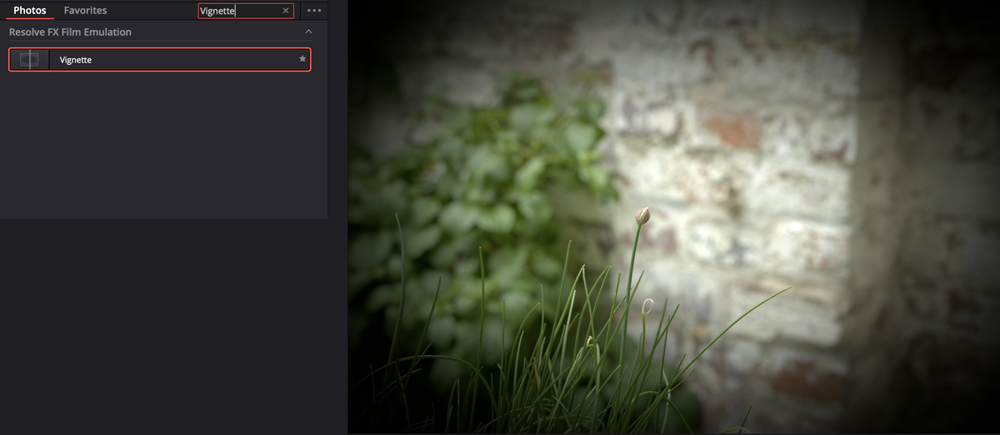

# Hiệu ứng ảnh

Mở bằng nút **Effects Library** trên toolbar. Kho hiệu ứng chia theo nhóm.

Trang Photo chỉ hiện **một nhóm hiệu ứng đã chọn lọc** cho ảnh tĩnh. Muốn dùng toàn bộ kho ResolveFX thì [đưa album sang trang Color](xuat-anh.md#đưa-album-sang-trang-color).

---

## Xem trước, áp, chỉnh

*Gõ tên vào ô Search, rê chuột lên thumbnail là Viewer xem trước, chưa cần áp thật.*

### Xem trước

Rê chuột ngang qua thumbnail hiệu ứng — Viewer hiện ngay kết quả trên ảnh đang chọn với thông số mặc định. Không cần áp thật.

**Hover Scrub Preview** mặc định đã bật. Nếu không thấy xem trước: menu tuỳ chọn (ba chấm) của Effects Library → tick **Hover Scrub Preview**.

### Tìm hiệu ứng

Gõ vào ô tìm kiếm trên đầu Effects Library. Hoặc bấm `⇧Space` để mở hộp tìm nhanh — bấm đúp kết quả là áp luôn vào ảnh đang chọn.

Tìm được cả theo **tên nhóm**: gõ `Stylize` ra mọi hiệu ứng trong nhóm Stylize. Ngoài tiếng Anh, Resolve còn tìm theo ngôn ngữ giao diện bạn đặt ở **Preferences → User → UI Settings**.

### Áp hiệu ứng

| Cho | Cách |
|---|---|
| Một ảnh | Kéo thumbnail hiệu ứng thả lên ảnh trong album. Hoặc chọn ảnh rồi bấm đúp hiệu ứng |
| Nhiều ảnh | Chọn các ảnh (`⌘`+click từng ảnh, `⇧`+click một dãy, `⌘A` tất cả) rồi bấm đúp hiệu ứng |

Áp bao nhiêu hiệu ứng lên một ảnh cũng được.

**Ví dụ:** chọn 12 ảnh trong album `Demo - Anh` bằng `⌘A` → bấm đúp **Vignette**. Cả 12 ảnh có vignette, chỉnh độ mạnh từng ảnh ở tab Effects.

### Chỉnh thông số

**Inspector → tab Effects**. Mọi hiệu ứng đã áp **xếp chồng từ trên xuống dưới** và chạy theo đúng thứ tự đó.

Đổi thứ tự: bấm **mũi tên lên/xuống** cạnh tên hiệu ứng.

Hiệu ứng có điều khiển kéo trên Viewer thì thường tự bật chế độ **Effects Overlay**. Không thấy thì bấm **Tools** → **Effects Overlay** → **Open FX Overlay**. Xem [Effects Overlay](chinh-anh.md#effects-overlay).

> **Thứ tự quan trọng.** Làm nét rồi mới làm mờ viền khác với làm mờ viền rồi mới làm nét. Nguyên tắc chung: hiệu ứng sửa ảnh (sharpen, giảm nhiễu) đặt **trên**, hiệu ứng tạo không khí (vignette, glow) đặt **dưới**.

### Gỡ hiệu ứng

| Muốn | Cách |
|---|---|
| Tắt tạm một hiệu ứng, giữ thông số | **Inspector → tab Effects** → bấm **công tắc cam** cạnh tên hiệu ứng. Bấm lại để bật |
| Xoá một hiệu ứng | **Inspector → tab Effects** → bấm **icon thùng rác** bên phải tên hiệu ứng |
| Gỡ hiệu ứng ở nhiều ảnh | Chọn các ảnh → chuột phải → **Remove Attributes** → tick hiệu ứng cần gỡ → **Apply** |
| Gỡ mọi hiệu ứng của ảnh | `⇧R` (Inspector đang được chọn) |

### Copy hiệu ứng sang ảnh khác

Copy kèm cả thông số đã chỉnh:

1. Chuột phải ảnh có hiệu ứng → **Copy Attributes** (`⌘C`).
2. Chuột phải ảnh nhận → **Paste Attributes** (`⌥V`).
3. Trong mục **Photo Attributes**, tick **Plugins**. Bỏ tick những mục khác nếu chỉ muốn copy hiệu ứng.
4. **Apply**.

> **Lưu ý:** click chuột giữa để copy chỉnh sửa **không** mang theo hiệu ứng. Muốn copy hiệu ứng phải dùng **Paste Attributes**.

### Hiệu ứng yêu thích

Bấm **ngôi sao nhỏ** trên thumbnail, hoặc chuột phải → **Add to Favorites**. Hiệu ứng hiện ở tab **Favorites** của Effects Library. Bỏ: bấm lại ngôi sao, hoặc chuột phải → **Remove from Favorites**.

> Favorite chỉ lưu **hiệu ứng**, không lưu thông số bạn đã chỉnh. Áp lại sẽ về mặc định.

---

## Hiệu ứng nào dùng được ở bản free

Danh sách dưới đối chiếu với nhãn trong manual cho toàn bộ ResolveFX. Không phải hiệu ứng nào cũng có mặt trong kho đã chọn lọc của trang Photo.

### Dùng được ở bản free

| Hiệu ứng | Dùng để | Mức |
|---|---|---|
| **Vignette** | Tối viền, dồn mắt vào giữa ảnh | ★★★ |
| **Sharpen** | Làm nét | ★★★ |
| **Glow** | Vùng sáng toả sáng mềm — ảnh mơ màng, ánh đèn đêm | ★★☆ |
| **Gaussian Blur** | Làm mờ — thường kết hợp mặt nạ | ★★☆ |
| **Light Rays** | Tia sáng xuyên qua cửa sổ, tán cây | ★☆☆ |
| **Film Damage** | Vết xước, bụi, viền phim cũ | ★☆☆ |
| **Mosaic Blur** | Che mặt, che biển số | ★☆☆ |
| **Prism Blur** | Tách màu kiểu lăng kính | ★☆☆ |
| **Blanking Fill** | Lấp viền trống bằng phiên bản mờ của ảnh | ★☆☆ |

### Chỉ có ở `Studio`

| Hiệu ứng | Là gì |
|---|---|
| **Film Grain** | Hạt phim |
| **Film Look Creator** | Bộ giả phim nhựa trọn gói: hạt, halation, bloom, vignette, split tone |
| **CineFocus** | Xoá phông giả bằng AI — tạo độ sâu trường ảnh như ống kính khẩu lớn |
| **Lens Blur** | Xoá phông kiểu ống kính |
| **Tilt-Shift Blur** | Hiệu ứng mô hình thu nhỏ |
| **Lens Flare**, **Lens Reflections**, **Aperture Diffraction** | Hiệu ứng ống kính, loé sáng |
| **Beauty**, **Face Refinement** | Làm đẹp da, chỉnh khuôn mặt |
| **Dehaze** | Xoá sương mù |
| **Contrast Pop** | Tăng tương phản cục bộ |
| **Color Compressor** | Gom màu về một tông |
| **Analog Damage** | Lỗi băng từ, VHS |
| **Depth Map** | Bản đồ độ sâu |
| **Halation** | Quầng đỏ quanh vùng sáng kiểu phim nhựa |
| **UltraSharpen** | Làm nét kiểu mới |

> **Lưu ý:** **Super Scale** (phóng to ảnh chất lượng cao) không phải hiệu ứng mà là tuỳ chọn trong **Clip Attributes**, và là `Studio`.

### Thay thế ở bản free

| Muốn hiệu ứng `Studio` | Làm gần giống ở bản free |
|---|---|
| **Film Grain** | Đưa album sang [trang Fusion](xuat-anh.md#đưa-sang-trang-fusion), thêm node **Film Grain** của Fusion trước node MediaOut. Hoặc phủ một ảnh hạt grain tải về bằng node **Merge** chế độ **Overlay** |
| **Dehaze** | Tab Photo: hạ **Lift**, tăng **Contrast**, tăng **Saturation** nhẹ |
| **Contrast Pop** | Tab RAW hoặc Photo: tăng **Midtone Detail** |
| **Beauty** | Tab Photo: **Midtone Details** về số âm nhẹ (khoảng −15) |
| **Halation**, **Film Look Creator** | **Glow** cường độ thấp + **Vignette** nhẹ + Temp ấm lên |
| **CineFocus**, **Lens Blur** | Sang trang Color: vẽ Power Window quanh chủ thể, đảo ngược, áp Blur |

---

## Công thức hiệu ứng thường dùng

Áp theo đúng thứ tự từ trên xuống. Hiệu ứng nào cũng chỉnh độ mạnh ở **Inspector → tab Effects**.

### Ảnh chân dung mềm mại
1. **Midtone Details** (tab Photo) khoảng −10
2. **Glow** — cường độ thấp
3. **Vignette** — nhẹ

**Dùng khi:** chân dung ngoài trời, ảnh cưới, ảnh sản phẩm mỹ phẩm.

### Ảnh phong cảnh có chiều sâu
1. **Midtone Detail** (tab RAW) khoảng +15
2. **Sharpen** — nhẹ
3. **Vignette** — vừa

**Dùng khi:** núi, đồng cỏ, kiến trúc — ví dụ ảnh trang trại cừu nhiều chi tiết cỏ và mây.

### Ảnh hoài cổ
1. Tab Photo: **Saturation** khoảng 35, **Temp** ấm lên
2. **Film Damage** — nhẹ
3. **Vignette** — mạnh

**Dùng khi:** ảnh kỷ niệm, ảnh quán cà phê, bộ ảnh theo phong cách film cũ.

> **Mẹo:** ưng công thức nào thì lưu lại: áp xong cho một ảnh, dùng [Paste Attributes](#copy-hiệu-ứng-sang-ảnh-khác) với ô **Plugins** để dán cho cả loạt.
