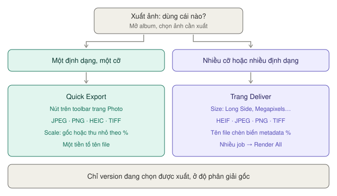

# Xuất ảnh, đưa sang trang Color

Hai cách xuất: **Quick Export** (nhanh, đủ dùng) và **trang Deliver** (đầy đủ tuỳ chọn).

*Một định dạng, một cỡ: Quick Export. Nhiều cỡ, nhiều định dạng, đặt tên theo metadata: trang Deliver.*

| | **Quick Export** | **Trang Deliver** |
|---|---|---|
| Mở ở | Nút trên toolbar trang Photo | Trang Deliver, khi đang mở một album |
| Định dạng | JPEG, PNG, HEIC, TIFF | HEIF, JPEG, PNG, TIFF |
| Đổi cỡ | Gốc hoặc theo % | Gốc, rộng × cao, cạnh ngắn, cạnh dài, %, megapixel |
| Tên file | Một tiền tố | Tên tự đặt + biến metadata + hậu tố + số chữ số |
| Nhiều bản một lượt | Không — xuất từng lần | Có — nhiều job trong Render Queue |

> **Chỉ phiên bản đang chọn của mỗi ảnh mới được xuất.** Nếu ảnh có nhiều [Versions](nap-va-album.md#versions--nhiều-phiên-bản-của-một-ảnh), kiểm tra Version Selector trước.

---

## Quick Export

`★★★ Hằng ngày`

Nút **Quick Export** trên toolbar trang Photo. Cửa sổ này **dành riêng cho ảnh tĩnh**, khác với Quick Export của video.

**Cách dùng:**
1. Chọn ảnh trong album (hoặc không chọn gì nếu xuất cả album).
2. Bấm **Quick Export** trên toolbar.
3. Chọn định dạng ở **cột trái**. Danh sách xem dạng thumbnail hoặc dạng list đều được.
4. Đặt thông số ở **cột phải**. Phía phải cũng hiện thông tin file của ảnh đang chọn.
5. Bấm **Export** → chọn thư mục lưu.

**Ví dụ — gửi khách 30 ảnh xem thử qua Zalo:** JPEG · **Export** cả album · **File Name** `Demo_` · **Scale** `50%` · **Resolution** `72` · **Quality** khoảng 85% · bỏ tick **Include Metadata**.

### Định dạng

| Định dạng | Dùng khi |
|---|---|
| **JPEG** | Đăng mạng, gửi khách. Phổ thông nhất |
| **PNG** | Cần nền trong suốt, hoặc đồ hoạ có chữ |
| **HEIC** | Dung lượng nhỏ hơn JPEG cùng chất lượng — hợp với thiết bị Apple |
| **TIFF** | In ấn, lưu trữ, gửi sang Photoshop |

### Thông số

| Thông số | Làm gì | Đặt gì |
|---|---|---|
| **Export** | Xuất **cả album** hay **chỉ ảnh đang chọn** | |
| **File Name** | Tiền tố tên file | Ví dụ `Cuoi_An_Binh_` |
| **Scale** | Kích thước gốc hoặc thu nhỏ theo % | Gốc cho in, thu nhỏ cho web |
| **Resolution** | Mật độ điểm ảnh, đơn vị ppi | **72** cho web và màn hình · **300** cho in |
| **Quality** | Chất lượng nén | Web: khoảng 85–90%. Lưu trữ: 100% |
| **Compression** | Kiểu nén (tuỳ định dạng) | |
| **Bit Depth** | Độ sâu màu | 8-bit cho JPEG. 16-bit cho TIFF nếu còn chỉnh tiếp |
| **Include Metadata** | Giữ thông tin máy ảnh, ngày chụp | Bỏ tick nếu không muốn lộ vị trí GPS |

Các ô hiện ra tuỳ định dạng bạn chọn — không phải định dạng nào cũng có đủ các ô trên.

> **Lưu ý:** **Resolution** (ppi) không đổi số pixel. Nó chỉ ghi vào file "in ra bao nhiêu điểm mỗi inch". Muốn ảnh nhỏ đi thì đổi **Scale**.

---

## Xuất từ trang Deliver

`★★☆ Thường dùng` — khi cần nhiều kích thước hoặc nhiều định dạng cùng lúc

Đang mở một album mà sang trang **Deliver**, Resolve tự chuyển sang **chế độ xuất ảnh** riêng.

### Cách làm

1. Ở trang Photo, mở album cần xuất. Bấm sang trang **Deliver**.
2. **Render Settings**:
   - **File Name** — tên gốc, ví dụ `Demo`.
   - **Location** — bấm **Browse** chọn thư mục.
   - **Export** — **Entire Album** (cả album) hay **Selected Photos** (chỉ ảnh đang chọn ở dải album dưới đáy trang Deliver).
3. Mục **Photo**: chọn **Format**, **Size**, **Quality** — xem bảng dưới.
4. Bấm **Add to Render Queue**.
5. Muốn thêm bản khác: đổi thiết lập, **Add to Render Queue** lần nữa.
6. Trong **Render Queue**, bấm **Render All**.

### Mục Photo

| Ô | Làm gì | Đặt gì |
|---|---|---|
| **Format** | **HEIF**, **JPEG**, **PNG**, **TIFF** | Như bảng [Định dạng](#định-dạng) ở trên. HEIF ở đây là HEIC ở Quick Export |
| **Bit Depth** | Độ sâu màu | 8-bit cho JPEG, 16-bit cho TIFF |
| **Include Alpha Channel** | Giữ nền trong suốt | Chỉ khi định dạng hỗ trợ (PNG, TIFF) |
| **Size** | Cỡ ảnh | Xem [Định cỡ ảnh](#định-cỡ-ảnh--mục-size) |
| **Resolution** | Mật độ điểm, đơn vị **ppi** hoặc **ppcm** (điểm mỗi cm) | `72` ppi cho web · `300` ppi cho in |
| **Quality** | Chất lượng nén | Web khoảng 85–90% |
| **Compression** | Mức hoặc kiểu nén | Tuỳ định dạng |
| **Include Metadata** | Giữ vị trí, thông số ống kính… | Bỏ tick khi đăng công khai |

### Đặt tên file tự động

Ô **File Name** có nút **+**. Bấm vào để chèn **thông tin metadata** vào tên file — tự điền theo từng ảnh. Ví dụ: tên + ngày chụp + số sao.

Resolve tự thêm số thứ tự ở cuối để không trùng tên.

Mục **File** cho thêm tuỳ chọn:

| Ô | Làm gì |
|---|---|
| **File Name Uses** | **Custom Name** (tên tự đặt) hoặc tên Photo Album + số thứ tự |
| **Custom Name** | Tên tự đặt. Gõ `%` rồi chọn trường metadata trong danh sách để chèn biến tự điền theo từng ảnh |
| **File Suffix** | Chữ thêm vào sau tên |
| **Use X Digits in the File Name** | Số chữ số của số thứ tự. `3` chữ số chạy tới 999 |

**Ví dụ:** File Name Uses **Custom Name** · Custom Name `Demo_` rồi chèn biến ngày chụp · File Suffix `_web` · `3` digits. Ra các file kiểu `Demo_<ngày>_web_001.jpg`. Render thử một ảnh trước để xem tên thật ra sao.

### Định cỡ ảnh — mục Size

| Chế độ | Làm gì | Dùng khi |
|---|---|---|
| **Original** | Đúng kích thước gốc | In, lưu trữ |
| **Width and Height** | Đặt chính xác rộng × cao | Khung thiết kế có sẵn |
| **Short Side** | Đặt cạnh ngắn, cạnh dài tự tính | |
| **Long Side** | Đặt cạnh dài, cạnh ngắn tự tính | **Đăng web** — ví dụ cạnh dài 2048px |
| **Percentage** | Thu nhỏ 25–100% | |
| **Megapixels** | Đặt theo số megapixel | Nền tảng giới hạn dung lượng |

Thêm: **Include Alpha Channel** cho PNG và TIFF có nền trong suốt.

### Ví dụ: một lần render ra ba bộ ảnh

Cùng một album, ba lần Add to Render Queue với ba thiết lập:

| Job | Định dạng | Size | Dùng cho |
|---|---|---|---|
| 1 | TIFF 16-bit | Original | Lưu trữ, in |
| 2 | JPEG 90% | Long Side 2048 | Gửi khách qua mạng |
| 3 | JPEG 85% | Long Side 1080 | Instagram |

Bấm **Render All** một lần, ra đủ ba thư mục.

---

## Đưa album sang trang Color

`★★☆ Thường dùng` — khi tab RAW và tab Photo không đủ

**Dùng khi:** cần chỉnh **riêng một vùng** — làm sáng riêng khuôn mặt, đổi riêng màu trời, đổi màu tóc. Đó là việc của Qualifier, Power Window, Color Warper — chỉ có ở trang Color.

**Cách làm:**
1. Ở trang Photo, mở album cần chỉnh.
2. Bấm sang trang **Color**. Album tự biến thành một **timeline** bình thường, mỗi ảnh là một clip.
3. Chọn ảnh, thêm node mới sau node đầu (`⌥S`), chỉnh bằng Qualifier, Window, Color Warper.
4. Quay lại trang **Photo**. Kết quả đã nằm trong album.

**Chỉnh sửa ở trang Photo không mất** — chúng tự trở thành **node đầu tiên** của mỗi ảnh. Bạn thêm node tiếp theo sau nó.

Xuất như bình thường, **vẫn ở độ phân giải gốc**.

**Ví dụ trong manual:** dùng **Color Warper** đổi màu tóc của người mẫu sang xanh lá đậm, phần còn lại của ảnh giữ nguyên. Các bước chi tiết có trong [Luồng chỉnh ảnh — bước 7](../../03-luong/chinh-anh.md#7-chỉnh-từng-vùng--sang-trang-color).

> Ở các trang khác, mỗi ảnh được gán một độ dài mặc định để hiển thị như clip. Đổi độ dài này ở **Preferences → User → Editing → General Settings → Standard still duration**. Quay lại trang Photo thì độ dài tự biến mất.

Chi tiết các công cụ trang Color: [Color](../color/README.md).

### Đưa sang trang Fusion

Tương tự, album đưa sang trang **Fusion** để ghép ảnh, thêm chữ, mặt nạ, keying, đặt vào không gian 3D. Ví dụ trong manual: dựng chữ bằng **MultiText**, đưa vào không gian 3D để xoay và phóng to, rồi quay về Photo xuất ở độ phân giải gốc với ppi cao để in.

Xem cách làm việc với node: [Fusion](../fusion/README.md).

### Trang Cut, Edit, Fairlight

Album chỉ **hiển thị như timeline** ở các trang này, không làm được gì nhiều. Muốn dùng ảnh đã chỉnh trong video: **xuất ra file** ở trang Photo rồi **nạp lại** như ảnh tĩnh bình thường.
