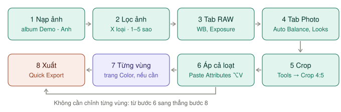
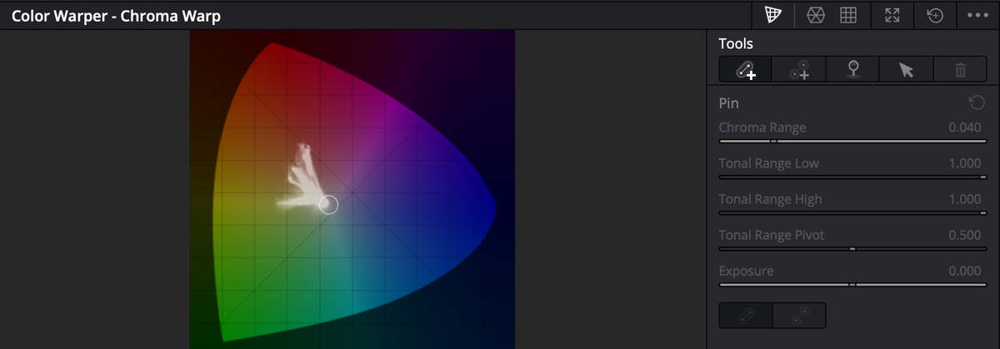

# Chỉnh ảnh tĩnh và ảnh RAW

Từ bản 21, Resolve có hẳn trang [Photo](../02-trang/photo/README.md) chuyên chỉnh ảnh — album, chấm sao, tab RAW, xuất JPEG/PNG/HEIC/TIFF ở độ phân giải gốc. **Với ảnh, bắt đầu ở trang Photo.** Chỉ sang trang **Color** khi cần chỉnh từng vùng (Qualifier, Power Window, Color Warper).


*Bước 7 là tuỳ chọn. Không cần chỉnh từng vùng thì đi thẳng từ bước 6 sang bước 8.*

| Bước | Trang | Thông số chính | Đọc |
|---|---|---|---|
| [1. Nạp ảnh, tạo album](#1-nạp-ảnh-tạo-album) | Photo | Album `Demo - Anh` | [Nạp ảnh, album](../02-trang/photo/nap-va-album.md) |
| [2. Lọc ảnh đẹp](#2-lọc-ảnh-đẹp) | Photo | `X` loại · `1`–`5` sao · lọc **≥ 4** | [Chấm sao, gắn cờ](../02-trang/photo/nap-va-album.md#chấm-sao-gắn-tag-gắn-cờ) |
| [3. Chỉnh RAW](#3-chỉnh-raw--cân-bằng-trắng-và-phơi-sáng) | Photo | White Balance, Exposure, Highlights | [Tab RAW](../02-trang/photo/chinh-anh.md#tab-raw--chỉnh-từ-dữ-liệu-gốc) |
| [4. Chỉnh màu, tương phản](#4-chỉnh-màu-và-tương-phản) | Photo | **Auto Balance**, Saturation `50` → `55` | [Tab Photo](../02-trang/photo/chinh-anh.md#tab-photo--adjustments) |
| [5. Crop](#5-crop-và-thẳng-khung) | Photo | Aspect Ratio `4:5` | [Crop](../02-trang/photo/chinh-anh.md#crop) |
| [6. Áp cho cả loạt](#6-áp-cho-cả-loạt) | Photo | `⌘C` → `⌥V` **Paste Attributes** | [Áp cùng chỉnh sửa](../02-trang/photo/chinh-anh.md#áp-cùng-chỉnh-sửa-cho-nhiều-ảnh) |
| [7. Chỉnh từng vùng (nếu cần)](#7-chỉnh-từng-vùng--sang-trang-color) | Color | Node sau node 01, `⌥S` | [Đưa album sang Color](../02-trang/photo/xuat-anh.md#đưa-album-sang-trang-color) |
| [8. Xuất](#8-xuất) | Photo, Deliver | JPEG 85–90% · 72 ppi | [Xuất ảnh](../02-trang/photo/xuat-anh.md) |

**Ví dụ trong sách:** album `Demo - Anh` gồm vài ảnh JPG stock miễn phí và một ảnh mẫu Canon **CR3** (RAW). Các bước dưới chỉnh ảnh CR3 trước, rồi áp sang cả album.

## 1. Nạp ảnh, tạo album

`★★★ Hằng ngày`

1. Mở trang **Photo**. Bấm icon **Import Media** trên đầu Media Pool → chọn **Import Media** (từng file) hoặc **Import Media Folder** (cả thư mục) → **Open**.
2. Chọn các ảnh vừa nạp → chuột phải → **Create New Photo Album Using Selected Clips...** → đặt tên `Demo - Anh` → **Create**.
3. Ảnh nạp thêm sau: chọn ảnh → chuột phải → **Add Photo(s) to Album**.
4. Bấm nút **Photo Album** trên toolbar để hiện dải album ở đáy màn hình.

Ảnh trên iPhone đã đồng bộ về Mac: **Import from Photos**. Đã có catalog Lightroom: xem [Nạp catalog Lightroom](../02-trang/photo/nap-va-album.md#nạp-catalog-lightroom). Chi tiết cách nạp: [Cách nạp](../02-trang/photo/nap-va-album.md#cách-nạp).

RAW đọc được: Canon **CR3**, Fujifilm **RAF**, Apple **ProRAW**, Nikon **NEF**, Sony **ARW**, Panasonic **RW2**. Ảnh thường: JPEG, PNG, HEIC, TIFF. Xem [Định dạng RAW được hỗ trợ](../02-trang/photo/nap-va-album.md#định-dạng-raw-được-hỗ-trợ).

## 2. Lọc ảnh đẹp

`★★★ Hằng ngày`

Đi qua từng ảnh bằng phím mũi tên, làm ba lượt:

1. **Loại:** ảnh mờ, nhắm mắt → `X`.
2. **Chấm sao:** `3` dùng được, `4` đẹp, `5` xuất sắc. `0` xoá sao.
3. **Chọn:** trên dải album, chuột phải icon **Rating** → lớn hơn hoặc bằng `4`. Bấm icon để bật lọc.

Xem [Quy trình lọc ảnh trong 3 lượt](../02-trang/photo/nap-va-album.md#quy-trình-lọc-ảnh-trong-3-lượt).

> **Mẹo:** chỉnh dở mà quên ảnh nào đã làm: mũi tên cạnh tên Photo Album → **Ungraded Photos**. Xem [Lọc nâng cao](../02-trang/photo/nap-va-album.md#lọc-nâng-cao).

## 3. Chỉnh RAW — cân bằng trắng và phơi sáng

`★★★ Hằng ngày` với ảnh RAW

Nút **Inspector** góc trên phải → tab **RAW** (chỉ sáng lên với file RAW). Các thanh ở đây tác động lên **dữ liệu cảm biến gốc**, nên chỉnh ở đây chất lượng hơn chỉnh về sau.

| Thanh | Làm gì |
|---|---|
| **White Balance** / **Color Temp** / **Tint** | Cân bằng trắng |
| **Exposure** | Phơi sáng, tính theo stop |
| **Highlights** / **Shadows** | Kéo lại vùng cháy và vùng tối |
| **Contrast** | Tương phản |
| **Color Boost** | Tăng độ tươi ở chỗ còn nhạt |
| **Midtone Detail** | Độ nét vùng trung gian |

Làm hết phơi sáng và cân bằng trắng ở đây trước. Thứ tự kéo: [Thứ tự kéo các thanh trong tab RAW](../02-trang/photo/chinh-anh.md#thứ-tự-kéo-các-thanh-trong-tab-raw).

**Ví dụ — ảnh CR3 trong album `Demo - Anh`, chụp ngược sáng, mặt tối, trời cháy:**

| Thanh | Đặt |
|---|---|
| **White Balance** | `Daylight` |
| **Exposure** | `+0.5` |
| **Highlights** | `−60` |
| **Shadows** | `+35` |
| **Contrast** | `+10` |
| **Color Boost** | `+15` |
| **Midtone Detail** | `+8` |

Bấm `⇧D` để so với ảnh gốc. Máy yếu, ảnh giật khi kéo: đặt **Decode Quality** `Half` lúc chỉnh, đổi về `Full` trước khi xuất.

Ảnh JPEG không có tab RAW. Cân bằng ở đâu: [Cân bằng trắng chỉnh ở đâu?](../02-trang/photo/chinh-anh.md#cân-bằng-trắng-chỉnh-ở-đâu)

## 4. Chỉnh màu và tương phản

`★★★ Hằng ngày`

Tab **Photo** của Inspector, mục **Adjustments**.

1. Bấm **Auto Balance** để có điểm khởi đầu. Không ưng thì `⌘R` để bỏ.
2. **Temp** / **Tint**: kéo đến khi vật trắng trông trung tính.
3. **Contrast**: kéo nhẹ sang phải. Ảnh tối thì hạ **Pivot** trước.
4. **Saturation**: từ `50` lên `55`.
5. `⇧D` so với gốc.

> **Lưu ý:** **Saturation** ở tab Photo mặc định là **50**, không phải 0. Kéo về `0` là ảnh đen trắng.

Xem [Auto Balance](../02-trang/photo/chinh-anh.md#auto-balance--bắt-đầu-từ-đây) và [Các thanh trong Adjustments](../02-trang/photo/chinh-anh.md#các-thanh-trong-adjustments).

Muốn tông màu có sẵn: [Looks](../02-trang/photo/chinh-anh.md#looks--tông-màu-có-sẵn). Thêm grain, vignette, glow: [Hiệu ứng ảnh](../02-trang/photo/hieu-ung.md). Hiệu ứng có điều khiển trên Viewer: [Effects Overlay](../02-trang/photo/chinh-anh.md#effects-overlay).

## 5. Crop và thẳng khung

`★★★ Hằng ngày`

1. Bấm **Tools** dưới đáy Viewer → **Crop**.
2. **Aspect Ratio** → `4:5` (bài đăng Instagram dọc). Bật ổ khoá **Lock Aspect Ratio**.
3. Kéo góc khung để chọn vùng, kéo trong khung để dời.
4. Ảnh nghiêng: **Tools** → **Transform** → chỉnh **Rotation Angle** đến khi đường chân trời thẳng.
5. Đóng thanh **Tools** — crop mới áp vào ảnh.

Xem [Crop](../02-trang/photo/chinh-anh.md#crop) và [Transform](../02-trang/photo/chinh-anh.md#transform).

## 6. Áp cho cả loạt

`★★☆ Thường dùng`

Ảnh cùng buổi chụp, cùng ánh sáng: chỉnh một ảnh rồi áp cho cả loạt.

| Cách | Làm | Copy gì |
|---|---|---|
| **Click chuột giữa** | Chọn các ảnh nhận → click chuột giữa vào ảnh đã chỉnh | Mọi thứ trừ hiệu ứng. Tab RAW chỉ đi theo khi cùng loại RAW |
| **Paste Attributes** | Ảnh nguồn `⌘C` → chọn ảnh nhận → `⌥V` → tick mục → **Apply** | Bạn chọn. Tick **Plugins** để dán cả hiệu ứng |

**Ví dụ:** ảnh CR3 đã chỉnh xong → `⌘C`. Lọc **Rating ≥ 4**, `⌘A` chọn hết → `⌥V` → tick mọi mục trừ phần crop → **Apply**. Mỗi ảnh vẫn giữ crop riêng.

> **Lỗi hay gặp:** dán từ ảnh CR3 sang ảnh JPG — phần tab RAW không đi theo vì khác loại file. Ảnh JPG chỉ nhận phần tab Photo.

Xem [Paste Attributes](../02-trang/photo/chinh-anh.md#cách-2--paste-attributes-chọn-được-copy-gì).

Thử nhiều kiểu trên một ảnh mà không mất bản cũ: [Versions](../02-trang/photo/nap-va-album.md#versions--nhiều-phiên-bản-của-một-ảnh). Khi xuất, chỉ phiên bản đang chọn được xuất.

## 7. Chỉnh từng vùng — sang trang Color

`★☆☆ Tình huống cụ thể`

Cần làm sáng riêng khuôn mặt, đổi riêng màu trời, đổi màu áo — đó là việc của trang Color.

1. Mở album ở trang Photo, rồi chuyển sang trang **Color**. Album tự thành một timeline, mỗi ảnh là một clip.
2. Chỉnh sửa ở trang Photo không mất — chúng thành **node đầu tiên** của mỗi ảnh. Thêm node sau nó (`⌥S`).
3. Chỉnh xong quay lại trang Photo. Kết quả đã nằm trong album, xuất vẫn ở độ phân giải gốc.

Chuỗi node gợi ý cho ảnh (node 01 là phần chỉnh từ trang Photo):

```
01 Photo        chỉnh từ trang Photo (tự có)
02 Color        Hue vs Hue, Hue vs Sat
03 Local        Power Window cho vùng cần sáng/tối riêng
04 Look         tông màu
05 Sharpen      Blur palette, làm nét nhẹ
```

**Ví dụ — đổi màu áo bằng Color Warper:** chọn ảnh → `⌥S` thêm node 02 → mở palette **Color Warper** → kéo điểm lưới ở vùng màu áo sang màu mới. Phần còn lại của ảnh giữ nguyên.


*Color Warper: kéo một điểm trên lưới để dời một dải màu sang màu khác.*

**Công cụ trang Color hợp với ảnh:**

| Công cụ | Dùng khi | Đọc |
|---|---|---|
| **Curves Hue vs Hue / Hue vs Sat** | Đổi riêng một màu mà không đụng màu khác | [Curves chi tiết](../02-trang/color/curves-chi-tiet.md#hue-vs-hue--đổi-màu-này-thành-màu-kia) |
| **Qualifier** | Tách vùng theo màu, có vùng lõi và vùng mềm cho H, S, L | [Qualifier](../02-trang/color/curves-va-vung.md#qualifier--hút-màu) |
| **Window** | Khoanh vùng. Ảnh tĩnh nên không cần Tracker | [Window](../02-trang/color/curves-va-vung.md#window--khoanh-vùng) |
| **Color Warper** | Kéo màu da, đổi màu áo | [Color Warper](../02-trang/color/palette-khac.md#color-warper--kéo-màu-này-sang-màu-kia) |
| **RGB Mixer** | Ảnh đen trắng có chủ ý | [RGB Mixer](../02-trang/color/palette-khac.md#rgb-mixer--đen-trắng-có-chủ-ý) |

Magic Mask (tự tách người) là `Studio`. Bản free dùng Qualifier + Window.

Cần ghép ảnh, thêm chữ: album cũng đưa sang được trang Fusion — xem [Đưa sang trang Fusion](../02-trang/photo/xuat-anh.md#đưa-sang-trang-fusion).

## 8. Xuất

`★★★ Hằng ngày`

| Cách | Khi nào | Đọc |
|---|---|---|
| **Quick Export** trên toolbar trang Photo | Một định dạng, nhanh. JPEG, PNG, HEIC, TIFF | [Quick Export](../02-trang/photo/xuat-anh.md#quick-export) |
| **Trang Deliver** khi đang mở album | Nhiều kích thước, nhiều định dạng một lượt | [Xuất từ trang Deliver](../02-trang/photo/xuat-anh.md#xuất-từ-trang-deliver) |

**Quick Export — gửi khách qua mạng:**

1. Chọn ảnh, hoặc không chọn gì để xuất cả album. Bấm **Quick Export**.
2. Cột trái chọn **JPEG**.
3. Cột phải: **Quality** khoảng 85–90%, **Resolution** `72` ppi (màn hình) hoặc `300` ppi (in), **Scale** `50%` nếu cần file nhẹ.
4. Bỏ tick **Include Metadata** nếu không muốn lộ vị trí GPS.
5. **Export** → chọn thư mục.

**Deliver — nhiều bộ một lượt:** mở album → trang **Deliver** → mục **Photo**: **Format** `JPEG`, **Size** `Long Side` `2048`, **Quality** `90` → **Add to Render Queue**. Đổi thành **TIFF** 16-bit · **Original** → **Add to Render Queue** lần nữa → **Render All**. Xem [Mục Photo](../02-trang/photo/xuat-anh.md#mục-photo) và [Định cỡ ảnh](../02-trang/photo/xuat-anh.md#định-cỡ-ảnh--mục-size).

> **Lưu ý:** **Resolution** (ppi) không đổi số pixel. Muốn ảnh nhỏ đi thì đổi **Scale** hoặc **Size**.

Mang tông màu ảnh sang video: [Lưu tông màu thành LUT](../02-trang/photo/chinh-anh.md#lưu-tông-màu-thành-lut).

## Ảnh nằm trong timeline video

Ảnh dùng làm cảnh trong video (ảnh minh hoạ, ảnh bìa) thì nạp như clip thường ở trang Media hoặc Edit, chỉnh ở trang Color như mọi clip khác.

- Độ dài mặc định trên timeline: **Preferences → User → Editing → General Settings → Standard still duration**.
- Lấy một khung hình từ video làm ảnh: **File → Export → Current Frame as Still** ở trang Media, Cut hoặc Edit. Xem [Ảnh tĩnh và chuỗi ảnh](../02-trang/deliver/preset-theo-nen-tang.md#ảnh-tĩnh-và-chuỗi-ảnh).

## Khi nào đừng dùng Resolve cho ảnh

- Cần xử lý hàng loạt vài nghìn ảnh mỗi tuần → phần mềm chuyên ảnh như Lightroom quen tay hơn.
- Cần retouch, xoá vật thể, ghép ảnh phức tạp → Photoshop hoặc Affinity. Object Removal ở Resolve là `Studio`.

Dùng Resolve cho ảnh khi: bạn cần tông màu khớp với video trong cùng dự án, hoặc cần công cụ tách màu của trang Color.

## Checklist trước khi xuất

- [ ] Ảnh nằm trong album, đã lọc còn ảnh **≥ 4** sao
- [ ] Ảnh RAW: đã chỉnh White Balance và Exposure ở tab **RAW**, không phải tab Photo
- [ ] Tab Photo: Saturation không vô tình về `0`
- [ ] Crop đúng tỉ lệ nơi đăng (`4:5`, `1:1`, `9:16`)
- [ ] Đã áp chỉnh sửa cho cả loạt, kiểm tra vài ảnh JPG lẫn RAW
- [ ] Ảnh có nhiều version: đã chọn đúng version muốn xuất
- [ ] **Decode Quality** về `Full`
- [ ] Đăng công khai: bỏ tick **Include Metadata**
