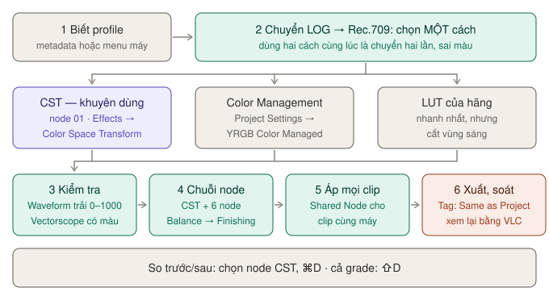
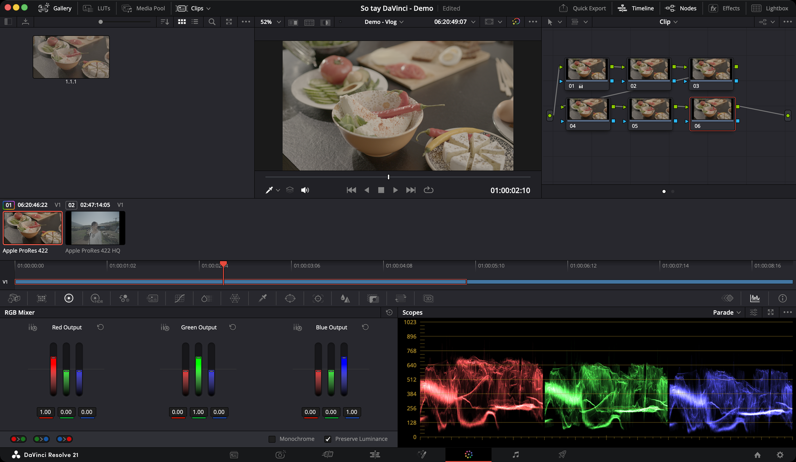

# Footage LOG sang Rec.709

Quay LOG xong mở ra thấy xám xịt, nhạt toẹt, tưởng hỏng. Không hỏng — đó là đúng. LOG là cách máy quay ghi hình **để giữ thông tin** vùng sáng và vùng tối, không phải để xem ngay.

Việc của bạn là chuyển nó về **Rec.709** — chuẩn màu của video HD, cũng là chuẩn mà màn hình thường và YouTube hiển thị.


*Bước 2 chỉ chọn một cách. Dùng hai cách cùng lúc là chuyển màu hai lần.*

| Bước | Làm gì | Thông số chính |
|---|---|---|
| 1 | Biết máy quay ở [profile nào](#profile-của-các-máy-phổ-biến) | Ví dụ Sony: `S-Gamut3.Cine` / `S-Log3` |
| 2 | [Chọn một trong ba cách](#ba-cách-chọn-một) chuyển đổi | Khuyên dùng **Color Space Transform** (CST) |
| 3 | [Kiểm tra bằng scope](#kiểm-tra-đã-đúng-chưa) trước khi chỉnh gì thêm | Waveform trải gần 0–1023 |
| 4 | [Chỉnh tiếp bằng chuỗi node](#chuỗi-node-đề-xuất-cho-footage-log) | CST + 6 node |
| 5 | [Áp cho mọi clip cùng máy](#áp-cho-mọi-clip-cùng-máy) | **Save as Shared Node** |
| 6 | [Xuất và soát màu](#xuất-và-soát-màu) | Color Space Tag, Gamma Tag: **Same as Project** |

**Ví dụ trong sách:** project "So tay DaVinci - Demo", timeline "Demo - Vlog" có 6 clip LOG 4K. Mỗi clip đã có chuỗi 6 node. Các bước dưới làm trên clip đầu tiên rồi áp cho 5 clip còn lại.

## Ba cách, chọn một

| Cách | Hợp với | Nhìn thấy phép chuyển? |
|---|---|---|
| [1. Color Space Transform](#cách-1--color-space-transform-khuyên-dùng) | Một máy LOG, muốn thấy rõ từng bước | Có — là một node |
| [2. Color Management](#cách-2--color-management-toàn-project) | Trộn nhiều máy LOG khác hãng | Không |
| [3. LUT của hãng](#cách-3--lut-chuyển-đổi-của-hãng) | Cần nhanh, đã có LUT | Có — nhưng cắt vùng sáng |

So sánh đầy đủ: [Cách nào cho mình?](../02-trang/color/lut-va-quan-ly-mau.md#cách-nào-cho-mình)

### Cách 1 — Color Space Transform (khuyên dùng)

`★★★ Hằng ngày` với footage LOG

**Là gì:** một hiệu ứng Resolve FX đổi màu từ không gian màu này sang không gian màu khác. Nó dùng cùng phép toán với Color Management nên chuyển sạch, không cắt cụt như LUT. Không cần bật Color Management mới dùng được.

**Dùng khi:** footage từ một máy, hoặc bạn muốn thấy phép chuyển nằm ngay trong node graph.

**Cách làm:** project để **Color science: DaVinci YRGB** (mặc định).

1. Sang trang **Color**, chọn clip. Chọn node 01 (hoặc `⌥S` thêm node). Chuột phải node → **Change Label** → gõ `CST`.
2. Bấm nút **Effects** trên toolbar → nhóm **Resolve FX Color** → kéo **Color Space Transform** thả lên node. Gõ `color space` vào ô tìm cho nhanh.
3. Ở tab **Settings** của bảng Effects, đặt:

| Ô | Đặt |
|---|---|
| **Input Color Space** / **Input Gamma** | Đúng profile máy quay, ví dụ `Sony S-Gamut3.Cine` / `Sony S-Log3` — xem [bảng dưới](#profile-của-các-máy-phổ-biến) |
| **Output Color Space** | `Rec.709` |
| **Output Gamma** | `Gamma 2.4` |
| **Tone Mapping Method** | `DaVinci` — nén mềm vùng sáng và tối thay vì cắt cụt |
| **Gamut Mapping Method** | Để `None`. Thử `Saturation Mapping` khi màu rực bị bết |

4. Bấm `⌘D` vài lần để bật/tắt node, so trước/sau.

Nút **Swap** cạnh các ô đổi ngược Input và Output — dùng khi bạn đặt CST thứ hai ở cuối chuỗi.

**Tone Mapping Method chọn gì:**

| Lựa chọn | Làm gì | Khi nào |
|---|---|---|
| **None** | Không nén dải sáng | Hai đầu cùng dải sáng |
| **Clip** | Cắt cứng phần vượt | Hầu như không dùng |
| **Simple** | Đường cong đơn giản | Nguồn HDR sang SDR, nhanh |
| **Luminance Mapping** | Như DaVinci, chính xác hơn khi mọi clip cùng một chuẩn (Rec.709, Rec.2020) | Nguồn chuẩn, không phải LOG |
| **DaVinci** | Nén mềm vùng sáng và tối, giảm màu nhẹ ở hai đầu | **Footage LOG từ máy quay** — mặc định nên chọn |
| **Saturation Preserving** | Nén mềm nhưng giữ màu ở vùng rất sáng/rất tối | Bạn muốn đẩy màu mạnh |

Bảng đầy đủ: [Color Space Transform → Thông số](../02-trang/color/lut-va-quan-ly-mau.md#thông-số).

**Ví dụ — clip đầu của "Demo - Vlog" (giả sử quay Sony S-Log3):** Input `Sony S-Gamut3.Cine` / `Sony S-Log3` · Output `Rec.709` / `Gamma 2.4` · Tone Mapping `DaVinci`. Ảnh hết xám, trời không cháy.

### Cách 2 — Color Management toàn project

`★★☆ Thường dùng` khi trộn nhiều máy

Ít thao tác nhất khi trộn nhiều máy quay. **Color Management** (RCM) là chế độ Resolve tự chuyển màu từng clip về một không gian chung.

1. **Project Settings** (`⇧9`) → **Color Management**.
2. **Color science** → **DaVinci YRGB Color Managed**.
3. Tick **Automatic Color Management**. **Color processing mode** → **SDR**.
4. **Output color space** → **Rec.709**.
5. Bấm **Save**.
6. Với clip LOG: chọn một hoặc nhiều clip trong Media Pool → chuột phải → **Input Color Space** → chọn profile máy quay. Resolve tự đoán theo loại file và codec, nhưng hay đoán sai với LOG ghi ở ProRes hoặc H.265.

Resolve tự xử lý phần còn lại. Đánh đổi: phép chuyển đổi **không hiện trong node graph** nên khó soi khi có gì sai. Chi tiết: [Bật Color Managed — cách đơn giản](../02-trang/color/lut-va-quan-ly-mau.md#bật-color-managed--cách-đơn-giản).

> **Lưu ý:** quyết định cách 2 **trước khi** chỉnh màu. Grade làm xong dựa vào preset Color Management đang chọn. Đổi Color science khi đã chỉnh xong là mọi grade lệch.

### Cách 3 — LUT chuyển đổi của hãng

`★☆☆ Tình huống cụ thể`

Nhanh nhất, kém linh hoạt nhất. **LUT** là một bảng tra cố định: mỗi màu vào ứng với một màu ra.

1. Tải LUT chuyển đổi từ trang hãng máy (Sony, Canon, Panasonic đều có).
2. **Project Settings → Color Management → Lookup Tables** → **Open LUT Folder**, chép file `.cube` vào đó, bấm **Update Lists**.
3. Chuột phải node 01 → **LUT** → chọn LUT đó.

Nhược điểm: LUT **cắt** thông tin ở vùng sáng và tối thay vì nén mềm như CST. Xem [Cài LUT mua/tải về](../02-trang/color/lut-va-quan-ly-mau.md#cài-lut-muatải-về).

> **Lỗi hay gặp:** dùng hai cách cùng lúc. Bật Color Managed rồi lại thêm CST hay LUT chuyển đổi là chuyển hai lần, ảnh sẽ quá đậm, quá tương phản.

## Đặt CST ở node nào

Hai trường phái, cả hai đều dùng được:

| Đặt ở | Bạn chỉnh trong | Hợp với |
|---|---|---|
| **Node đầu** | Rec.709. Bánh xe màu, Curves phản ứng như bạn quen | Người mới. Sách này dùng cách này |
| **Node cuối** | Không gian rộng của máy quay, giữ nhiều thông tin vùng sáng hơn | Colorist đã quen. Bánh xe màu phản ứng lạ hơn vì đang làm trên dữ liệu log |

Chọn một và giữ nhất quán trong cả project.

> **Mẹo:** muốn kiểu "node cuối" mà bánh xe vẫn dễ chịu: đặt CST đầu chuyển sang `DaVinci Wide Gamut` / `DaVinci Intermediate`, chỉnh ở giữa, rồi CST cuối chuyển sang `Rec.709` / `Gamma 2.4`. DaVinci Wide Gamut là không gian rộng hơn cả Rec.2020 và ACES, thiết kế để chỉnh màu.

## Kiểm tra đã đúng chưa

Sau khi áp CST, trước khi chỉnh gì. Mở scope: **Workspace → Video Scopes → On** (`⇧⌘W`) hoặc nút scope trên toolbar trang Color.

| Scope | Đúng | Sai |
|---|---|---|
| **Waveform** | Ảnh trải gần hết từ 0 đến khoảng 1023, không dồn cục ở giữa | Dồn trong khoảng 200–700: chưa chuyển, hoặc sai Input Gamma |
| **Vectorscope** | Có màu rõ, vệt da nằm gần đường skin tone | Co cụm vào tâm: vẫn còn LOG |
| Mắt thường | Ảnh trông **bình thường**, không xám nhưng chưa "đẹp" | Cháy trắng, hoặc màu quá đậm |

Xem [Waveform](../02-trang/color/scopes.md#waveform) và [Vectorscope](../02-trang/color/scopes.md#vectorscope). Đẹp là việc của các node sau.

**So trước/sau:**
- Chọn node CST → `⌘D` bật/tắt riêng node đó.
- `⇧D` bật/tắt toàn bộ grade và hiệu ứng.
- Grab Still (`⌥⌘G`) lúc chưa chỉnh, rồi bấm đúp still để chia đôi Viewer — xem [Image Wipe](../02-trang/color/giao-dien.md#image-wipe--so-với-still).

## Chuỗi node đề xuất cho footage LOG

```
01 CST          chuyển LOG → Rec.709
02 Balance      cân bằng trắng, điểm đen, điểm trắng
03 Contrast     tương phản
04 Color        sửa hue, saturation
05 Secondary    da người, vùng cục bộ
06 Look         LUT sáng tạo hoặc color warper
07 Finishing    vignette, làm nét
```

Đây là [chuỗi 6 node](../02-trang/color/node.md#chuỗi-6-node-cơ-bản) có thêm node CST ở đầu. Dùng Cách 2 thì bỏ node 01.


*Chuỗi 6 node của clip demo. Footage LOG thì thêm node CST trước node đầu.*

| Node | Làm gì, ví dụ giá trị | Đọc |
|---|---|---|
| 02 Balance | Nhìn [Parade](../02-trang/color/scopes.md#parade), kéo **Offset** cho ba kênh R, G, B ngang nhau ở vùng trắng | [Bánh xe màu](../02-trang/color/can-bang.md#sáng-tối--4-bánh-xe) |
| 03 Contrast | **Contrast** từ `1.000` lên `1.100`, giữ **Pivot** mặc định `0.435` | [Cân bằng](../02-trang/color/can-bang.md) |
| 06 Look | LUT sáng tạo, **Key Output Gain** `0.5` nếu gắt | [LUT sáng tạo](../02-trang/color/lut-va-quan-ly-mau.md#lut-là-gì), [giảm độ mạnh LUT](../02-trang/color/lut-va-quan-ly-mau.md#giảm-độ-mạnh-lut) |

## Áp cho mọi clip cùng máy

Có 40 clip cùng máy, cùng profile:

1. Ở clip đầu tiên, chuột phải node CST → **Save as Shared Node**.
2. Ở clip khác: chuột phải trong Node Editor → **Add Node** → chọn Shared Node đó (cuối danh sách, mang nhãn bạn đã đặt, ví dụ `CST`).
3. Sửa Shared Node ở một clip → mọi clip dùng nó đổi theo.

> **Lưu ý:** Shared Node **tự khoá** ngay khi tạo, để tránh sửa nhầm. Muốn chỉnh: chuột phải node → **Lock Node** để mở khoá, chỉnh xong khoá lại.

Xem [Shared Node](../02-trang/color/lut-va-quan-ly-mau.md#một-cst-cho-mọi-clip-cùng-máy--shared-node). Muốn copy cả chuỗi node: [Áp grade cho nhiều clip](../02-trang/color/node.md#áp-grade-cho-nhiều-clip) hoặc [Group](../02-trang/color/node.md#group--nhóm-các-clip-cùng-bối-cảnh).

**Ví dụ:** clip 1 của "Demo - Vlog" có node `CST` → Save as Shared Node. Chọn clip 2 đến 6, ở mỗi clip **Add Node → CST**, kéo node mới lên đầu chuỗi.

## Profile của các máy phổ biến

| Máy | Input Color Space | Input Gamma |
|---|---|---|
| Sony (S-Log3) | S-Gamut3.Cine | S-Log3 |
| Canon (C-Log3) | Canon Cinema Gamut | Canon Log 3 |
| Panasonic (V-Log) | V-Gamut | V-Log |
| Fujifilm (F-Log) | F-Log Gamut | F-Log |
| DJI (D-Log) | DJI D-Gamut | D-Log |
| GoPro (Protune Flat) | Protune Native | Protune Flat |
| Blackmagic | Blackmagic Design Wide Gamut Gen 4/5 | Blackmagic Design Film (Gen 5 tuỳ máy) |

> **Lưu ý:** tên trong menu CST thường kèm tên hãng (ví dụ `Sony S-Log3`) và có thể khác chút theo bản Resolve. Bảng trên là tên gần đúng để bạn tìm. Mở menu, tìm theo tên hãng trước. Đặc biệt Fujifilm, DJI, GoPro: nếu menu không có đúng tên, chọn mục gần nhất cùng hãng, hoặc dùng LUT của hãng (cách 3).

Không chắc máy mình quay ở profile nào: xem metadata clip ở trang Media ([Metadata Editor](../02-trang/media/metadata.md)), hoặc tra trong menu quay của máy.

## Xuất và soát màu

1. Ở trang Deliver, preset YouTube hoặc TikTok dùng được ngay — xem [Preset theo nền tảng](../02-trang/deliver/preset-theo-nen-tang.md).
2. Dùng Custom Export thì để **Advanced Settings → Color Space Tag** và **Gamma Tag** ở **Same as Project**, **Data Levels** ở **Auto**. Hai ô tag này ghi vào file thông tin "đây là Rec.709", để trình phát hiển thị đúng. Xem [Advanced Settings](../02-trang/deliver/cai-dat-xuat.md#advanced-settings--những-ô-đáng-biết).
3. Render xong, mở file xem thử bằng VLC — QuickTime có cách xử lý gamma riêng, dễ làm bạn tưởng màu sai.

## Lỗi hay gặp

**Áp CST xong ảnh cháy trắng** — sai Input Gamma. Kiểm tra lại profile máy quay.

**Ảnh vẫn xám sau khi áp CST** — có thể bạn đặt Output Gamma là `Linear`, hoặc Input Gamma đang là Rec.709. Đổi Output về `Gamma 2.4`, Input về đúng gamma LOG.

**Màu sai hẳn, quá đậm hoặc quá tương phản** — chuyển đổi hai lần: đang bật Color Managed mà vẫn thêm CST hoặc LUT chuyển đổi. Bỏ một trong hai.

**Sửa Shared Node không được** — node đang khoá. Chuột phải → **Lock Node** để mở.

**Màu trong Resolve đẹp, xuất ra nhạt** — thường do màn hình Mac dùng profile Display P3 còn video xuất ra Rec.709.

1. Không bật Color Management: kiểm tra **Project Settings → Color Management → Timeline color space** là Rec.709 Gamma 2.4. Bật Color Management: **Output color space** là Rec.709.
2. **DaVinci Resolve → Preferences → System → General** → tick **Use Mac Display Color Profile for viewers**, để Viewer hiển thị gần với màn hình Mac.
3. Xuất cho web mà QuickTime vẫn lệch: cùng mục đó có ô **Automatically Tag Rec.709 Scene Clips as Rec.709-A**.
4. Xem thử file xuất ra bằng VLC thay vì QuickTime.

Thêm: [Lỗi thường gặp](../04-tham-khao/loi-thuong-gap.md#màu-trong-resolve-đẹp-xuất-ra-nhạt).

## Checklist trước khi xuất

- [ ] Biết profile máy quay, đã chọn đúng Input Color Space / Input Gamma
- [ ] Chỉ dùng **một** cách chuyển: CST, hoặc Color Management, hoặc LUT
- [ ] CST: Output `Rec.709` / `Gamma 2.4`, Tone Mapping `DaVinci`
- [ ] Waveform trải gần 0–1023, Vectorscope có màu, không co cụm
- [ ] Mọi clip cùng máy đã có node CST (Shared Node)
- [ ] Bật/tắt bằng `⇧D` thấy grade có tác dụng ở mọi clip
- [ ] Custom Export: Color Space Tag, Gamma Tag **Same as Project**
- [ ] Đã xem file xuất bằng VLC
