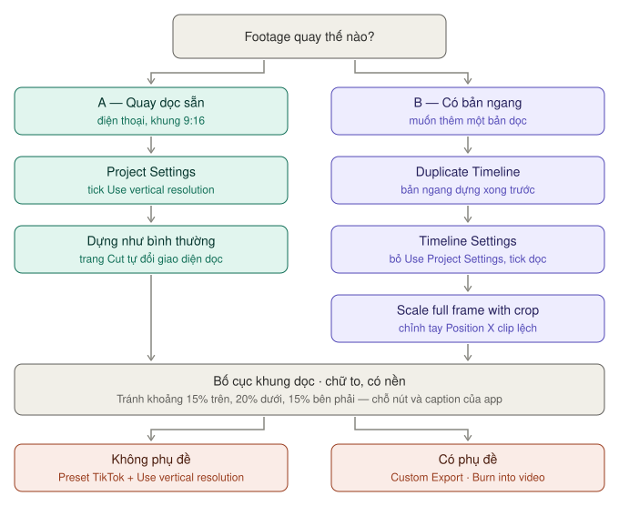
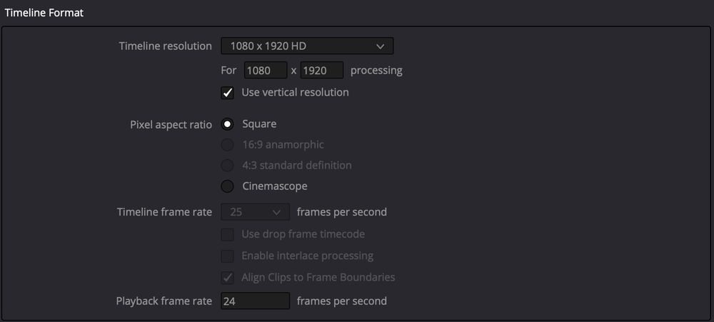
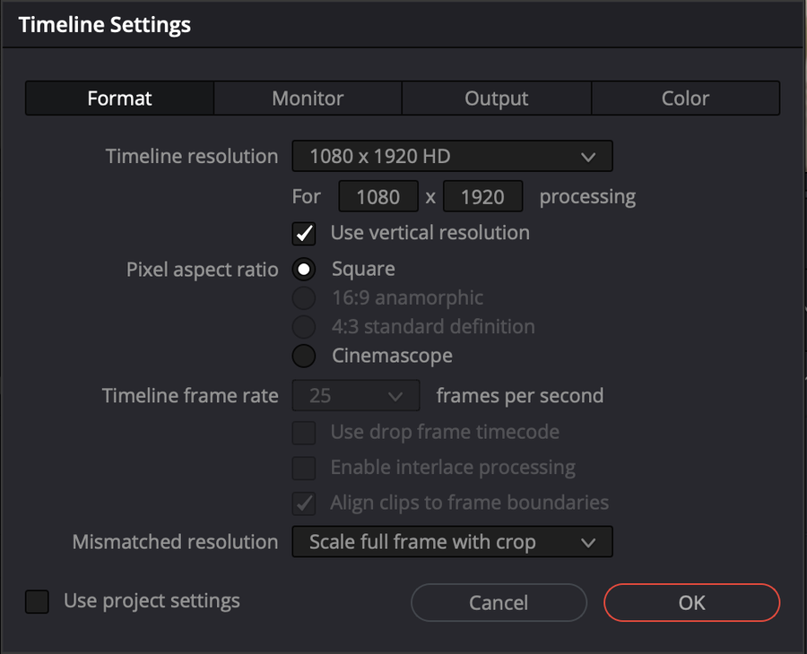

# Video dọc cho TikTok, Reels, Shorts

Có hai tình huống khác hẳn nhau. Chọn đúng tình huống trước khi làm.

*Nhánh trái cho footage quay dọc. Nhánh phải cho bản ngang đã dựng xong. Hai nhánh gặp nhau ở bước bố cục, rồi tách ra theo có phụ đề hay không.*

| Tình huống | Làm theo | Khung cuối |
|---|---|---|
| Quay dọc sẵn bằng điện thoại | [Tình huống A](#tình-huống-a--quay-dọc-sẵn) | 1080×1920 |
| Có bản ngang, cần thêm bản dọc | [Tình huống B](#tình-huống-b--có-sẵn-bản-ngang-muốn-cắt-ra-bản-dọc) | 1080×1920 |

Sau đó cả hai cùng đi qua [Bố cục khung dọc](#bố-cục-khung-dọc), [Chữ và phụ đề](#chữ-và-phụ-đề-cho-video-dọc), [Xuất](#xuất) và [Checklist](#checklist-trước-khi-đăng).

## Tình huống A — quay dọc sẵn

*Một ô tick đảo 1920×1080 thành 1080×1920.*

Đơn giản nhất.

1. **Project Settings** (`⇧9`) → **Master Settings** → **Timeline resolution** `1920 x 1080 HD` → tick **Use vertical resolution**. Ô này đảo chiều ngang và dọc, khung thành **1080×1920**.
2. **Timeline frame rate** khớp footage — điện thoại thường quay 30 fps, có máy 25 hoặc 60 fps. Xem frame rate của clip ở cột **FPS** trong Media Pool (chế độ List). Đặt trước khi nạp clip — xem [Tạo project](../01-bat-dau/tao-du-an.md#bước-2--frame-rate-thứ-không-sửa-được-về-sau).
3. Dựng như bình thường. Trang Cut tự đổi giao diện khi timeline dọc — xem [Cut → giao diện video dọc](../02-trang/cut/giao-dien.md#giao-diện-tự-đổi-khi-làm-video-dọc).
4. Sang [Bố cục khung dọc](#bố-cục-khung-dọc) và [Xuất](#xuất).

## Tình huống B — có sẵn bản ngang, muốn cắt ra bản dọc

Đây mới là tình huống thường gặp, và có một cái bẫy.

> **Đừng dựng trực tiếp trên timeline 9:16 nếu bạn quay ngang.** Khung dọc che mất hai bên nên bạn không thấy được chủ thể đang ở đâu, dựng rất khổ.

Cách đúng: **dựng xong bản ngang trước**, rồi mới tạo bản dọc từ nó.

### Các bước

*Bỏ tick Use project settings, tick Use vertical resolution, Mismatched resolution = Scale full frame with crop. Frame rate mờ vì timeline đã có clip.*

Ví dụ với timeline **Demo - Vlog** (1920×1080, 25 fps) của project demo:

1. Dựng và hoàn thiện bản ngang 1920×1080.
2. Trong Media Pool, chọn timeline → **Edit → Duplicate Timeline**. Đổi tên thành `Demo - Vlog doc`. Xem [Nhân bản timeline](../02-trang/edit/timeline-nang-cao.md#nhân-bản-timeline--giữ-phiên-bản).
3. Chuột phải timeline mới trong Media Pool → **Timelines → Timeline Settings** → bỏ tick ô **Use project settings** ở góc dưới trái hộp thoại. Các ô trong bốn tab **Format**, **Monitor**, **Output**, **Color** hết mờ, sửa được.
4. Tab **Format**: tick **Use vertical resolution** (hoặc gõ thẳng 1080 × 1920). Xem [Timeline Settings](../02-trang/edit/timeline-nang-cao.md#timeline-settings--mỗi-timeline-một-cỡ-khung).
5. Vẫn tab **Format**, ô **Mismatched resolution** → **Scale full frame with crop** — xem [mục dưới](#cách-nhanh-hơn-cho-cả-timeline). Bấm **OK**.
6. Phát lại cả timeline. Clip nào chủ thể lệch khỏi khung: chọn clip → **Inspector → Transform** → chỉnh **Position X** cho chủ thể vào giữa. Cần cận hơn thì tăng **Zoom**, ví dụ `1.15`. Xem [Inspector](../02-trang/edit/inspector.md#những-việc-làm-hằng-ngày).

Bản ngang gốc vẫn nguyên vẹn vì bạn làm trên bản sao.

> **Mẹo:** trước khi nhân bản, bật khung **9:16** trên Viewer bản ngang để xem trước phần nào sẽ còn lại. Trang Cut: nút **Safe Area** góc phải Viewer → nhóm **Social Media** → **9:16**. Trang Edit: nút **Safe Area and Guides** góc trên phải Timeline Viewer.

### Cách nhanh hơn cho cả timeline

Thay vì chỉnh từng clip, đặt chế độ xử lý chung cho clip khác cỡ khung. Ở Timeline Settings của timeline dọc là ô **Mismatched resolution** (tab Format); ở **Project Settings → Image Scaling → Input Scaling** nó tên **Mismatched resolution files**:

| Chọn | Kết quả | Dùng khi |
|---|---|---|
| **Scale full frame with crop** | Cạnh ngắn của clip lấp đầy khung, phần thừa hai bên bị cắt | **Video dọc** |
| **Scale entire image to fit** | Giữ toàn bộ hình, có viền đen. Mặc định | Không muốn mất phần nào |
| **Center crop with no resizing** | Cắt giữa, không phóng to | Footage rất lớn (4K vào khung 1080) |
| **Stretch frame to all corners** | Kéo giãn hình cho vừa khung | Footage anamorphic. Đừng dùng cho video dọc — người bị kéo dài |

Đặt **Scale full frame with crop** rồi chỉ chỉnh tay những clip có chủ thể lệch khỏi giữa.

**Ví dụ:** clip 1920×1080 vào khung 1080×1920 với **Scale full frame with crop** — hình phóng lên cho chiều cao đủ 1920, chỉ còn khoảng một phần ba bề ngang ở giữa.

### Cách dùng Adjustment Clip

`★☆☆ Tình huống cụ thể`

Nếu muốn giữ một timeline duy nhất:

1. Ở timeline ngang, thêm **Adjustment Clip** lên track trên cùng, kéo dài hết timeline. Xem [Adjustment Clip](../02-trang/edit/chu-va-hieu-ung.md#adjustment-clip).
2. Chỉnh Transform trên adjustment clip đó.
3. Khi xuất bản dọc thì bật nó, xuất bản ngang thì tắt.

Cách này gọn nhưng khó chỉnh riêng từng cảnh.

> **Smart Reframe** — tính năng tự bám chủ thể khi đổi tỉ lệ — là `Studio`. Bản free phải chỉnh tay. Xem [Free và Studio](../01-bat-dau/free-vs-studio.md).

## Bố cục khung dọc

Đừng đặt nội dung quan trọng ở sát mép:

| Vùng | Bị che bởi | Tránh khoảng |
|---|---|---|
| Trên | Tên tài khoản, tab của app | 15% chiều cao |
| Dưới | Caption, nút tương tác, thanh nhạc | 20% chiều cao |
| Phải | Cột nút like, comment, share | 15% bề ngang |

Với khung 1080×1920: tránh khoảng 290 px trên, 385 px dưới, 160 px bên phải.

**Bật khung an toàn trên Viewer:** nút **Safe Area** của Viewer → **Title** (vùng cho chữ) và **Action** (vùng cho hành động). Hoặc **View → Safe Area**. Chữ nằm trong khung **Title** là an toàn với cả màn hình bị cắt mép.

Các con số trong bảng là tham khảo từ thói quen dựng, không phải thông số của Resolve. Mỗi nền tảng đổi giao diện thường xuyên — mở app xem thử một video trước khi đăng.

## Chữ và phụ đề cho video dọc

Chữ phải **to hơn nhiều** so với video ngang vì người ta xem trên điện thoại. Cỡ chữ tối thiểu nên chiếm khoảng 1/20 chiều cao khung — khung 1920 px thì chữ cao khoảng 100 px.

Luôn có **nền mờ hoặc viền** sau chữ — nền video thay đổi liên tục, chữ trắng trơn sẽ có lúc chìm.

| Muốn | Làm ở |
|---|---|
| Vài dòng chữ to, tiêu đề | Text+ — xem [Chữ](../02-trang/edit/chu-va-hieu-ung.md#chữ--text-text) |
| Chữ chạy từng ký tự, viền nhiều lớp | Fusion — xem [Chữ động với Text+](../02-trang/fusion/chu-dong.md) |
| Phụ đề cả video | Track phụ đề — xem [Phụ đề](../02-trang/edit/phu-de.md) |

**Phụ đề cho video dọc:** tab **Track** của Inspector phụ đề → **Position** đẩy phụ đề lên khỏi 20% dưới cùng; **Stroke** hoặc **Background** cho dễ đọc. Mỗi dòng ngắn, khoảng 4–6 chữ, vì khung hẹp. Xem [Kiểu chữ phụ đề](../02-trang/edit/phu-de.md#kiểu-chữ-phụ-đề).

## Xuất

Sang trang **Deliver**. Ở đầu Viewer, chọn đúng **timeline dọc** (ví dụ `Demo - Vlog doc`).

| Có phụ đề? | Dùng | Vì sao |
|---|---|---|
| Không | [Preset TikTok](#không-có-phụ-đề--preset-tiktok) | Nhanh, ít ô |
| Có | [Custom Export](#có-phụ-đề--custom-export) | Preset TikTok không có mục phụ đề |

### Không có phụ đề — preset TikTok

1. Ô **Preset** → **TikTok** → **1080p**. Panel hiện **dạng gọn**: một danh sách, không có tab.
2. Tick **Use vertical resolution** — Resolution đổi từ 1920×1080 thành **1080×1920**. Preset mặc định **không** tick, đây là bước hay quên nhất.
3. **File Name** có chữ `doc` để khỏi lẫn bản ngang. Bấm **Browse** chọn **Location**.
4. Để **Frame rate** là Timeline Frame Rate, **Format** MP4, **Video Codec** H.264, **Audio Codec** AAC như preset điền sẵn.
5. Âm thanh: preset TikTok **không có** ô Normalize Audio. Hãy đo độ to ở trang Fairlight trước khi xuất — xem [Loudness meter](../02-trang/fairlight/loudness-va-xuat.md#loudness-meter--đo-độ-to-cảm-nhận). Nhắm khoảng −14 LUFS như YouTube là mức an toàn cho mạng xã hội. Chưa kịp đo thì xuất bằng [Custom Export](#có-phụ-đề--custom-export) và tick **Audio Normalization** ở tab Audio.
6. Nhìn Viewer: hình đứng dọc, **không** có viền đen hai bên. Liếc **Estimated File Size**.
7. **Add to Render Queue** → **Render All**.

Chi tiết: [Preset TikTok, Reels, Shorts](../02-trang/deliver/preset-theo-nen-tang.md#tiktok-reels-shorts--video-dọc). Muốn tải thẳng lên TikTok: tick **Upload directly to TikTok** ở cùng panel.

### Có phụ đề — Custom Export

TikTok và Reels **không đọc file phụ đề rời**, nên phải in phụ đề vào hình. Dạng gọn của preset TikTok không có mục phụ đề.

1. Ô **Preset** → **Custom Export**. Panel hiện ba tab **Video · Audio · File**.
2. Tab Video: **Format** MP4, **Codec** H.264, **Resolution** 1080×1920 (hoặc tick **Use vertical resolution**), **Frame rate** Timeline Frame Rate.
3. **Quality** → **Restrict to** 15.000 Kb/s (cùng mức 1080p). Xem [Quality — bitrate](../02-trang/deliver/cai-dat-xuat.md#quality--chọn-bitrate).
4. Cuối tab Video → **Subtitle Settings** → tick **Export Subtitle** → **Format: Burn into video**. Xem [Subtitle Settings](../02-trang/deliver/cai-dat-xuat.md#subtitle-settings).
5. Tab Audio: **Codec** AAC, **Data Rate** 320 Kb/s. Chưa đo độ to ở Fairlight thì tick **Audio Normalization** → **Normalize to Standard**, chọn **Standard** — xem [Audio Normalization](../02-trang/deliver/cai-dat-xuat.md#audio-normalization).
6. **Add to Render Queue** → **Render All**.

> **Burn into video chỉ in track phụ đề đang bật.** Có nhiều track phụ đề thì kiểm tra track nào đang bật ở timeline trước khi render.

Dùng lại lần sau: menu ba chấm của Render Settings → **Save as New Preset**, đặt tên *TikTok doc*. Xem [Tự tạo preset](../02-trang/deliver/preset-theo-nen-tang.md#tự-tạo-preset).

### Xuất cả bản ngang và bản dọc một lượt

1. Chọn timeline ngang → preset YouTube → **Add to Render Queue**.
2. Chọn timeline dọc → preset TikTok (hoặc preset *TikTok doc* của bạn) → **Add to Render Queue**.
3. **Render All**.

Xem [Một lượt xuất YouTube và bản dọc](../02-trang/deliver/README.md#một-lượt-xuất-youtube-và-bản-dọc).

### Lỗi hay gặp

| Hiện tượng | Sửa |
|---|---|
| Viền đen hai bên | Đang xuất timeline ngang, hoặc quên **Use vertical resolution** |
| Viền đen trên dưới trong timeline dọc | **Mismatched resolution** đang là **Scale entire image to fit**. Đổi sang **Scale full frame with crop** |
| Không thấy phụ đề trên TikTok | Xuất phụ đề dạng file rời. Đổi sang **Burn into video** |
| Chủ thể bị cắt mất | Chỉnh **Position X** của clip đó ở Inspector |
| Video nhỏ tiếng hơn video khác | Chưa đo loudness. Đo ở Fairlight hoặc tick **Audio Normalization** khi xuất |

Thêm: [Render xong mà file lỗi](../02-trang/deliver/render-queue-va-loi.md#render-xong-mà-file-lỗi).

## Checklist trước khi đăng

- [ ] Timeline là **1080×1920**, đúng frame rate footage.
- [ ] Không clip nào còn viền đen. Chủ thể nằm trong khung ở mọi cảnh.
- [ ] Chữ và phụ đề nằm ngoài 15% trên, 20% dưới, 15% bên phải. Có nền hoặc viền.
- [ ] Có phụ đề thì đã xuất bằng **Burn into video**, đúng track đang bật.
- [ ] Độ to quanh −14 LUFS, hoặc đã tick **Audio Normalization**.
- [ ] Deliver: chọn đúng timeline dọc, tên file có `doc`.
- [ ] Mở file xuất ra trên điện thoại xem thử một lượt.
