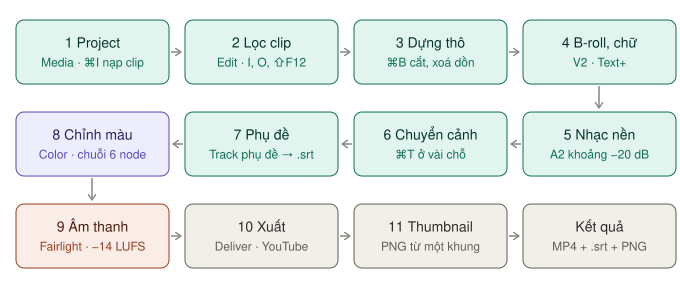
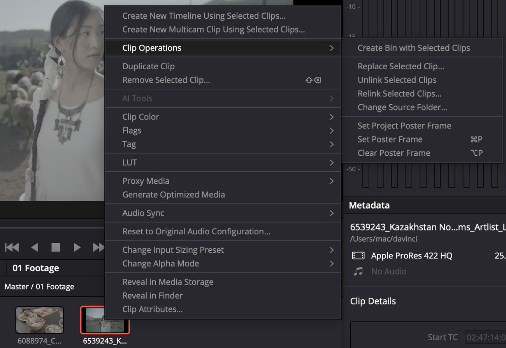
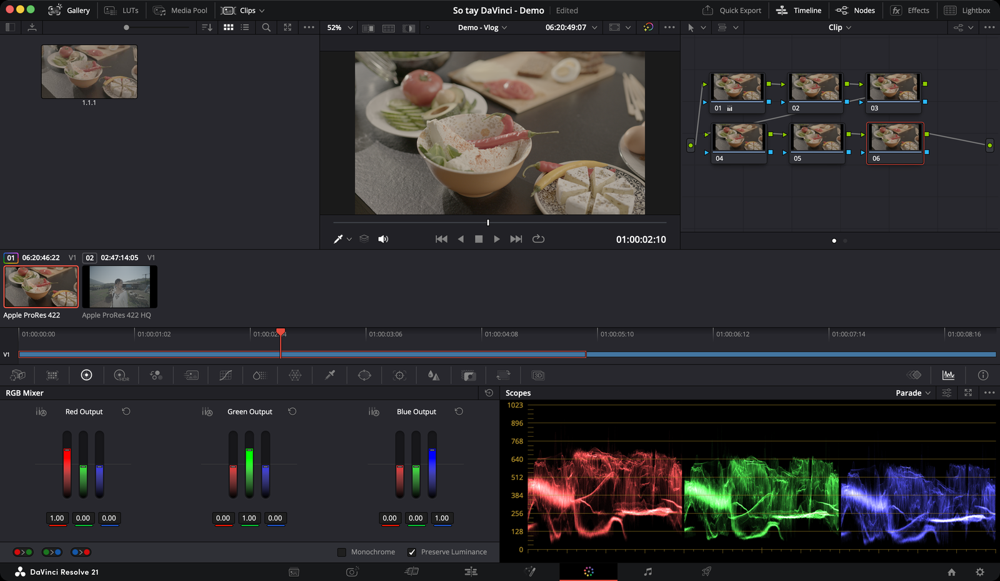

# Vlog YouTube từ đầu đến cuối

Luồng đầy đủ cho một video 10–15 phút, quay bằng một máy, có nhạc nền, chữ và phụ đề. Làm theo đúng thứ tự này thì không phải quay lại sửa.

*Đi theo hàng: trái sang phải, rồi phải sang trái, rồi trái sang phải. Xanh lá là trang Media/Edit, tím là Color, cam là Fairlight, xám là Deliver.*

**Ví dụ xuyên suốt trang này:** project **So tay DaVinci - Demo**, timeline **Demo - Vlog** 25 fps. V1 có 6 clip, A1 tên **Giong noi** (lời thuyết minh), A2 tên **Nhac nen**.

| Bước | Trang | Kết quả | Thông số chính |
|---|---|---|---|
| [1. Chuẩn bị project](#1-chuẩn-bị-project) | Media | Timeline đúng frame rate | 1920×1080, 25 fps |
| [2. Lọc trước khi dựng](#2-lọc-trước-khi-dựng) | Edit | Bản thô đã bỏ phần thừa | `I`, `O`, `⇧F12` |
| [3. Dựng thô](#3-dựng-thô) | Edit | Nội dung và nhịp xong | `⌘B`, `Fn+Delete`, marker `M` |
| [4. B-roll và chữ](#4-b-roll-và-chữ) | Edit, Fusion | Lớp hình phụ, tiêu đề | B-roll ở V2, Text+ 3–4 giây |
| [5. Nhạc nền](#5-nhạc-nền) | Edit | Nhạc nằm dưới lời | Nhạc khoảng −20 dB |
| [6. Chuyển cảnh](#6-chuyển-cảnh) | Edit | Vài chỗ chuyển mềm | `⌘T`, chỉ ở chỗ đổi chủ đề |
| [7. Phụ đề](#7-phụ-đề) | Edit | Track phụ đề | Track `Tieng Viet` |
| [8. Chỉnh màu](#8-chỉnh-màu) | Color | Màu đều giữa các clip | Chuỗi 6 node |
| [9. Âm thanh tinh](#9-âm-thanh-tinh) | Fairlight | Lời rõ, đủ to −14 LUFS | Ducker 2–5 dB, Limiter −1 dB |
| [10. Xuất](#10-xuất) | Deliver | File MP4 + file `.srt` | Preset YouTube 1080p |
| [11. Thumbnail](#11-thumbnail) | Edit | Ảnh bìa PNG | Current Frame as Still |

Xong hết thì soát lại bằng [Checklist trước khi đăng](#checklist-trước-khi-đăng).

## 1. Chuẩn bị project

1. Tạo project mới, đặt tên có ngày tháng. Đặt **Timeline frame rate** trước khi nạp clip — xem [Tạo project](../01-bat-dau/tao-du-an.md#bước-2--frame-rate-thứ-không-sửa-được-về-sau).
   - **Project Settings** (`⇧9`) → **Master Settings** → **Timeline resolution** `1920 x 1080 HD`, **Timeline frame rate** `25` (hoặc đúng frame rate máy quay).
   - Footage 4K mà máy khoẻ thì đặt `3840 x 2160` và xuất 2160p ở bước 10.
2. Tạo bin cho gọn: chuột phải vùng trống Media Pool → **New Bin**. Ví dụ `01 Footage` … `05 Timelines` như project demo.
3. Nạp toàn bộ footage vào Media Pool (`⌘I`). Resolve hỏi đổi frame rate thì chọn **Change**. Xem [Nạp media](../02-trang/media/nap-media.md) và [Hộp thoại đổi frame rate](../02-trang/media/nap-media.md#hộp-thoại-đổi-frame-rate).
4. Chọn các clip → chuột phải → **Create New Timeline Using Selected Clips**. Timeline mới theo đúng Project Settings vừa đặt. Bấm đúp tên timeline trong Media Pool, đổi thành `Demo - Vlog`.
5. Nếu máy lag: chọn hết clip → chuột phải → **Generate Optimized Media**, rồi bật **Playback → Use Optimized Media If Available**. Xem [Optimized Media](../02-trang/media/nap-media.md#optimized-media) và [Tối ưu hiệu năng](../04-tham-khao/hieu-nang.md).

*Mục trên cùng tạo timeline từ các clip đang chọn. Generate Optimized Media nằm ở giữa menu.*

> **Lưu ý:** frame rate của timeline gần như không sửa được khi đã dựng. Đặt sai thì phải tạo timeline mới.

## 2. Lọc trước khi dựng

Đừng kéo hết mọi thứ xuống timeline rồi mới cắt.

1. Bấm đúp một clip trong Media Pool để mở ở Source Viewer.
2. Xem một lượt. Bấm `I` ở chỗ bạn bắt đầu nói, `O` sau câu cuối khoảng nửa giây.
3. Bấm `⇧F12` (**Append to End of Timeline**) để nối đoạn đó vào cuối timeline. Xem [Append](../02-trang/edit/dung-va-cat.md#append--f12).
4. Lặp lại cho clip tiếp theo.

Xong bước này bạn có một bản thô đã bỏ hết phần thừa.

## 3. Dựng thô

Sắp xếp lại thứ tự, cắt bớt. Chỉ quan tâm **nội dung và nhịp**, chưa quan tâm đẹp xấu.

| Việc | Phím |
|---|---|
| Cắt clip tại con trỏ | `⌘B` |
| Xoá clip và dồn phần sau lại (ripple delete) | `Fn+Delete` (phím Forward Delete) |
| Xoá clip, để lại khoảng trống | `Delete` |
| Chế độ chọn / chế độ dao cắt | `A` / `B` |
| Chế độ trim | `T` |
| Đặt marker | `M` |

Xem [Cắt và xoá](../02-trang/edit/dung-va-cat.md#cắt-và-xoá) và [Marker](../02-trang/edit/dung-va-cat.md#marker).

**Đặt marker chapter ngay lúc này:** ở đầu mỗi phần của vlog, bấm `M`, rồi bấm đúp marker và gõ tên phần vào ô **Name**. Mọi marker chapter phải **cùng một màu**. Bước 10 dùng chúng để tạo chapter trên YouTube.

> **Mẹo:** xem lại bản thô với tốc độ 1.5× (**Playback → Speed**) để nhận ra chỗ nào lê thê.

## 4. B-roll và chữ

- **B-roll** đặt lên track V2 bằng `F12` (**Place on Top**). Đặt destination đúng track trước khi bấm (`⌥2` để chọn V2). Xem [Place On Top](../02-trang/edit/dung-va-cat.md#place-on-top--f12).
- **Chữ tĩnh, tiêu đề đơn giản:** **Effects → Toolbox → Titles** → kéo **Text+** lên track trên. Để chữ hiện khoảng 3–4 giây, đủ đọc hai lần. Xem [Chữ — Text, Text+](../02-trang/edit/chu-va-hieu-ung.md#chữ--text-text).
- **Tiêu đề chạy, nhiều lớp viền bóng:** mở clip chữ ở trang Fusion. Xem [Ví dụ: tiêu đề trượt vào](../02-trang/fusion/README.md#ví-dụ-tiêu-đề-trượt-vào-trên-video) và [Chữ động với Text+](../02-trang/fusion/chu-dong.md). Clip đầu của timeline demo có sẵn tiêu đề Fusion "PHO MAI & RAU CU" để bạn mở ra xem.

> Việc gì làm được trong 30 giây ở trang Edit thì làm ở Edit. Fusion nặng máy hơn nhiều — xem [Khi nào cần Fusion](../02-trang/fusion/README.md#khi-nào-cần-fusion-khi-nào-không).

## 5. Nhạc nền

**LUFS** là đơn vị đo độ to theo tai người nghe, không phải theo đỉnh sóng. YouTube dùng mức −14 LUFS.

1. Kéo nhạc xuống track A2. Bấm đúp tên track để đặt tên: A1 `Giong noi`, A2 `Nhac nen`.
2. Chọn hết clip lời ở A1 → chuột phải → **Normalize Audio Levels**:
   - **Normalization Mode:** một chuẩn đo loudness, ví dụ **BS.1770-4** (chuẩn mới nhất).
   - Mức đích: khoảng `−16` LUFS cho lời — chừa chỗ cho nhạc. Bước 9 sẽ đo lại cả bài.
   - **Set Level:** **Relative** nếu thu cùng một mic, cùng một buổi. **Independent** nếu các buổi to nhỏ khác hẳn nhau.
   - Xem [Normalize](../02-trang/fairlight/mixer-va-track-fx.md#normalize--cân-đều-các-clip).
3. Kéo volume nhạc xuống tạm khoảng `−20 dB` (kéo đường ngang trên clip nhạc, hoặc Inspector → **Volume**). Bước 9 sẽ cho nhạc tự nhỏ khi có lời.

## 6. Chuyển cảnh

Ít thôi. Phần lớn cắt thẳng là đẹp nhất.

1. Bấm chọn điểm nối giữa hai clip.
2. `⌘T` thêm chuyển cảnh mặc định (**Cross Dissolve**).
3. Chỉ dùng ở chỗ chuyển chủ đề hoặc chuyển thời gian. Đừng dùng transition loè loẹt ở mọi điểm cắt.

Xem [Chuyển cảnh](../02-trang/edit/chu-va-hieu-ung.md#chuyển-cảnh).

## 7. Phụ đề

Không bắt buộc, nhưng giúp người xem không bật tiếng.

1. Chuột phải đầu track bất kỳ → **Add Subtitle Track**. Bấm đúp tên track, đổi thành `Tieng Viet` — tên này thành tên file `.srt`. Xem [Thêm track phụ đề](../02-trang/edit/phu-de.md#thêm-track-phụ-đề).
2. Gõ từng câu ở Inspector → tab **Captions**, hoặc nhập file `.srt` làm sẵn. Xem [Gõ phụ đề tay](../02-trang/edit/phu-de.md#gõ-phụ-đề-tay) và [Nhập file SRT](../02-trang/edit/phu-de.md#nhập-file-srt).
3. Mỗi câu một hoặc hai dòng, đủ lâu để đọc — xem [Kiểm tra độ dài câu](../02-trang/edit/phu-de.md#kiểm-tra-độ-dài-câu).
4. Kiểu chữ cho cả track: chọn đầu track → Inspector → tab **Track**. Chọn font có đủ dấu tiếng Việt. Xem [Kiểu chữ phụ đề](../02-trang/edit/phu-de.md#kiểu-chữ-phụ-đề).

Chi tiết: [Phụ đề](../02-trang/edit/phu-de.md). Tự tạo phụ đề bằng AI là `Studio`.

## 8. Chỉnh màu

Sang trang **Color**. Quay LOG thì làm [LOG sang Rec.709](log-sang-rec709.md) trước bước này.

*Clip đầu timeline Demo - Vlog đã dựng đủ 6 node. Parade ở góc dưới phải dùng để cân ba kênh R, G, B.*

1. Clip đầu tiên: dựng [chuỗi 6 node](../02-trang/color/node.md#chuỗi-6-node-cơ-bản) (`⌥S` năm lần). Chuột phải từng node → **Change Label**: `Balance`, `Contrast`, `Color`, `Secondary`, `Look`, `Finishing`.
2. Cân bằng ở node 01 bằng **Parade** — chân và đỉnh ba cột R/G/B ngang nhau. Xem [Cân bằng trắng](../02-trang/color/can-bang.md) và [Parade](../02-trang/color/scopes.md#parade).
3. Tương phản ở node 02. Trên **Waveform**, ảnh trải từ gần 0 tới gần 1000 mà không dồn sát trần — xem [Waveform](../02-trang/color/scopes.md#waveform).
4. Look ở node 05. LUT sáng tạo quá gắt thì [giảm độ mạnh LUT](../02-trang/color/lut-va-quan-ly-mau.md#giảm-độ-mạnh-lut).
5. `⌥⌘G` (**Grab Still**) lưu grade. Lưu thành **PowerGrade** nếu muốn dùng cho project sau — xem [PowerGrade](../02-trang/color/node.md#powergrade--khung-node-dùng-cho-mọi-project).
6. Các clip còn lại: chọn clip đích → click chuột giữa vào clip đã chỉnh (hoặc chuột phải → **Apply Grade**). Chỉnh tay từng clip chỗ nào lệch. Xem [Áp grade cho nhiều clip](../02-trang/color/node.md#áp-grade-cho-nhiều-clip).
7. So trước/sau: `⇧D`.

Nếu các cảnh quay cùng một chỗ cùng ánh sáng, dùng [Group](../02-trang/color/node.md#group--nhóm-các-clip-cùng-bối-cảnh) thay vì copy từng clip.

## 9. Âm thanh tinh

Sang trang **Fairlight**. Bấm **Mixer** góc trên phải. Làm đúng thứ tự:

| # | Việc | Ở đâu | Đặt |
|---|---|---|---|
| 1 | Giọng đều | Cột A1 → **Track FX** → ô **Dial Lev** | Bật **Dialogue Leveler**, tick **Lift Soft Dialogue** |
| 2 | Bớt ồn nền (nếu có) | **Effects → Audio FX → Fairlight FX** → **Noise Reduction** thả lên đầu track A1 | Thử preset **De-Hiss** |
| 3 | EQ giọng | Bấm đúp ô **EQ** ở cột A1 | **Hi-Pass** 80 Hz · hạ khoảng 2 dB quanh 300 Hz · nâng khoảng 2 dB quanh 4 kHz |
| 4 | Nén nhẹ | Bấm đúp ô **Dynamics** → bật **Compressor** | **Ratio** 3:1, hạ **Threshold** tới khi chỉ chỗ to nhất bị nén |
| 5 | Nhạc tự nhỏ khi có lời | Cột A2 → **Track FX** → **Ducker** | **Source** = A1 · **Duck Level** 2–5 dB (mặc định 2.7 dB) |
| 6 | Chặn trần | Cột **Bus 1** → **+** ở mục **Effects** → **Limiter** | **Ceiling** −1 dB |
| 7 | Đo độ to cả bài | **Meters** → menu ba chấm của Loudness meter → **YouTube** | **Integrated** quanh −14 LUFS |

Chi tiết từng dòng:

1. **Giọng đều:** xem [Dialogue Leveler](../02-trang/fairlight/mixer-va-track-fx.md#dialogue-leveler--giọng-đều-không-cần-chỉnh-tay).
2. **Ồn nền:** xem [Noise Reduction](../02-trang/fairlight/lam-sach-giong.md#noise-reduction--giảm-ồn-nền).
3. **EQ:** con số trong bảng là điểm khởi đầu, nghe rồi chỉnh. Xem [EQ](../02-trang/fairlight/lam-sach-giong.md#eq--3-thao-tác-cho-giọng-nói).
4. **Compressor:** xem [Compressor](../02-trang/fairlight/lam-sach-giong.md#compressor).
5. **Ducker:** không thấy ô Ducker thì menu ba chấm của Mixer → **Visible Track FX** → tick Ducker. Xem [Ducker](../02-trang/fairlight/mixer-va-track-fx.md#ducker--nhạc-tự-nhỏ-khi-có-lời).
6. **Limiter:** xem [Limiter trên Bus](../02-trang/fairlight/loudness-va-xuat.md#limiter-trên-bus--chặn-trần).
7. **Đo:** đưa con trỏ về đầu, bấm **Reset**, phát hết video. **Integrated** nên quanh −14 LUFS. Ô **TP** (true peak — đỉnh thật, tính cả đỉnh nằm giữa hai mẫu) nên dưới −1. Xem [Loudness meter](../02-trang/fairlight/loudness-va-xuat.md#loudness-meter--đo-độ-to-cảm-nhận) và [Đặt chuẩn YouTube](../02-trang/fairlight/loudness-va-xuat.md#đặt-chuẩn-youtube).
8. Soát lần cuối: không track nào còn **Solo** hay **Mute** nhầm. Xem [Kiểm tra trước khi sang Deliver](../02-trang/fairlight/loudness-va-xuat.md#kiểm-tra-trước-khi-sang-deliver).

> **Lỗi hay gặp:** Integrated đo được −20 LUFS mà vẫn xuất. Video sẽ nhỏ hơn hẳn các video khác trên YouTube. Tăng fader **Bus 1** rồi đo lại, hoặc tick **Normalize Audio** ở bước 10.

## 10. Xuất

Sang trang **Deliver**. Kiểm tra tên timeline ở đầu Viewer là `Demo - Vlog`.

1. Ô **Preset** → **YouTube** → **1080p** (hoặc **2160p** nếu timeline 4K). Panel đổi sang **dạng gọn** — một danh sách, không có tab. Xem [Panel có hai dạng](../02-trang/deliver/giao-dien.md#panel-có-hai-dạng--tuỳ-preset).
2. Gõ **File Name** (ví dụ `Demo - Vlog`), bấm **Browse** chọn **Location**.
3. Để **Frame rate** là Timeline Frame Rate, **Format** MP4, **Video Codec** H.264, **Audio Codec** AAC như preset điền sẵn.
4. **Data burn-in:** mặc định Same as Project. Nếu đã bật timecode ở **Workspace → Data Burn-In** để gửi duyệt thì đổi sang **None**, kẻo timecode dính vào bản đăng.
5. **Normalize Audio:** tick nếu ở bước 9 chưa đạt −14 LUFS. Ô này đưa tiếng về mức chuẩn của YouTube — xem [Audio Normalization](../02-trang/deliver/cai-dat-xuat.md#audio-normalization).
6. Để tắt **Use Proxy Media** — render từ proxy sẽ kém nét.
7. Liếc **Estimated File Size**, rồi **Add to Render Queue** → **Render All**.

Chi tiết: [Preset YouTube](../02-trang/deliver/preset-theo-nen-tang.md#youtube).

**Tải thẳng lên YouTube:** tick **Upload directly to YouTube** ở preset. Hiện thêm **Title**, **Description**, **Chapters from Markers** (chọn màu marker đã đặt ở bước 3), **Upload Thumbnail**, **Visibility**, **Category**. Xem [Tải thẳng lên YouTube](../02-trang/deliver/preset-theo-nen-tang.md#tải-thẳng-lên-youtube).

**Chapter khi chỉ xuất file:** **Custom Export** → **Format** MP4 → tick **Chapters from Markers**, chọn màu marker. Xem [Chapters from Markers](../02-trang/deliver/cai-dat-xuat.md#chapters-from-markers).

**Cần bitrate cụ thể** (ví dụ 15.000 Kb/s cho 1080p)? Dạng gọn không có ô bitrate. Chọn **Custom Export** → tab Video → **Quality → Restrict to**. Xem [Quality — bitrate](../02-trang/deliver/cai-dat-xuat.md#quality--chọn-bitrate).

**File phụ đề cho YouTube:** từ trang Edit, **File → Export Subtitle** ra `.srt`, rồi tải lên YouTube cùng video. Hoặc dùng Custom Export → cuối tab Video → **Subtitle Settings** → **As a separate file**. Xem [Xuất phụ đề](../02-trang/edit/phu-de.md#xuất-phụ-đề).

**Render xong:** chuột phải job → **Reveal in Finder**, mở xem đầu, giữa, cuối. Lỗi gì thì tra [Render xong mà file lỗi](../02-trang/deliver/render-queue-va-loi.md#render-xong-mà-file-lỗi).

## 11. Thumbnail

1. Ở trang Edit, đặt con trỏ đúng khung muốn lấy. Chọn khung mặt rõ, không nhoè chuyển động.
2. **File → Export → Current Frame as Still** → chọn **PNG** → đặt tên `thumbnail`.
3. Khung 1920×1080 đã đúng tỉ lệ 16:9. Thêm chữ to bằng phần mềm thiết kế nếu cần.

Xem [Một khung hình](../02-trang/deliver/preset-theo-nen-tang.md#một-khung-hình--không-cần-sang-deliver). Muốn chỉnh màu riêng cho ảnh bìa: nạp PNG vào trang [Photo](../02-trang/photo/README.md).

## Thời gian tham khảo

| Bước | Thời gian cho video 12 phút |
|---|---|
| Lọc + dựng thô | 1–2 giờ |
| B-roll, chữ | 45 phút |
| Phụ đề gõ tay | 45–90 phút |
| Âm thanh | 30 phút |
| Màu | 30–60 phút |
| Xuất | 10–20 phút |

## Checklist trước khi đăng

- [ ] Timeline đúng frame rate máy quay, đúng 1920×1080 (hoặc 3840×2160).
- [ ] Không còn khung đen lọt giữa các clip — xem cả timeline ở mức zoom nhỏ nhất.
- [ ] Chữ, tiêu đề không chạm mép khung, không sai chính tả.
- [ ] Phụ đề: font đủ dấu tiếng Việt, không câu nào hiện quá ngắn.
- [ ] Màu đều giữa các clip — bấm `⇧D` so trước/sau vài clip.
- [ ] **Integrated** quanh −14 LUFS, **TP** dưới −1. Không track nào Solo/Mute nhầm.
- [ ] Nhạc nhỏ xuống khi có lời, không lấn giọng.
- [ ] Deliver: đúng timeline, **Data burn-in** không in timecode, **Use Proxy Media** tắt.
- [ ] Marker chapter cùng một màu.
- [ ] Mở file xuất ra xem đầu, giữa, cuối. Có file `.srt` và ảnh bìa PNG.
