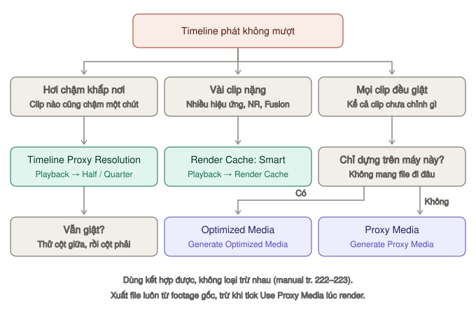

# Tối ưu hiệu năng

Resolve lag không có nghĩa là máy bạn yếu. Phần lớn trường hợp là do codec của footage, không phải do phần cứng.

Làm theo thứ tự dưới đây, dừng lại ngay khi đã đủ mượt. Đừng làm hết từ đầu.

*Chọn theo triệu chứng, theo bảng "Which Playback Optimization Method Should I Use?" của manual (tr. 223). Các cách dùng chung được với nhau.*

| Bước | Hợp khi | Tốn gì | Mức |
|---|---|---|---|
| [1. Hạ độ phân giải khi xem](#bước-1--hạ-độ-phân-giải-khi-xem-miễn-phí-tức-thì) | Hơi chậm khắp nơi | Không tốn gì | `★★★ Hằng ngày` |
| [2. Render Cache](#bước-2--render-cache) | Vài clip nặng hiệu ứng | Ổ cache | `★★★ Hằng ngày` |
| [3. Hạ timeline resolution](#bước-3--hạ-timeline-resolution) | Footage 4K trở lên | Không tốn gì | `★★☆ Thường dùng` |
| [4. Optimized Media](#bước-4--optimized-media) | Mọi clip giật, chỉ dựng trên máy này | Ổ, thời gian tạo | `★★☆ Thường dùng` |
| [5. Proxy Media](#bước-5--proxy-media) | Mọi clip giật, cần mang đi hoặc làm nhóm | Ổ, thời gian tạo | `★★☆ Thường dùng` |
| [Riêng trang Fusion](#riêng-trang-fusion) | Comp Fusion chậm | — | `★☆☆ Tình huống cụ thể` |

## Bước 1 — Hạ độ phân giải khi xem (miễn phí, tức thì)

**Là gì:** Timeline Proxy Mode — Resolve hạ độ phân giải của timeline ngay lúc phát, không tạo file nào (manual tr. 201, 222). Tên có chữ "proxy" nhưng **không liên quan** tới Proxy Media ở Bước 5.

**Dùng khi:** timeline chỉ hơi chậm, clip nào cũng chậm một chút.

**Cách làm:** **Playback → Timeline Proxy Resolution → Half** (hoặc **Quarter**). Chọn **None** để tắt.

**Ví dụ:** timeline 3840×2160 → chọn Half, Viewer xử lý như 1920×1080; Quarter như 960×540. Lúc xuất vẫn đủ 4K vì Deliver không dùng chế độ này.

Đây là thứ nên thử đầu tiên, mất 2 giây.

> **Mẹo:** footage raw (BRAW, R3D…) còn một nút nữa: palette **Camera Raw** → hạ **Decode Quality** khi dựng (tr. 201).

## Bước 2 — Render Cache

**Là gì:** Resolve render sẵn những đoạn nặng ra file cache, rồi phát lại file đó thay vì tính lại từng khung (tr. 205–211).

**Dùng khi:** chỉ vài clip giật — clip có Noise Reduction, nhiều ResolveFX, Fusion, chồng lớp, đổi tốc độ.

**Playback → Render Cache** (hoặc `⌥R` ở trang Edit, Color để đổi vòng). Ba chế độ (tr. 206):

| Chế độ | Làm gì |
|---|---|
| **Off** | Tắt |
| **Smart** | Resolve tự cache những thứ hay nặng: clip H.264/H.265/raw, clip đổi tốc độ, Fusion, node có Noise Reduction, Motion Blur, ResolveFX, chuyển cảnh, clip chồng lớp có opacity hoặc composite mode (tr. 209–210) |
| **User** | Chỉ render những clip bạn tự đánh dấu |

**Smart là lựa chọn tốt cho hầu hết trường hợp.** Bật lên rồi để máy nghỉ vài phút. Vạch nhỏ ở mép dưới thước timeline trang Edit: **đỏ** là đang chờ cache, **xanh lam** là đã cache xong (tr. 208).

Chế độ **User**: chuột phải clip → **Render Cache Color Output** cho những clip có nhiều hiệu ứng — cache cả grade của clip (tr. 210). Ở trang Color, chuột phải một node → **Node Cache → On** để cache riêng node đó và mọi node phía trước.

Định dạng file cache: **Project Settings → Master Settings → Optimized Media and Render Cache → Render cache format** (tr. 147).

Đặt nơi lưu cache: **Project Settings → Master Settings → Working Folders → Cache files location**. Trỏ vào SSD nhanh. Xem [Tạo project → Nơi lưu cache](../01-bat-dau/tao-du-an.md#bước-5--nơi-lưu-cache-và-file-tạo-ra).

Dọn cache: **Playback → Delete Render Cache → All / Unused / Selected Clips** (tr. 211). Tự xoá cache cũ: **Preferences → User → Project Save and Load → Cache Management** (tr. 117).

Lúc xuất, cache dùng lại được nhờ ô **Use render cached images** — xem [Render cache khi xuất](../02-trang/deliver/render-queue-va-loi.md#render-cache-và-use-render-cached-images).

## Bước 3 — Hạ timeline resolution

**Dùng khi:** footage 4K hoặc lớn hơn, máy không theo kịp kể cả ở Bước 1.

**Project Settings → Master Settings → Timeline resolution** → hạ xuống 1920×1080 dù footage là 4K.

Lúc xuất, ở trang Deliver đặt lại Resolution thành 3840×2160. Resolve render từ footage gốc nên **không mất chất lượng** — vị trí, zoom, window đều tính theo tỉ lệ khung nên tự co giãn đúng.

> **Lưu ý:** đổi timeline resolution là đổi project. Hiệu ứng tính theo pixel cố định (một số node Fusion, chữ đặt theo pixel) nên xem lại ở cỡ 4K trước khi xuất.

Cách này hiệu quả rõ rệt và hay bị bỏ qua.

## Bước 4 — Optimized Media

**Là gì:** bản sao nhẹ của footage bằng codec dễ giải mã (ProRes, DNxHR), do Resolve tự quản lý (tr. 202–204).

**Dùng khi:** mọi clip đều giật — thường là H.264/H.265 từ điện thoại, máy ảnh, raw hoặc 8K — và bạn **chỉ dựng trên máy này**.

**Cách làm:** chọn toàn bộ clip trong Media Pool → chuột phải → **Generate Optimized Media**. Rồi bật **Playback → Use Optimized Media If Available**. Tắt ô này là quay về file gốc ngay.

Chọn codec ở **Project Settings → Master Settings → Optimized Media and Render Cache → Optimized media format** (tr. 203):

| Máy | Codec nên chọn |
|---|---|
| Mac | ProRes 422 LT, hoặc ProRes 422 Proxy nếu máy yếu |
| Windows | DNxHR SQ, hoặc DNxHR LB nếu máy yếu |

Ô **Optimized media resolution**: Original, Half, Quarter, Eighth, Sixteenth hoặc **Choose automatically**. Footage 4K dựng timeline 1080 thì đặt Half.

Nhược điểm: tốn dung lượng ổ, và mất thời gian tạo. File optimized (đuôi `.dvcc`) nằm trong thư mục cache, **không** đi theo khi archive hay Media Management, và không mở được bằng phần mềm khác (tr. 204).

> **Mẹo:** chỉ footage raw hoặc H.265 mới cần optimize. Lọc bằng Smart Bin theo codec rồi chọn cả bin (tr. 202).

## Bước 5 — Proxy Media

**Là gì:** cũng là bản nhẹ của footage như Optimized Media. Khác ở chỗ proxy là file độc lập, bạn tự quản lý: chép sang máy khác, relink lại, hoặc tạo bằng phần mềm ngoài đều được. Optimized Media thì Resolve quản lý bên trong, không xuất ra được (manual tr. 222).

**Dùng khi:** mọi clip đều giật **và** cần mang media đi — làm nhóm, dựng trên laptop rồi chuyển sang máy bàn.

**Cách làm:**
1. Đặt định dạng ở **Project Settings → Master Settings → Optimized Media and Render Cache → Proxy media format** và **Proxy media resolution** (tr. 213).
2. Chuột phải clip → **Generate Proxy Media**. File vào **Proxy generation location** ở Working Folders (tr. 214).
3. Chọn cách phát: trang Edit **Playback → Proxy Handling** (trang Cut: icon Proxy Handling trên Viewer). **Prefer Proxies** dùng proxy, clip nào chưa có proxy thì dùng file gốc; **Disable All Proxies** chỉ dùng file gốc (tr. 215).

> **Mẹo:** **Prefer Proxies** còn cứu được khi file gốc mất: clip thiếu file gốc vẫn phát bằng proxy, timeline hiện vạch tím ở đoạn đó (tr. 215).

So sánh Proxy và Optimized Media chi tiết: [Proxy và Optimized Media](../02-trang/media/nap-media.md#proxy-và-optimized-media).

> **Lưu ý:** lúc xuất, để **tắt** **Use Proxy Media** — render từ proxy sẽ kém nét. Xem [Render xong mà file lỗi](../02-trang/deliver/render-queue-va-loi.md#render-xong-mà-file-lỗi).

## Riêng trang Fusion

Fusion nặng hơn trang Edit nhiều và không đảm bảo phát đúng tốc độ thực.

- Chuột phải vùng nút phát → bật **Proxy** hoặc **Auto Proxy**. Xem [Time Ruler và nút phát](../02-trang/fusion/giao-dien.md#time-ruler-và-nút-phát).
- Giữ `⌘` kéo trên Time Ruler để thu hẹp vùng render khi xem thử.
- Node quá nặng: chọn node, `⌘U` để ngừng cập nhật. Xem [Xoá, tắt tạm, khoá node](../02-trang/fusion/node-co-ban.md#xoá-tắt-tạm-khoá-node).
- Việc làm được ở trang Edit thì đừng mở Fusion. Xem [Khi nào cần Fusion](../02-trang/fusion/README.md#khi-nào-cần-fusion-khi-nào-không).

## Vấn đề gốc — codec của footage

Nếu footage là **H.264 hoặc H.265** quay từ điện thoại hay máy ảnh, đó chính là nguyên nhân. Hai codec này nén rất chặt, mỗi khung hình phải giải mã dựa vào các khung lân cận, nên tua ngược hay nhảy cóc đều rất nặng.

ProRes và DNxHR nén từng khung độc lập nên nhẹ hơn nhiều khi dựng, đổi lại file to gấp nhiều lần.

Nếu bạn làm dự án dài với footage H.265, chuyển đổi toàn bộ sang ProRes trước bằng **Shutter Encoder** (miễn phí) hoặc **HandBrake** sẽ tiết kiệm nhiều thời gian hơn là vật lộn với proxy.

## Thiết lập khác đáng chỉnh

**Project Settings → Master Settings:**
- **Optimized Media Resolution** → Half

**Preferences → System → Memory and GPU** (tr. 100):
- **GPU processing mode** — chọn giữa OpenCL, CUDA, Metal. Trên Mac dùng **Metal** (hoặc để Auto).
- **Limit Resolve Memory Usage to** — mặc định đã là **75%** RAM, cũng là mức tối đa. Hạ xuống nếu vừa dựng vừa mở nhiều app khác.
- **Limit Fusion Memory Cache to** — phần RAM cho bộ nhớ phát của trang Fusion, trích từ con số ở trên.

**Preferences → System → Decode Options** (tr. 102):
- Bật **Decode H.264/HEVC using hardware acceleration** nếu máy hỗ trợ

**Preferences → System → Media Storage:** ổ đầu tiên trong danh sách là nơi mặc định chứa cache và still — chọn ổ nhanh nhất (tr. 17).

## Cấu hình máy tham khảo

| Làm gì | RAM | Ghi chú |
|---|---|---|
| 1080p | 16 GB | Đủ dùng |
| 4K | 32 GB | Nên có |
| 4K nhiều lớp, nhiều hiệu ứng | 64 GB | |

Ổ lưu footage nên là SSD. Ổ cứng cơ 5400 vòng là nút thắt lớn hơn cả CPU yếu.

## Thói quen giúp máy nhẹ

- Đóng Chrome khi dựng. Mỗi tab là một tiến trình ăn RAM.
- Tắt **Fusion** và các hiệu ứng nặng khi chưa cần xem.
- Dọn cache định kỳ: **Playback → Delete Render Cache → All**, hoặc **Unused** để giữ cache của clip đang dùng.
- Chia dự án dài thành nhiều timeline ngắn rồi ghép ở timeline tổng.

---

**Nguồn tham khảo thêm:** [Miracamp](https://www.miracamp.com/learn/davinci-resolve/how-to-fix-laggy-playback-in-davinci-resolve-optimize-timeline-performance) và [Elements.tv](https://elements.tv/blog/davinci-resolve-5-ways-to-achieve-better-playback-performance/).
