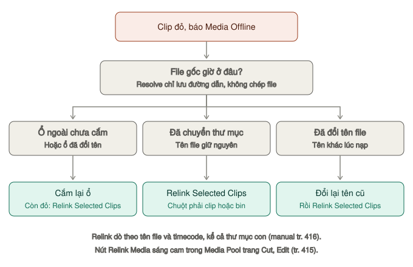
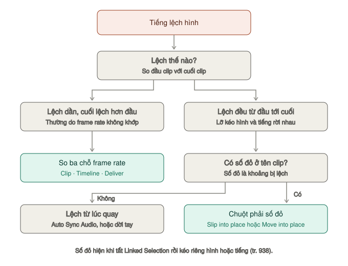

# Lỗi thường gặp

Mỗi mục theo cùng một mạch: **triệu chứng → nguyên nhân → cách sửa → cách phòng**. Số trang ghi "tr." là trang trong DaVinci Resolve Manual.

| Nhóm | Lỗi | Hay gặp |
|---|---|---|
| Media | [Media Offline](#clip-hiện-màu-đỏ-media-offline), [Không mở được MP4 điện thoại](#resolve-không-mở-được-file-mp4-từ-điện-thoại), [Project biến mất](#project-biến-mất) | `★★★` |
| Dựng | [Tiếng lệch hình](#tiếng-lệch-hình), [Không kéo được clip](#không-kéo-được-clip-xuống-timeline) | `★★☆` |
| Fusion | [Fusion chậm](#fusion-làm-resolve-chậm-hẳn), [Text+ không hiện chữ](#text-không-hiện-chữ) | `★★☆` |
| Tiếng | [Một bên tai nghe](#chỉ-nghe-được-một-bên-tai-nghe), [Tiếng rè, quá to, quá nhỏ](#tiếng-rè-quá-to-hoặc-quá-nhỏ-sau-khi-xuất) | `★★★` |
| Phụ đề | [Phụ đề không hiện](#phụ-đề-không-hiện) | `★★☆` |
| Xuất | [Video giật](#video-xuất-ra-bị-giật), [Màu nhạt](#màu-trong-resolve-đẹp-xuất-ra-nhạt), [Render kẹt, lỗi](#export-bị-kẹt-ở-0-hoặc-báo-lỗi) | `★★★` |

## Clip hiện màu đỏ "Media Offline"

Resolve không tìm thấy file gốc. Nó **không nhúng media vào project**, chỉ lưu đường dẫn.

*Cách sửa tuỳ file gốc đang ở đâu.*

Nguyên nhân: bạn đổi tên file, chuyển thư mục, hoặc rút ổ cứng ngoài.

**Cách sửa** (manual tr. 415–416):
1. Nhìn Media Pool trang Cut hoặc Edit: icon **Relink Media** sáng cam. Bấm vào để xem clip mất nằm ở ổ nào, rồi **Locate** để chỉ chỗ mới, hoặc **Disk Search** để Resolve tự lục ổ.
2. Hoặc chuột phải clip trong Media Pool → **Relink Selected Clips** (chuột phải bin → **Relink Clips for Selected Bin** để làm cả bin) → chọn thư mục chứa file → **OK**. Resolve dò theo **tên file và timecode** trong thư mục đó và mọi thư mục con; không thấy thì hỏi có tìm sâu hơn không.

Ví dụ: footage `Demo - Vlog` chuyển từ `~/Movies/DaLat` sang ổ ngoài `/Volumes/SSD/DaLat` → Relink Selected Clips → chọn `/Volumes/SSD/DaLat` → mọi clip hết đỏ.

> **Lỗi hay gặp:** đổi tên file trong Finder sau khi nạp. Relink dò theo tên nên không tìm ra — đổi lại tên cũ rồi relink.

> **Mẹo:** nếu đã tạo Proxy Media, chọn **Playback → Proxy Handling → Prefer Proxies**: clip mất file gốc vẫn phát bằng proxy trong lúc bạn tìm file (tr. 215).

Phòng tránh: sắp xếp thư mục footage **trước khi** nạp vào Resolve, và đừng đổi tên file sau đó.

## Video xuất ra bị giật

Gần như luôn là do frame rate lệch.

Kiểm tra ba chỗ phải khớp nhau:
1. Frame rate của footage (xem ở trang Media, panel Metadata)
2. **Project Settings → Timeline frame rate**
3. Trang Deliver → **Frame rate** — để **Timeline Frame Rate**. Xem [Cài đặt xuất](../02-trang/deliver/cai-dat-xuat.md#tab-video)

Frame rate của project bị khoá khi Media Pool đã có clip (manual tr. 375). Timeline sai frame rate thì tạo timeline mới: **File → New Timeline** (`⌘N`) → bỏ tick **Use Project Settings** → tab **Format** đặt **Timeline frame rate** đúng (tr. 860) → copy toàn bộ clip từ timeline cũ sang.

> **Lỗi hay gặp:** điện thoại quay **frame rate biến thiên** (VFR) — file ghi 30 fps nhưng thực tế dao động. Tiếng lệch dần dù mọi ô đã khớp. Chuyển file sang frame rate cố định bằng **Shutter Encoder** hoặc **HandBrake** trước khi nạp.

## Tiếng lệch hình

*Xem đầu clip rồi cuối clip để biết lệch dần hay lệch đều.*

**Nếu lệch dần theo thời gian** — frame rate lệch. Xem mục trên.

**Nếu lệch một khoảng cố định** — thường do lỡ kéo hình và tiếng lệch nhau khi tắt Linked Selection. Clip lệch sẽ hiện **số đỏ** ở đầu thanh tên clip — đó là khoảng timecode bị lệch (manual tr. 938). Chuột phải vào số đỏ đó:

- **Slip into place** — trượt nội dung clip đang chọn cho khớp, clip không xê dịch
- **Move into place** — dời clip đang chọn về đúng chỗ khớp
- **Slip others into place** / **Move others into place** — giữ nguyên clip đang chọn, sửa các phần còn lại cho khớp theo nó

**Nếu lệch cố định mà không có số đỏ** — tiếng lệch từ lúc quay hoặc thu riêng. Ghép tiếng thu rời bằng **Auto Sync Audio** theo sóng âm hoặc timecode (tr. 453), hoặc tắt Linked Selection (`⌘⇧L`) rồi dời tay từng khung bằng `,` `.`.

## Màu trong Resolve đẹp, xuất ra nhạt

Vấn đề color management, hay gặp trên Mac.

Màn hình Mac và các trình phát (QuickTime, trình duyệt) xử lý gamma, không gian màu theo cách riêng, nên cùng một file có thể trông khác trong Resolve và ngoài Resolve.

Kiểm tra:
- **Project Settings → Color Management → Output color space** phải là Rec.709 (ví dụ **Rec.709 Gamma 2.4**) khi xuất cho YouTube, mạng xã hội
- Mở file xuất ra bằng **VLC** thay vì QuickTime — QuickTime có cách xử lý màu riêng làm sai lệch
- Custom Export: **Advanced Settings** → **Color Space Tag**, **Gamma Tag** để **Same as Project**, **Data Levels** để **Auto**. Xem [Advanced Settings](../02-trang/deliver/cai-dat-xuat.md#advanced-settings--những-ô-đáng-biết)

Chi tiết: [LUT và quản lý màu](../02-trang/color/lut-va-quan-ly-mau.md#color-management-của-project), [LOG sang Rec.709](../03-luong/log-sang-rec709.md#xuất-và-soát-màu).

## Chỉ nghe được một bên tai nghe

Mic thu mono nhưng Resolve gán vào một kênh của stereo.

Sửa: chuột phải clip trong Media Pool → **Clip Attributes** → tab **Audio** → đổi **Format** từ Stereo sang **Mono**, hoặc gán cả hai kênh output về cùng một source. Xem [Clip Attributes → Tab Audio](../02-trang/media/clip-attributes.md#tab-audio).

## Tiếng rè, quá to hoặc quá nhỏ sau khi xuất

| Hiện tượng | Nguyên nhân | Sửa |
|---|---|---|
| Rè, vỡ tiếng ở chỗ to | Đỉnh vượt 0. Nén AAC còn đẩy đỉnh lên thêm | Đặt **Limiter** ở Bus 1, **Ceiling** −1 dB. Số **TP** dưới −1. Xem [Limiter trên Bus](../02-trang/fairlight/loudness-va-xuat.md#limiter-trên-bus--chặn-trần) |
| Cả video nhỏ hơn video khác trên YouTube | **Integrated** thấp hơn −14 LUFS nhiều | Đo bằng [Loudness meter](../02-trang/fairlight/loudness-va-xuat.md#loudness-meter--đo-độ-to-cảm-nhận). Hoặc tick **Normalize Audio** lúc xuất, Standard **YouTube** |
| Clip này to, clip kia nhỏ | Mỗi clip thu một mức | **Normalize Audio Levels** — xem [Normalize](../02-trang/fairlight/mixer-va-track-fx.md#normalize--cân-đều-các-clip) |
| Nhạc lấn lời | Nhạc để quá to | **Ducker** — xem [Ducker](../02-trang/fairlight/mixer-va-track-fx.md#ducker--nhạc-tự-nhỏ-khi-có-lời) |
| File xuất mất một track, hoặc chỉ có một track | Track còn bật **Solo** hay **Mute** | Tắt S và M ở đầu track. Xem [Kiểm tra trước khi sang Deliver](../02-trang/fairlight/loudness-va-xuat.md#kiểm-tra-trước-khi-sang-deliver) |
| Không có tiếng | Chưa tick **Export Audio**, hoặc Output Track chọn nhầm bus | Tab Audio của Custom Export. Xem [Tab Audio](../02-trang/deliver/cai-dat-xuat.md#tab-audio) |

## Không kéo được clip xuống timeline

| Nguyên nhân | Sửa |
|---|---|
| Track bị khoá | Bấm icon ổ khoá ở đầu track, hoặc `⌥⇧1` cho V1 (`⌥⇧9` mở/khoá mọi track hình) — manual tr. 912 |
| Nút edit (F9, F10…) không đưa clip xuống | **Destination control** (ô V1, A1 ở đầu track) chưa bật — bấm `⌥1` cho V1, `⌥⌘1` cho A1; bấm lại để tắt/bật (tr. 989) |
| Kéo được hình mà không có tiếng, hoặc ngược lại | Lỡ giữ `⌥` (chỉ hình) hoặc `⇧` (chỉ tiếng) khi kéo, hoặc kéo từ ô **Video-only** / **Audio-only** hiện ở đáy Viewer nguồn (tr. 916). Kéo lại, không giữ phím |

## Export bị kẹt ở 0% hoặc báo lỗi

- Thư mục đích hết chỗ, hoặc không có quyền ghi.
- Bật/tắt ô **Use hardware acceleration if available** rồi thử lại.
- Có clip offline trong timeline — Resolve cảnh báo **Media Offline** ngay khi thêm job vào Render Queue (manual tr. 4212). Sửa theo [mục Media Offline](#clip-hiện-màu-đỏ-media-offline) trước khi render.
- Tên file có ký tự đặc biệt — đổi tên đơn giản hơn.

Render xong mà hình đứng, mờ, có khung đỏ, dính timecode: xem bảng [Render xong mà file lỗi](../02-trang/deliver/render-queue-va-loi.md#render-xong-mà-file-lỗi).

## Resolve không mở được file MP4 từ điện thoại

Clip nạp vào nhưng chỉ có tiếng, hình đen, hoặc báo không hỗ trợ. Thường do codec điện thoại mà bản free giải mã hạn chế — hay gặp với HEVC 10-bit, HDR (Dolby Vision, HLG) của iPhone và Android đời mới.

Cách sửa:
1. Thử bật **Preferences → System → Decode Options → Decode H.264/HEVC using hardware acceleration** (manual tr. 102), khởi động lại Resolve.
2. Vẫn không được: chuyển đổi trước bằng **Shutter Encoder** hoặc **HandBrake** sang H.264 8-bit hoặc ProRes 422.

Phòng tránh: trên điện thoại tắt quay HDR, chọn frame rate cố định (24, 25 hoặc 30).

## Project biến mất

Resolve lưu project trong **project library** (thư viện project; bản cũ gọi là database) chứ không phải file rời.

Tìm lại: mở **Project Manager** (`⇧0`), kiểm tra xem bạn có đang ở đúng thư viện không — nút góc trên trái mở thanh **Project Libraries** liệt kê mọi thư viện trên máy (manual tr. 82). Project cũng có thể nằm trong một thư mục con — bấm đúp để mở thư mục.

Khôi phục bản cũ: chuột phải project → **Project Backups** → chọn bản → **Load**. Xem [Tạo project → Bước 6](../01-bat-dau/tao-du-an.md#bước-6--tự-động-lưu-và-bản-sao-lưu).

Mang sang máy khác: **File → Export Project** ra `.drp` (tr. 79).

> **Lưu ý:** bản sao lưu không chứa still và LUT (tr. 115). Cần đủ thì dùng **Export Project With Stills and LUTs**.

## Fusion làm Resolve chậm hẳn

Mỗi clip có Fusion composition đều phải render lại liên tục.

| Cách | Ở đâu |
|---|---|
| Việc làm được ở trang Edit thì làm ở Edit | Xem [Khi nào cần Fusion](../02-trang/fusion/README.md#khi-nào-cần-fusion-khi-nào-không) |
| Bật **Proxy** hoặc **Auto Proxy** khi xem trong Fusion | Chuột phải vùng nút phát. Xem [Time Ruler và nút phát](../02-trang/fusion/giao-dien.md#time-ruler-và-nút-phát) |
| Thu hẹp vùng render | Giữ `⌘` kéo trên Time Ruler |
| Ngừng cập nhật node nặng | Chọn node, `⌘U`. Xem [Xoá, tắt tạm, khoá node](../02-trang/fusion/node-co-ban.md#xoá-tắt-tạm-khoá-node) |
| Bật **Render Cache Smart** | **Playback → Render Cache**. Xem [Tối ưu hiệu năng](hieu-nang.md#bước-2--render-cache) |
| **Render in Place** | Chuột phải clip trên timeline Edit — "nướng" mọi hiệu ứng thành file mới (manual tr. 1187). Muốn sửa lại: chuột phải → **Decompose to Original** (tr. 1188) |

## Text+ không hiện chữ

Thường do màu chữ trùng màu nền, hoặc **Size** quá nhỏ/quá lớn khiến chữ nằm ngoài khung.

Kiểm tra trong Inspector: **Color** ở tab Shading, và **Size** cùng **Center** ở tab Layout. Xem [Chữ động với Text+](../02-trang/fusion/chu-dong.md#tab-shading).

Trong Fusion mà chữ không ra hình cuối: Text+ chưa nối vào Merge, hoặc nối ngược Background và Foreground — chọn Merge, `⌘T`. Xem [Lỗi hay gặp trong Fusion](../02-trang/fusion/node-co-ban.md#lỗi-hay-gặp).

## Phụ đề không hiện

| Hiện tượng | Nguyên nhân | Sửa |
|---|---|---|
| Không thấy phụ đề trên Viewer | Track phụ đề đang tắt. Chỉ **một** track phụ đề hiện trên hình — bật track này thì track khác tự tắt | Bấm nút bật ở đầu track. Xem [Thêm track phụ đề](../02-trang/edit/phu-de.md#thêm-track-phụ-đề) |
| Không thấy vùng track phụ đề | Đã ẩn ở **Timeline View Options** | Bật lại nút **Subtitle**. Ẩn vùng track không tắt phụ đề trên hình |
| Chữ thành ô vuông, dấu lệch | Font thiếu dấu tiếng Việt | Đổi font ở tab **Track**. Xem [Kiểu chữ phụ đề](../02-trang/edit/phu-de.md#kiểu-chữ-phụ-đề) |
| File xuất không có phụ đề | Chưa tick **Export Subtitle**. Preset YouTube, TikTok dạng gọn không có mục này | **Custom Export** → cuối tab Video → **Subtitle Settings**. Xem [Subtitle Settings](../02-trang/deliver/cai-dat-xuat.md#subtitle-settings) |
| Không thấy phụ đề trên TikTok, Reels | Xuất dạng file rời — hai nền tảng này không đọc | **Format: Burn into video** |
| Burn in ra sai ngôn ngữ | Burn into video chỉ in track đang bật | Bật đúng track rồi render. Xem [Xuất phụ đề](../02-trang/edit/phu-de.md#xuất-phụ-đề) |

## Tài liệu chính thống

Khi tài liệu này không đủ, tra ở nguồn gốc:

- **DaVinci Resolve Manual** — bản PDF đầy đủ nhất, đã có sẵn trong máy bạn tại `/Applications/DaVinci Resolve/DaVinci Resolve Manual.pdf`. Hơn 4000 trang, tra bằng tìm kiếm.
- **Sáu cuốn hướng dẫn miễn phí của Blackmagic** cho Resolve 20 — xem [Nguồn tham khảo](nguon.md).
- **Diễn đàn Blackmagic** — [forum.blackmagicdesign.com](https://forum.blackmagicdesign.com), nơi hỏi đáp chính thức.
