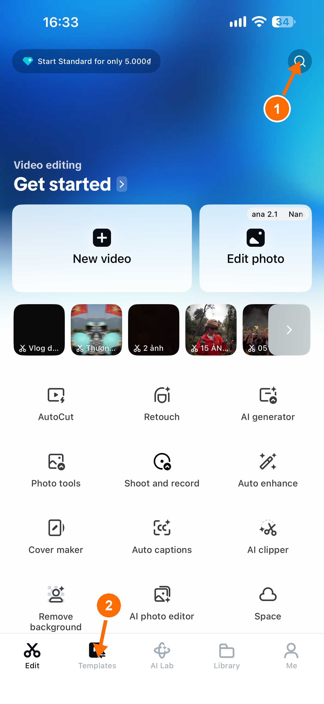
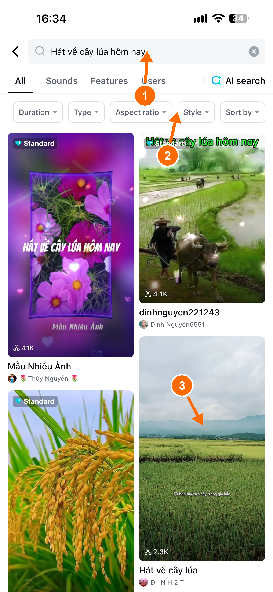
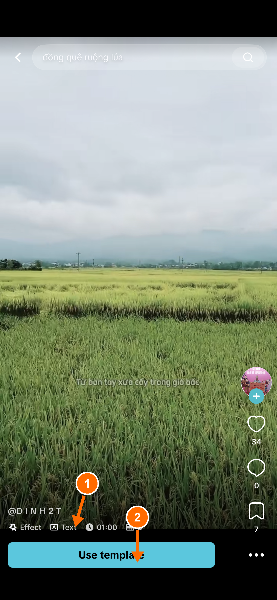
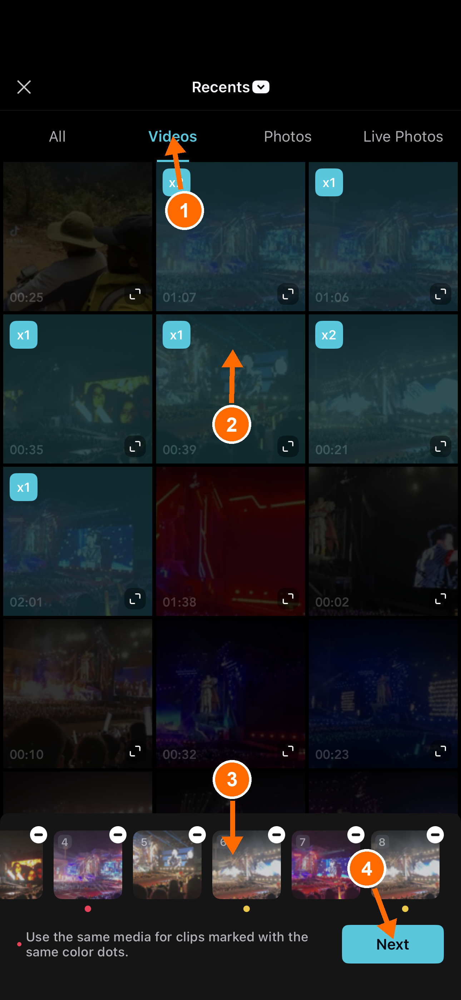
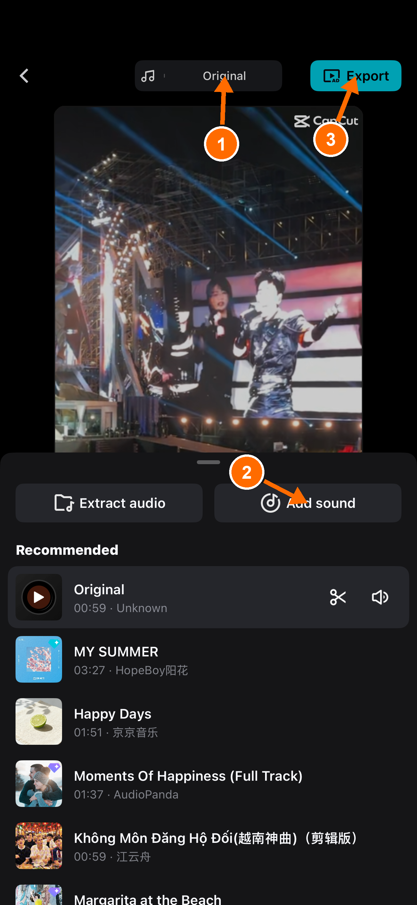
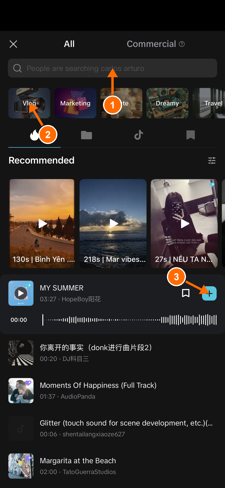
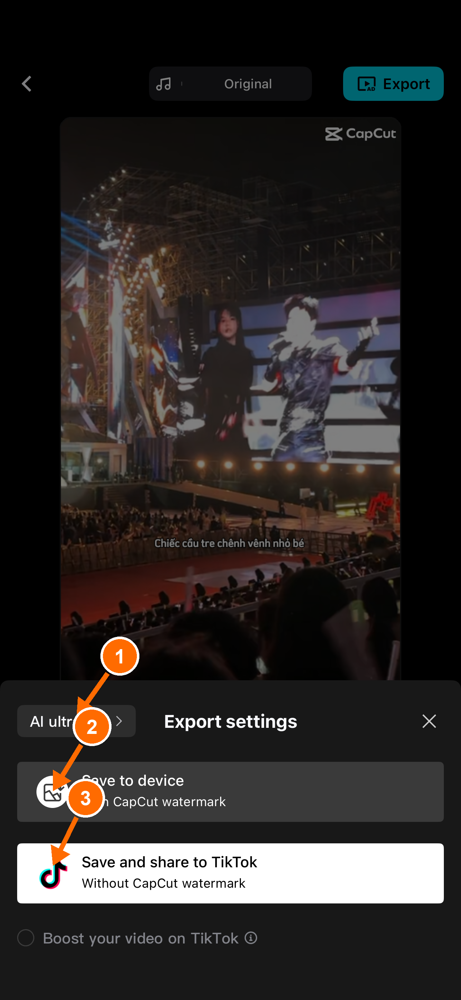
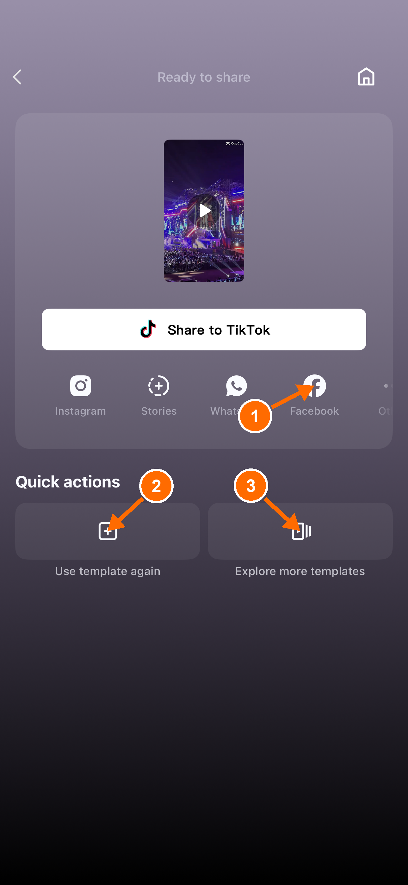

# CapCut trên điện thoại — dựng nhanh bằng mẫu có sẵn

> **Một câu:** không cần biết dựng video, chỉ cần chọn một mẫu có sẵn, nhét ảnh/video của mình vào, rồi xuất — CapCut tự ghép hiệu ứng, nhạc, chữ cho mình.

Các số **(1) (2) (3)...** trên ảnh chỉ đúng vị trí cần chạm vào, khớp với số trong từng bước mô tả bên dưới.

## 1. Mở app, vào mục tìm mẫu

1. Mở app CapCut.
2. Chạm kính lúp **(1)** ở góc trên phải để tìm mẫu theo từ khoá.
3. Hoặc chạm tab **Mẫu (Templates) (2)** ở thanh dưới để lướt kho mẫu có sẵn.

## 2. Tìm và lọc mẫu

1. Gõ từ khoá vào ô tìm kiếm **(1)** — ví dụ "đồng quê", "sinh nhật", "du lịch".
2. Dùng hàng bộ lọc **(2)** để thu hẹp kết quả: thời lượng, ảnh hay video, tỉ lệ khung hình, phong cách.
3. Chạm vào một mẫu ưng ý **(3)** để xem trước.

> **Lưu ý:** mẫu nào có nhãn **"Standard"** (biểu tượng viên kim cương) ở góc trên-trái là mẫu trả phí, phải có gói CapCut Pro mới dùng được. Mẫu không có nhãn này thì dùng miễn phí bình thường.

## 3. Xem trước và chọn dùng mẫu

1. Xem thông tin mẫu **(1)**: hiệu ứng, chữ có sẵn, thời lượng, cần bao nhiêu ảnh/video.
2. Ưng ý thì bấm **Dùng mẫu (Use template) (2)** để bắt đầu dùng mẫu này.

## 4. Chọn ảnh/video đưa vào mẫu

1. Chọn tab **Video** hoặc **Ảnh (Videos/Photos) (1)** tuỳ mẫu đang cần loại nào.
2. Chạm chọn từng ảnh/video **(2)** theo đúng thứ tự muốn nó xuất hiện trong video.
3. Dải ô nhỏ bên dưới **(3)** là từng đoạn trong mẫu — ô nào có chấm màu giống nhau thì dùng chung một ảnh/video.
4. Chọn đủ rồi bấm **Tiếp theo (Next) (4)**.

## 5. Màn hình chỉnh sửa và chọn nhạc

1. Thanh nhạc nền hiện tại của mẫu nằm ở trên **(1)** — mặc định là "Original".
2. Muốn đổi nhạc khác thì bấm **Thêm nhạc (Add sound) (2)**.
3. Ưng ý rồi thì bấm **Xuất (Export) (3)** ở góc trên phải.

### Nếu muốn đổi nhạc

1. Gõ tên bài hát hoặc từ khoá vào ô tìm kiếm **(1)**.
2. Hoặc chọn nhanh theo chủ đề có sẵn **(2)**: Vlog, Cute, Dreamy...
3. Nghe thử rồi bấm dấu **+ (3)** ở bài muốn dùng để thêm vào video.

## 6. Cài đặt khi xuất

1. Chọn chất lượng xuất **(1)** — nên để mức cao nhất cho đẹp.
2. **Lưu vào máy (Save to device) (2):** lưu video vào điện thoại, nhưng có logo CapCut nhỏ ở góc.
3. **Lưu và đăng TikTok (Save and share to TikTok) (3):** xuất bản không có logo CapCut, nhưng sẽ dẫn qua bước chia sẻ lên TikTok trước.

Nếu định đăng lên Facebook, cứ chọn **Lưu vào máy** cho đơn giản — không cần qua TikTok, chỉ đánh đổi một logo nhỏ ở góc video.

## 7. Đăng thẳng lên Facebook

1. Xuất xong, màn hình **"Sẵn sàng chia sẻ" (Ready to share)** hiện ra.
2. Bấm biểu tượng **Facebook (1)** để đăng thẳng video lên Facebook.
3. Nếu chưa muốn đăng ngay, có thể **dùng lại mẫu này (2)** hoặc **tìm mẫu khác (3)** để dựng tiếp.

## Video xuất ra lưu ở đâu trên điện thoại?

Video luôn được lưu vào app **Ảnh** của iPhone, nằm trong album **Gần đây (Recents)**. Lần xuất đầu tiên, CapCut sẽ xin quyền truy cập Ảnh — nhớ bấm **Cho phép (Allow)** thì file mới lưu được vào máy.
