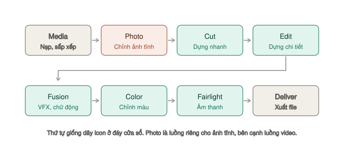

# Sổ tay DaVinci Resolve 21

Tài liệu tiếng Việt cho DaVinci Resolve 21 (bản free), viết theo hướng tra cứu nhanh khi đang dựng.

Mọi phím tắt trong tài liệu này được đối chiếu với **DaVinci Resolve Manual** bản gốc của Blackmagic Design đi kèm phần mềm, không chép từ blog. Phím ghi theo bàn phím macOS: `⌘` Command, `⌥` Option, `⇧` Shift.



## Ký hiệu trong tài liệu

Mỗi tính năng được gắn mức độ hay dùng, để bạn biết nên học cái nào trước:

| Ký hiệu | Nghĩa |
|---|---|
| `★★★ Hằng ngày` | Dùng ở hầu như mọi video. Học trước tiên |
| `★★☆ Thường dùng` | Dùng thường xuyên, đáng biết sớm |
| `★☆☆ Tình huống cụ thể` | Chỉ cần khi gặp đúng tình huống |
| `Studio` | Chỉ có ở bản trả phí |

Mỗi tính năng viết theo cùng một khuôn: **là gì → dùng khi nào → cách làm → ví dụ**.

## Đọc theo thứ tự nào

Nếu bạn mới bắt đầu, đi theo đúng thứ tự mục lục bên trái. Nếu bạn đã dựng được rồi và chỉ cần tra:

| Bạn đang muốn | Đọc trang |
|---|---|
| Hiểu từng trang làm gì | [Tám trang và vai trò](01-bat-dau/giao-dien.md) |
| Dựng phim, cắt ghép | [Trang Edit](02-trang/edit/README.md) |
| Chỉnh màu | [Trang Color](02-trang/color/README.md) |
| Làm chữ động, tiêu đề chạy | [Fusion → Chữ động với Text+](02-trang/fusion/chu-dong.md) |
| Ghép phông xanh, bám chuyển động | [Fusion → Mask, Tracker, Delta Keyer](02-trang/fusion/mask-tracker-keyer.md) |
| Giọng bị ồn, ù, chói | [Fairlight → Làm sạch giọng](02-trang/fairlight/lam-sach-giong.md) |
| Tiếng đủ to cho YouTube (−14 LUFS) | [Fairlight → Loudness](02-trang/fairlight/loudness-va-xuat.md) |
| Thêm phụ đề, xuất `.srt` | [Edit → Phụ đề](02-trang/edit/phu-de.md) |
| Xuất file | [Trang Deliver](02-trang/deliver/README.md) |
| Xuất đúng chuẩn YouTube, TikTok | [Deliver → Preset theo nền tảng](02-trang/deliver/preset-theo-nen-tang.md) |
| Render lỗi, file xuất hỏng | [Deliver → Render xong mà file lỗi](02-trang/deliver/render-queue-va-loi.md#render-xong-mà-file-lỗi) |
| Làm video dọc cho TikTok, Reels | [Luồng: video dọc](03-luong/video-doc.md) |
| Footage quay LOG bị xám xịt | [Luồng: LOG sang Rec.709](03-luong/log-sang-rec709.md) |
| Chỉnh ảnh tĩnh, ảnh RAW | [Trang Photo](02-trang/photo/README.md) |
| Cân bằng trắng cho ảnh chỉnh ở đâu | [Photo → Chỉnh ảnh](02-trang/photo/chinh-anh.md#cân-bằng-trắng-chỉnh-ở-đâu) |
| Dựng nhanh video ngắn | [Trang Cut](02-trang/cut/README.md) |
| Máy lag, tua giật | [Tối ưu hiệu năng](04-tham-khao/hieu-nang.md) |
| Quên phím tắt | [Bảng phím tắt](04-tham-khao/phim-tat.md) |
| Gặp lỗi lạ | [Lỗi thường gặp](04-tham-khao/loi-thuong-gap.md) |

## Xem tài liệu này

**Cách nhanh nhất** — không cần cài gì, chỉ cần có Python:

```bash
cd davinci-guide && python3 -m http.server 8000
```

Mở `http://localhost:8000` trên trình duyệt. File `index.html` dùng docsify, nó tự đọc `SUMMARY.md` làm mục lục.

**Sync lên GitBook:** đẩy thư mục này lên một repo Git, rồi trong GitBook chọn *Integrations → GitHub/GitLab → Sync*. GitBook đọc `SUMMARY.md` làm cấu trúc sách nên không cần sửa gì thêm.

## Phạm vi

Viết cho **bản free**. Những chỗ một tính năng chỉ có ở bản Studio đều được ghi rõ bằng nhãn `Studio`. Xem [Free và Studio khác gì nhau](01-bat-dau/free-vs-studio.md).
